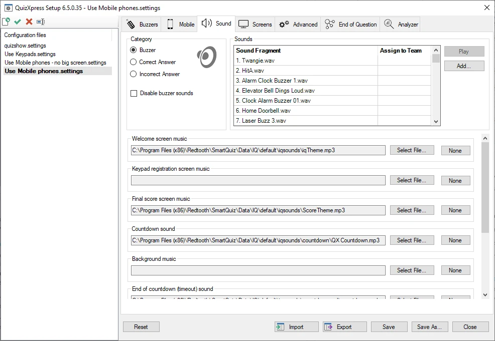
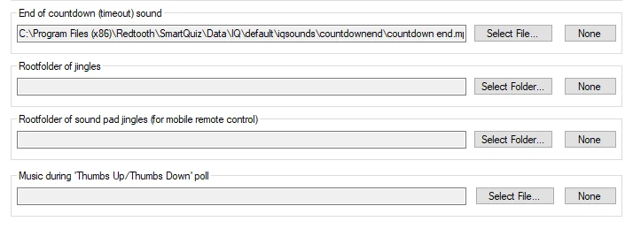

# Configurare i suoni – la scheda Sounds

Nella pagina delle impostazioni audio è possibile definire varie impostazioni per i suoni riprodotti durante un quiz. Sul lato sinistro, nel riquadro «Category», scegliere prima la categoria di suoni che si desidera modificare. L'«elenco dei suoni» sul lato destro verrà quindi popolato con i suoni della categoria scelta.

Selezionando la categoria «buzzer sounds», è possibile assegnare un suono al buzzer di una squadra specifica nell'elenco. È anche possibile aggiungere suoni personali e assegnarli a giocatori/squadre. Questo non vale però quando si usano i telefoni cellulari: per questi si applica il meccanismo dei «jingle», spiegato più avanti.

Selezionando la categoria «Right Answer», l'elenco sul lato destro viene popolato con i suoni riprodotti in modo casuale durante il quiz quando una squadra dà una risposta corretta. Un suono può essere incluso o escluso inserendo o rimuovendo il segno di spunta accanto ad esso. Lo stesso vale per i suoni «Incorrect Answer».

Durante l'installazione di QuizXpress viene installato un insieme di suoni predefiniti tra cui scegliere.

{ width="605" loading=lazy }

È possibile impostare i seguenti suoni/brani musicali:

- *Welcome screen music* - la musica riprodotta all'avvio del quiz.

- *Keypad registration screen music* – la musica riprodotta quando viene mostrata la schermata di registrazione delle pulsantiere (questa schermata non viene mostrata per impostazione predefinita quando si usano i telefoni cellulari)

- *Final score screen music* - la musica riprodotta quando vengono mostrati i punteggi finali.

- *Countdown sound* – il suono riprodotto durante il conto alla rovescia.

- *Background music* – la musica che riempie tutti i momenti altrimenti silenziosi.

> { width="605" loading=lazy }

- *End of countdown music* – il suono riprodotto al termine del conto alla rovescia.

- *Root folder of jingles* – indica una cartella contenente brevi estratti sonori che i giocatori possono selezionare dopo essersi connessi al quiz, in modo che ogni giocatore abbia il proprio «jingle». I jingle vengono utilizzati per:

  - Bonus points - il suono del giocatore che è stato il primo a dare la risposta corretta viene riprodotto quando viene mostrata la schermata dei punti bonus.

  - Dito più Veloce – viene riprodotto il suono del giocatore che ha premuto per primo, mentre il nome del giocatore compare sullo schermo nel quiz player.

  - Intermediate score overviews – il suono del giocatore al primo posto viene riprodotto quando si mostra la classifica.

- *Root folder of sound pad jingles (for mobile remote control) – indica una cartella contenente musica o effetti sonori che verranno mostrati nella scheda «Soundboard» dell'app QuizXpress Director. Ciò consente al Quizmaster di riprodurre musica o frammenti sonori in qualsiasi momento desiderato.*

- *Music during ‘Thumbs Up/Thumbs Down’ poll* – dopo che un giocatore è stato il primo a rispondere a una domanda di tipo Dito più Veloce, il Quizmaster può chiedere agli altri giocatori se concordano o meno con la risposta data, dando loro la possibilità di vincere (o perdere) anch'essi il 50% dei punti della domanda. Il suono scelto viene riprodotto mentre il sondaggio «Thumbs Up/Thumbs Down» è in corso. Un sondaggio può essere avviato dall'app QuizXpress Director o da Director sul computer.

Ciascuno di questi suoni può essere «cancellato» premendo il pulsante «None»; in tal caso non verrà riprodotto alcun suono.
