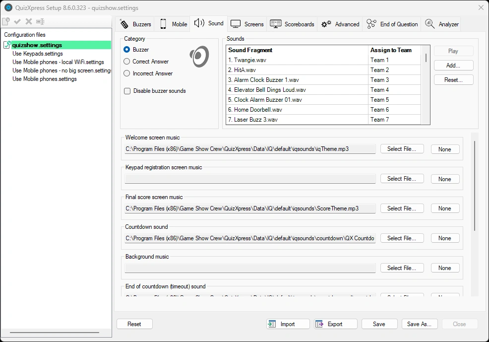
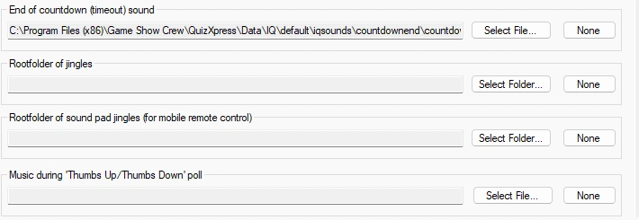

# Geluiden configureren – het tabblad Geluiden

Op de pagina met geluidsinstellingen kunt u verschillende instellingen opgeven voor de geluiden die tijdens een quiz worden afgespeeld. Kies links, in het vak ‘Categorie’, eerst een categorie geluiden die u wilt wijzigen. De ‘geluidenlijst’ rechts wordt dan gevuld met de geluiden uit de gekozen categorie.

Wanneer u de categorie ‘buzzergeluiden’ selecteert, kunt u in de lijst een geluid toewijzen aan de buzzer van een specifiek team. U kunt ook uw eigen geluiden toevoegen en aan spelers/teams toewijzen. Dit geldt echter niet bij het gebruik van mobiele telefoons — daarvoor geldt het ‘jingles’-mechanisme, dat zo meteen wordt uitgelegd.

Wanneer u de categorie ‘Juist antwoord’ selecteert, wordt de lijst rechts gevuld met geluiden die tijdens de quiz willekeurig worden afgespeeld wanneer een team een juist antwoord geeft. U kunt een geluid opnemen of uitsluiten door het vinkje erachter in te stellen of te verwijderen. Hetzelfde geldt voor de geluiden voor ‘Onjuist antwoord’.

Bij de installatie van QuizXpress wordt een set standaardgeluiden geïnstalleerd waaruit u kunt kiezen.

{ width="605" loading=lazy }

De volgende geluiden/muziek kunnen worden ingesteld:

- *Muziek van het welkomstscherm* - de muziek die wordt afgespeeld wanneer de quiz start.

- *Muziek van het keypadregistratiescherm* – de muziek die wordt afgespeeld wanneer het keypadregistratiescherm wordt getoond (dit scherm wordt standaard niet getoond wanneer mobiele telefoons worden gebruikt)

- *Muziek van het eindstandscherm* - de muziek die wordt afgespeeld wanneer de eindscores worden getoond.

- *Aftelgeluid* – het geluid dat tijdens het aftellen wordt afgespeeld.

- *Achtergrondmuziek* – de muziek om alle anders stille momenten te vullen.

> { width="605" loading=lazy }

- *Muziek aan het einde van het aftellen* – het geluid dat wordt afgespeeld wanneer het aftellen afloopt.

- *Hoofdmap van jingles* – wijst naar een map met geluidsfragmenten die spelers kunnen selecteren zodra ze verbinding maken met de quiz, zodat elke speler zijn eigen ‘jingle’ heeft. Jingles worden gebruikt voor:

  - Bonuspunten - het geluid van de speler die als eerste het juiste antwoord gaf, wordt afgespeeld wanneer het bonuspuntenscherm wordt getoond.

  - Snelste drukker – het geluid van de speler die als eerste drukte wordt afgespeeld, samen met de naam van de speler die op het scherm in de quizspeler verschijnt.

  - Tussenstanden – het geluid van de speler die als eerste staat, wordt afgespeeld wanneer de ranglijst wordt getoond.

- *Hoofdmap van soundpad-jingles (voor mobiele afstandsbediening) – wijst naar een map met muziek of geluidseffecten die op het tabblad ‘Soundboard’ in de QuizXpress Director-app worden getoond. Zo kan de host op elk gewenst moment muziek of geluidsfragmenten afspelen.*

- *Muziek tijdens de poll ‘Thumbs Up/Thumbs Down’* – nadat een speler als eerste een vraag voor de snelste drukker heeft beantwoord, kan de host de andere spelers vragen of ze het eens of oneens zijn met het gegeven antwoord, waardoor zij ook de kans krijgen om 50% van de vraagpunten te winnen (of te verliezen). Het gekozen geluid wordt afgespeeld terwijl de poll ‘Thumbs Up/Thumbs Down’ loopt. Een poll kan worden gestart vanuit de QuizXpress Director-app of vanuit Director op de computer.

Elk van deze geluiden kunt u ‘wissen’ door op de knop ‘Geen’ te drukken; in dat geval wordt er geen geluid afgespeeld.
