# Configurare l'hardware – la scheda Buzzers

QuizXpress è progettato per funzionare con diversi tipi di dispositivi di input. Di seguito è riportata una descrizione dei dispositivi che possono essere configurati nella scheda «Buzzers» di Quiz Setup.

È inoltre possibile utilizzare dispositivi mobili con QuizXpress. I dispositivi mobili possono essere usati come estensione del sistema di buzzer o keypad esistente. Per maggiori informazioni sul supporto dei keypad mobili, consultare [Configurare il supporto dei keypad mobili](setting-up-mobile-keypad-support.md).

Al primo avvio di Quiz Setup dopo l'installazione di QuizXpress, come sistema di buzzer è selezionato «None». Prima di eseguire un quiz in QuizXpress Live, è necessario scegliere un sistema di buzzer in Quiz Setup. Ciò è indicato anche dal suggerimento mostrato al primo avvio di Quiz Setup, come illustrato di seguito.

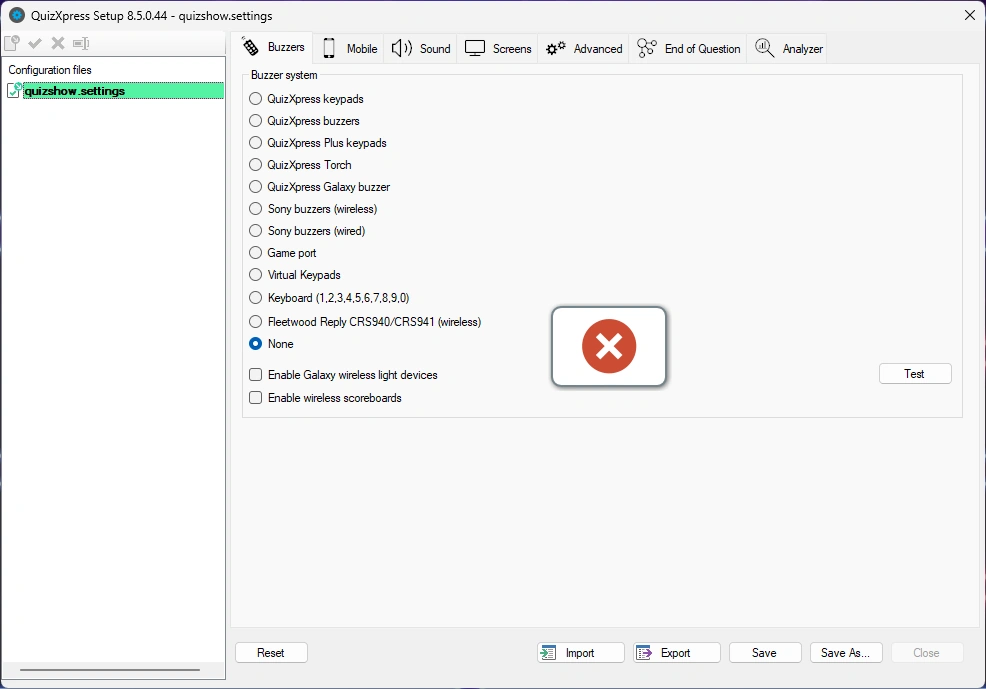{ width="460" loading=lazy }

Il suggerimento indica inoltre che i «Quizmaster hints» vengono mostrati per impostazione predefinita quando si esegue un quiz show in QuizXpress Live. Si tratta di una funzione di apprendimento che va disattivata quando si esegue uno show in produzione.

!!! note

    dopo aver selezionato la configurazione hardware, è possibile fare clic sul pulsante «Test» per verificare la connettività dei dispositivi collegati. Se la connessione riesce, viene mostrato un segno di spunta verde per ogni dispositivo connesso correttamente.*

## Sistemi di buzzer a scelta multipla

QuizXpress supporta alcuni sistemi di buzzer a scelta multipla, elencati in questa sezione. Si noti che la disponibilità di pulsanti a scelta multipla abilita due funzioni in QuizXpress:

- La possibilità di far rispondere le persone a una domanda a scelta multipla (votazione o risposta del pubblico)

- La possibilità di lasciare che QuizXpress giudichi automaticamente le risposte a scelta multipla per una domanda «fastest finger» (risponde il primo a premere il buzzer). Si noti che è facoltativo: è anche possibile lasciare che sia il conduttore del quiz a giudicare le risposte date. Questo si può impostare in QuizXpress Studio tramite il flag «auto judge» di una diapositiva del quiz.

### Keypad base QuizXpress

I keypad di questo sistema hanno sei pulsanti a scelta multipla e un pulsante fastest-finger. La base è collegata al PC tramite un cavo USB, ha una portata di 100 metri/350 piedi e può leggere fino a 100 keypad al secondo. È possibile giocare a QuizXpress con un massimo di 400 keypad contemporaneamente.

Il sistema di keypad QuizXpress include un telecomando Quizmaster che il conduttore del quiz può usare per gestire il quiz.

Ogni keypad QuizXpress ha un id univoco preprogrammato. Quando si usano i keypad QuizXpress, inserire gli id dei dispositivi utilizzati per il quiz nel campo «Keypads:» in Quiz Setup. Ad esempio, se si usano i keypad da 1 a 10, inserire l'intervallo «1-10». Se si usano i keypad 1, 2, 3, 4 e 6, inserire il testo «1,2,3,4,6».

Per maggiori informazioni sull'installazione del sistema di keypad QuizXpress, fare riferimento all'Appendice A.

!!! note

    durante il quiz non è necessario utilizzare tutti i keypad indicati in Quiz Setup. Prima di avviare il quiz viene mostrata una schermata di registrazione dei keypad. I giocatori partecipanti si fanno riconoscere premendo un tasto sul proprio keypad durante questa schermata di registrazione.*

### Keypad QuizXpress Plus

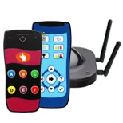{ width="173" loading=lazy }

Il sistema di keypad QuizXpress Plus è simile ai keypad QuizXpress base, ma ha una portata maggiore, è quattro volte più veloce e può gestire fino a 2000 keypad su un solo ricevitore. Con il sistema Plus si ottiene una portata di circa 350 metri grazie alle 4 antenne del ricevitore e una velocità di interrogazione di 400 keypad al secondo (il sistema base ne gestisce 100 al secondo).

### Buzzer QuizXpress

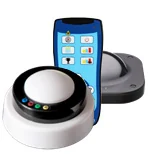{ width="154" loading=lazy }

Con i buzzer QuizXpress si ottiene la combinazione di un grande pulsante da battere e 4 pulsanti a scelta multipla. Il pulsante ha una luce che lampeggia quando il buzzer è il primo a essere premuto. I buzzer sono wireless e hanno una portata di 60 metri. Sono alimentati da 2 batterie Duracell D.

### Buzzer QuizXpress Galaxy RGB

I buzzer QuizXpress Galaxy RGB sono buzzer interattivi, ricaricabili e wireless, con un pulsante fastest-finger e 4 pulsanti a scelta multipla in 64 colori.

Forniscono un riscontro visivo per diversi eventi che avvengono nel quiz, ad esempio:

- Indicare chi ha risposto correttamente (verde) o in modo errato (rosso) al termine di una domanda

- Mostrare le scelte dei giocatori illuminando il colore della risposta selezionata

- Il più veloce a premere lampeggia e blocca gli altri (colori personalizzabili)

- Selezionare in modo casuale uno o più buzzer (la luce si sposta tra il pubblico – ad esempio per scegliere un vincitore o un partecipante)

- Assegnare un colore a ciascun buzzer durante le pause o farli lampeggiare

È possibile configurare varie opzioni per i buzzer Galaxy nella scheda Galaxy di QuizXpress Director (vedere 5.7.9).

### Torce QuizXpress

Illuminare il pubblico con il buzzer QuizXpress Torch! Il buzzer a torcia ricaricabile ha un pulsante fastest-finger, 4 pulsanti a scelta multipla e LED interni che supportano 128 colori possibili. È possibile utilizzare fino a 3000 torce.

I buzzer Torch possono:

- fornire un riscontro – chi ha risposto correttamente, chi in modo errato, chi non ha risposto

- mostrare le scelte fatte dal pubblico.

- mostrare chi ha premuto per primo in una domanda fastest-finger

- cambiare colore una volta effettuata una scelta

- essere usati per mostrare luci casuali (fisse o a ritmo di musica) – ottimo durante le pause!

- essere usati per estrarre qualcuno dal pubblico o scegliere un fortunato vincitore (o più vincitori)

In pratica, le torce sono un dispositivo Galaxy (vedere 4.1.3) e un buzzer in uno. È possibile configurare varie opzioni per le Torce nella scheda Galaxy di QuizXpress Director (vedere 5.7.9).

### Buzzer Fleetwood Reply Systems

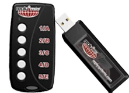{ width="169" loading=lazy }

Fleetwood Reply Systems offre una varietà di strumenti portatili e interattivi per la risposta del pubblico e il voto elettronico, comunemente usati in riunioni, formazione, processi decisionali e ricerca.

QuizXpress funziona con i keypad wireless Reply® Mini Model CRS5000 e Reply Worldwide, insieme a una base CRS940/CRS941. La base è collegata al PC tramite un cavo USB. È possibile giocare a QuizXpress con un massimo di 250 keypad contemporaneamente.

Ogni buzzer Reply Systems ha un id univoco preprogrammato (a differenza dei buzzer Sony). Quando si usano i buzzer Reply System, aggiungere gli id dei buzzer utilizzati per il quiz nel campo «Keypads:». Ad esempio, se si usano i keypad da 1 a 10, inserire l'intervallo «1-10». Se si usano i keypad 1, 2, 4 e 6, inserire il testo «1,2,4,6». Impostare inoltre il canale della base selezionando il canale corretto dall'elenco a discesa «Channel».

Per maggiori informazioni sull'installazione del sistema Reply, fare riferimento all'Appendice B.

!!! note

    durante il quiz non è necessario utilizzare tutti i buzzer indicati in Quiz Setup. Prima di avviare il quiz viene mostrata una schermata di registrazione dei buzzer. I giocatori partecipanti si fanno riconoscere premendo un tasto sul proprio buzzer durante questa schermata di registrazione.*

### Keypad virtuali

QuizXpress include un keypad virtuale software che può essere eseguito sulla stessa macchina o su altre macchine della rete. Si connette a QuizXpress Live tramite una connessione TCP/IP. Ogni keypad virtuale ha un id del keypad che può essere modificato all'istante.

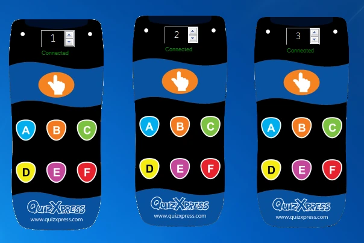{ width="360" loading=lazy }

!!! note

    quando si avvia Live con keypad virtuali configurati, Windows può chiedere conferma per aprire una porta sul firewall locale.*

Con il keypad virtuale è molto semplice testare il proprio quiz, anche senza alcun hardware reale.

### Buzzer Sony Buzz™

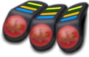{ width="150" loading=lazy }QuizXpress funziona anche con i buzzer Sony Buzz™. Il sistema funziona sia con la versione cablata sia con quella wireless di questi buzzer.

Si noti che la versione wireless di questi buzzer è progettata per funzionare entro circa 10 metri (26 piedi) al massimo. L'edizione QuizXpress Home funziona con un massimo di 12 unità Sony Buzz wireless. L'edizione QuizXpress Pro non ha limiti, anche se in pratica non ne sono stati usati più di 16, a causa di limitazioni pratiche (un ricevitore ogni 4 buzzer e limiti di distanza).

Un ricevitore USB viene utilizzato per 4 buzzer Sony wireless, quindi tenere presente che saranno necessarie porte USB sufficienti. Inoltre, poiché la portata dei buzzer è limitata, se possibile distribuire i ricevitori in modo strategico all'interno dell'area del quiz. Questo tipo di dispositivo non è più in produzione ed è disponibile solo sul mercato dell'usato.

### QuizXpress Luminous e Sparkle

| 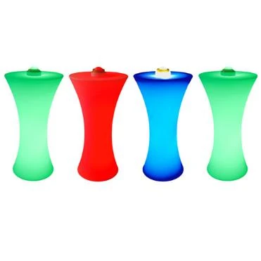{ width="238" loading=lazy } | 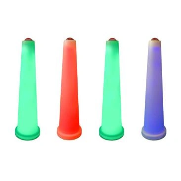{ width="232" loading=lazy } |
|------------------------------------------------------------------------------------------------------------------------------------------------------------------------|-----------------------------------------------------------------------------------------------------------------------------------------------------------------------|
| Tavoli da palco illuminati QuizXpress Luminous                                                                                                                         | Pali buzzer QuizXpress Sparkle                                                                                                                                        |

Luminous e Sparkle funzionano esattamente come i buzzer QuizXpress, quindi è questo il tipo di dispositivo da selezionare in Quiz Setup. Si noti che il palo buzzer Sparkle non ha pulsanti a scelta multipla, quindi può essere usato con *domande aperte* o con domande a scelta multipla impostate su «manual judgment» (in questo caso il giocatore comunica a voce al conduttore del quiz quale risposta a scelta multipla è corretta, e il conduttore giudica la risposta data). Il tavolo da palco sincronizza automaticamente le proprie luci con il buzzer abbinato.

## Sistemi di buzzer a pulsante singolo

Oltre ai buzzer con pulsanti a scelta multipla, QuizXpress supporta anche buzzer con un solo pulsante (a volte chiamati «slammer»). Con questi pulsanti l'attenzione si concentra davvero sull'aspetto fastest-finger del gioco: risponde chi batte per primo. In questo caso il conduttore del quiz giudica sempre la risposta (il giudizio automatico non è possibile, poiché non ci sono pulsanti a scelta multipla).

### Buzzer QuizXpress Cube

| 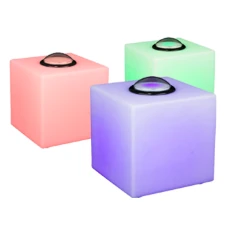{ width="146" loading=lazy } | I cubi buzzer sono dispositivi ricaricabili con un potente LED RGB e un solo pulsante. Con questo tipo di buzzer è possibile eseguire solo domande di tipo fastest-finger, poiché non ci sono pulsanti a scelta multipla. Molto adatti per le finali. Per usare questo tipo di buzzer, è sufficiente selezionare «QuizXpress Buzzers» come tipo di dispositivo. |
|--------------------------------------------------------------------------------------------------------------------------------------------------------------------------------------------------|------------------------------------------------------------------------------------------------------------------------------------------------------------------------------------------------------------------------------------------------------------------------------------------------------------------------------|

I cubi hanno tre colori diversi. La tabella seguente elenca i colori dei buzzer e il loro significato:

| Colore              | Significato                                |
|---------------------|--------------------------------------------|
| Verde               | Pronto, il buzzer può essere premuto       |
| Rosso               | Fuori dal gioco/dalla domanda              |
| Blu (lampeggiante)  | Prima persona ad aver premuto il buzzer    |
| Verde (lampeggiante) | È stata data la risposta corretta         |
| Rosso (lampeggiante) | È stata data una risposta errata          |

### Game Port

QuizXpress supporta anche i dispositivi standard con game port (joystick o altri controller). Ogni pulsante di un controller game port standard può fungere da buzzer. Questa interfaccia è particolarmente utile per realizzare installazioni interattive personalizzate, ad esempio in un museo. Contattarci per maggiori dettagli o assistenza.

### Tastiera

| 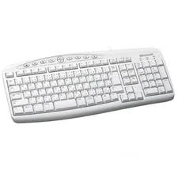{ width="182" loading=lazy } | Oltre ai sistemi di buzzer descritti sopra, è possibile usare anche la tastiera per prenotarsi. I tasti 1, 2, 3, 4, 5, 6, 7, 8, 9 e 0 corrispondono a 10 buzzer che possono partecipare. Quando non sono disponibili buzzer, usare la tastiera è una buona alternativa. Questa opzione può essere utilizzata anche per altri dispositivi buzzer che inviano sequenze di tasti all'applicazione. |
|------------------------------------------------------------------------------------------------------------------------------------------------------------------------------------|------------------------------------------------------------------------------------------------------------------------------------------------------------------------------------------------------------------------------------------------------------------------------------------------------------------------------------------------------------------|

## Dispositivi wireless QuizXpress Galaxy RGB

| 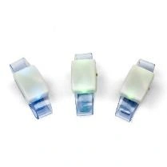{ width="133" loading=lazy }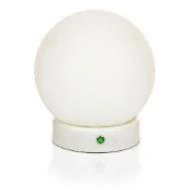{ width="122" loading=lazy }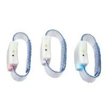{ width="115" loading=lazy }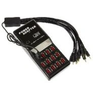{ width="118" loading=lazy } | I dispositivi Galaxy RGB (braccialetti ricaricabili o lampadine da tavolo chiamate Spheres) sono completamente integrati con QuizXpress e migliorano l'esperienza complessiva del game show. Quando sono abilitati, QuizXpress fornisce un riscontro ai giocatori, ad esempio se la loro risposta è stata ricevuta dal sistema, se l'ultima risposta era corretta o errata e se sono ancora in gioco durante un last-man-standing, ecc. Per abilitare il supporto Galaxy, collegare il ricevitore Galaxy aggiuntivo a una porta USB del PC e selezionare la casella «Enable Galaxy devices» in Quiz Setup. |
|-------------------------------------------------------------------------------------------------------------------------------------------------------------------------------------------------------------------------------------------------------------------------------------------------------------------------------------------------------------------------------------------------------------------------------------------|-----------------------------------------------------------------------------------------------------------------------------------------------------------------------------------------------------------------------------------------------------------------------------------------------------------------------------------------------------------------------------------------------------------------------------------------------------------------------------------------------------------------------------------------------------------------------------|

I dispositivi Galaxy contengono LED RGB, il che significa che possono assumere qualsiasi colore. Di seguito è riportata una panoramica dei colori utilizzati durante un quiz show.

| Evento durante il quiz show                 | Colore                                                                   |
|---------------------------------------------|--------------------------------------------------------------------------|
| Schermata iniziale di QuizXpress            | Vengono mostrati colori casuali                                          |
| Schermata di registrazione – non ancora registrato | Blu                                                               |
| Schermata di registrazione – registrato     | Verde                                                                    |
| Domanda – l'orologio avvia il conto alla rovescia | Blu                                                                |
| Domanda – voto ricevuto                     | Viola                                                                    |
| Domanda – risposta errata                   | Rosso                                                                    |
| Domanda – risposta corretta                 | Verde                                                                    |
| Last man standing – fuori dal gioco         | Rosso; rimane rosso fino al termine del round last-man-standing          |
| Schermata dei punteggi finali               | Vincitore: oro; 2o posto: argento; 3o posto: bronzo |

## Tabelle punteggi wireless QuizXpress

| 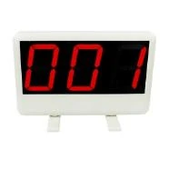{ width="117" loading=lazy }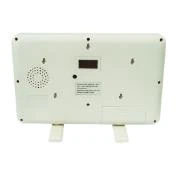{ width="112" loading=lazy } | Con le tabelle punteggi wireless, i giocatori ricevono un riscontro immediato sul proprio punteggio attuale. La tabella può visualizzare valori compresi tra -99 e 999. Per abilitare le tabelle punteggi, collegare il ricevitore delle tabelle punteggi a una porta USB del PC e selezionare la casella «Enable wireless scoreboard» in Quiz Setup. |
|---------------------------------------------------------------------------------------------------------------------------------------------------------------------------------------------------------------------------------------------------------------------------------------------------------------------------------------------------------------------------------------|--------------------------------------------------------------------------------------------------------------------------------------------------------------------------------------------------------------------------------------------------------------------------------------------------------|
