# Uw hardware configureren – het tabblad Buzzers

QuizXpress is ontworpen om met verschillende typen invoerapparaten te werken. Hieronder volgt een beschrijving van de apparaten die u kunt configureren op het tabblad ‘Buzzers’ in Quiz Setup.

U kunt ook mobiele apparaten gebruiken met QuizXpress. Mobiele apparaten kunt u gebruiken als uitbreiding van uw bestaande buzzer- of keypadsysteem. Meer over ondersteuning voor mobiele keypads leest u in [Ondersteuning voor mobiele keypads instellen](setting-up-mobile-keypad-support.md).

Wanneer u Quiz Setup voor het eerst start na de installatie van QuizXpress, is ‘Geen’ gekozen als buzzersysteem. Voordat u een quiz in QuizXpress Live uitvoert, moet in Quiz Setup een buzzersysteem worden gekozen. Dit wordt ook aangegeven door de hulpballon die de eerste keer dat u Quiz Setup start wordt getoond, zoals hieronder te zien is.

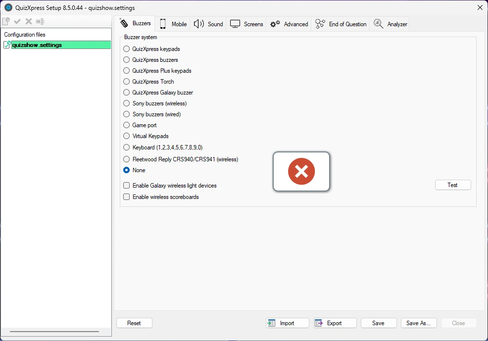{ width="460" loading=lazy }

In de hulpballon staat ook dat ‘Hints voor de quizmaster’ standaard worden getoond wanneer u een quizshow uitvoert in QuizXpress Live. Dit is een leerfunctie die u moet uitschakelen wanneer u een echte show uitvoert.

!!! note

    nadat u uw hardwareconfiguratie hebt geselecteerd, kunt u op de knop ‘Test’ klikken om de verbinding met de aangesloten apparaten te testen. Als de verbinding slaagt, wordt voor elk apparaat dat succesvol verbinding heeft gemaakt een groen vinkje getoond.*

## Meerkeuzebuzzersystemen

QuizXpress ondersteunt een aantal meerkeuzebuzzersystemen, die in deze sectie worden opgesomd. Let op: de beschikbaarheid van meerkeuzeknoppen maakt twee functies in QuizXpress mogelijk:

- De optie om mensen een meerkeuzevraag te laten beantwoorden (stemmen of publieksreactie)

- De optie om QuizXpress meerkeuzeantwoorden automatisch te laten beoordelen bij een vraag met de ‘snelste vinger’ (wie als eerste buzzt, antwoordt). Let op: dit is optioneel; u kunt de gegeven antwoorden ook door de quizmaster laten beoordelen. Dit stelt u in QuizXpress Studio in met de vlag ‘Automatisch beoordelen’ van een quizdia.

### Basis-keypads van QuizXpress

De keypads van dit systeem hebben zes meerkeuzeknoppen en één knop voor de snelste vinger. Het basisstation wordt met een USB-kabel op de pc aangesloten, heeft een bereik van 100 meter en kan tot 100 keypads per seconde uitlezen. QuizXpress kan met maximaal 400 keypads tegelijk worden gespeeld.

Het QuizXpress-keypadsysteem wordt geleverd met een afstandsbediening voor de quizmaster waarmee de quizmaster de quiz kan bedienen.

Elk QuizXpress-keypad heeft een vooraf geprogrammeerde unieke id. Wanneer u QuizXpress-keypads gebruikt, voert u de id’s van de apparaten die voor de quiz worden gebruikt in het invoerveld ‘Keypads:’ in Quiz Setup in. Als u bijvoorbeeld keypads 1 tot 10 gebruikt, voert u het bereik ‘1-10’ in. Als u keypads 1, 2, 3, 4 en 6 gebruikt, voert u de tekst ‘1,2,3,4,6’ in.

Zie [QuizXpress keypads en buzzers](../hardware-installation/quizxpress-keypads-and-buzzers.md) voor meer informatie over de installatie van het QuizXpress-keypadsysteem.

!!! note

    bij het spelen van de quiz hoeven niet alle in Quiz Setup aangegeven keypads te worden gebruikt. Voordat de quiz begint, wordt een aanmeldscherm voor keypads getoond. Deelnemende spelers maken zich bekend door tijdens dit aanmeldscherm op een toets van hun keypad te drukken.*

### QuizXpress Plus-keypads

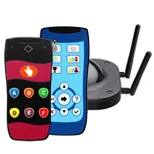{ width="173" loading=lazy }

Het QuizXpress Plus-keypadsysteem lijkt op de basis-keypads van QuizXpress, maar heeft een groter bereik, is vier keer sneller en kan tot 2000 keypads op één ontvanger aan. Met het Plus-systeem krijgt u dankzij de 4 antennes op de ontvanger een bereik van ongeveer 350 meter en een pollingsnelheid van 400 keypads per seconde (het basissysteem haalt 100 keypads per seconde).

### QuizXpress-buzzers

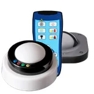{ width="154" loading=lazy }

Met de QuizXpress-buzzers krijgt u een combinatie van een grote drukknop en 4 meerkeuzeknoppen. De knop heeft een lampje dat knippert wanneer de buzzer als eerste is ingedrukt. De buzzers zijn draadloos en hebben een bereik van 60 meter. Ze worden gevoed door 2 Duracell D-batterijen.

### QuizXpress Galaxy RGB-buzzers

De QuizXpress Galaxy RGB-buzzers zijn interactieve, oplaadbare, draadloze buzzers met een knop voor de snelste vinger en 4 meerkeuzeknoppen in 64 kleuren.

Ze geven feedback over verschillende gebeurtenissen in de quiz, zoals:

- Aangeven wie juist (groen) of onjuist (rood) had aan het einde van een vraag

- De keuzes van spelers tonen door de kleur van het gekozen antwoord op te lichten

- De snelste drukker knippert en blokkeert de anderen (kleuren zijn aan te passen)

- Willekeurig een of meer buzzers selecteren (licht beweegt door het publiek, bijvoorbeeld om een winnaar of deelnemer aan te wijzen)

- Tijdens pauzes aan elke buzzer een kleur toewijzen of ze laten knipperen

U kunt verschillende opties voor de Galaxy-buzzers instellen op het tabblad Galaxy in QuizXpress Director (zie [Het tabblad Galaxy](../live/quizxpress-director/the-galaxy-tab.md)).

### QuizXpress-torches

Zet uw publiek in het licht met de QuizXpress Torch-buzzer! De oplaadbare torch-buzzer heeft een knop voor de snelste vinger, 4 meerkeuzeknoppen en interne ledlampjes die 128 mogelijke kleuren ondersteunen. U kunt tot 3000 torches gebruiken.

De Torch-buzzers kunnen:

- feedback geven: wie juist had, wie onjuist had, wie niet antwoordde

- de keuzes van het publiek tonen.

- tonen wie als eerste buzzte bij een vraag met de snelste vinger

- van kleur veranderen zodra een keuze is gemaakt

- worden gebruikt om willekeurige lichtjes te tonen (vast of op het ritme van muziek), mooi tijdens pauzes!

- worden gebruikt om iemand uit het publiek te trekken of een gelukkige winnaar (of winnaars) aan te wijzen

In feite zijn de torches een galaxy-apparaat (zie [Draadloze QuizXpress Galaxy RGB-apparaten](#draadloze-quizxpress-galaxy-rgb-apparaten)) en een buzzer in één. U kunt verschillende opties voor de torches instellen op het tabblad Galaxy in QuizXpress Director (zie [Het tabblad Galaxy](../live/quizxpress-director/the-galaxy-tab.md)).

### Buzzers van Fleetwood Reply Systems

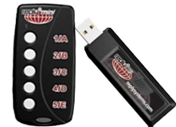{ width="169" loading=lazy }

Fleetwood Reply Systems levert een breed assortiment draagbare, interactieve tools voor publieksreactie en elektronisch stemmen, die veel worden gebruikt bij vergaderingen, trainingen, besluitvorming en onderzoek.

QuizXpress werkt met Reply® Mini Model CRS5000 en draadloze Reply Worldwide-keypads, samen met een CRS940/CRS941-basisstation. Het basisstation wordt met een USB-kabel op de pc aangesloten. QuizXpress kan met maximaal 250 keypads tegelijk worden gespeeld.

Elke Reply Systems-buzzer heeft een vooraf geprogrammeerde unieke id (in tegenstelling tot Sony-buzzers). Wanneer u Reply Systems-buzzers gebruikt, voegt u de id’s van de buzzers die voor de quiz worden gebruikt toe aan het invoerveld ‘Keypads:’. Als u bijvoorbeeld keypads 1 tot 10 gebruikt, voert u het bereik ‘1-10’ in. Als u keypads 1, 2, 4 en 6 gebruikt, voert u de tekst ‘1,2,4,6’ in. Stel ook het kanaal van het basisstation in door het juiste kanaal te kiezen in de vervolgkeuzelijst ‘Kanaal’.

Zie [Fleetwood Reply-buzzers](../hardware-installation/fleetwood-reply-buzzers.md) voor meer informatie over de installatie van het Reply-systeem.

!!! note

    bij het spelen van de quiz hoeven niet alle in Quiz Setup aangegeven buzzers te worden gebruikt. Voordat de quiz begint, wordt een aanmeldscherm voor buzzers getoond. Deelnemende spelers maken zich bekend door tijdens dit aanmeldscherm op een toets van hun buzzer te drukken.*

### Virtuele keypads

QuizXpress wordt geleverd met een virtueel, softwarematig keypad dat u op dezelfde computer of op andere computers in het netwerk kunt uitvoeren. Het maakt via een TCP/IP-verbinding verbinding met QuizXpress Live. Elk virtueel keypad heeft een keypad-id die u direct kunt wijzigen.

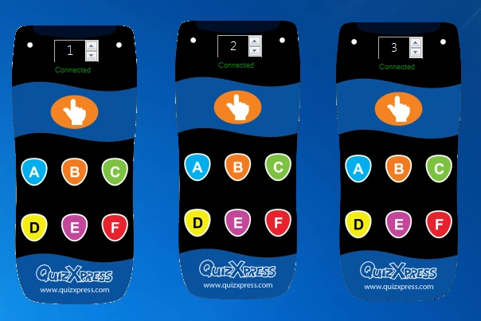{ width="360" loading=lazy }

!!! note

    wanneer u Live start met geconfigureerde virtuele keypads, kan Windows u om bevestiging vragen om een poort op de lokale firewall te openen.*

Met het virtuele keypad kunt u uw quiz heel eenvoudig testen, ook als u geen echte hardware hebt.

### Sony Buzz™-buzzers

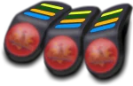{ width="150" align=left loading=lazy }QuizXpress werkt ook met Sony Buzz™-buzzers. Het systeem werkt met zowel de bedrade als de draadloze versie van deze buzzers.

Let op: de draadloze versie van deze buzzers is ontworpen voor een bereik van maximaal ongeveer 10 meter. QuizXpress Home-editie werkt met maximaal 12 draadloze Sony Buzz-eenheden. De QuizXpress Pro-editie kent geen limiet, hoewel in de praktijk nooit meer dan 16 zijn gebruikt vanwege praktische beperkingen (één ontvanger per 4 buzzers en afstandsbeperkingen).

Eén USB-ontvanger wordt gebruikt voor 4 draadloze Sony-buzzers, dus houd er rekening mee dat u voldoende beschikbare USB-poorten nodig hebt. Omdat het bereik van de buzzers beperkt is, kunt u de ontvangers ook het beste strategisch verdelen in de quizruimte, indien mogelijk. Dit type apparaat wordt niet meer geproduceerd en is alleen nog tweedehands verkrijgbaar.

### QuizXpress Luminous en Sparkle

| 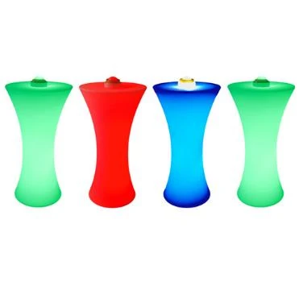{ width="238" loading=lazy } | 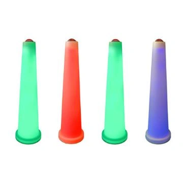{ width="232" loading=lazy } |
|------------------------------------------------------------------------------------------------------------------------------------------------------------------------|-----------------------------------------------------------------------------------------------------------------------------------------------------------------------|
| Verlichte podiumtafels QuizXpress Luminous                                                                                                                               | Buzzerpalen QuizXpress Sparkle                                                                                                                                       |

De Luminous en Sparkle werken net als de QuizXpress-buzzers, dus dat is het apparaattype dat u in Quiz Setup selecteert. Let op: de Sparkle-buzzerpaal heeft geen meerkeuzeknoppen, dus u kunt deze gebruiken bij *open vragen* of bij meerkeuzevragen die op ‘handmatige beoordeling’ staan (hierbij vertelt de speler de quizmaster mondeling welk meerkeuzeantwoord juist is en beoordeelt de quizmaster het gegeven antwoord). De podiumtafel synchroniseert zijn lichten automatisch met de gekoppelde buzzer.

## Buzzersystemen met één knop

Naast buzzers met meerkeuzeknoppen ondersteunt QuizXpress ook buzzers met één knop (soms ‘slammers’ genoemd). Bij deze knoppen ligt de nadruk echt op het aspect van de snelste vinger: wie het eerst slaat, antwoordt. In dat geval beoordeelt de quizmaster het antwoord altijd (automatische beoordeling is niet mogelijk, omdat er geen meerkeuzeknoppen zijn).

### QuizXpress Cube-buzzers

| 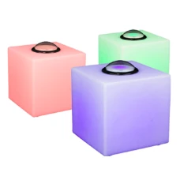{ width="146" loading=lazy } | De buzzerkubussen zijn oplaadbare apparaten met een sterke RGB-led en één knop. Met dit type buzzer kunt u alleen vragen van het type snelste vinger uitvoeren, omdat er geen meerkeuzeknoppen zijn. Zeer geschikt voor finalespellen. Om dit type buzzer te gebruiken, selecteert u eenvoudig ‘QuizXpress Buzzers’ als apparaattype. |
|--------------------------------------------------------------------------------------------------------------------------------------------------------------------------------------------------|------------------------------------------------------------------------------------------------------------------------------------------------------------------------------------------------------------------------------------------------------------------------------------------------------------------------------|

De kubussen hebben drie verschillende kleuren. De volgende tabel geeft de kleuren van de buzzers en de betekenis van de kleuren:

| Kleur            | Betekenis                      |
|------------------|------------------------------|
| Groen            | Gereed, buzzer kan worden ingedrukt |
| Rood              | Uit het spel/de vraag     |
| Blauw (knipperend)  | Eerste persoon die heeft gebuzzt  |
| Groen (knipperend) | Juist antwoord gegeven     |
| Rood (knipperend)   | Onjuist antwoord gegeven   |

### Gamepoort

QuizXpress ondersteunt ook standaard gamepoortapparaten (joysticks of andere controllers). Elke knop op een standaard gamepoortcontroller kan als buzzer fungeren. Deze interface is vooral handig bij het bouwen van aangepaste interactieve opstellingen, bijvoorbeeld in een museum. Neem contact met ons op voor meer informatie of ondersteuning.

### Toetsenbord

| 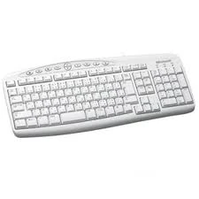{ width="182" loading=lazy } | Naast de hierboven beschreven buzzersystemen kunt u ook het toetsenbord gebruiken om te buzzen. De toetsen 1, 2, 3, 4, 5, 6, 7, 8, 9 en 0 komen overeen met 10 buzzers die kunnen meespelen. Wanneer er geen buzzers beschikbaar zijn, is het toetsenbord een goed alternatief. U kunt deze optie ook gebruiken voor andere buzzerapparaten die toetsaanslagen naar de toepassing sturen. |
|------------------------------------------------------------------------------------------------------------------------------------------------------------------------------------|------------------------------------------------------------------------------------------------------------------------------------------------------------------------------------------------------------------------------------------------------------------------------------------------------------------------------------------------------------------|

## Draadloze QuizXpress Galaxy RGB-apparaten

| 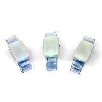{ width="133" loading=lazy }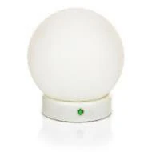{ width="122" loading=lazy }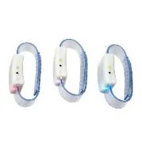{ width="115" loading=lazy }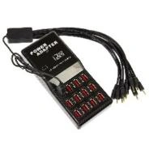{ width="118" loading=lazy } | De Galaxy RGB-apparaten (oplaadbare polsbandjes of tafellampen, Spheres genoemd) zijn volledig geïntegreerd met QuizXpress en verbeteren de beleving van de game show. Wanneer ingeschakeld, geeft QuizXpress spelers feedback, zoals of hun antwoord door het systeem is ontvangen, of hun laatste antwoord juist of onjuist was en of ze nog in het spel zitten tijdens last-man-standing, enzovoort. Om Galaxy-ondersteuning in te schakelen, sluit u de aanvullende Galaxy-ontvanger aan op een USB-poort van uw pc en vinkt u in Quiz Setup het selectievakje ‘Ondersteuning voor Galaxy draadloze LED apparaten inschakelen’ aan. |
|-------------------------------------------------------------------------------------------------------------------------------------------------------------------------------------------------------------------------------------------------------------------------------------------------------------------------------------------------------------------------------------------------------------------------------------------|-----------------------------------------------------------------------------------------------------------------------------------------------------------------------------------------------------------------------------------------------------------------------------------------------------------------------------------------------------------------------------------------------------------------------------------------------------------------------------------------------------------------------------------------------------------------------------|

De Galaxy-apparaten bevatten RGB-ledlampjes, wat betekent dat ze elke kleur kunnen hebben. Hieronder volgt een overzicht van de kleuren die tijdens een quizshow worden gebruikt.

| Gebeurtenis tijdens quizshow              | Kleur                                                                    |
|-------------------------------------|--------------------------------------------------------------------------|
| Startscherm van QuizXpress             | Willekeurige kleuren worden getoond                                                  |
| Aanmeldscherm – nog niet aangemeld  | Blauw                                                                     |
| Aanmeldscherm – aangemeld                | Groen                                                                    |
| Vraag – klok begint af te tellen   | Blauw                                                                     |
| Vraag – stem ontvangen            | Paars                                                                   |
| Vraag – antwoord onjuist         | Rood                                                                      |
| Vraag – antwoord juist           | Groen                                                                    |
| Last man standing – uit het spel | Rood; blijft rood tot de last-man-standing-ronde voorbij is               |
| Eindscorescherm                   | Winnaar: goud; 2e plaats: zilver; 3e plaats: brons |

## Draadloze QuizXpress-scoreborden

| 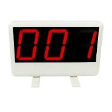{ width="117" loading=lazy }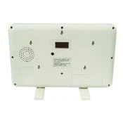{ width="112" loading=lazy } | Met de draadloze scoreborden krijgen spelers direct feedback over hun huidige score. Het scorebord kan waarden van -99 tot 999 tonen. Om de scoreborden in te schakelen, sluit u de scorebordontvanger aan op een USB-poort van uw pc en vinkt u in Quiz Setup het selectievakje ‘Ondersteuning voor draadloze scoreborden inschakelen’ aan. |
|---------------------------------------------------------------------------------------------------------------------------------------------------------------------------------------------------------------------------------------------------------------------------------------------------------------------------------------------------------------------------------------|--------------------------------------------------------------------------------------------------------------------------------------------------------------------------------------------------------------------------------------------------------------------------------------------------------|
