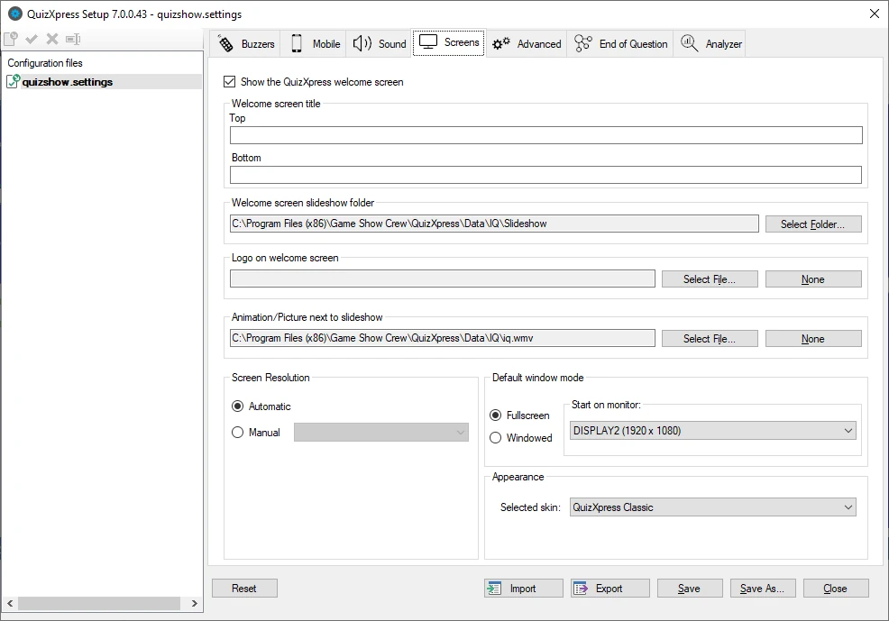
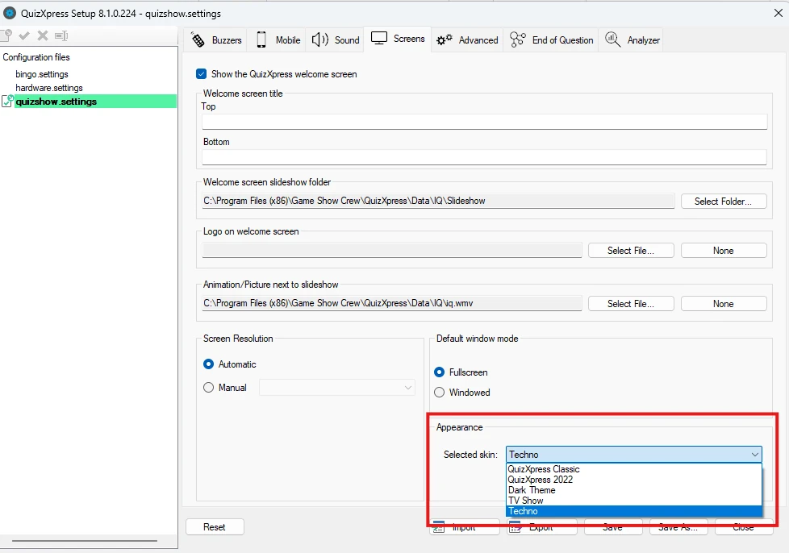
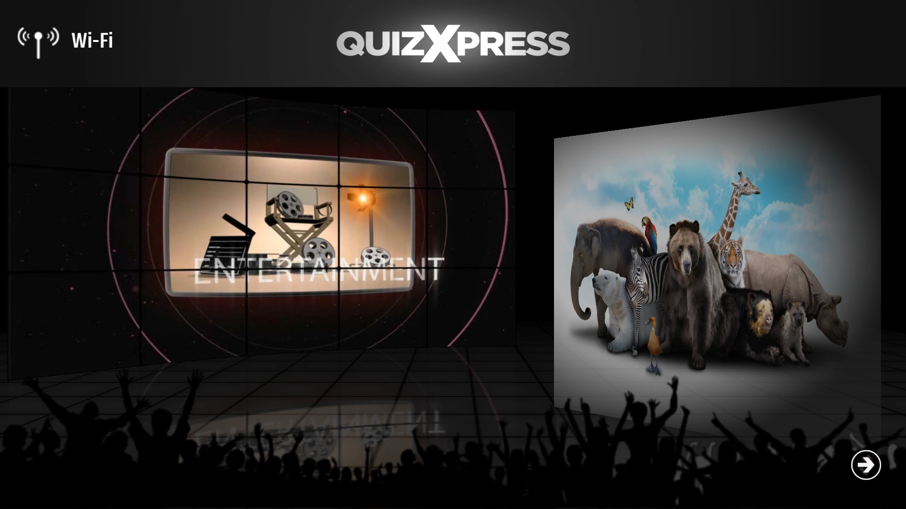
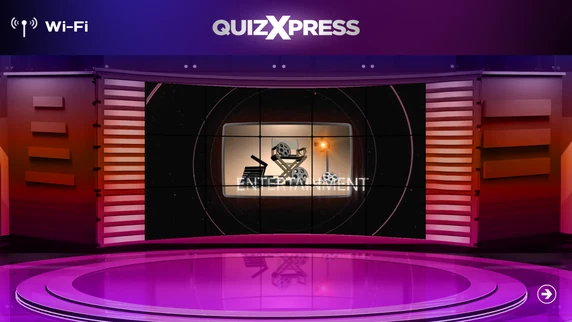
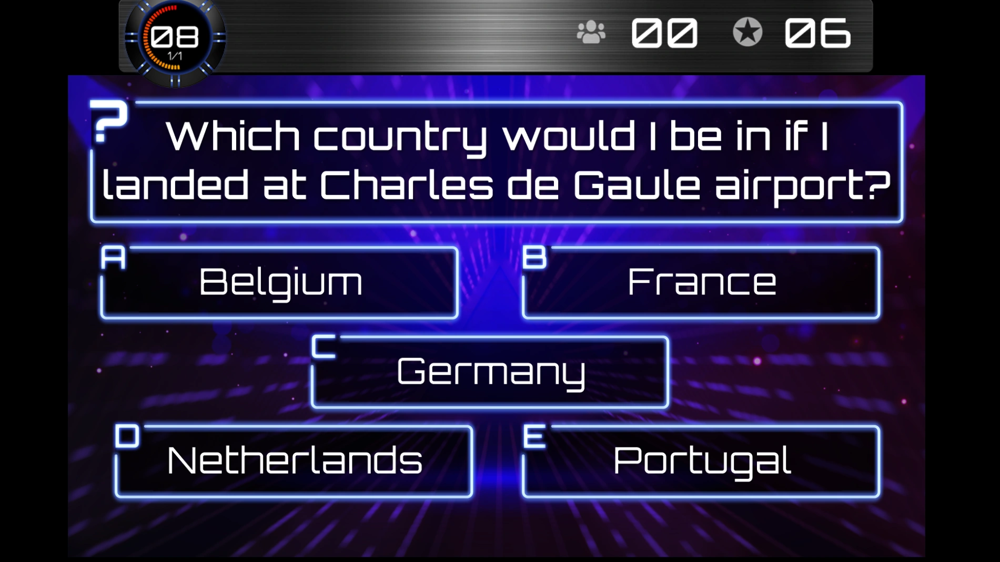

# Personnaliser l'apparence – l'onglet Screens

L'onglet « Screens » contient divers paramètres permettant de personnaliser l'écran d'accueil. Il contient aussi les paramètres relatifs aux différentes résolutions/modes d'affichage de QuizXpress Live.

{ width="593" loading=lazy }

Les paramètres suivants s'appliquent à l'écran d'accueil :

- Welcome screen title, Top and Bottom : texte à afficher en haut et en bas de l'écran.

- Welcome screen slideshow folder : dossier contenant les images du diaporama joué sur l'écran d'accueil. Un ensemble d'images de diaporama par défaut est installé avec QuizXpress.

- Logo on welcome screen : logo affiché en haut de l'écran. Ce logo est affiché à côté du « Top text » de l'écran d'accueil (facultatif ; un clic sur « Clear » n'affiche aucun logo).

- Animation (movie)/picture shown next to the slideshow : animation (vidéo)/image affichée à côté du diaporama (facultatif ; un clic sur « Clear » n'affiche ni vidéo ni image à côté du diaporama).

Veuillez consulter [Le vérificateur de lancement](../live/starting-a-quiz/the-launch-checker.md) pour voir les paramètres de l'écran d'accueil en action.

La section « Screen Resolution » vous permet de spécifier la résolution avec laquelle le système démarre. Normalement, vous pouvez la régler sur Automatic, mais dans certains cas particuliers, vous pouvez souhaiter définir la résolution manuellement.

Dans la section « Default window mode », vous indiquez comment et où le programme démarre. Il peut démarrer en mode plein écran ou en mode fenêtré (remarque : vous pouvez toujours basculer avec la touche M, ou en cliquant sur le bouton en haut à droite du formulaire du quiz player). Vous pouvez également indiquer le moniteur sur lequel démarrer.

Le quiz player propose plusieurs « skins » (apparences ou thèmes). Chaque thème a ses propres couleurs, musiques, images, etc. pour s'accorder à votre show.

Vous pouvez passer d'un skin disponible à un autre dans la section Appearance :

{ width="431" loading=lazy }

!!! tip "Votre propre skin"
    Vous pouvez aussi créer votre propre skin à l'image de votre marque, avec vos propres couleurs, polices et images. Voir [Skinning](../advanced/skinning/index.md).

| { loading=lazy }                                                                                                         | { loading=lazy } |
|-----------------------------------------------------------------------------------------------------------------------------------------------------------------------------------------|---------------------------------------------------------------------------------|
| Écran d'accueil « Dark Theme »                                                                                                                                                          | Écran d'accueil « TV Show »                                                     |
|                                                                                                                                                                                         |                                                                                 |
| { loading=lazy } |                                                                                 |
| Écran de quiz « Techno Theme »                                                                                                                                                          |                                                                                 |
