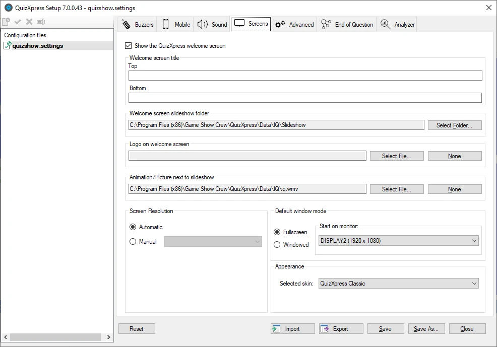
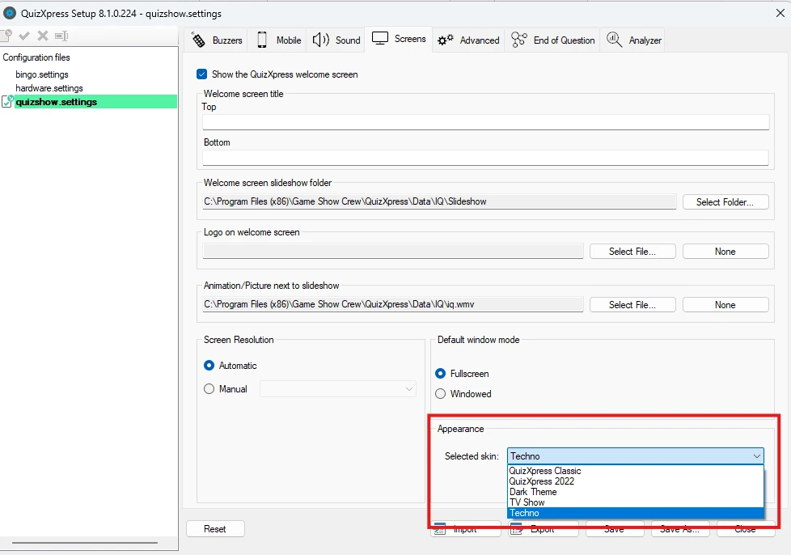
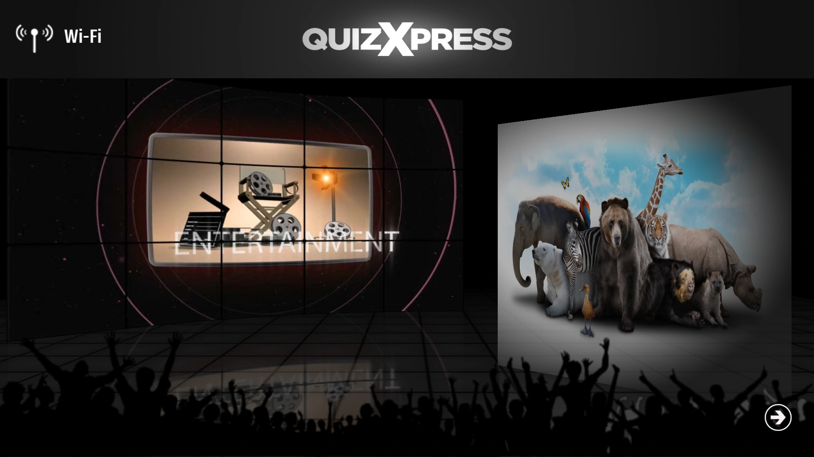
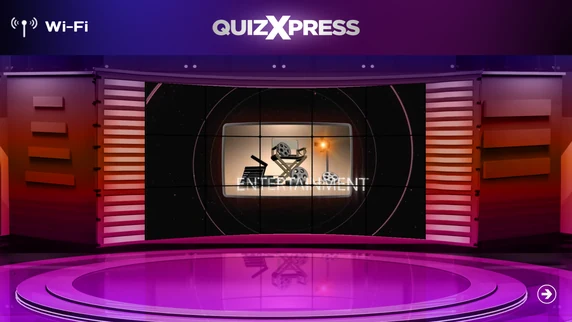
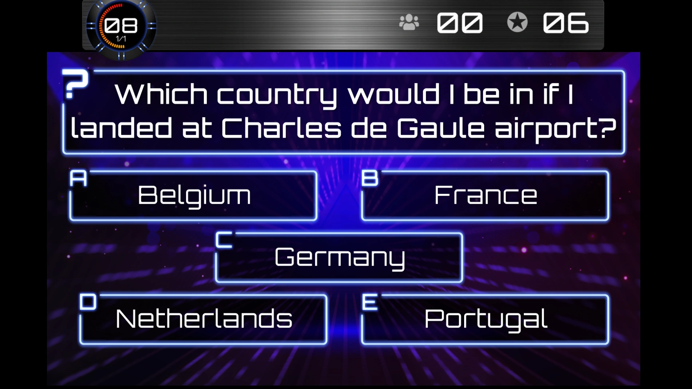

# De look aanpassen – het tabblad ‘Schermen’

Het tabblad ‘Schermen’ bevat diverse instellingen waarmee u het welkomstscherm aanpast. Ook bevat het instellingen voor de verschillende schermresoluties en schermmodi van QuizXpress Live.

{ width="593" loading=lazy }

De volgende instellingen gelden voor het welkomstscherm:

- Titel welkomstscherm, boven en onder: tekst die boven en onder aan het scherm wordt getoond.

- Map met diashow voor welkomstscherm: map met de afbeeldingen die in de diashow op het welkomstscherm worden afgespeeld. Bij de installatie van QuizXpress wordt een standaardset diashowafbeeldingen meegeleverd.

- Logo op welkomstscherm: logo dat boven aan het scherm wordt getoond. Dit logo staat naast de ‘Toptekst’ van het welkomstscherm (optioneel; met ‘Wissen’ wordt geen logo getoond).

- Animatie (film)/afbeelding naast de diashow (optioneel; met ‘Wissen’ wordt geen film/afbeelding naast de diashow getoond).

Bekijk [De startcontrole](../live/starting-a-quiz/the-launch-checker.md) om de instellingen voor het welkomstscherm in actie te zien.

Met het gedeelte ‘Schermresolutie’ bepaalt u met welke resolutie het systeem start. Meestal kunt u dit op Automatisch laten staan, maar in bijzondere gevallen wilt u de resolutie misschien handmatig instellen.

In het gedeelte ‘Standaard window mode’ geeft u aan hoe en waar het programma start. Het kan starten op volledig scherm of in een venster (let op: u kunt dit altijd wisselen met de M-toets of met de knop rechtsboven in het venster van de quizspeler). U kunt ook de monitor kiezen waarop het programma start.

De quizspeler wordt geleverd met meerdere ‘skins’ (uiterlijken of thema’s). Elk thema heeft eigen kleuren, muziek, afbeeldingen enzovoort die bij uw show passen.

U kunt tussen de beschikbare skins wisselen in het gedeelte Weergave:

{ width="431" loading=lazy }

!!! tip "Uw eigen skin"
    U kunt ook uw eigen skin maken in uw huisstijl, met uw eigen kleuren, lettertypen en afbeeldingen. Zie [Skinning](../advanced/skinning/index.md).

| { loading=lazy }                                                                                                         | { loading=lazy } |
|-----------------------------------------------------------------------------------------------------------------------------------------------------------------------------------------|---------------------------------------------------------------------------------|
| Welkomstscherm ‘Dark Theme’                                                                                                                                                             | Welkomstscherm ‘TV Show’                                                        |
|                                                                                                                                                                                         |                                                                                 |
| { loading=lazy } |                                                                                 |
| Quizscherm ‘Techno Theme’                                                                                                                                                               |                                                                                 |
