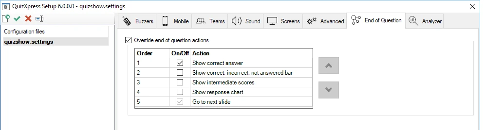
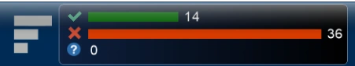

# Actions de fin de question

Dans cet onglet, vous pouvez définir les actions exécutées (et dans quel ordre) lorsqu'une question se termine (toutes les réponses ont été reçues, ou une bonne réponse a été donnée à une question ouverte).

{ width="604" loading=lazy }

Normalement, si les actions ne sont pas remplacées, une séquence d'actions standard est exécutée, par exemple la mise en évidence de la bonne réponse et l'affichage des statistiques dans le panneau d'informations, etc. Lorsque vous remplacez les actions standard, les actions configurées sont exécutées une par une dans l'ordre défini chaque fois que vous appuyez sur le bouton OK de la télécommande de l'animateur de quiz, que vous appuyez sur la barre d'espace dans Live, ou que vous cliquez sur le bouton ‘Next’ dans Director.

Les actions suivantes sont disponibles pour la configuration :

**Show correct answer**

Cette action met en évidence la bonne réponse sur la diapositive et affiche un indicateur — généralement une coche, bien que cela puisse varier selon le style de votre diapositive. Vous pouvez ignorer cette action si vous souhaitez afficher la bonne réponse d'une autre manière (par exemple, avec une forme ou un élément de texte sur la diapositive).

**Show correct, incorrect, not answered bar**

Affiche le graphique des réponses dans la barre d'informations supérieure.

{ width="457" loading=lazy }

**Show intermediate scores**

Ouvre le classement (aperçu du top 20, normalement ouvert avec la touche ‘S’)

**Show response chart**

Affiche l'écran du graphique à barres des réponses.

**Go to next slide**

Passe à la diapositive suivante ; cette action est toujours activée et toujours exécutée en dernier.
