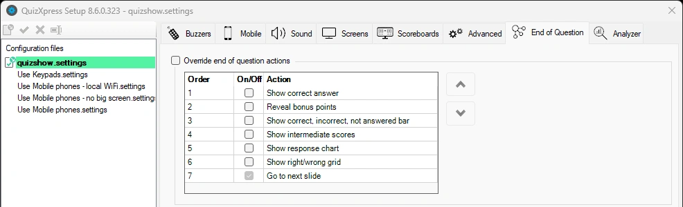
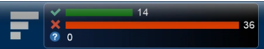

# Acties aan het einde van een vraag

Op dit tabblad bepaalt u welke acties worden uitgevoerd (en in welke volgorde) wanneer een vraag eindigt (alle antwoorden zijn ontvangen, of bij een open vraag is een juist antwoord gegeven).

{ width="604" loading=lazy }

Als de acties niet zijn aangepast, wordt normaal gesproken een standaardreeks acties uitgevoerd, zoals het markeren van het juiste antwoord en het tonen van statistieken in het infopaneel. Als u de standaardacties overschrijft, worden de ingestelde acties een voor een in de ingestelde volgorde uitgevoerd wanneer u op de OK-knop van de afstandsbediening van de quizmaster drukt, op de spatiebalk in Live drukt of in Director op de knop ‘Volgende’ klikt.

De volgende acties kunt u instellen:

**Toon juist antwoord**

Deze actie markeert het juiste antwoord op de dia en toont een indicator, meestal een vinkje. Dit kan verschillen per stijl van uw dia. U kunt deze actie overslaan als u het juiste antwoord op een andere manier wilt tonen (bijvoorbeeld met een vorm of een tekstelement op de dia).

**Toon balk juist, onjuist, niet beantwoord**

Toont de antwoordgrafiek in de infobalk bovenaan.

{ width="457" loading=lazy }

**Toon tussenscores**

Opent de ranglijst (overzicht van de top 20, normaal geopend met de toets ‘S’)

**Toon antwoordgrafiek**

Toont het scherm met de staafgrafiek van de antwoorden.

**Ga naar volgende dia**

Gaat door naar de volgende dia; deze actie staat altijd aan en wordt altijd als laatste uitgevoerd.
