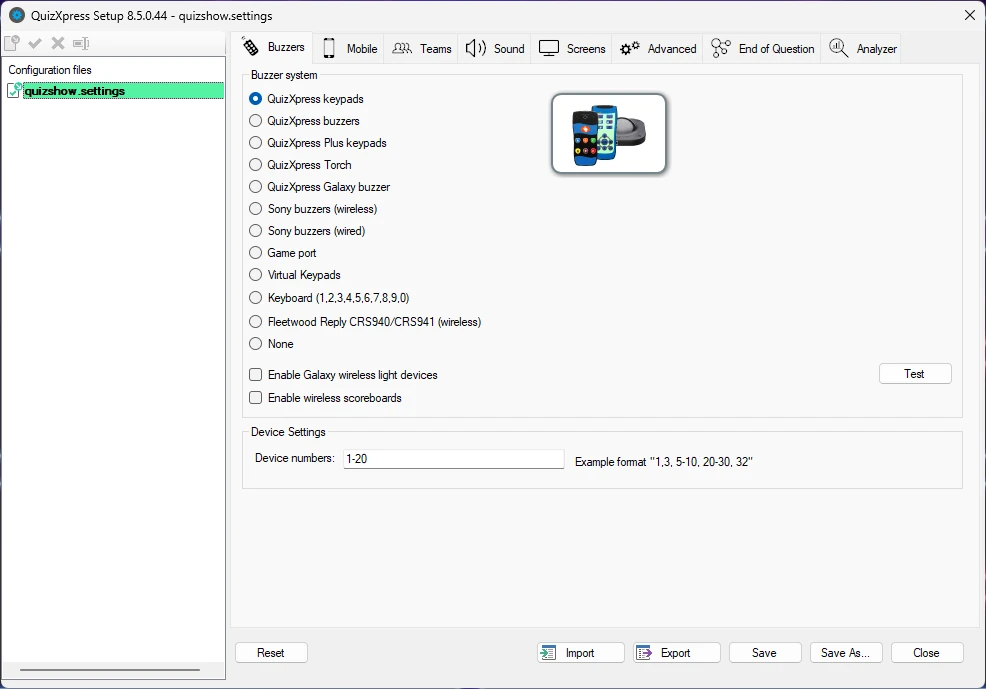

# Configuración del concurso con QuizXpress Setup

El capítulo anterior describía cómo diseñar un quiz en QuizXpress Studio. El siguiente paso es ‘ejecutar’ el quiz en QuizXpress Live. Sin embargo, antes de hacerlo, puede que desee cambiar algunos aspectos del concurso, por ejemplo el tipo de hardware que utiliza, los nombres de los equipos, los sonidos de los pulsadores, los textos de la pantalla de bienvenida, las imágenes de la presentación de diapositivas, etc.

El programa Quiz Setup se encuentra en el menú Inicio de Windows o en el menú External Tools de Studio (cinta Home).

Quiz Setup permite gestionar varios archivos de configuración. En la vista de lista situada a la izquierda de la interfaz de usuario, puede ver los archivos de configuración disponibles. El que aparece en **negrita** es el archivo activo, lo que significa que esos ajustes se utilizarán al ejecutar un quiz de producción. Puede cambiar el archivo activo haciendo clic con el botón derecho sobre él y seleccionando ‘Activate’ en el menú contextual. Para cargar un archivo y editarlo, haga doble clic en él o seleccione ‘Load’ en el menú contextual.

{ width="605" loading=lazy }

Al hacer clic en ‘Reset’, el sistema vuelve a la configuración predeterminada. Tenga en cuenta que siempre tendrá que seleccionar un sistema de pulsadores antes de poder utilizar cualquier funcionalidad.

Al hacer clic en el botón Save, el archivo de configuración actual se guarda en el disco.

Al hacer clic en el botón **Save As…**, el archivo de configuración actual puede guardarse con otro nombre.

Los botones Import y Export le permiten exportar (guardar) a un archivo los ajustes cargados actualmente. Este archivo puede importarse después en QuizXpress Setup en otro equipo, lo que permite transferir los ajustes de forma sencilla y segura. Tenga en cuenta que las carpetas a las que se haga referencia en el archivo de configuración deben existir en el equipo que importe los ajustes (de lo contrario, se mostrarán advertencias al iniciar un concurso con los ajustes importados).

Hay varias pestañas en las que se pueden modificar los distintos ajustes. En las secciones siguientes se describe cada página y sus ajustes.
