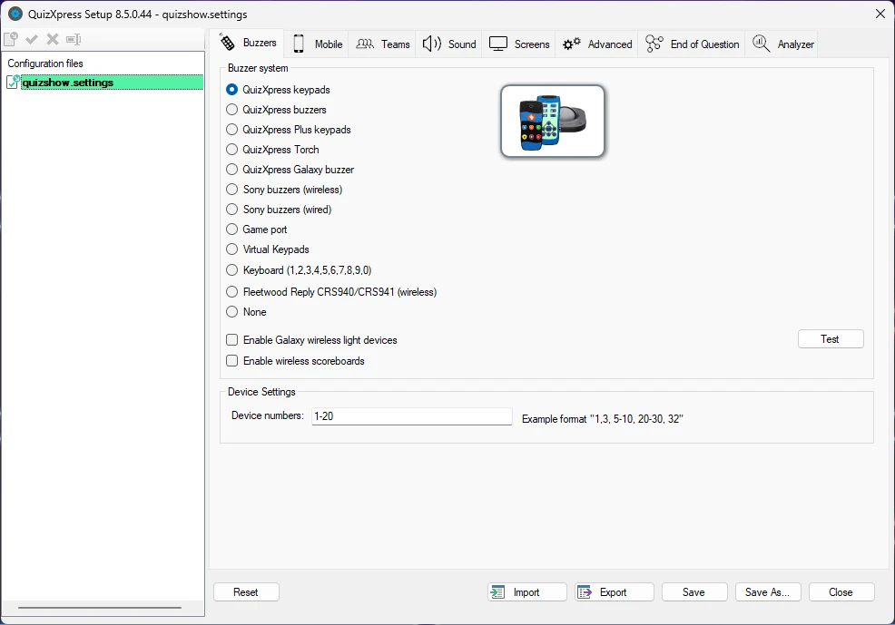

# De game show instellen met QuizXpress Setup

In het vorige hoofdstuk is beschreven hoe u een quiz ontwerpt in QuizXpress Studio. De volgende stap is de quiz ‘uitvoeren’ in QuizXpress Live. Voordat u dat doet, wilt u misschien enkele onderdelen van de game show aanpassen, zoals het type hardware dat u gebruikt, de teamnamen, de buzzergeluiden, de teksten op het welkomstscherm, de diashowafbeeldingen enzovoort.

Het programma Quiz Setup vindt u in het Windows Startmenu of in het menu Externe hulpprogramma’s in Studio (lint Start).

In Quiz Setup kunt u meerdere instellingenbestanden beheren. In de lijstweergave links in de gebruikersinterface ziet u de beschikbare configuratiebestanden. Het bestand in **vet** is het actieve bestand: die instellingen worden gebruikt wanneer u een echte quiz uitvoert. U wijzigt het actieve bestand door er met de rechtermuisknop op te klikken en in het contextmenu ‘Activeren’ te kiezen. Om een bestand te laden om het te bewerken, dubbelklikt u erop of kiest u ‘Laden’ in het contextmenu.

{ width="605" loading=lazy }

Met ‘Resetten’ keert het systeem terug naar de standaardconfiguratie. Let op: u moet altijd eerst een buzzersysteem kiezen voordat u functionaliteit kunt gebruiken.

Met de knop Opslaan wordt het huidige instellingenbestand op schijf opgeslagen.

Met de knop **Opslaan als…** kunt u het huidige instellingenbestand onder een andere naam opslaan.

Met de knoppen Importeren en Exporteren exporteert (bewaart) u de momenteel geladen instellingen naar een bestand. Dit bestand kunt u vervolgens importeren in QuizXpress Setup op een andere computer, zodat u instellingen eenvoudig en betrouwbaar overdraagt. Let op: mappen waarnaar in het instellingenbestand wordt verwezen, moeten aanwezig zijn op de computer die de instellingen importeert (anders worden waarschuwingen getoond bij het starten van een quizshow met de geïmporteerde instellingen).

Er zijn meerdere tabbladen waarop u de verschillende instellingen kunt wijzigen. In de volgende secties wordt elk tabblad met zijn instellingen beschreven.
