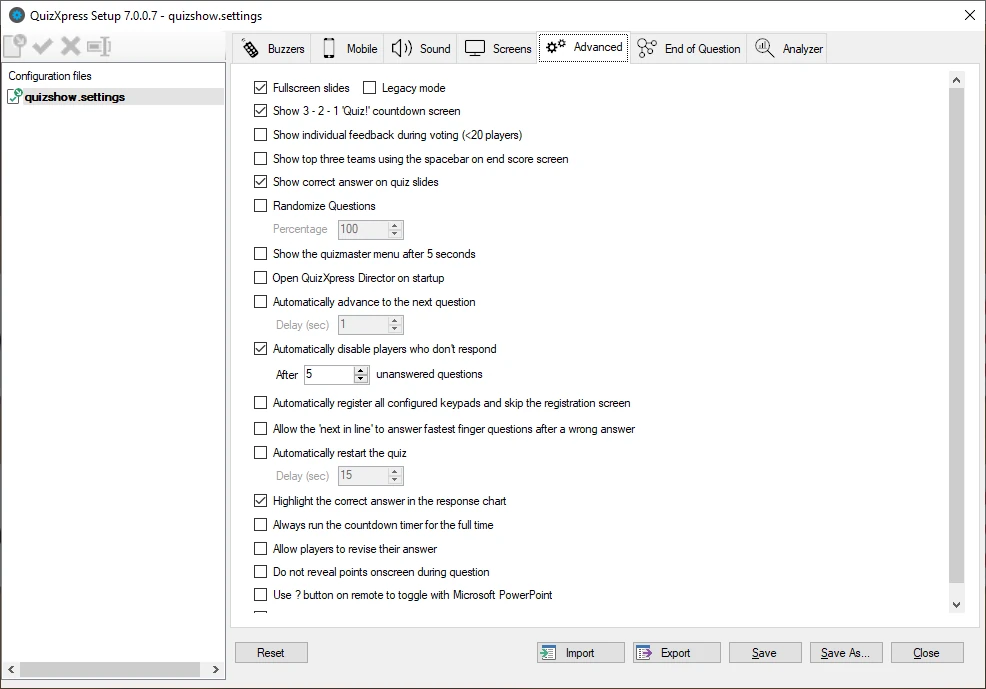

# Altre impostazioni – la scheda Advanced

La scheda Advanced contiene diverse impostazioni avanzate:

{ width="598" loading=lazy }

**Full screen slides**

Questa opzione mostra ogni diapositiva a schermo intero. Per impostazione predefinita, le diapositive ‘fluttuano’ sullo schermo, con margini su tutti i lati.

Facendo clic sull'opzione a schermo intero, le diapositive vengono mostrate a schermo intero. Lo sfondo viene esteso per adattarsi all'intero desktop e anche le dimensioni degli elementi della diapositiva (domanda, risposte) vengono leggermente aumentate.

!!! note

    quando si fa clic sull'opzione Full screen slides, compare una seconda opzione, ‘Legacy mode’. Questa supporta la vecchia impostazione Full screen, che funzionava in modo leggermente diverso. In precedenza, l'opzione delle diapositive a schermo intero faceva sovrapporre la barra dell'orologio al testo della domanda. Per risolvere il problema, gli elementi delle diapositive (il testo della domanda e le risposte) dovevano essere spostati verso il basso per adattarsi alla visualizzazione a schermo intero. Se si hanno quiz con un layout progettato per la vecchia opzione Full screen, selezionare la casella ‘Legacy mode’.

**Show 3-2-1 Quiz countdown screen**

Indica se prima dell'inizio del quiz viene mostrata un'animazione di conto alla rovescia.

**Show individual feedback during voting (\<20 players)**

Quando questa opzione è selezionata, ogni singolo voto viene mostrato per le domande in cui la votazione è impostata su ‘True’. Se l'opzione non è selezionata, viene mostrato solo un contatore con il numero totale di voti ricevuti. Per un esempio, vedere le immagini mostrate alla fine di 5.4.5. Questo vale solo quando i giocatori sono meno di 20.

**Show top three teams using space on end score screen:**

Quando è impostata, la schermata del punteggio finale non mostra automaticamente i primi 3 giocatori ma attende che venga premuta la barra spaziatrice. Premendo più volte la barra spaziatrice vengono mostrati in sequenza il 3o, il 2o e il 1o posto. Successivamente viene mostrata la classifica completa.

**Use remote control**

Indica se viene utilizzato un telecomando per il conduttore del quiz (per il sistema di buzzer QuizXpress questa opzione è sempre abilitata, poiché il sistema include un telecomando speciale).

**Show correct answer**

Se selezionata (impostazione predefinita), la risposta corretta (indicata da un segno di spunta verde) viene mostrata quando viene valutata una domanda a scelta multipla. Se deselezionata, la risposta corretta non viene mostrata, lasciando che sia il conduttore a comunicarla al pubblico. In alternativa, è possibile usare una forma per sostituire questo comportamento predefinito e indicare personalmente la risposta corretta — ad esempio, mostrando una grande freccia rossa che punta alla risposta giusta.

**Randomize Questions**

Se selezionata, le domande di un quiz vengono mostrate in ordine casuale. Quando sono presenti dei round, le domande all'interno di ciascun round vengono mescolate. Indicando una percentuale, è possibile far sì che QuizXpress mostri solo una parte delle domande (in ordine casuale). Il modo in cui le diapositive vengono mescolate è controllato dall'opzione ‘Shuffle mode’, che può essere impostata per ogni diapositiva.

** Show Quizmaster Hints**

Durante l'esecuzione di un game show in QuizXpress Live sono disponibili più comandi nelle diverse fasi — ad esempio, mostrare grafici, passare alla diapositiva successiva, mostrare le panoramiche dei punteggi o giudicare le domande. Tutti questi comandi hanno scorciatoie da tastiera (oppure possono essere azionati con un telecomando per il conduttore del quiz).

Per guidare i principianti, durante un quiz possono essere mostrati dei suggerimenti per il conduttore, che visualizzano tutti i comandi disponibili man mano che diventano applicabili. Quando il conduttore del quiz è sicuro nell'uso del sistema, può disattivare questa impostazione (in Quiz Setup) in modo che il pubblico non veda più i suggerimenti. Per impostazione predefinita, i suggerimenti per il conduttore del quiz sono **abilitati**.

**Enable QuizXpress Director**

Quando questa opzione è selezionata, Director si apre immediatamente all'avvio di QX Live. Se questa opzione non è impostata, è comunque possibile aprire Director in qualsiasi momento con il tasto ‘D’ *(nota: questa opzione è disponibile solo nell'edizione Ultimate)*.

**Automatically advance to the next question**

Con questa opzione è possibile far passare Live alla domanda successiva senza intervento. Quindi, se si ha una serie di domande a scelta multipla da proporre al pubblico senza essere presenti, questa è l'opzione da usare. È inoltre possibile impostare il tempo tra le domande.

**Automatically disable players that don’t respond**

Quando è abilitata, il sistema disabilita automaticamente i giocatori che non hanno risposto per un certo numero di domande (il che significa che probabilmente hanno lasciato il quiz).

**Automatically register all keypads**

Normalmente il pubblico deve registrarsi all'inizio di una sessione. In questo modo il sistema sa quali keypad partecipano e può terminare una domanda una volta ricevute tutte le risposte. Se questo processo di registrazione è scomodo, è possibile impostare questa opzione: il sistema salterà la schermata di registrazione e registrerà tutti i keypad configurati. Ad esempio, se la configurazione dei dispositivi è impostata su ‘1-100’, i keypad da 1 a 100 verranno tutti registrati.

**Allow the next in line to answer**

Quando è abilitata, il sistema consente in sequenza a tutti i giocatori che hanno risposto a una domanda aperta (entro 2 secondi dalla prima risposta) di fornire una risposta, finché non viene data una risposta corretta. Se non è abilitata, solo il primo giocatore può rispondere, dopodiché il sistema riapre la possibilità di rispondere a tutti i giocatori (tranne quelli che hanno già dato una risposta errata).

**Automatically restart the quiz**

Questa opzione consente di riavviare automaticamente il quiz un certo numero di secondi dopo aver raggiunto la schermata del punteggio finale, permettendo di creare un quiz autonomo che non richiede la presenza di un conduttore del quiz.

**Highlight the correct answer in the response chart**

Se non si desidera che la risposta corretta venga evidenziata nel grafico delle risposte, disattivare questa impostazione. Può essere utile, ad esempio, quando si vuole prima verificare con il pubblico quante risposte ci sono state per ciascuna opzione, senza evidenziare quella corretta.

**Always run the countdown timer for the full time**

Se si desidera che l'orologio scorra per l'intero tempo specificato, indipendentemente dal fatto che tutti abbiano già risposto, selezionare questa opzione (quando l'opzione è disattivata, l'orologio si ferma non appena tutti hanno risposto). Se si preferisce un tempo di conto alla rovescia costante, selezionare questa opzione.

**Allow players to revise their answer**

Quando si seleziona questa opzione, i giocatori possono modificare la risposta mentre il conto alla rovescia è in corso.

**Do not reveal points onscreen during question**

Per impostazione predefinita, il sistema mostra i punti guadagnati o persi per le domande di tipo ‘fastest finger’. Per creare più suspense, è possibile impostare questa opzione in modo che i punti di un giocatore non siano noti fino alla visualizzazione della classifica.

**Use ‘?’ button on remote to toggle with Microsoft PowerPoint**

Per gli utenti che desiderano combinare QuizXpress con presentazioni PowerPoint, questa funzione consente di passare dalla schermata di PowerPoint a QuizXpress usando il pulsante ‘?’ del telecomando per presentazioni.

**Remove top panel when answering to avoid overlapping**

In determinate situazioni (domanda aperta, votazione con feedback individuale), la diapositiva si sposta verso l'alto quando un giocatore preme il buzzer, sovrapponendosi al pannello superiore. Questa impostazione fa scomparire temporaneamente il pannello superiore per evitare la sovrapposizione.
