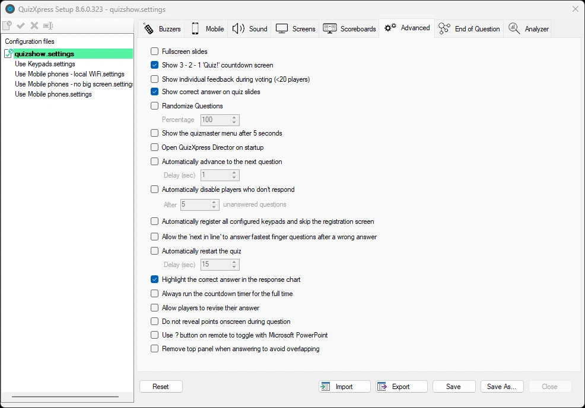

# Overige instellingen – het tabblad Geavanceerd

Het tabblad Geavanceerd bevat verschillende geavanceerde instellingen:

{ width="598" loading=lazy }

**Dia’s op volledig scherm**

Met deze optie wordt elke dia op volledig scherm getoond. Standaard ‘zweven’ dia’s op het scherm, met marges aan alle kanten.

Als u de optie voor volledig scherm aanklikt, worden dia’s op volledig scherm getoond. De achtergrond wordt uitgebreid tot het hele bureaublad en ook de afmetingen van de diaonderdelen (vraag, antwoorden) worden iets groter.

!!! note

    wanneer u de optie Dia’s op volledig scherm aanklikt, verschijnt een tweede optie, ‘Legacy modus (achtergrond en inhoud op volledig scherm)’. Deze ondersteunt de oude instelling voor volledig scherm, die iets anders werkte. Voorheen zorgde de optie voor dia’s op volledig scherm ervoor dat de klokbalk over de vraagtekst heen viel. Om dit op te lossen, moesten de onderdelen op de dia’s (zowel de vraagtekst als de antwoorden) naar beneden worden verplaatst om weergave op volledig scherm mogelijk te maken. Als u quizzen hebt met een indeling die is ontworpen voor de oude optie voor volledig scherm, vinkt u het vakje ‘Legacy modus (achtergrond en inhoud op volledig scherm)’ aan.

**Toon het aftelscherm 3-2-1 van de quiz**

Geeft aan of een aftelanimatie wordt getoond voordat de quiz begint.

**Toon individuele feedback tijdens antwoorden (<20 spelers)**

Als deze optie is aangevinkt, wordt elke individuele stem getoond bij vragen waarvoor stemmen op ‘Waar’ is ingesteld. Als deze optie niet is aangevinkt, wordt alleen een teller getoond met het totale aantal ontvangen stemmen. Zie voor een voorbeeld de afbeeldingen aan het einde van 5.4.5. Dit geldt alleen wanneer er minder dan 20 spelers zijn.

**Top drie teams door middel van spatie tonen op het eindscorescherm:**

Als deze optie is ingesteld, toont het eindscorescherm de top 3 spelers niet automatisch, maar wacht het tot op de spatiebalk wordt gedrukt. Door meerdere keren op de spatiebalk te drukken, worden achtereenvolgens de 3e, 2e en 1e plaats getoond. Daarna wordt een volledige ranglijst getoond.

**Afstandsbediening gebruiken**

Geeft aan of een afstandsbediening voor de quizmaster wordt gebruikt (voor het QuizXpress buzzersysteem is deze optie altijd ingeschakeld, omdat dit systeem een speciale afstandsbediening bevat).

**Toon juist antwoord**

Als dit is aangevinkt (standaard), wordt het juiste antwoord (aangegeven met een groen vinkje) getoond wanneer een meerkeuzevraag wordt beoordeeld. Als dit niet is aangevinkt, wordt het juiste antwoord niet getoond, zodat u het publiek zelf kunt vertellen wat het juiste antwoord is. U kunt ook een vorm gebruiken om dit standaardgedrag te overschrijven en zelf het juiste antwoord aan te geven, bijvoorbeeld met een grote rode pijl die naar het juiste antwoord wijst.

**Vragen in willekeurige volgorde tonen**

Als dit is aangevinkt, worden de vragen van een quiz in willekeurige volgorde getoond. Als er rondes zijn, worden de vragen binnen elke ronde geschud. Door een percentage op te geven, kunt u QuizXpress laten bepalen dat slechts een deel van de vragen (in willekeurige volgorde) wordt getoond. Hoe dia’s worden geschud, wordt bepaald door de optie ‘Shuffle instelling’, die u per dia kunt instellen.

** Toon hints voor de quizmaster**

Wanneer u een quizshow uitvoert in QuizXpress Live, zijn in de verschillende fasen meerdere opdrachten beschikbaar, bijvoorbeeld het tonen van grafieken, doorgaan naar de volgende dia, het tonen van scoreoverzichten of het beoordelen van vragen. Al deze opdrachten hebben sneltoetsen op het toetsenbord (of kunnen worden bediend met een afstandsbediening voor de quizmaster).

Om beginnende gebruikers te begeleiden, kunnen tijdens een quiz hints voor de quizmaster worden getoond, met alle beschikbare opdrachten zodra ze van toepassing zijn. Zodra de quizmaster het systeem vol vertrouwen bedient, kan hij of zij deze instelling uitschakelen (in Quiz Setup), zodat het publiek de hints niet meer ziet. Standaard zijn hints voor de quizmaster **ingeschakeld**.

**QuizXpress Director inschakelen**

Als deze optie is aangevinkt, wordt Director direct geopend wanneer QX Live start. Als deze vlag niet is ingesteld, kunt u Director altijd openen met de toets ‘D’ *(let op: deze optie is alleen beschikbaar in de Ultimate-editie)*.

**Ga automatisch door naar de volgende vraag**

Met deze optie kunt u Live zonder tussenkomst laten doorgaan naar de volgende vraag. Als u dus een reeks meerkeuzevragen voor uw publiek wilt laten draaien zonder aanwezig te zijn, gebruikt u deze optie. U kunt ook de tijd tussen de vragen instellen.

**Schakel spelers die niet reageren automatisch uit**

Als dit is ingeschakeld, schakelt het systeem automatisch spelers uit die gedurende een bepaald aantal vragen niet hebben geantwoord (waarschijnlijk hebben zij de quiz verlaten).

**Registreer alle keypads automatisch**

Normaal gesproken moet het publiek zich aan het begin van een sessie aanmelden. Zo weet het systeem welke keypads meedoen en kan het een vraag beëindigen zodra alle antwoorden zijn ontvangen. Als dit registratieproces ongemakkelijk is, kunt u deze vlag instellen: het systeem slaat dan het registratiescherm over en meldt alle geconfigureerde keypads aan. Als u de apparaatconfiguratie bijvoorbeeld op ‘1-100’ hebt gezet, worden keypads 1-100 allemaal geregistreerd.

**De eerstvolgende laten antwoorden**

Als dit is ingeschakeld, laat het systeem alle spelers die op een open vraag hebben gereageerd (binnen 2 seconden na de eerste reactie) achtereenvolgens een antwoord geven, totdat een juist antwoord is gegeven. Als dit niet is ingeschakeld, mag alleen de eerste speler antwoorden, waarna het systeem het woord weer vrijgeeft aan alle spelers (behalve degenen die al een onjuist antwoord hebben gegeven).

**Herstart de quiz automatisch**

Met deze optie herstart de quiz automatisch een bepaald aantal seconden nadat het eindscorescherm is bereikt, zodat u een zelfstandige quiz kunt maken waarbij geen quizmaster aanwezig hoeft te zijn.

**Toon het correcte antwoord in de response grafiek**

Als u niet wilt dat het juiste antwoord in de antwoordgrafiek wordt gemarkeerd, schakelt u deze instelling uit. Dit kan bijvoorbeeld handig zijn wanneer u eerst bij het publiek wilt nagaan hoeveel antwoorden er voor elk antwoord waren, zonder het juiste antwoord te markeren.

**Laat de timer doorlopen tot de ingestelde tijd**

Als u wilt dat de klok de volledige ingestelde tijd doorloopt, ongeacht of iedereen al heeft geantwoord, vinkt u deze optie aan (als de optie uit staat, stopt de klok zodra iedereen heeft geantwoord). Als u de voorkeur geeft aan een constante aftelduur, vinkt u deze optie aan.

**Spelers toestaan om hun antwoord te herzien**

Wanneer u deze optie aanvinkt, kunnen spelers hun antwoord herzien zolang de aftelklok loopt.

**Verberg scores bij snelste drukker vragen**

Standaard toont het systeem de gewonnen of verloren punten bij vragen met de snelste vinger. Om meer spanning op te bouwen, kunt u deze vlag instellen zodat de punten van een speler pas bekend zijn wanneer de ranglijst wordt getoond.

**Gebruik de [?] knop op afstandsbediening om te switchen met Microsoft PowerPoint**

Voor gebruikers die QuizXpress willen combineren met PowerPoint-presentaties kunt u met deze functie wisselen tussen het PowerPoint-scherm en QuizXpress met de knop ‘?’ op de presentatie-afstandsbediening.

**Verwijder top paneel bij antwoord om overlap te voorkomen**

In bepaalde situaties (open vraag, stemmen met individuele feedback) schuift de dia omhoog wanneer een speler buzzt, waardoor deze het bovenpaneel overlapt. Met deze instelling verdwijnt het bovenpaneel tijdelijk om de overlap te voorkomen.
