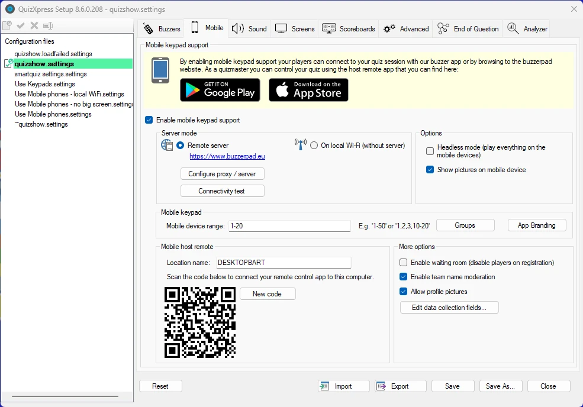
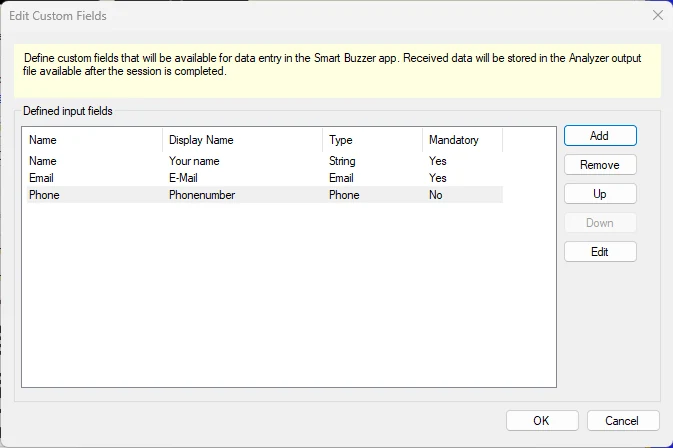
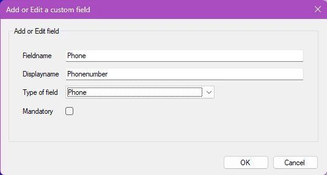
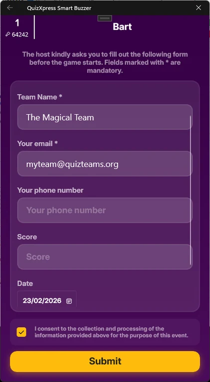
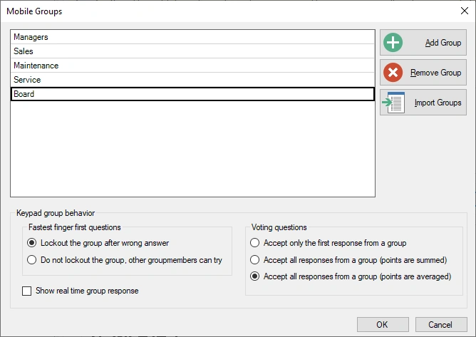
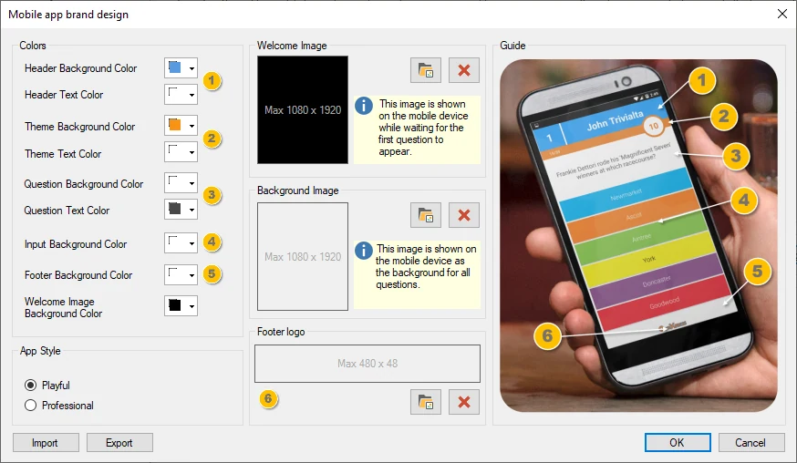

# Configurare il supporto per le pulsantiere mobili

QuizXpress supporta l'uso di telefoni cellulari e tablet come dispositivi di input. I giocatori possono connettersi con un normale browser web oppure utilizzare la nostra app Smart Buzzer per Android e iOS. Per poter attivare questa funzione è necessario possedere una licenza che supporti le pulsantiere mobili.

Per abilitare il supporto per le pulsantiere mobili, selezionare prima la casella ‘Enable mobile keypad support’. Verranno quindi visualizzate tre sezioni da configurare:

## Modalità server

Esistono due modi per eseguire il sistema con le pulsantiere mobili:

1)  Utilizzando uno dei nostri server cloud (è richiesta una connessione a Internet sia per l'utente sia per i giocatori, che possono partecipare da tutto il mondo)

2)  Utilizzando un router Wi-Fi locale collegato al proprio laptop (non è richiesta alcuna connessione a Internet, ma tutti i giocatori devono trovarsi nello stesso luogo fisico per connettersi al router)

{ width="455" loading=lazy }

Sono disponibili diverse opzioni:

- **Play in ‘Headless’ mode** – Da utilizzare quando non è disponibile uno schermo esterno\proiettore e si desidera che i giocatori giochino solo sul proprio dispositivo mobile. Si noti che in questo caso i Moduli Gioco e le domande video non sono supportati. In modalità headless, sul computer viene mostrata solo la schermata di Director con un lettore del quiz integrato (per ulteriori informazioni su Director, fare riferimento a [QuizXpress Director](../live/quizxpress-director/index.md)).

- **Show pictures on mobile device** – Indica se le immagini vengono inviate anche all'app Smart Buzzer / all'app browser buzzerpad (nota: durante il quiz è possibile attivare o disattivare questa opzione nelle Mobile Settings di Director).

- **Enable waiting room** – quando è attiva, tutti i giocatori mobili vengono impostati immediatamente su ‘disabled’ dopo la registrazione e non possono partecipare al quiz, anche se il loro dispositivo mostra le domande. Il Quizmaster deve prima abilitare ogni giocatore in Director. Utilizzarla, ad esempio, quando i giocatori devono pagare una quota d'ingresso prima di poter partecipare.

- **Enable team name moderation – quando è abilitata, il server buzzerpad analizza i nomi dei giocatori alla ricerca di parolacce da un elenco predefinito (attualmente solo in olandese, inglese e francese) e le sostituisce con ‘#####’**

- **Allow profile pictures – consente ai giocatori di caricare le proprie immagini del profilo nel quiz in modo che compaiano nelle classifiche e in altri elementi visivi.Data collection with custom fields**

Il sistema supporta la raccolta di dati dai singoli utenti in una schermata che compare dopo la connessione al quiz. I campi da raccogliere possono essere configurati qui in Quiz Setup e i dati acquisiti saranno disponibili dopo il quiz nel file di output di Analyzer.

{ width="449" loading=lazy }

Per aggiungere un campo, fare clic su Add e inserire i dettagli nel popup del campo personalizzato:

{ width="296" loading=lazy }

Quando l'utente si connette, gli viene presentata una schermata di inserimento dati, come nel seguente esempio:

{ width="211" loading=lazy }

Quando si utilizza la modalità *Remote server*, è possibile selezionare il server usato per ospitare la sessione del quiz facendo clic sul pulsante *Configure proxy / server*. Il server predefinito è [www.buzzerpad.com](http://www.buzzerpad.com). Questo server si trova negli Stati Uniti centro-meridionali. Se ci si trova in Europa, può essere preferibile passare a [www.buzzerpad.eu](http://www.buzzerpad.eu) per una latenza inferiore.

## Sezione Mobile keypad

Qui si configura l'intervallo di pulsantiere che possono connettersi al quiz. Per impostazione predefinita, quando si abilita il supporto per le pulsantiere mobili, il campo ‘Mobile device range’ viene compilato con gli ID da 1 fino al numero massimo di giocatori consentito dalla licenza.

Se si dispone già di un kit di buzzer o pulsantiere, è possibile estenderlo con giocatori che giocano su pulsantiere mobili. In questo caso, quando si abilita il supporto per le pulsantiere mobili, compare un campo ‘Mobile device range’ che parte dal più alto ID di pulsantiera o buzzer definito nella scheda Buzzers. Il numero massimo in questo caso è quello consentito dalla licenza.

Esempio: nella scheda Buzzers si indica che si gioca con le pulsantiere QuizXpress 1-20. Nella scheda Mobile si abilita il supporto per le pulsantiere mobili. Se si dispone di una licenza Ultimate 50 (che consente fino a 50 giocatori), il campo ‘Mobile device range’ verrà compilato con 21-50.

### Giocare in gruppi

Quando si desidera che il pubblico gareggi in gruppi utilizzando dispositivi mobili, è necessario predefinire un elenco di gruppi. Quando un giocatore si connette al quiz, sul suo dispositivo gli viene chiesto di selezionare il gruppo per cui giocare.

Facendo clic sul pulsante ‘Groups’ compare un modulo in cui è possibile configurare i gruppi e il loro comportamento:

{ width="298" loading=lazy }

Nella sezione inferiore si definisce il comportamento per le domande di tipo Dito più Veloce e per quelle di votazione.

### Personalizzare il marchio dell'app mobile

Quando si gioca con l'app QuizXpress Smart Buzzer, è possibile impostare il proprio marchio con il Branding Designer, modificando i colori, il logo e l'immagine di benvenuto dell'app:

{ width="549" loading=lazy }

Giocare con gruppi predefiniti

**Sezione Mobile host remote**

In questa sezione viene presentato il codice QR utilizzato per collegare l'app di controllo remoto al computer.

L'app per controllare il quiz in corso è disponibile per Android e iOS. Si possono trovare qui:

| Mobile Director per Android | <https://play.google.com/store/apps/details?id=com.gameshowcrew.quizxpressdirector> |
|-----------------------------|-------------------------------------------------------------------------------------|
| Mobile Director per iOS     | <https://apps.apple.com/us/app/quizxpress-director/id1493187163>                    |

Nell'app Mobile remote è possibile registrare più computer da controllare. Questi computer vengono visualizzati con il rispettivo ‘Location name’, che può essere impostato nella sezione Mobile remote. Il nome predefinito è il nome del computer.

Per collegare il telecomando Mobile presenter al computer, aprire l'app Virtual remote e fare clic sul pulsante ‘più’. Sul dispositivo mobile si apre uno scanner di codici QR. Scansionare il codice QR mostrato nella sezione Mobile remote e il nome inserito nel campo ‘Location name’ verrà aggiunto all'elenco dei computer nell'app Mobile remote.

!!! warning

    si noti che l'app dispone di un'impostazione del server che deve corrispondere al server selezionato in Quiz Setup. Inoltre, se si utilizza il Wi-Fi, è necessario impostare l'app su ‘Wi-Fi’.**

## Altre opzioni – Waiting room

Se si esegue un quiz con QuizXpress Mobile e si desidera un maggiore controllo su chi entra nel gioco, è possibile usare l'impostazione ‘Waiting Room’. Quando questa impostazione è attiva, i giocatori che entrano nel gioco sono inattivi per impostazione predefinita.

Per far entrare i giocatori nel gioco, abilitarli esplicitamente nella scheda Teams di QuizXpress Director. Un esempio è un pub quiz in cui i giocatori devono pagare una piccola quota per partecipare: alla ricezione del pagamento di un giocatore, il Quizmaster può abilitare quel giocatore.
