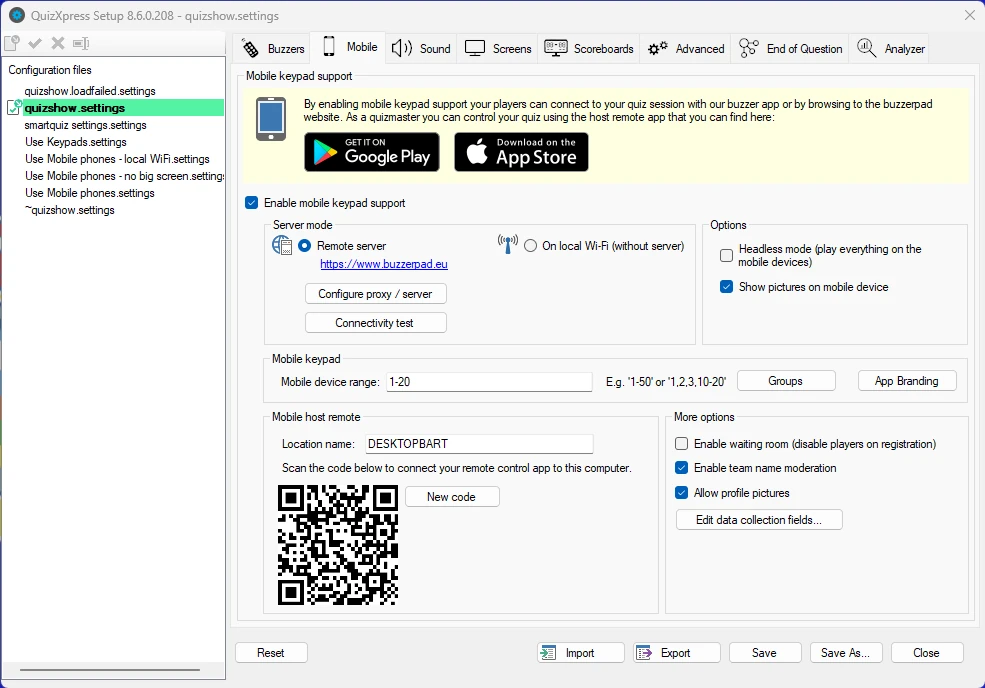
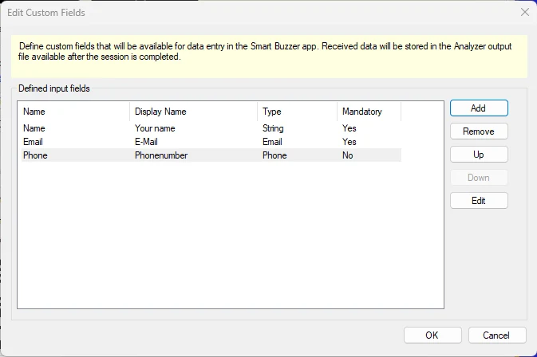
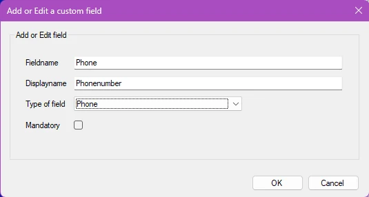
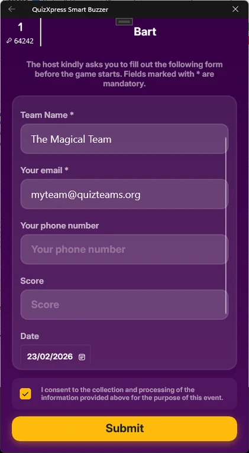
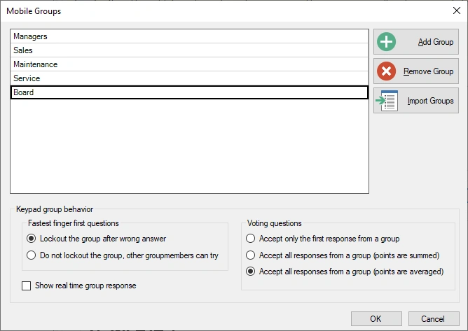
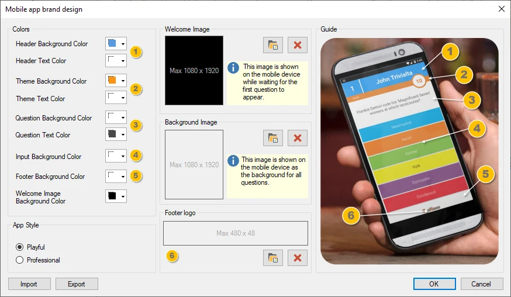

# Ondersteuning voor mobiele keypads instellen

QuizXpress ondersteunt het gebruik van mobiele telefoons en tablets als invoerapparaat. Spelers kunnen verbinding maken met een standaard webbrowser, of onze Smart Buzzer-app voor Android en iOS gebruiken. U moet een licentie hebben die mobiele keypads ondersteunt voordat u deze functie kunt activeren.

Om ondersteuning voor mobiele keypads in te schakelen, vinkt u eerst het selectievakje ‘Mobiele keypad support inschakelen’ aan. Vervolgens ziet u drie secties om te configureren:

## Servermodus

Er zijn twee manieren om het systeem met mobiele keypads te gebruiken:

1)  Met een van onze cloudservers (internet vereist voor u en uw spelers, die vanuit de hele wereld kunnen meedoen)

2)  Met een lokale wifirouter die op uw laptop is aangesloten (geen internet nodig, maar alle spelers moeten zich op één fysieke locatie bevinden om verbinding te maken met uw router)

{ width="455" loading=lazy }

Er zijn verschillende opties:

- **Spelen in ‘Headless’-modus** – Gebruik dit wanneer er geen extern scherm of beamer beschikbaar is en u wilt dat spelers alleen op hun mobiel spelen. Let op: in dat geval worden minigames en videovragen niet ondersteund. Bij spelen in headless-modus wordt alleen het Director-scherm getoond op de computer met een geïntegreerde quizspeler (zie [QuizXpress Director](../live/quizxpress-director/index.md) voor meer informatie over Director).

- **Toon afbeeldingen op mobiele apparaten** – Geeft aan of afbeeldingen ook naar de Smart Buzzer-app / buzzerpad-browserapp worden gestuurd (let op: tijdens de quiz kunt u dit in- of uitschakelen in de Mobiele instellingen in Director).

- **Wachtkamer inschakelen** – wanneer dit aan staat, worden alle mobiele spelers direct na registratie op ‘uitgeschakeld’ gezet en kunnen ze niet aan de quiz deelnemen, hoewel hun apparaat wel de vragen toont. De host moet elke speler eerst inschakelen in Director. Gebruik dit bijvoorbeeld wanneer spelers eerst toegangsgeld moeten betalen voordat ze mogen deelnemen.

- **Schakel teamnaammoderatie in – wanneer dit is ingeschakeld, scant de buzzerpad-server spelersnamen op grof taalgebruik uit een vooraf gedefinieerde lijst (momenteel alleen in het Nederlands, Engels en Frans) en vervangt die door ‘#####’**

- **Profielfoto’s toestaan – laat spelers hun profielfoto naar de quiz uploaden, zodat die op ranglijsten en andere visuele elementen verschijnt.Gegevens verzamelen met aangepaste velden**

Het systeem ondersteunt het verzamelen van gegevens van individuele gebruikers op een scherm dat verschijnt nadat zij verbinding hebben gemaakt met de quiz. De te verzamelen velden kunt u hier in Quiz Setup instellen en de vastgelegde gegevens zijn na de quiz beschikbaar in het uitvoerbestand van Analyzer.

{ width="449" loading=lazy }

Om een veld toe te voegen, klikt u op Toevoegen en voert u de gegevens in het pop-upvenster voor aangepaste velden in:

{ width="296" loading=lazy }

Wanneer de gebruiker verbinding maakt, wordt een gegevensinvoerscherm getoond, zoals in het volgende voorbeeld:

{ width="211" loading=lazy }

Bij gebruik van de modus *Externe server* kunt u de server selecteren waarop uw quizsessie wordt gehost door op de knop *Configureer proxy / server* te klikken. De standaardserver is [www.buzzerpad.com](http://www.buzzerpad.com). Deze server staat in het zuidelijk-centrale deel van de VS. Als u in Europa woont, kunt u beter overschakelen naar [www.buzzerpad.eu](http://www.buzzerpad.eu) voor een lagere latentie.

## Sectie Mobiele keypad

Hier configureert u het bereik van keypads dat verbinding kan maken met uw quiz. Wanneer u ondersteuning voor mobiele keypads inschakelt, wordt het veld ‘Apparaat nummers’ standaard gevuld met de id’s 1 tot en met het maximumaantal spelers dat uw licentie toestaat.

Als u al een set buzzers of keypads hebt, kunt u die uitbreiden met spelers die op mobiele keypads spelen. In dat geval verschijnt, wanneer u ondersteuning voor mobiele keypads inschakelt, een ‘Apparaat nummers’-bereik dat begint bij de hoogste keypad- of buzzer-id die op het tabblad Buzzers is gedefinieerd. Het maximum is in dit geval het aantal dat uw licentie toestaat.

Voorbeeld: op het tabblad Buzzers geeft u aan dat u speelt met QuizXpress-keypads 1-20. Op het tabblad Mobiel schakelt u ondersteuning voor mobiele keypads in. Als u een Ultimate 50-licentie hebt (die tot 50 spelers toestaat), wordt het veld ‘Apparaat nummers’ gevuld met 21-50.

### Spelen in groepen

Wanneer u wilt dat uw publiek in groepen strijdt terwijl het mobiele apparaten gebruikt, moet u vooraf een lijst met groepen definiëren. Wanneer een speler verbinding maakt met uw quiz, wordt hem of haar op het apparaat gevraagd de groep te kiezen waarvoor hij of zij speelt.

Door op de knop ‘Groepen’ te klikken, verschijnt een formulier waarin u de groepen en het groepsgedrag kunt instellen:

{ width="298" loading=lazy }

In het onderste gedeelte bepaalt u het gedrag voor vragen met de snelste vinger en voor stemvragen.

### De mobiele app voorzien van uw eigen branding

Wanneer u speelt met de QuizXpress Smart Buzzer-app, kunt u met de Branding Designer uw eigen branding instellen en de kleuren, het logo en de welkomstafbeelding van de app wijzigen:

{ width="549" loading=lazy }

Spelen met vooraf gedefinieerde groepen

**Sectie Mobiele host-afstandsbediening**

In deze sectie wordt de QR-code getoond waarmee de afstandsbedieningsapp met uw computer wordt verbonden.

De app om de lopende quiz te bedienen is beschikbaar voor Android en iOS. U vindt ze hier:

| Mobile Director voor Android | <https://play.google.com/store/apps/details?id=com.gameshowcrew.quizxpressdirector> |
|-----------------------------|-------------------------------------------------------------------------------------|
| Mobile Director voor iOS     | <https://apps.apple.com/us/app/quizxpress-director/id1493187163>                    |

In de app Mobile remote kunt u meerdere computers registreren om te bedienen. Deze computers worden weergegeven met hun ‘Locatie naam’, die u in de sectie Mobile remote kunt instellen. De standaardnaam is de naam van de computer.

Om de Mobile presenter remote met de computer te verbinden, opent u de app Virtual remote en klikt u op de knop ‘plus’. Op uw mobiele apparaat opent een QR-codescanner. Scan de QR-code die in de sectie Mobile remote wordt getoond, waarna de naam die in het veld ‘Locatie naam’ is ingevoerd wordt toegevoegd aan de lijst met computers in de app Mobile remote.

!!! warning

    let op: de app heeft een serverinstelling die moet overeenkomen met de server die u in Quiz Setup hebt geselecteerd. Als u wifi gebruikt, moet u ook de instelling van de app wijzigen naar ‘Wi-Fi’.**

## Overige opties – Wachtkamer

Als u een quiz uitvoert met QuizXpress Mobile en meer controle wilt over wie het spel binnenkomt, kunt u de instelling ‘Wachtkamer’ gebruiken. Wanneer deze instelling actief is, zijn spelers die het spel binnenkomen standaard inactief.

Om spelers tot het spel toe te laten, schakelt u ze expliciet in op het tabblad Teams in QuizXpress Director. Een voorbeeld is een pubquiz waarbij spelers een klein bedrag moeten betalen om mee te doen: na ontvangst van de betaling van een speler kan de host die speler inschakelen.
