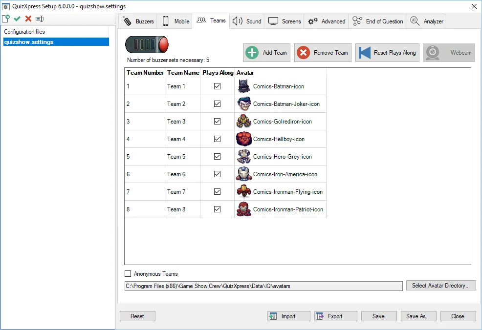
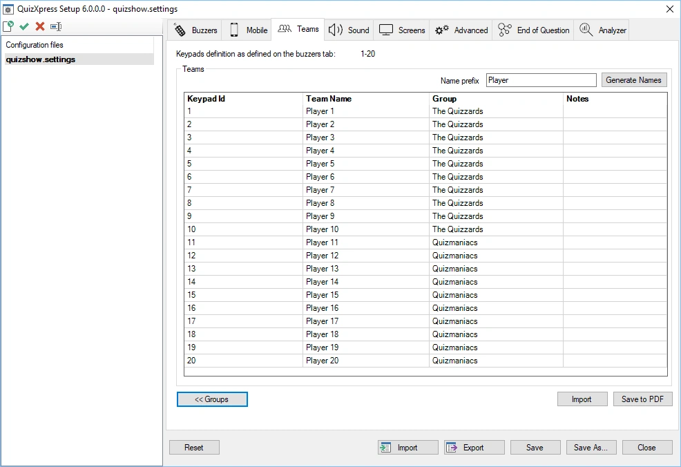
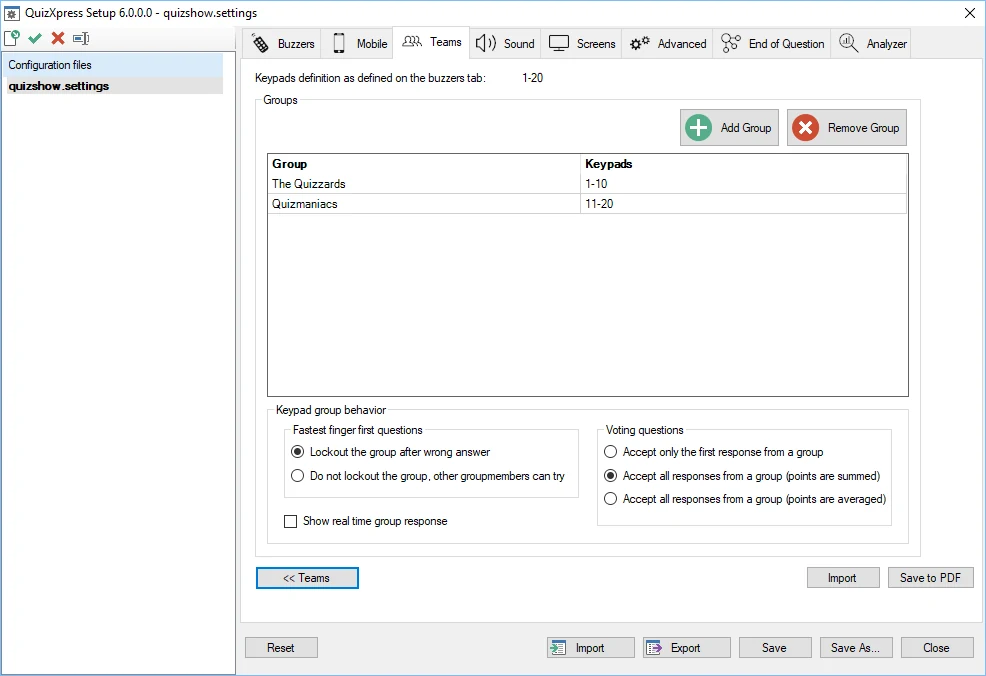
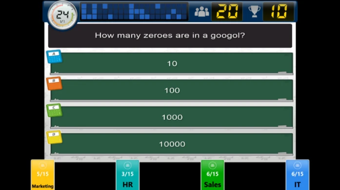
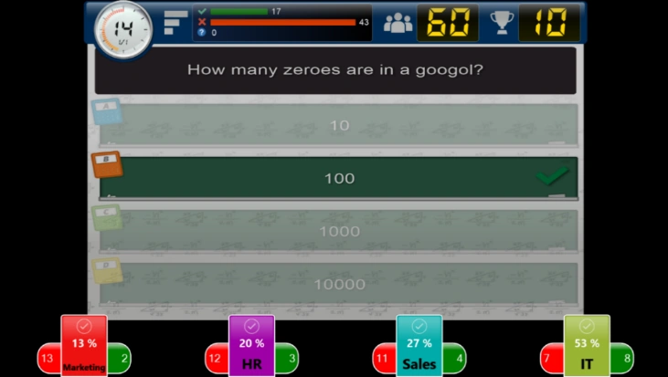
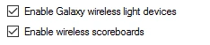
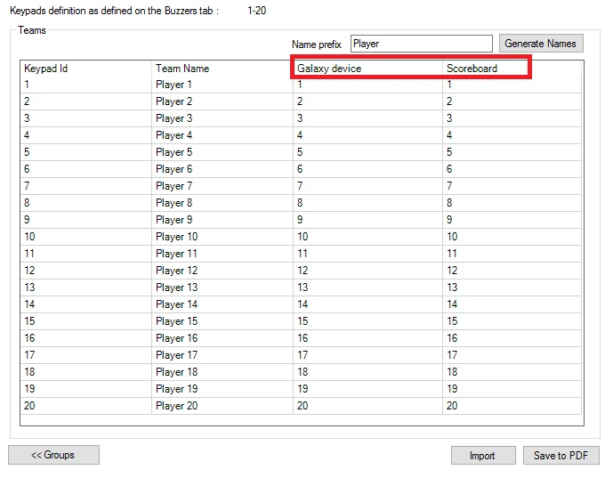

# Configurare le squadre – la scheda Teams

Esistono due diverse ‘versioni’ della scheda Teams: una quando nella scheda ‘Buzzers’ sono selezionati i buzzer Sony e una quando sono selezionati i buzzer Fleetwood Reply o QuizXpress (dispositivi numerati).

## Scheda Teams – Buzzer Sony

Di seguito è riportata la scheda Teams utilizzata quando sono selezionati i buzzer Sony. Funzionalità:

- Aggiunta e rimozione di squadre

- Indicazione se una squadra partecipa o meno al quiz.

- Assegnazione di avatar alle squadre. In fondo alla pagina delle impostazioni delle squadre è possibile indicare in quale cartella si trovano gli avatar utilizzati.

In alto nella pagina è possibile vedere quanti set di buzzer sono necessari in base al numero di squadre partecipanti presenti nell'elenco.

Un'altra funzione è la possibilità di usare squadre anonime. In questo caso l'elenco delle squadre/avatar viene ignorato e il processo di accesso è simile a quello dei buzzer Fleetwood Reply. Questo si usa tipicamente quando si impiegano grandi quantità di buzzer Sony, poiché la normale procedura di accesso per i buzzer Sony — che associa un buzzer alla volta a una squadra — richiederebbe troppo tempo.

{ width="605" loading=lazy }

## Scheda Teams – Keypad QuizXpress

Nella scheda Teams è possibile definire i nomi delle squadre/giocatori e definire dei gruppi. Questa scheda non è disponibile quando si usa solo Mobile; quando Mobile viene usato in combinazione con keypad o buzzer, la pagina viene comunque mostrata.

Per tutti i tipi di buzzer tranne i buzzer Sony, il numero di squadre deriva dalla stringa ‘Keypads’ inserita nella scheda ‘Buzzers’. Ad esempio, quando si usa la stringa 1-50, la scheda ‘Teams’ mostra un elenco di keypad da 1 a 50 e i nomi predefiniti delle squadre *Team 1 … Team 50*. I nomi delle squadre possono essere modificati nella seconda colonna dell'elenco.

Come spiegato sopra, per cambiare il numero di squadre è necessario modificare la stringa ‘Keypads’ nella scheda ‘Buzzers’.

!!! note

    è possibile utilizzare gli avatar in combinazione con i buzzer Reply/QuizXpress. Per farlo, creare immagini (.jpg o .gif) nella cartella predefinita degli avatar (c:\program files\game show crew\QuizXpress\Data\IQ\Avatars) con i nomi delle squadre. Ad esempio, per Team A, creare un'immagine denominata ‘Team A.jpg’.

Come si può vedere nell'immagine seguente, sono disponibili vari altri comandi:

- Generate Names: consente di generare rapidamente nomi di squadre usando un certo schema, seguito da un indice. Ad esempio, è possibile generare rapidamente nomi come team 1…team 50, player 1…player 50, participant 1…participant 50

- Import: importa l'elenco dei nomi delle squadre da Excel o da un file di testo. Per Excel, inserire i nomi nella prima colonna del primo foglio; per un file di testo, inserire ogni nome su una nuova riga.

- Save to PDF: per ottenere una panoramica delle squadre assegnate a ciascun keypad, esportare l'elenco in PDF premendo il pulsante ‘Save to PDF’

- Groups: è possibile dividere le squadre in gruppi. Maggiori informazioni nella sezione seguente.

> { width="605" loading=lazy }

### Raggruppare i keypad

È possibile dividere le squadre in gruppi in Quiz Setup (in alternativa, è possibile dividere le squadre in gruppi anche durante l'esecuzione di un quiz. Per maggiori informazioni, fare riferimento a [Demographic](../live/starting-a-quiz/the-quiz-screen-voting-everybody-answers.md#demographic) relativo alle diapositive demografiche del quiz.

Facendo clic sul pulsante ‘Groups’ viene mostrato un elenco in cui è possibile inserire i nomi dei gruppi e il relativo insieme di keypad. Vedere l'immagine seguente:

{ width="605" loading=lazy }

Premendo il pulsante ‘Add’ compare una finestra in cui è possibile inserire sia il nome del gruppo sia i keypad corrispondenti (inserendo una stringa di keypad). È inoltre possibile rimuovere i gruppi.

Quando si inserisce l'intervallo di keypad per un gruppo (ad esempio ‘1, 2, 3, 10-20’), viene eseguito un controllo per verificare che l'intervallo rientri nell'intervallo di keypad definito nella scheda ‘Buzzers’. In caso contrario, viene mostrato un messaggio di errore.

Le altre impostazioni modificabili qui riguardano il comportamento dei gruppi per le domande di tipo fastest finger e per quelle di votazione.

Le opzioni per le domande fastest finger sono:

| **Lockout**    | Con questa opzione abilitata, solo il primo giocatore di un gruppo che risponde può rispondere alla domanda. Se la risposta fornita è errata, l'intero gruppo viene bloccato. |
|----------------|----------------------------------------------------------------------------------------------------------------------------------------------------------------|
| **No lockout** | Se la prima persona del gruppo risponde in modo errato, un'altra persona del gruppo può comunque provare.                                                                    |

Le opzioni per le domande di votazione sono:

| **Accept only the first response** | Conta solo la prima risposta ricevuta dal gruppo e aggiunge punti al punteggio del gruppo |
|------------------------------------|--------------------------------------------------------------------------------------------|
| **Sum points**                     | Tutte le risposte vengono accettate e i punti vengono sommati                                      |
| **Average points**                 | Tutte le risposte vengono accettate e viene calcolata la media dei punti                                    |

#### Mostrare le risposte dei gruppi in tempo reale durante il quiz

Quando si abilita l'impostazione ‘Show real time group responses’, le risposte di ciascun gruppo vengono mostrate sullo schermo in tempo reale durante il game show.

{ width="442" loading=lazy }

Mentre il conto alla rovescia procede, per ogni gruppo si vedono il numero di giocatori del gruppo e il numero di quelli che hanno risposto finora. Ad esempio, nell'immagine sopra il gruppo HR ha 15 giocatori, dei quali 3 hanno risposto finora.

Al termine del conto alla rovescia, per ogni gruppo vengono mostrati il numero di risposte corrette, il numero di risposte errate e la percentuale di risposte corrette.

{ width="463" loading=lazy }

### Assegnare dispositivi Galaxy e tabelle punteggi ai partecipanti

Quando la licenza QuizXpress include il supporto per i dispositivi Galaxy o per le tabelle punteggi, nella scheda Buzzers di QuizXpress Setup compaiono le seguenti opzioni:

{ width="234" loading=lazy }

Quando si abilita il supporto per Galaxy o per le tabelle punteggi, nell'elenco della scheda Teams compaiono colonne aggiuntive.

{ width="504" loading=lazy }

Ogni dispositivo Galaxy o tabella punteggi ha un ID. In questo elenco è possibile indicare quale ID di dispositivo Galaxy e/o di tabella punteggi viene usato per ciascun giocatore.
