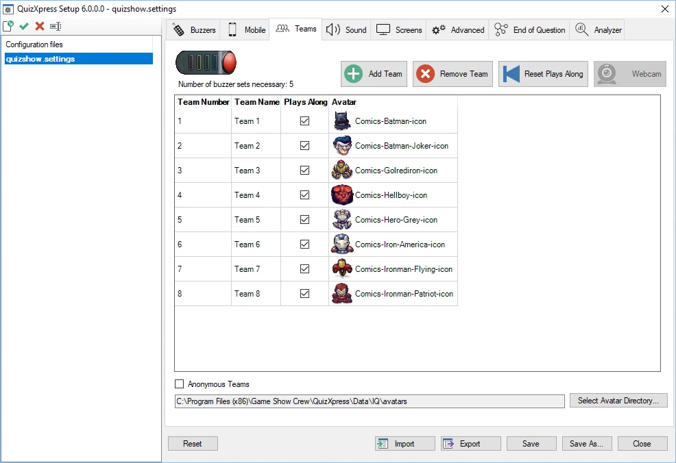
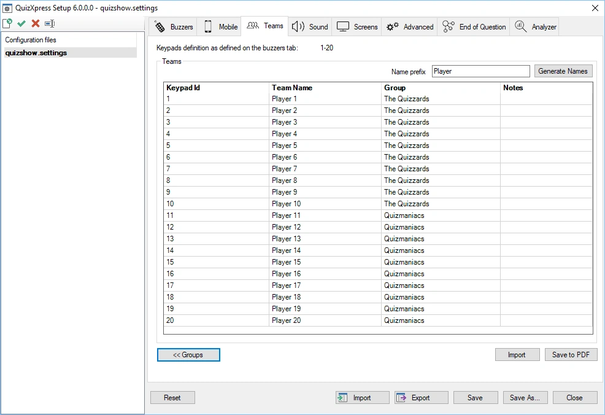
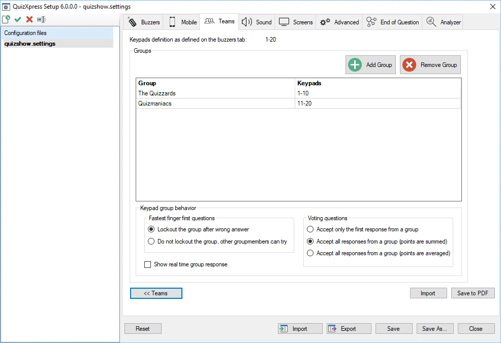
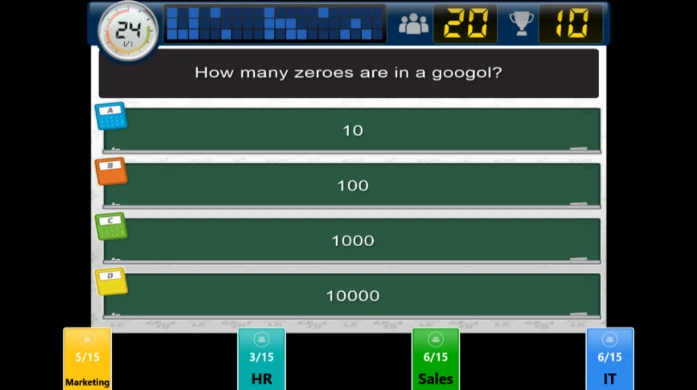
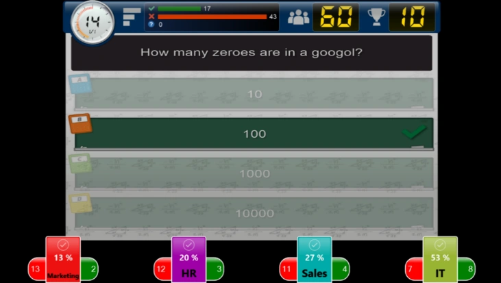
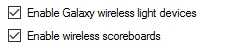
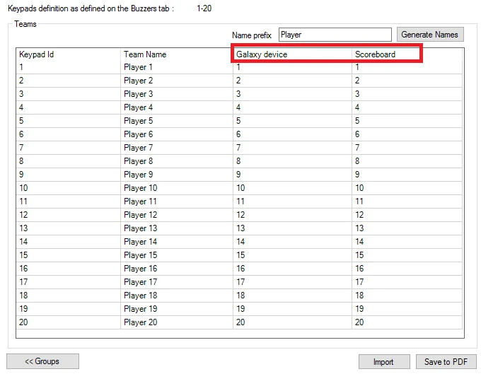

# Teams instellen – het tabblad Teams

Er zijn twee verschillende ‘varianten’ van het tabblad Teams: een voor wanneer op het tabblad ‘Buzzers’ Sony-buzzers zijn geselecteerd en een voor wanneer Fleetwood Reply- of QuizXpress-buzzers (genummerde apparaten) zijn geselecteerd.

## Tabblad Teams – Sony-buzzers

Hieronder ziet u het tabblad Teams zoals het wordt gebruikt wanneer Sony-buzzers zijn geselecteerd. De functionaliteit omvat:

- Teams toevoegen en verwijderen

- Aangeven of een team meespeelt in de quiz.

- Avatars aan teams toewijzen. Onderaan de pagina met teaminstellingen kunt u aangeven in welke map de gebruikte avatars staan.

Bovenaan de pagina ziet u hoeveel buzzersets nodig zijn gezien het aantal meespelende teams in de lijst.

Een andere functie is het gebruik van anonieme teams. In dat geval wordt de lijst met teams/avatars genegeerd en lijkt het aanmeldproces op dat van Fleetwood Reply-buzzers. Dit wordt meestal gebruikt wanneer veel Sony-buzzers worden ingezet, omdat de normale aanmeldprocedure voor Sony-buzzers, waarbij elke buzzer een voor een aan een team wordt gekoppeld, te lang zou duren.

{ width="605" loading=lazy }

## Tabblad Teams – QuizXpress-keypads

Op het tabblad Teams kunt u de team-/spelersnamen en groepen definiëren. Dit tabblad is niet beschikbaar wanneer alleen Mobiel wordt gebruikt; wanneer Mobiel in combinatie met keypads of buzzers wordt gebruikt, wordt de pagina nog steeds getoond.

Bij alle buzzertypen behalve Sony-buzzers wordt het aantal teams afgeleid van de tekenreeks ‘Keypads’ die op het tabblad ‘Buzzers’ is ingevoerd. Als bijvoorbeeld de tekenreeks 1-50 wordt gebruikt, toont het tabblad ‘Teams’ een lijst met keypads 1 tot 50 en de standaardteamnamen *Team 1 … Team 50*. Teamnamen kunt u wijzigen in de tweede kolom van de lijst.

Zoals hierboven uitgelegd, wijzigt u de tekenreeks ‘Keypads’ op het tabblad ‘Buzzers’ als u het aantal teams wilt wijzigen.

!!! note

    het is mogelijk om avatars te gebruiken in combinatie met Reply/QuizXpress-buzzers. Maak hiervoor afbeeldingen (.jpg of .gif) in de standaard avatarmap (c:\program files\game show crew\QuizXpress\Data\IQ\Avatars) met de namen van de teams. Maak bijvoorbeeld voor Team A een afbeelding met de naam ‘Team A.jpg’.

Zoals op de onderstaande afbeelding te zien is, zijn er verschillende andere opdrachten beschikbaar:

- Namen genereren: hiermee kunt u snel teamnamen genereren volgens een bepaald patroon, gevolgd door een volgnummer. U kunt bijvoorbeeld snel namen genereren als team 1…team 50, speler 1…speler 50, deelnemer 1…deelnemer 50

- Importeren: importeer de lijst met teamnamen uit Excel of een tekstbestand. Zet bij Excel de namen in de eerste kolom van het eerste werkblad; zet bij een tekstbestand elke naam op een nieuwe regel.

- Opslaan als PDF: om een overzicht te krijgen van de teams die aan elk keypad zijn toegewezen, exporteert u de lijst naar PDF door op de knop ‘Opslaan als PDF’ te drukken

- Groepen: het is mogelijk om teams in groepen te verdelen. Meer hierover leest u in de volgende sectie.

> { width="605" loading=lazy }

### Keypads groeperen

U kunt teams in Quiz Setup in groepen verdelen (het is ook mogelijk om teams in groepen te verdelen terwijl u een quiz uitvoert. Zie [Demografisch](../live/starting-a-quiz/the-quiz-screen-voting-everybody-answers.md#demografisch) bij demografische quizdia’s voor meer informatie hierover.

Wanneer u op de knop ‘Groepen’ klikt, wordt een lijst getoond waarin u groepsnamen en de bijbehorende set keypads kunt invoeren. Zie de onderstaande afbeelding:

{ width="605" loading=lazy }

Door op de knop ‘Toevoegen’ te drukken, verschijnt een venster waarin u zowel de groepsnaam als de bijbehorende keypads kunt invoeren (door een keypadtekenreeks in te voeren). U kunt groepen ook verwijderen.

Wanneer u het keypadbereik voor een groep invoert (bijvoorbeeld ‘1, 2, 3, 10-20’), wordt gecontroleerd of het bereik binnen het keypadbereik valt dat op het tabblad ‘Buzzers’ is gedefinieerd. Is dat niet zo, dan wordt een foutmelding getoond.

De andere instellingen die u hier kunt wijzigen, zijn hoe groepen zich moeten gedragen bij vragen met de snelste vinger en bij stemvragen.

De opties voor vragen met de snelste vinger zijn:

| **Uitsluiting**    | Als deze optie is ingeschakeld, kan alleen de eerste speler in een groep die reageert de vraag beantwoorden. Als het gegeven antwoord onjuist is, wordt de hele groep uitgesloten. |
|----------------|----------------------------------------------------------------------------------------------------------------------------------------------------------------|
| **Geen uitsluiting** | Als de eerste persoon in de groep een onjuist antwoord geeft, kan een andere persoon in de groep het nog proberen.                                                                    |

De opties voor stemvragen zijn:

| **Alleen het eerste antwoord accepteren** | Alleen het eerste antwoord dat van de groep wordt ontvangen telt mee en voegt punten toe aan de groepsscore |
|------------------------------------|--------------------------------------------------------------------------------------------|
| **Punten optellen**                     | Alle antwoorden worden geaccepteerd en de punten worden opgeteld                                      |
| **Punten middelen**                 | Alle antwoorden worden geaccepteerd en het gemiddelde van de punten wordt genomen                                      |

#### Groepsantwoorden realtime tonen tijdens de quiz

Wanneer u de instelling ‘Groepsantwoorden realtime tonen’ inschakelt, worden de antwoorden van elke groep tijdens de quizshow realtime op het scherm getoond.

{ width="442" loading=lazy }

Terwijl de klok aftelt, ziet u voor elke groep het aantal spelers in de groep en het aantal dat tot nu toe heeft geantwoord. In de afbeelding hierboven heeft de groep HR bijvoorbeeld 15 spelers, van wie er tot nu toe 3 hebben geantwoord.

Aan het einde van het aftellen worden per groep het aantal juiste antwoorden, het aantal onjuiste antwoorden en het percentage juiste antwoorden getoond.

{ width="463" loading=lazy }

### Galaxy-apparaten en scoreborden aan deelnemers toewijzen

Wanneer uw QuizXpress-licentie ondersteuning voor Galaxy-apparaten of scoreborden bevat, ziet u de volgende opties op het tabblad Buzzers van QuizXpress Setup:

{ width="234" loading=lazy }

Wanneer u ondersteuning voor Galaxy of scoreborden inschakelt, verschijnen extra kolommen in de lijst op het tabblad Teams.

{ width="504" loading=lazy }

Elk Galaxy-apparaat en elk scorebord heeft een ID. In deze lijst kunt u aangeven welk Galaxy-apparaat-ID en/of scorebord-ID voor elke speler wordt gebruikt.
