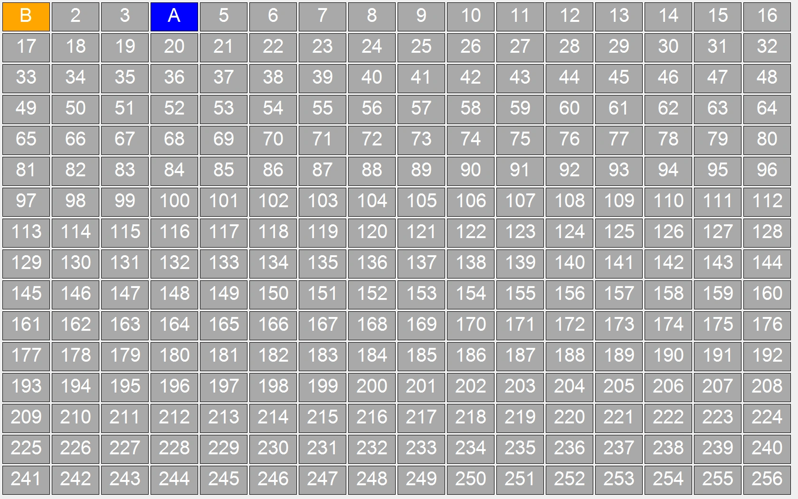
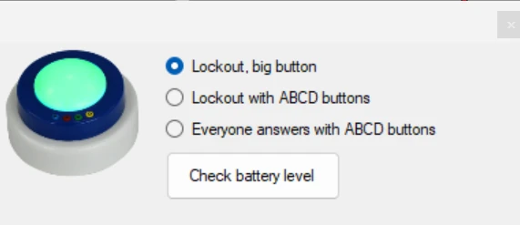

# Tester votre configuration de buzzers

Vous pouvez utiliser l'application Buzzer Test, que vous trouverez dans le menu Démarrer de Windows sous QuizXpress, pour vérifier que les buzzers sont correctement connectés et configurés. Cette application affiche une grille d'indicateurs ; lorsqu'un événement de buzzer est reçu, elle affiche des informations sur le bouton pressé. Cette application est également utile pour tester la portée des buzzers dans une grande salle.

{ loading=lazy }

Pour quitter l'application Buzzer Test, appuyez sur la touche *Escape* ou utilisez la combinaison de touches Windows standard *Alt+F4*. Buzzer Test est également disponible dans le menu *Tools* de QuizXpress Studio. Au démarrage de Buzzer Test, l'arrière-plan est gris foncé pendant la connexion au matériel de buzzers ; lorsque la connexion réussit, l'arrière-plan devient blanc, et en cas de problème avec le matériel, l'arrière-plan devient rouge.

Vous pouvez également utiliser Buzzer Test pour vérifier le niveau de batterie des buzzers.

{ width="315" loading=lazy }

Dans le formulaire d'options, appuyez sur le bouton **Check battery level**, puis allumez chaque buzzer en appuyant sur le gros bouton en dôme. Le niveau de batterie s'affichera dans la grille des buzzers.
