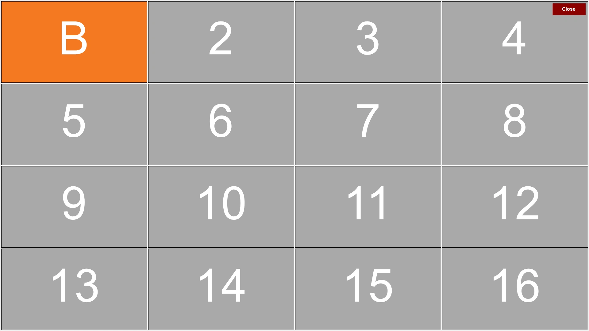
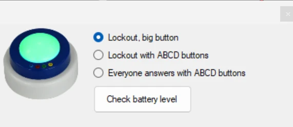

# Uw buzzeropstelling testen

Met de toepassing Buzzer Test, die u in het Windows Startmenu onder QuizXpress vindt, kunt u testen of de buzzers zijn aangesloten en juist zijn geconfigureerd. Deze toepassing toont een raster van indicatoren; wanneer een buzzergebeurtenis wordt ontvangen, toont het informatie over de ingedrukte knop. Deze toepassing is ook handig om het bereik van de buzzers in een grote zaal te testen.

{ loading=lazy }

Om de toepassing Buzzer Test af te sluiten, drukt u op de toets *Escape* of gebruikt u de standaard Windows-sneltoets *Alt+F4*. Buzzer Test is ook beschikbaar in het menu *Tools* van QuizXpress Studio. Tijdens het opstarten van Buzzer Test is de achtergrond donkergrijs terwijl er verbinding wordt gemaakt met de buzzerhardware; als de verbinding slaagt, wordt de achtergrond wit, en als er een probleem met de hardware is, wordt de achtergrond rood.

U kunt Buzzer Test ook gebruiken om het batterijniveau van de buzzers te controleren.

{ width="315" loading=lazy }

Druk in het optiesvenster op de knop **Batterijniveau controleren** en schakel vervolgens elke buzzer in door op de grote bolle knop te drukken. Het batterijniveau wordt getoond in het buzzerraster.
