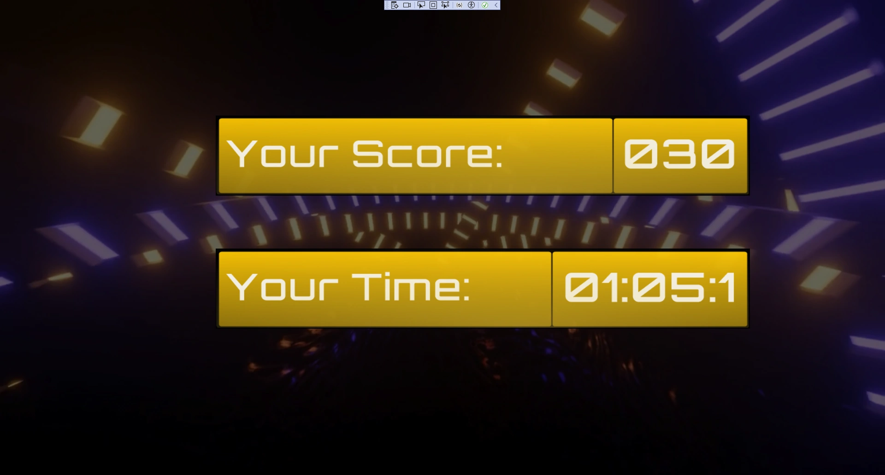
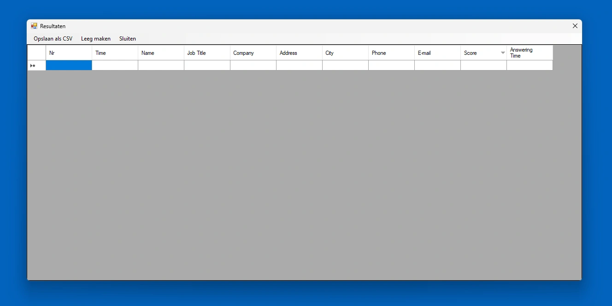
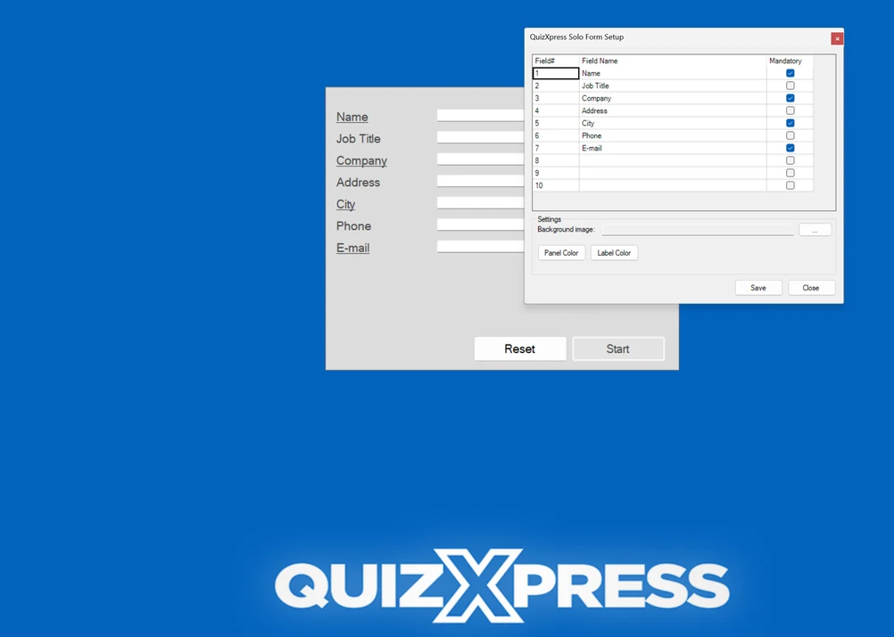

# Lancer votre quiz sur un stand de salon avec QuizXpress Solo

QuizXpress Solo est une variante de QuizXpress Live qui permet à une seule personne de jouer à un quiz. Avant de démarrer le quiz, cette personne doit toutefois saisir quelques données personnelles, après quoi le quiz commence. À l'aide d'un seul buzzer, elle peut répondre aux questions présentées. Le score final, ainsi que le temps utilisé pour répondre à toutes les questions (uniquement les bonnes), est enregistré et peut être affiché, trié par score, sur demande.

Imaginez que vous soyez à un salon professionnel et que vous souhaitiez attirer des visiteurs sur votre stand en leur proposant de jouer à un quiz. Bien sûr, vous aimeriez recueillir des informations sur ces personnes, qui doivent donc renseigner quelques détails avant le début du quiz. Une fois le quiz terminé, l'écran de démarrage (saisie des données) de QuizXpress Live s'affiche à nouveau, prêt pour le joueur suivant. Comme tous les scores sont enregistrés dans un fichier Excel, vous pouvez, en fin de journée, désigner le gagnant qui remportera (par exemple) un prix. QuizXpress Solo peut être lancé depuis le menu Démarrer via Démarrer > Tous les programmes > QuizXpress > QuizXpress Solo.

L'écran de démarrage de QuizXpress Solo se présente comme suit :

Le bouton ‘Results’, utilisé pour afficher les résultats enregistrés, se trouve en haut à droite de l'écran. Il n'est toutefois pas affiché automatiquement — c'est un ‘bouton caché’, qui n'apparaît qu'après avoir appuyé sur la touche Contrôle (Ctrl), afin d'empêcher les personnes non autorisées de consulter les scores.

Lorsque vous appuyez sur Contrôle, un bouton ‘Setup’ apparaît également. En l'utilisant, vous pouvez personnaliser les champs de saisie affichés, personnaliser la couleur du panneau central et des libellés, et sélectionner une image à utiliser comme arrière-plan.

Appuyer sur la touche Ctrl affiche aussi le bouton Exit pour fermer l'application.

Une fois toutes les informations nécessaires renseignées (les champs soulignés sont obligatoires), le bouton ‘Start’ devient vert, et l'utilisateur doit appuyer dessus pour commencer le quiz. L'écran d'accueil du quiz s'affiche. Appuyer sur le buzzer fait passer à la première question. On répond aux questions à l'aide du bouton A, B, C ou D du buzzer. Lorsqu'une question a reçu une réponse, un joueur peut continuer en appuyant sur n'importe quelle touche du buzzer. En bref, l'ensemble du quiz peut être piloté avec un seul buzzer. Une fois le quiz terminé, l'écran des scores s'affiche, comme suit (selon le skin choisi — dans l'exemple ci-dessous, le skin Techno était actif) :

{ loading=lazy }

L'écran des scores affiche à la fois le score du joueur et le temps nécessaire pour répondre aux questions. Seul le temps passé à répondre correctement est comptabilisé. Après avoir appuyé sur l'un des boutons du buzzer, l'écran initial de QuizXpress Live s'affiche à nouveau.

Appuyer sur ‘Results’ affiche l'écran des scores avec tous les participants qui ont joué jusqu'à présent :

{ loading=lazy }

### Personnaliser l'écran de saisie des données de QuizXpress Solo

L'arrière-plan comme les champs qui peuvent (ou doivent) être renseignés sont personnalisables.

#### Personnaliser l'image d'arrière-plan

L'image d'arrière-plan de l'écran de saisie des données de QuizXpress Solo peut être personnalisée en (re)plaçant un fichier .jpg nommé “QuizXpressSolo.jpg”, ou un fichier .png nommé “QuizXpressSolo.png”, dans le répertoire d'installation de QuizXpress.

#### Personnaliser les champs de saisie des données

Les champs de saisie des données de QuizXpress Solo peuvent également être personnalisés. Pour cela, appuyez sur le bouton ‘Setup’ affiché en haut de l'écran (comme le bouton ‘Results’, il devient visible en appuyant sur \<Ctrl>). Après avoir appuyé sur ‘Setup’, l'écran suivant s'affiche :

Dans la fenêtre affichée (voir page suivante), tous les champs de saisie peuvent être configurés (il y a un maximum de 10 champs). Si un champ doit être rempli par un participant avant le début du quiz, cochez la case de la colonne ‘Mandatory’ pour ce champ. Dans ce cas, le champ sera souligné sur l'écran de démarrage de QuizXpress Solo, indiquant au participant qu'il doit le renseigner avant de pouvoir commencer le quiz. Lorsque tous les champs obligatoires sont remplis, le bouton ‘Start’ devient vert, et l'utilisateur doit appuyer dessus pour commencer le quiz.

!!! note

    si le nombre de champs est modifié, les résultats de scores précédemment enregistrés seront effacés après confirmation. Dans ce cas, un message s'affichera pour vous rappeler d'enregistrer d'abord les résultats précédents si nécessaire (vous pouvez le faire en appuyant sur le bouton ‘Results’ pour afficher les résultats actuels, puis en choisissant ‘Save as CSV’).

{ loading=lazy }
