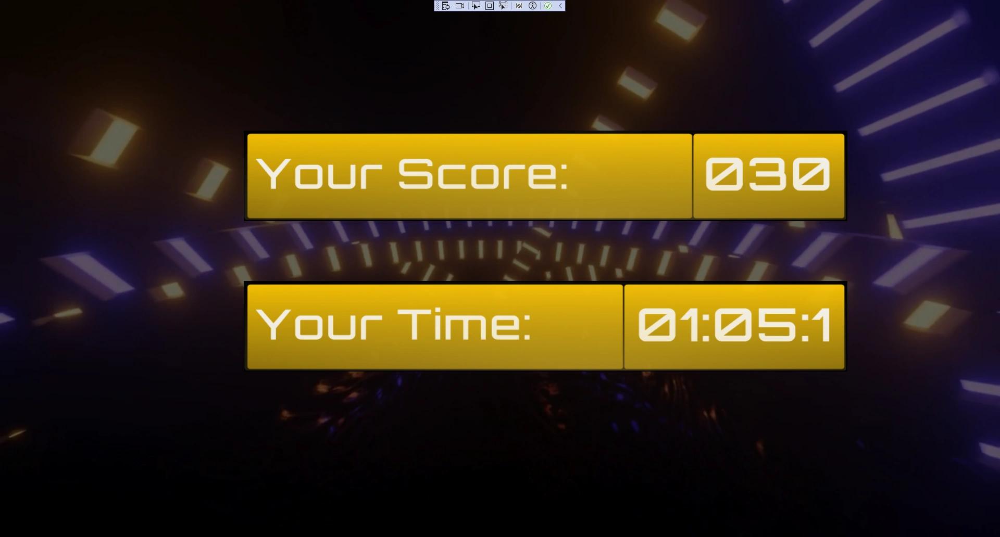
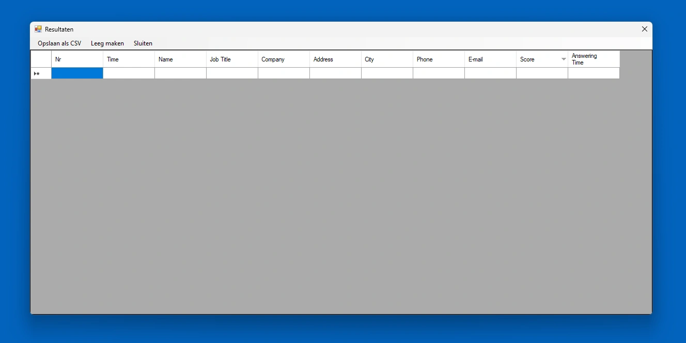
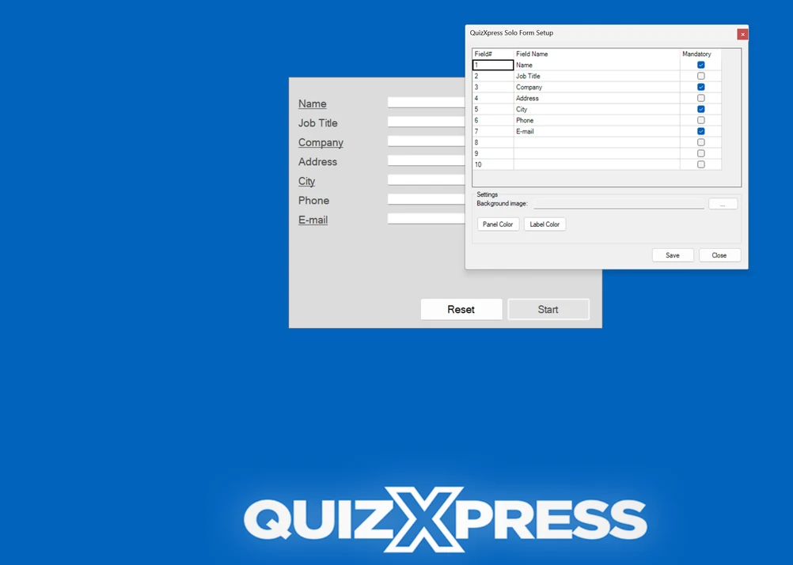

# Uw quiz draaien op een beursstand met QuizXpress Solo

QuizXpress Solo is een variant van QuizXpress Live waarmee één persoon een quiz kan spelen. Voordat de quiz begint, moet deze persoon eerst enkele persoonlijke gegevens invoeren, waarna de quiz start. Met één buzzer beantwoordt deze persoon de getoonde vragen. De eindscore en de tijd die nodig was om alle vragen te beantwoorden (alleen de juiste), worden vastgelegd en kunnen op verzoek worden getoond, gesorteerd op score.

Stel u voor dat u op een beurs staat en mensen naar uw stand wilt lokken door hen een quiz te laten spelen. Natuurlijk wilt u van deze mensen wat gegevens verzamelen, dus ze moeten eerst enkele gegevens invullen voordat de quiz begint. Nadat iemand de quiz heeft afgerond, wordt het startscherm (gegevensinvoer) van QuizXpress Live opnieuw getoond, klaar voor de volgende speler. Omdat alle scores in een Excel-bestand worden opgeslagen, kunt u aan het eind van de dag de winnaar kiezen die (bijvoorbeeld) een prijs wint. QuizXpress Solo kunt u starten vanuit het Startmenu via Start > Alle programma’s > QuizXpress > QuizXpress Solo.

Het startscherm van QuizXpress Solo ziet er als volgt uit:

De knop ‘Resultaten’, waarmee u de opgeslagen resultaten toont, staat rechtsboven in het scherm. Hij wordt echter niet automatisch getoond: het is een ‘verborgen knop’ die pas verschijnt nadat u op de Control-toets (Ctrl) drukt, zodat onbevoegden de scores niet kunnen bekijken.

Wanneer u op Control drukt, ziet u ook een knop ‘Setup’. Hiermee kunt u de getoonde invoervelden aanpassen, de kleur van het middelste paneel en de labels aanpassen en een afbeelding als achtergrond kiezen.

Als u op Ctrl drukt, verschijnt ook de knop Afsluiten om de toepassing te sluiten.

Nadat alle benodigde gegevens zijn ingevuld (onderstreepte invoervelden zijn verplicht), wordt de knop ‘Begin’ groen en moet de gebruiker erop drukken om de quiz te starten. Het welkomstscherm van de quiz wordt getoond. Door op de buzzer te drukken gaat u naar de eerste vraag. Vragen beantwoordt u met de knop A, B, C of D op de buzzer. Nadat een vraag is beantwoord, kan een speler verdergaan door op een willekeurige knop van de buzzer te drukken. Kortom: de hele quiz is te bedienen met één buzzer. Nadat iemand de quiz heeft afgerond, wordt het scorescherm getoond, dat er als volgt uitziet (afhankelijk van de gekozen skin; in het onderstaande voorbeeld was de Techno-skin actief):

{ loading=lazy }

Het scorescherm toont zowel de score van de speler als de tijd die nodig was om de vragen te beantwoorden. Alleen de tijd die aan juiste antwoorden is besteed, wordt geteld. Nadat u op een van de buzzerknoppen hebt gedrukt, wordt het beginscherm van QuizXpress Live opnieuw getoond.

Als u op ‘Resultaten’ drukt, wordt het scorescherm getoond met alle deelnemers die tot nu toe hebben gespeeld:

{ loading=lazy }

### Het gegevensinvoerscherm van QuizXpress Solo aanpassen

Zowel de achtergrond als de velden die kunnen (of moeten) worden ingevuld, zijn aan te passen.

#### De achtergrondafbeelding aanpassen

De achtergrondafbeelding van het gegevensinvoerscherm van QuizXpress Solo past u aan door een .jpg-bestand met de naam “QuizXpressSolo.jpg”, of een .png-bestand met de naam “QuizXpressSolo.png”, in de installatiemap van QuizXpress te plaatsen (of te vervangen).

#### De gegevensinvoervelden aanpassen

Ook de gegevensinvoervelden van QuizXpress Solo kunt u aanpassen. Om de velden aan te passen, drukt u op de knop ‘Setup’ boven in het scherm (net als de knop ‘Resultaten’ wordt deze zichtbaar als u op \<Ctrl> drukt). Nadat u op ‘Setup’ hebt gedrukt, wordt het volgende scherm getoond:

In het getoonde venster (zie volgende pagina) kunt u alle gegevensinvoervelden configureren (er zijn maximaal 10 velden). Als een deelnemer een veld moet invullen voordat de quiz kan starten, plaatst u een vinkje in de kolom ‘Verplicht’ voor dat veld. In dat geval wordt het veld onderstreept op het startscherm van QuizXpress Solo, zodat de deelnemer weet dat het moet worden ingevuld voordat hij of zij de quiz kan starten. Wanneer alle verplichte velden zijn ingevuld, wordt de knop ‘Begin’ groen en moet de gebruiker erop drukken om de quiz te starten.

!!! note

    als het aantal velden wordt gewijzigd, worden eerder opgeslagen scoreresultaten na bevestiging gewist. In dat geval verschijnt een melding die u eraan herinnert om de vorige resultaten eerst op te slaan als dat nodig is (dit kan door op de knop ‘Resultaten’ te drukken om de huidige resultaten te tonen en vervolgens ‘Opslaan als CSV’ te kiezen).

{ loading=lazy }
