# Immagini

## Inserire un'immagine

Esistono diversi formati di diapositiva che contengono segnaposto per un'immagine:

| 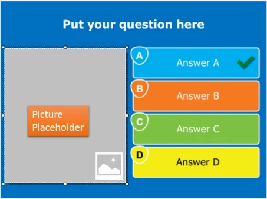{ width="288" loading=lazy } | 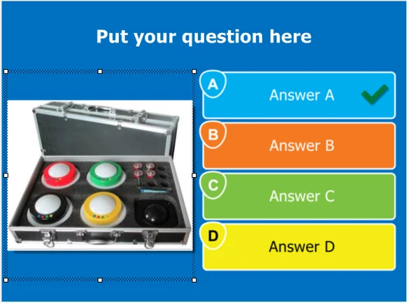{ width="291" loading=lazy } |
|---------------------------------------------------------------------------|---------------------------------------------------------------------------------|

Per riempire il segnaposto con un'immagine ‘vera’, fare clic sul segnaposto per selezionarlo. Verrà quindi visualizzata la scheda contestuale ‘PICTURE’ della barra multifunzione:

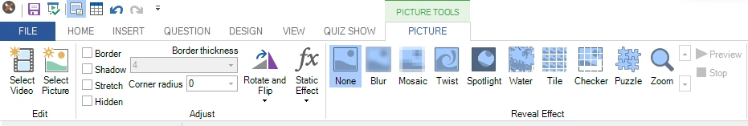{ width="605" loading=lazy }

Qui è possibile fare clic su ‘Select Picture’ per aprire un file browser e selezionare dal disco uno qualsiasi dei formati di file immagine supportati. Successivamente è possibile impostare le proprietà dell'immagine e applicare effetti o trasformazioni statiche. È inoltre possibile trascinare immagini (e video) direttamente da Esplora risorse di Windows su un segnaposto per immagine (o sullo sfondo della diapositiva per impostare l'immagine di sfondo).

Le immagini possono anche avere una rappresentazione testuale sotto forma di etichetta. È possibile impostare l'etichetta facendo clic con il pulsante destro del mouse sull'immagine e selezionando “Set Label” dal menu. Un esempio di utilizzo di questa etichetta è la presentazione di una domanda con immagine nell'app Smart Buzzer. Se si sceglie di non mostrare le immagini sul telefono (per la modalità Wi-Fi, vedere 4.2.1 e per la modalità server vedere 5.7.8.3), sul telefono verrà mostrata invece l'etichetta.

In alternativa, è possibile fare clic con il pulsante destro del mouse sul segnaposto per visualizzare le opzioni:

Qui è possibile scegliere di inserire un'immagine, un video o un grafico. Quando si ha un layout con più immagini, le immagini possono anche fungere da risposte alla domanda. In tal caso, è possibile impostare un'immagine come risposta corretta, indicare l'ordine delle immagini per una domanda a risposte ordinate oppure impostare la percentuale di correttezza per una domanda con più immagini come risposte.

È inoltre possibile generare immagini con l'IA. Per ulteriori informazioni, fare riferimento a 3.8.4.

Per ulteriori informazioni sulle altre impostazioni delle immagini, fare riferimento a [Picture properties](../user-interface-overview/advanced-properties-grid.md#proprieta-delle-immagini).

## Ritaglio

Facendo clic con il pulsante destro del mouse su un'immagine, nel menu contestuale compare il comando ‘Crop…’. Questo apre l'editor **Crop Image**, che consente di selezionare la parte dell'immagine da presentare nel quiz:

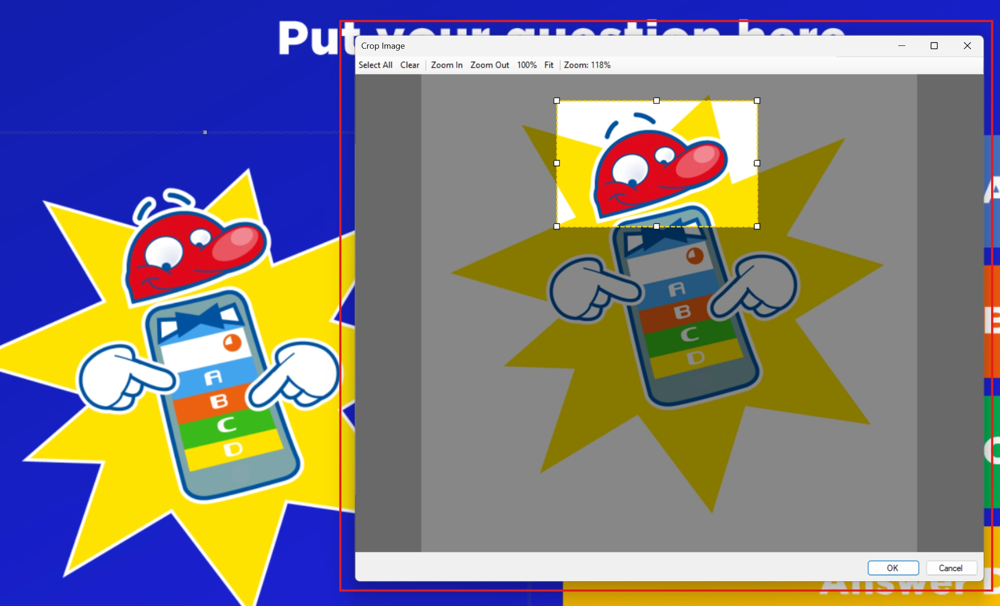{ loading=lazy }

Il risultato è:

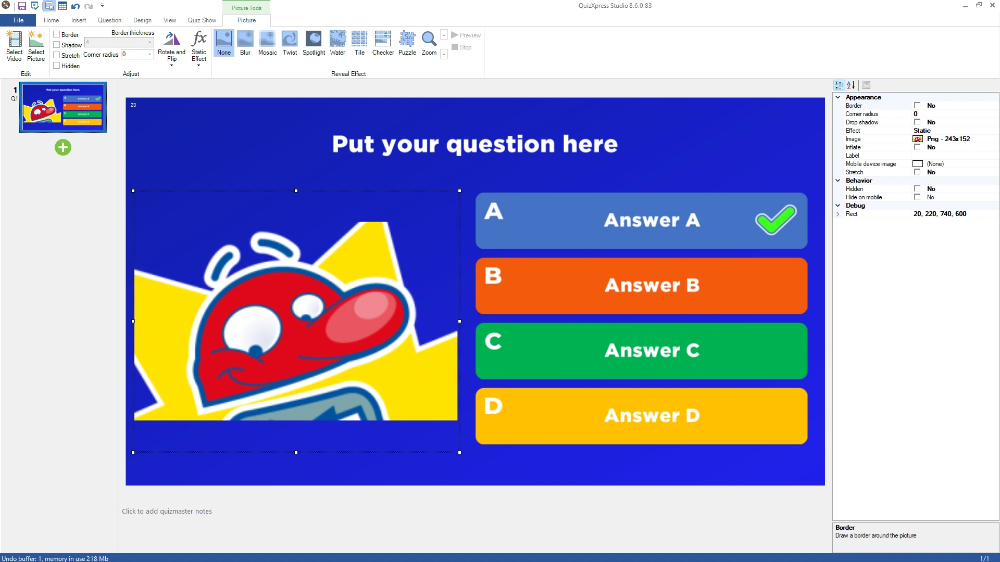{ loading=lazy }

Si noti che l'immagine *originale* non viene conservata dopo il ritaglio, ma se il risultato non piace è sempre possibile annullare il ritaglio (all'interno della stessa sessione).

## Da testo a immagine

Questa funzione è particolarmente utile per creare domande di abbinamento o progettare cartelle del Bingo: è possibile generare immagini dal testo direttamente in Studio. Fare clic con il pulsante destro del mouse sull'immagine e selezionare ‘Text to Image’ dal menu contestuale:

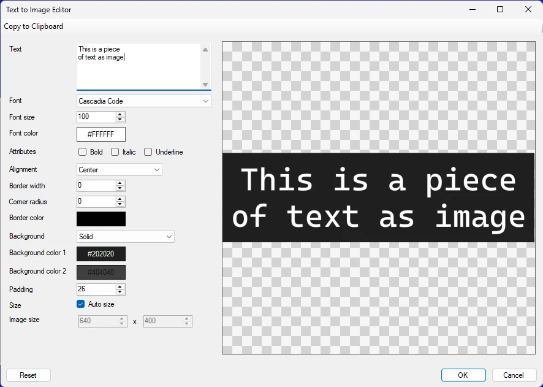{ width="591" loading=lazy }

È possibile formattare il testo con varie opzioni e, al termine, fare clic su OK per sostituire il segnaposto dell'immagine sulla diapositiva con l'immagine generata:

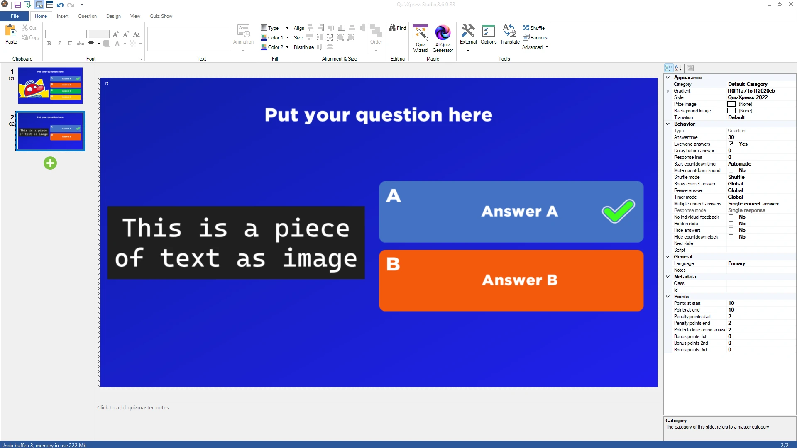{ loading=lazy }

## Applicare gli effetti

Una delle proprietà di un'immagine all'interno di una domanda è ‘Effect’. Quando si sceglie un valore per questa proprietà nella griglia delle proprietà, l'effetto scelto viene applicato all'immagine per tutta la durata della domanda. All'inizio della domanda l'effetto è applicato alla massima intensità, quindi può essere molto difficile capire cosa mostri l'immagine. Man mano che il tempo della domanda scende verso 0, l'immagine ritorna lentamente al suo stato originale. È possibile visualizzare in anteprima gli effetti selezionando l'immagine e facendo clic su ‘Preview’.

Vedere la seguente sequenza di immagini per un esempio:

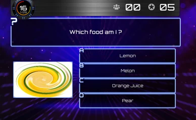{ loading=lazy } 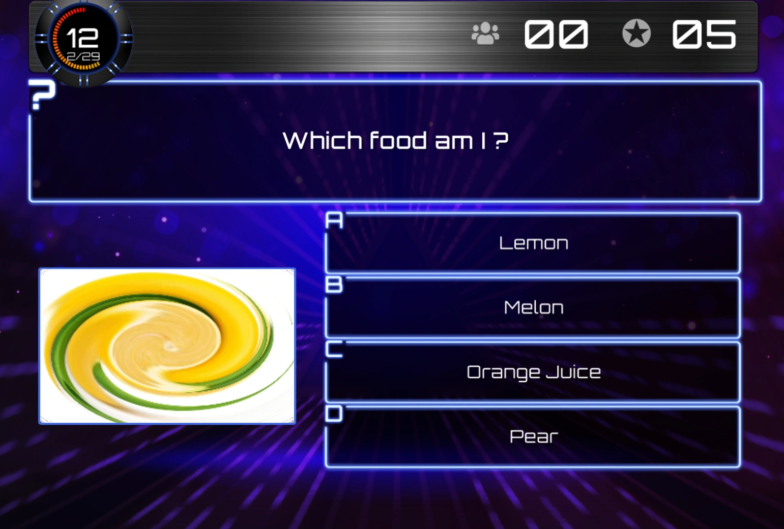{ loading=lazy } 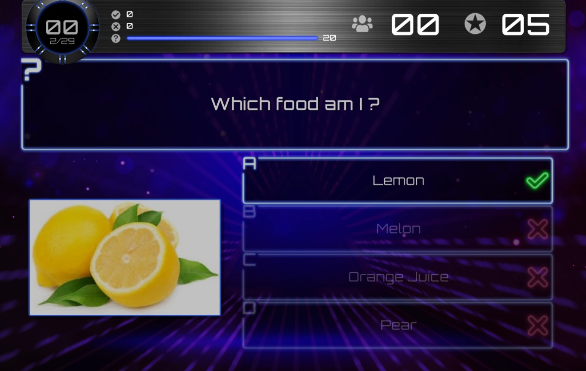{ loading=lazy }

Diverse fasi di un effetto ‘Twist’.

Di seguito sono riportati gli effetti disponibili.

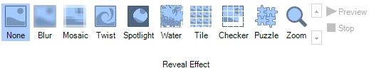{ width="402" loading=lazy }
