# Afbeeldingen

## Een afbeelding invoegen

Er zijn verschillende diaformaten die tijdelijke aanduidingen voor een afbeelding bevatten:

| 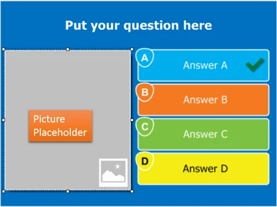{ width="288" loading=lazy } | 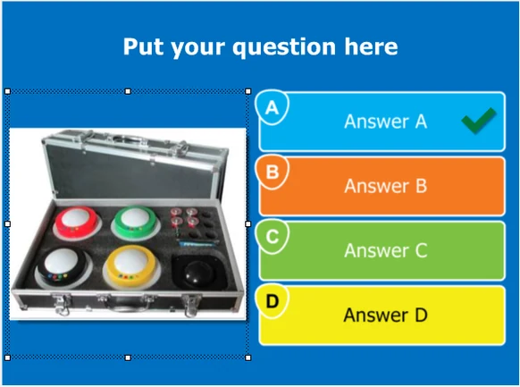{ width="291" loading=lazy } |
|---------------------------------------------------------------------------|---------------------------------------------------------------------------------|

Om de tijdelijke aanduiding te vullen met een ‘echte’ afbeelding, klikt u op de aanduiding om deze te selecteren. Het contextuele linttabblad ‘AFBEELDING’ verschijnt dan:

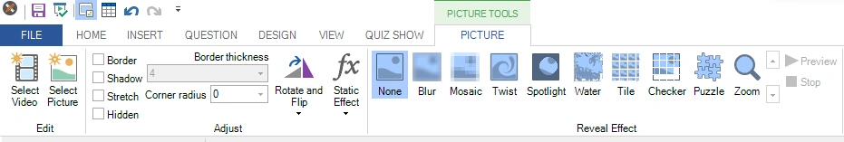{ width="605" loading=lazy }

Hier kunt u op ‘Selecteer afbeelding’ klikken om een bestandsbrowser te openen en een van de ondersteunde afbeeldingsbestandsindelingen van schijf te selecteren. Daarna kunt u de eigenschappen van de afbeelding instellen en effecten of statische transformaties toepassen. U kunt afbeeldingen (en video’s) ook rechtstreeks vanuit Windows Verkenner naar een tijdelijke aanduiding voor afbeeldingen slepen (of naar de achtergrond van de dia om de achtergrondafbeelding in te stellen).

Afbeeldingen kunnen ook een tekstuele weergave hebben in de vorm van een label. U stelt het label in door met de rechtermuisknop op de afbeelding te klikken en in het menu “Label instellen” te kiezen. Dit label wordt bijvoorbeeld gebruikt wanneer een afbeeldingsvraag wordt getoond in de Smart Buzzer-app. Als u ervoor kiest geen afbeeldingen op de telefoon te tonen (voor wifimodus, zie [Het systeem instellen](../../live/using-mobile-keypads/setting-up-the-system.md) en voor servermodus zie [Het tabblad Mobiel](../../live/quizxpress-director/the-mobile-tab.md#instellingen)), wordt in plaats daarvan het label op de telefoon getoond.

U kunt ook met de rechtermuisknop op de aanduiding klikken om de opties te tonen:

Hier kunt u kiezen om een afbeelding, een video of een grafiek in te voegen. Wanneer u een indeling met meerdere afbeeldingen hebt, kunnen de afbeeldingen ook als antwoorden op de vraag dienen. In dat geval kunt u een afbeelding instellen als het juiste antwoord, de volgorde van de afbeeldingsantwoorden aangeven voor een vraag met antwoorden in volgorde, of het juistheidspercentage instellen voor een vraag met meerdere afbeeldingsantwoorden.

U kunt afbeeldingen ook met AI genereren. Zie [QuizXpress en AI](../quizxpress-and-ai.md) voor meer informatie.

Voor meer informatie over andere afbeeldingsinstellingen, zie [Afbeeldingseigenschappen](../user-interface-overview/advanced-properties-grid.md#afbeeldingseigenschappen).

## Bijsnijden

Wanneer u met de rechtermuisknop op een afbeelding klikt, ziet u in het contextmenu de opdracht ‘Bijsnijden...’. Hiermee opent u de editor **Afbeelding bijsnijden**, waarmee u het gedeelte van de afbeelding selecteert dat in uw quiz wordt getoond:

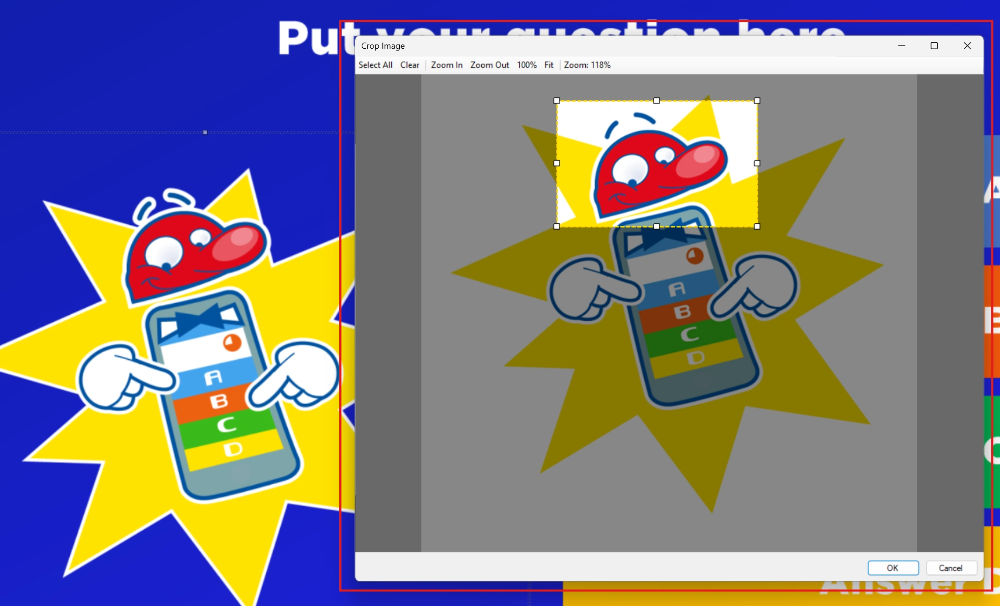{ loading=lazy }

Het resultaat is:

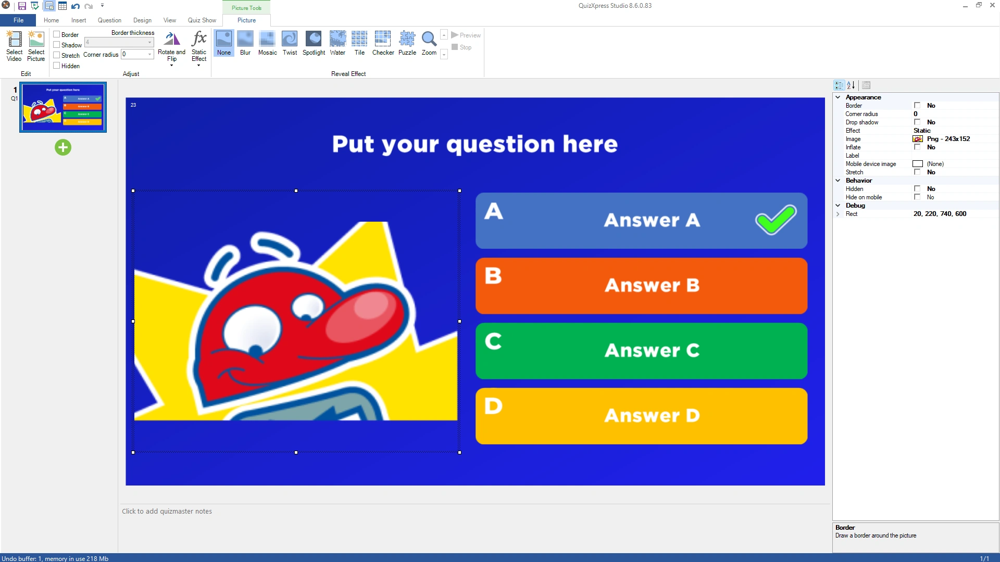{ loading=lazy }

Let op: de *originele* afbeelding wordt na het bijsnijden niet bewaard, maar als u het resultaat niet bevalt, kunt u het bijsnijden altijd ongedaan maken (binnen dezelfde sessie).

## Tekst naar afbeelding

Dit is vooral handig bij het maken van koppelvragen of het ontwerpen van Bingo-kaarten: u kunt rechtstreeks in Studio afbeeldingen uit tekst genereren. Klik met de rechtermuisknop op de afbeelding en kies ‘Tekst naar afbeelding...’ in het contextmenu:

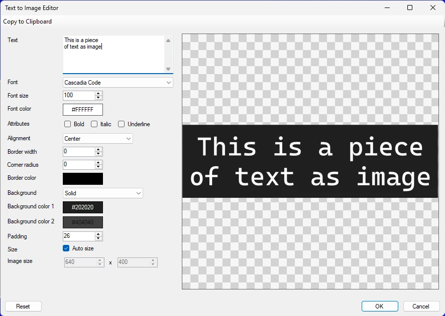{ width="591" loading=lazy }

U kunt de tekst met diverse opties opmaken en als u klaar bent, klikt u op OK om de tijdelijke aanduiding op uw dia te vervangen door de gegenereerde afbeelding:

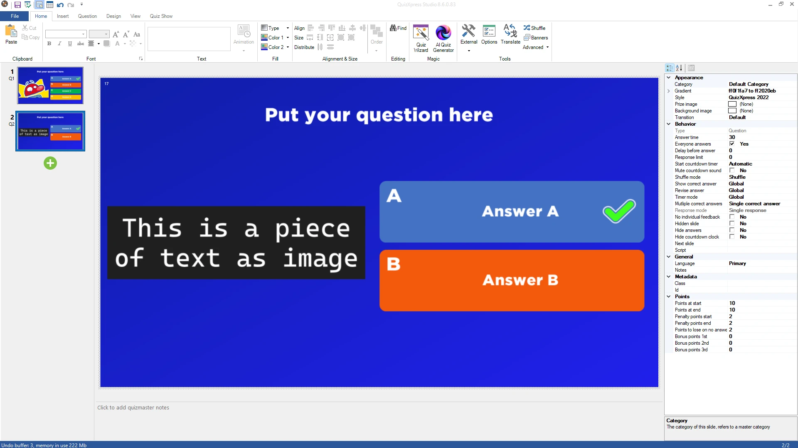{ loading=lazy }

## Effecten toepassen

Een van de eigenschappen van een afbeelding binnen een vraag is ‘Effect’. Wanneer in het eigenschappenraster een waarde voor deze eigenschap wordt gekozen, wordt het gekozen effect gedurende de vraag op de afbeelding toegepast. Wanneer de vraag begint, wordt het effect op volle sterkte toegepast, waardoor het erg moeilijk kan zijn te zien wat de afbeelding toont. Naarmate de tijd van de vraag naar 0 loopt, keert de afbeelding langzaam terug naar de oorspronkelijke staat. U kunt effecten bekijken door de afbeelding te selecteren en op ‘Voorbeeld’ te klikken.

Zie de volgende reeks afbeeldingen voor een voorbeeld:

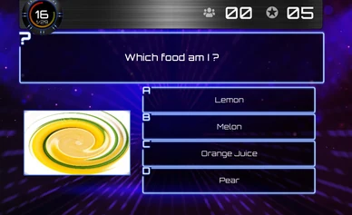{ loading=lazy } 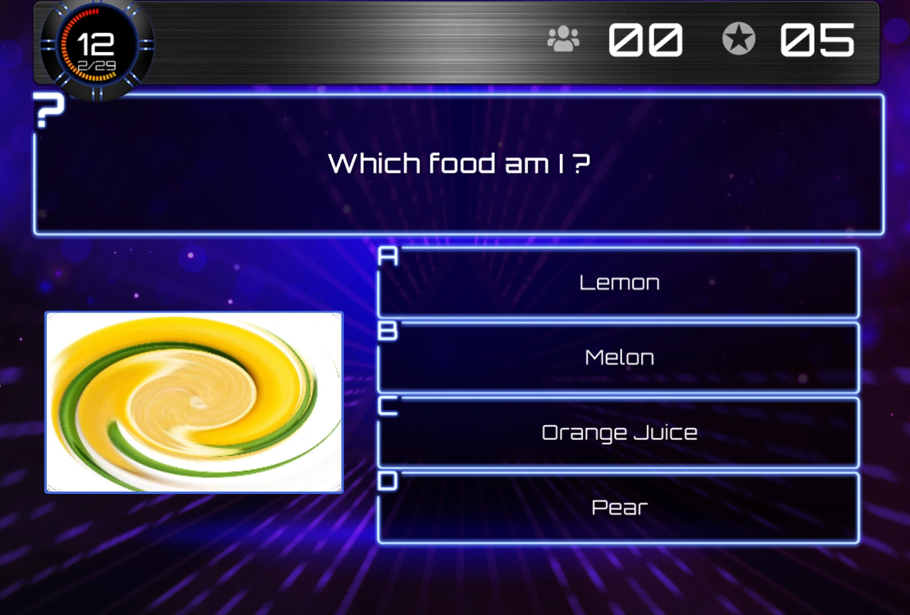{ loading=lazy } 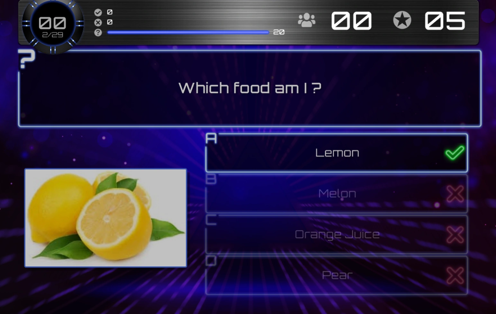{ loading=lazy }

Verschillende fasen van een effect ‘Draaikolk’.

Hieronder staan de beschikbare effecten.

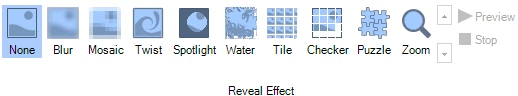{ width="402" loading=lazy }
