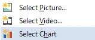
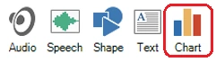
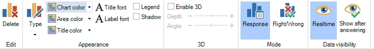
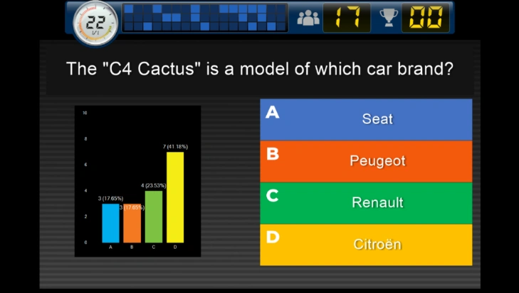
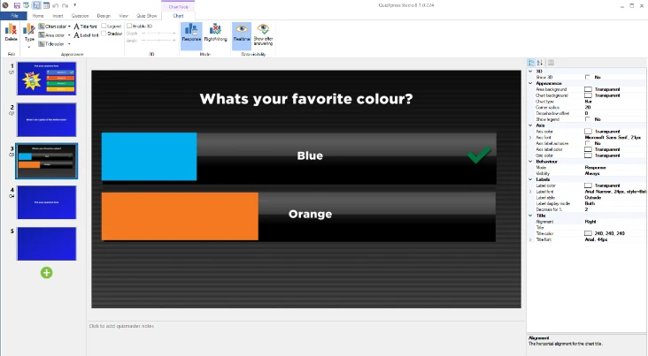

# Graphique en temps réel

Vous pouvez insérer un graphique de réponses en temps réel dans une diapositive. Pendant que le compte à rebours défile, le graphique affiche en direct toutes les réponses données par le public.

{ width="163" loading=lazy }Il existe deux façons d'ajouter un graphique à une diapositive :

1)  Choisissez une diapositive avec un espace réservé image/vidéo. Cliquez avec le bouton droit sur l'espace réservé et choisissez Select Chart

2)  Sélectionnez l'onglet de ruban INSERT et cliquez sur le bouton ‘Chart’ { width="228" loading=lazy }

Une fois le graphique inséré, l'onglet de ruban contextuel CHART devient visible pour configurer les différentes options.

{ width="605" loading=lazy }

L'onglet propose les options suivantes :

- Delete : supprimer le graphique de la diapositive

- Type : choisir l'un des types de graphique suivants : Bar, Column, Pie, Donut

- Set colors : Chart color (partie extérieure du graphique), Area color (partie intérieure du graphique), Title color (couleur du texte du titre au-dessus du graphique)

- Font buttons : définir la police du titre et des libellés.

- Legend : afficher une légende à côté du graphique

- Shadow : ajouter une ombre portée au graphique

- Enable 3D : rendre le graphique en 3D. Vous pouvez éventuellement définir la profondeur et l'angle du graphique 3D

- Mode : choisir d'afficher dans le graphique la répartition des réponses, ou la répartition correct/incorrect/sans réponse

- Data visibility : indiquer si vous souhaitez voir les résultats en temps réel ou si les résultats doivent être affichés une fois que tous les joueurs ont répondu.

Dans le volet des propriétés, vous pouvez configurer quelques autres aspects du graphique, comme le texte et l'alignement du titre, la couleur des libellés (un libellé contient le nombre de réponses pour un segment) et la couleur des axes.

{ width="465" loading=lazy }

Vous pouvez définir la couleur d'arrière-plan de l'élément graphique sur transparent pour créer des mises en page plus intéressantes avec des graphiques. Cela vous permet, par exemple, de concevoir des diapositives de réponse du public où le graphique recouvre les réponses.

{ width="466" loading=lazy }
