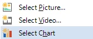
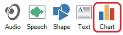
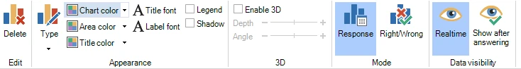
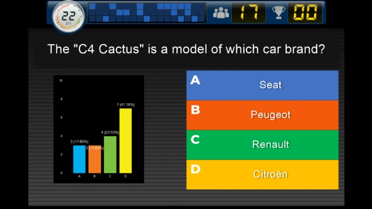
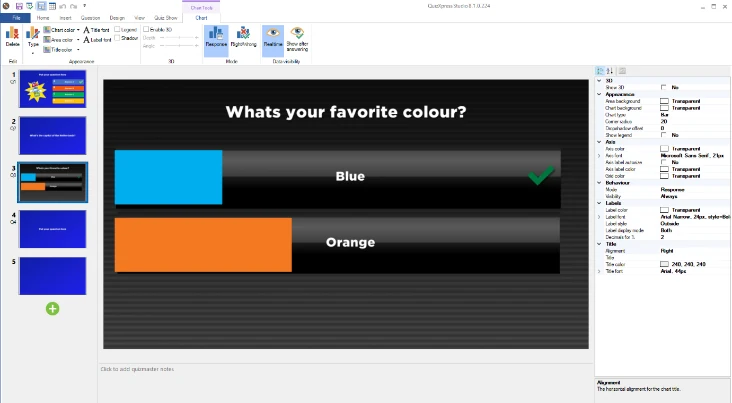

# Realtime grafiek

U kunt een realtime antwoordgrafiek op een dia plaatsen. Terwijl de klok aftelt, toont de grafiek live alle antwoorden die het publiek heeft gegeven.

{ width="163" align=left loading=lazy }Er zijn twee manieren om een grafiek aan een dia toe te voegen:

1)  Kies een dia met een tijdelijke aanduiding voor afbeelding/video. Klik met de rechtermuisknop op de aanduiding en kies Grafiek selecteren

2)  Selecteer het tabblad INVOEGEN op het lint en klik op de knop ‘Grafiek’ { width="228" loading=lazy }

Nadat de grafiek is ingevoegd, wordt het contextuele linttabblad GRAFIEK zichtbaar om de verschillende opties in te stellen.

{ width="605" loading=lazy }

Het tabblad heeft de volgende opties:

- Verwijderen: de grafiek van de dia verwijderen

- Type: kies een van de volgende grafiektypen: Staaf, Kolom, Cirkel, Donut

- Kleuren instellen: Grafiekkleur (buitenste deel van de grafiek), Vlakkleur (binnenste deel van de grafiek), Titelkleur (kleur van de titeltekst boven de grafiek)

- Lettertypeknoppen: het lettertype van de titel en de labels instellen.

- Legenda: een legenda naast de grafiek tonen

- Schaduw: een slagschaduw aan de grafiek toevoegen

- 3D inschakelen: de grafiek 3D maken. Optioneel kunt u de diepte en hoek van de 3D-grafiek instellen

- Modus: kies of de grafiek de verdeling van de antwoorden toont, of de verdeling juist/onjuist/niet beantwoord

- Zichtbaarheid data: geef aan of u de resultaten realtime wilt zien of dat de resultaten pas worden getoond nadat alle spelers hebben geantwoord.

In het eigenschappenvenster kunt u nog enkele andere aspecten van de grafiek instellen, zoals de titeltekst en uitlijning, de labelkleur (een label bevat het aantal antwoorden voor een segment) en de askleur.

{ width="465" loading=lazy }

U kunt de achtergrondkleur van het grafiekelement op transparant instellen om interessantere indelingen met grafieken te maken. Zo kunt u bijvoorbeeld publieksantwoorddia’s bouwen waarbij de grafiek over de antwoorden heen ligt.

{ width="466" loading=lazy }
