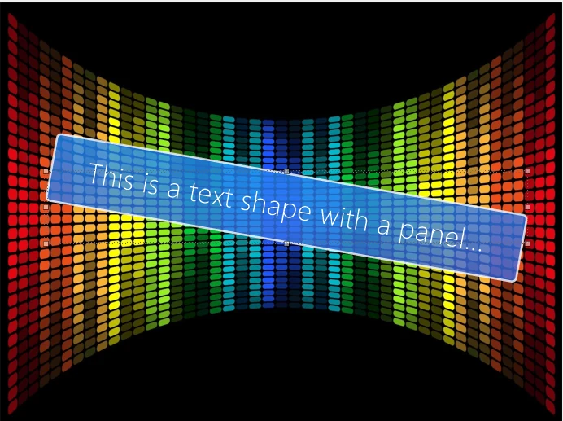
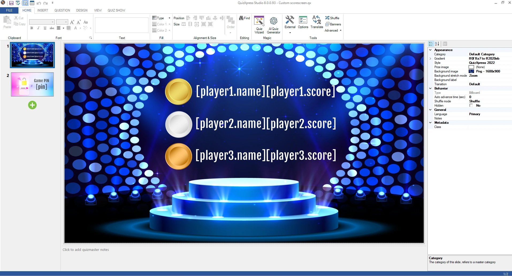
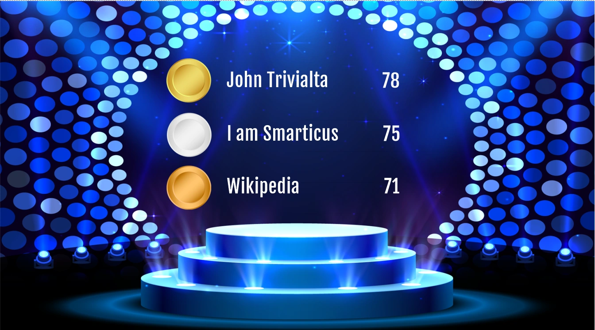
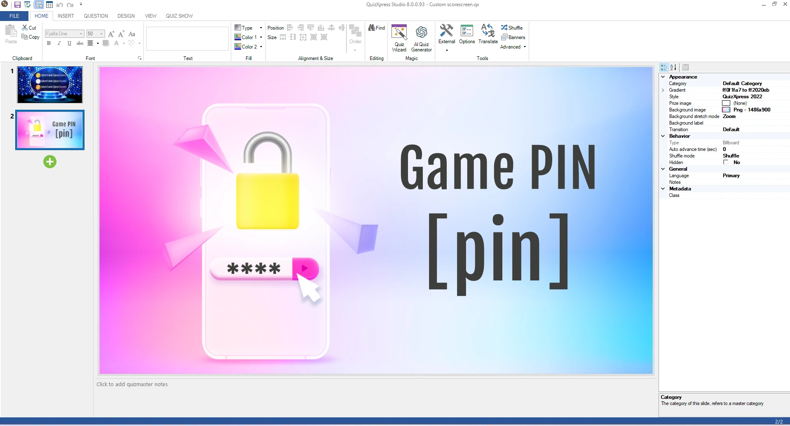
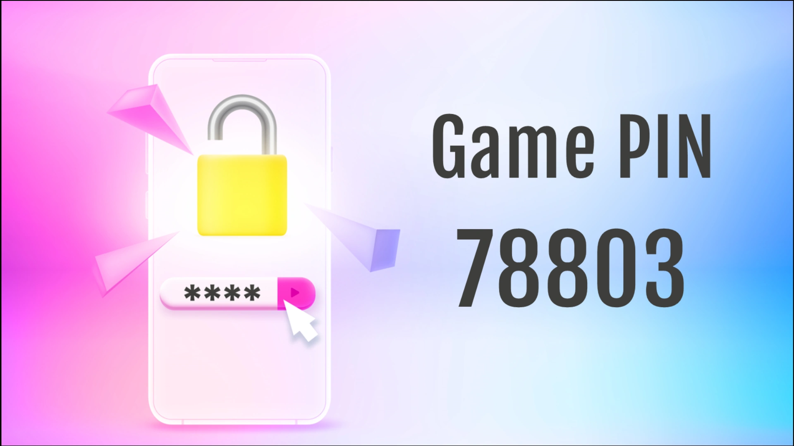
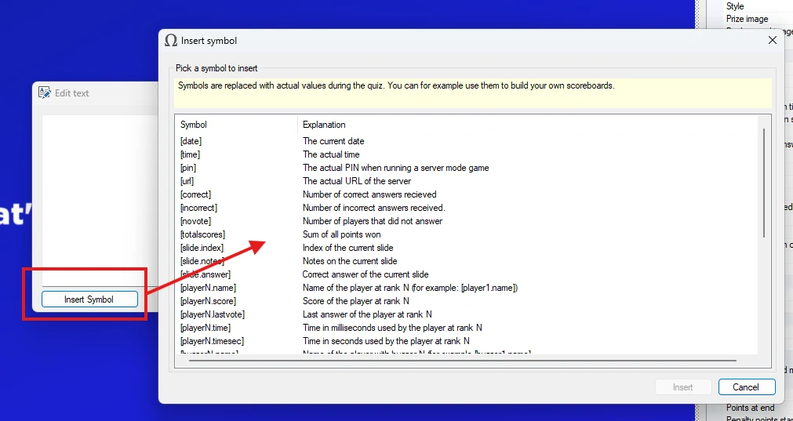
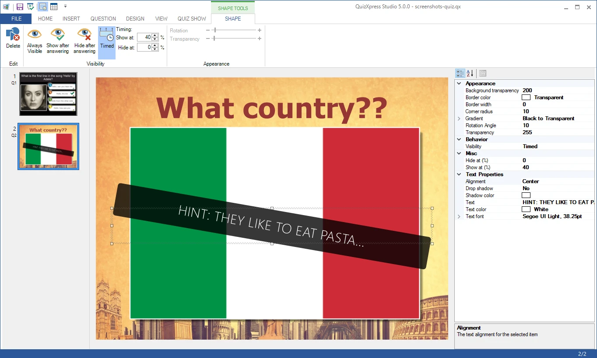

# Formas

Puede añadir formas o imágenes arbitrarias a su diapositiva. Las formas pueden utilizarse con distintos fines, por ejemplo:

- Podría insertar una flecha grande para señalar algo en una imagen sobre la que está preguntando a su público. Si establece la opción Visibility en ‘Visible after answers’, la forma solo se hace visible cuando ha terminado la cuenta atrás de la pregunta.

- Podría ocultar parte de una imagen en una diapositiva superponiéndole una forma. Si establece la opción Visibility en ‘Hide after answers’, la forma se oculta cuando termina la cuenta atrás, revelando lo que hay detrás.

Para insertar una forma, utilice el comando *Insert->Shape* del panel de tareas (este comando se hace visible después de seleccionar el fondo de la diapositiva). Se le pedirá entonces que seleccione un archivo de forma. De forma predeterminada, el explorador de archivos filtra los archivos *\*.emf* o *\*.wmf*. Estos tipos de archivo utilizan un formato ‘vectorial’ (a diferencia de los formatos de mapa de bits) que se ve bien incluso después de escalar la forma. Las formas también pueden utilizar como origen cualquier formato de imagen admitido (png, jpg, bmp, etc.); puede seleccionar estos otros formatos en el explorador de archivos. Tenga en cuenta que los archivos de imagen no se escalan bien y el resultado puede verse pixelado al ampliarlo.

El elemento de forma tiene las siguientes propiedades:

| Property       | Description                                                                                                                                                                                     |
|----------------|-------------------------------------------------------------------------------------------------------------------------------------------------------------------------------------------------|
| Picture        | La imagen de origen de la forma. Puede utilizar el botón … para seleccionar otro origen                                                                                                         |
| Rotation Angle | El ángulo en el que se gira opcionalmente la forma                                                                                                                                              |
| Transparency   | Transparencia de la forma                                                                                                                                                                       |
| Visibility     | Condición de visibilidad. Puede establecerse en ‘Always visible’, ‘Visible after answers’ (oculta la forma hasta que termina la pregunta) o ‘Hide after answers’ (muestra la forma hasta que termina la pregunta). |

Para eliminar una forma, selecciónela y pulse la tecla Supr (Delete). QuizXpress incluye algunas formas de ejemplo predeterminadas. También puede crear sus propias formas, por ejemplo con Microsoft PowerPoint, guardando una forma de PowerPoint como imagen (haga clic con el botón derecho en la forma, seleccione ‘Save as picture’ y elija *wmf* o *emf* como formato de archivo).

## Formas de texto

Puede añadir elementos de texto a las diapositivas de su quiz, y su visibilidad se puede controlar igual que la de las formas de imagen. Un ejemplo de uso de un elemento de texto es mostrar la respuesta correcta en una pregunta abierta (una vez respondida y juzgada la pregunta), o dar pistas durante la pregunta. Mediante la cuadrícula de propiedades, puede establecer algunas de las propiedades más avanzadas, como el color del panel de fondo del texto y el radio de las esquinas, para crear elementos visuales atractivos (tenga en cuenta que estas propiedades no están disponibles en la cinta de opciones). Las formas de texto tienen las siguientes propiedades adicionales:

| Property                | Description                                                                           |
|-------------------------|---------------------------------------------------------------------------------------|
| Background transparency | Transparencia del panel de fondo. De forma predeterminada, el fondo es totalmente transparente. |
| Border color            | Color del borde alrededor del panel                                                   |
| Border width            | Grosor de la línea alrededor del panel                                                |
| Corner radius           | Radio de las esquinas del panel de fondo                                              |
| Gradient                | Relleno degradado del fondo                                                           |
| Alignment               | Alineación del texto (izquierda, centro, derecha)                                     |
| Drop shadow             | Sombra proyectada del texto                                                           |
| Shadow color            | Color de la sombra proyectada                                                         |
| Text                    | El texto en sí                                                                        |
| Text color              | Color del texto                                                                       |
| Font                    | Fuente utilizada para dibujar el texto                                                |

Con estas propiedades, puede crear paneles de texto como:

{ width="376" loading=lazy }

### Símbolos de texto

Mediante las formas de texto, puede crear pantallas personalizadas que contengan datos que solo se conocen mientras se desarrolla el programa. Para ello, los campos de texto (formas) de QuizXpress pueden contener ‘símbolos’ predefinidos. Cuando se realiza el programa con público, estos símbolos se sustituyen por sus valores correspondientes.

Se pueden utilizar elementos como nombres de jugadores, puntuaciones, respuestas, tiempos de respuesta, el código PIN, el índice de la diapositiva, las notas de la diapositiva, el número de respuestas correctas e incorrectas, y muchos más.

A continuación se muestran algunos ejemplos de pantallas con un diseño personalizado. A la izquierda se ve el aspecto de la diapositiva en QuizXpress Studio. A la derecha se ve cómo podría verse la diapositiva durante una partida.

| { loading=lazy } | { loading=lazy } |
|---------------------------------------------------------------------------------|---------------------------------------------------------------------------------|
| { loading=lazy }  | { loading=lazy } |
|                                                                                 |                                                                                 |

Al editar elementos de texto en el formulario del editor de texto (haga doble clic en un texto o en una forma de texto para abrirlo), hay un botón ‘Insert Symbol’ para insertar un símbolo de texto. También puede escribir los símbolos manualmente. El cuadro de diálogo Insert Symbol enumera todos los símbolos junto con una explicación de cada uno.

{ width="544" loading=lazy }

Algunos ejemplos de símbolos que puede utilizar:

| **\[date\]**        | Fecha actual                                        | **\[slide.answer\]**     | Respuesta correcta de la pregunta actual |
|---------------------|-----------------------------------------------------|--------------------------|------------------------------------|
| **\[time\]**        | Hora actual                                         | **\[playerX.name\]**     | Nombre del jugador con la posición X |
| **\[pin\]**         | PIN móvil actual                                    | **\[playerX.score\]**    | Puntuación del jugador con la posición X |
| **\[url\]**         | URL del servidor de juego                           | **\[playerX.lastvote\]** | Último voto                        |
| **\[correct\]**     | N.º de jugadores que respondieron correctamente tras la pregunta | **\[playerX.time\]**     | Tiempo de respuesta en milisegundos |
| **\[incorrect\]**   | N.º de jugadores que respondieron incorrectamente tras la pregunta | **\[playerX.timesec\]**  | Tiempo de respuesta en segundos    |
| **\[novote\]**      | N.º de jugadores que no respondieron tras la pregunta | **\[buzzerX.name\]**     | Nombre del jugador con el pulsador X |
| **\[slide.index\]** | Número de diapositiva de la pregunta actual         | **\[buzzerX.score\]**    | Puntuación del jugador con el pulsador X |
| **\[slide.notes\]** | Notas de la pregunta actual                         |                          |                                    |

Puede utilizar los símbolos en cualquier elemento de texto. Por ejemplo, podría insertar una forma de texto y escribir algo como: “Abra su aplicación Smart Buzzer y conéctese con el código de juego: \[pin\]”

Los símbolos de texto son una excelente manera de hacer más dinámicas las diapositivas de su quiz y, por ejemplo, de diseñar sus propios marcadores personalizados.

## Formas temporizadas

También puede mostrar y ocultar formas y elementos de texto a lo largo del tiempo estableciendo las propiedades de forma temporizada en la pestaña contextual SHAPE TOOLS de la cinta de opciones. Esto le permite, por ejemplo, crear una ‘pista’ que aparece transcurrido cierto tiempo a medida que avanza la cuenta atrás, como se muestra en el siguiente ejemplo:

{ loading=lazy }

En este ejemplo, el elemento de texto con panel aparece cuando ha transcurrido el 40 % del tiempo de la cuenta atrás.

Si deja el porcentaje ‘Hide at:’ en 0 %, la pista se muestra hasta el final de la cuenta atrás.

Alternativamente, puede, por ejemplo, ir eliminando con el tiempo los elementos que tapan partes de una foto.
