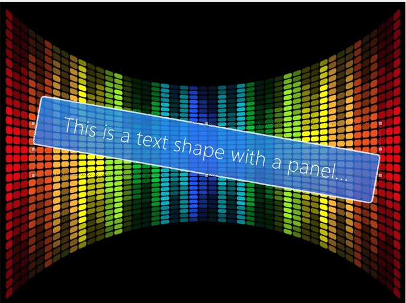
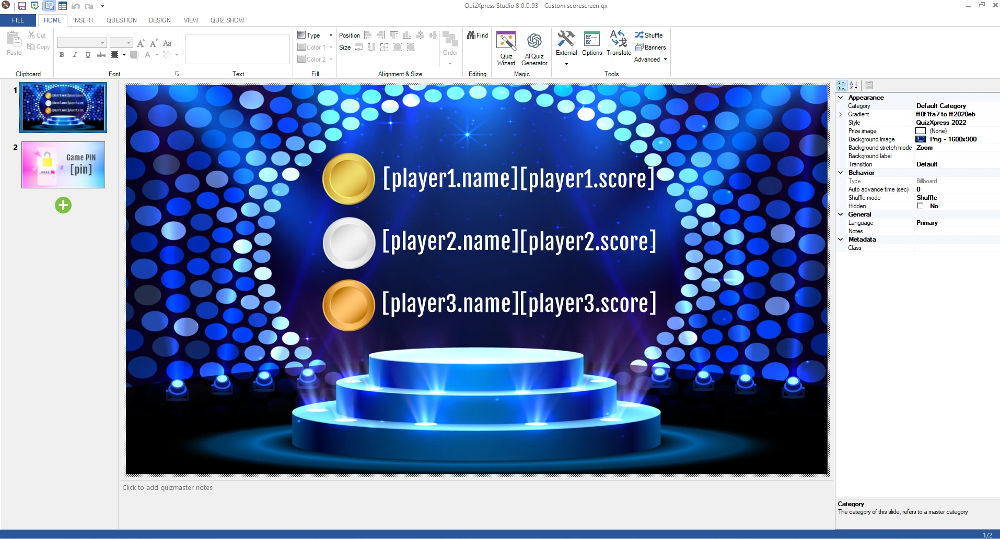
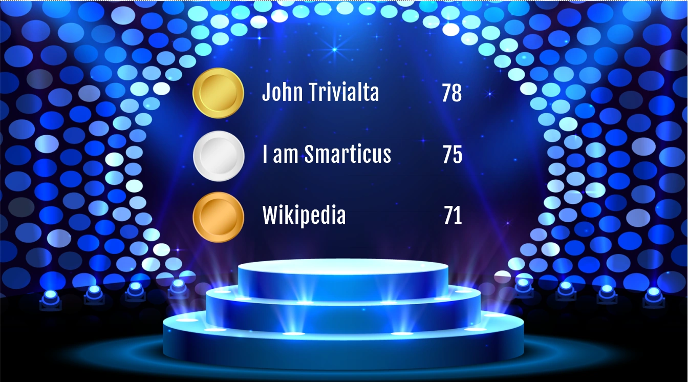
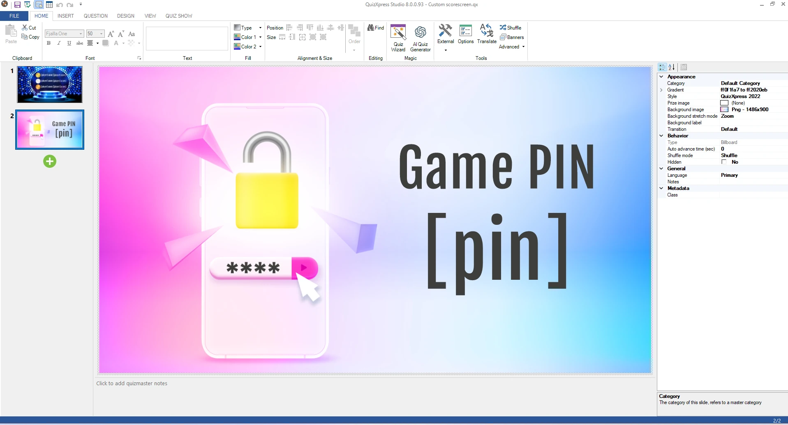
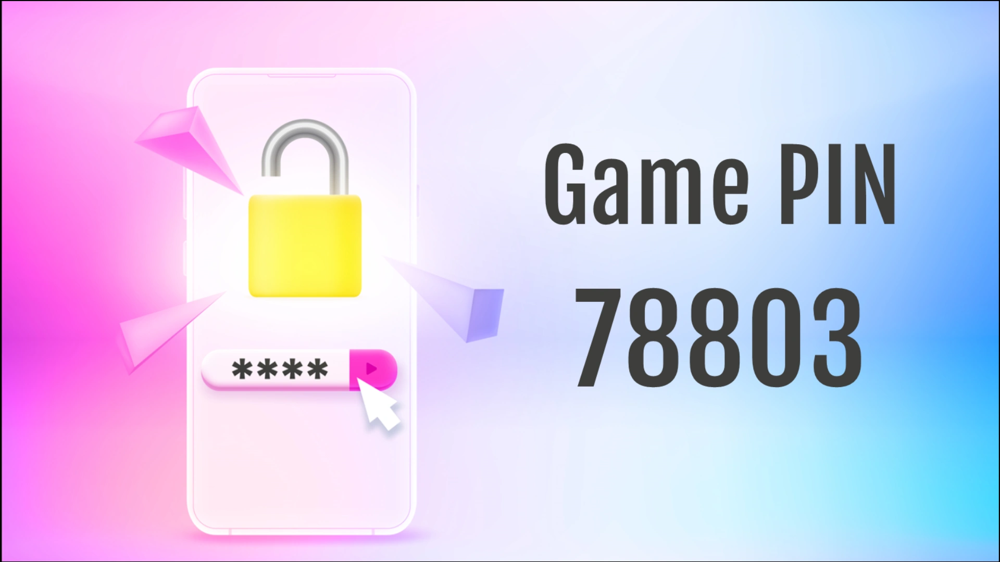
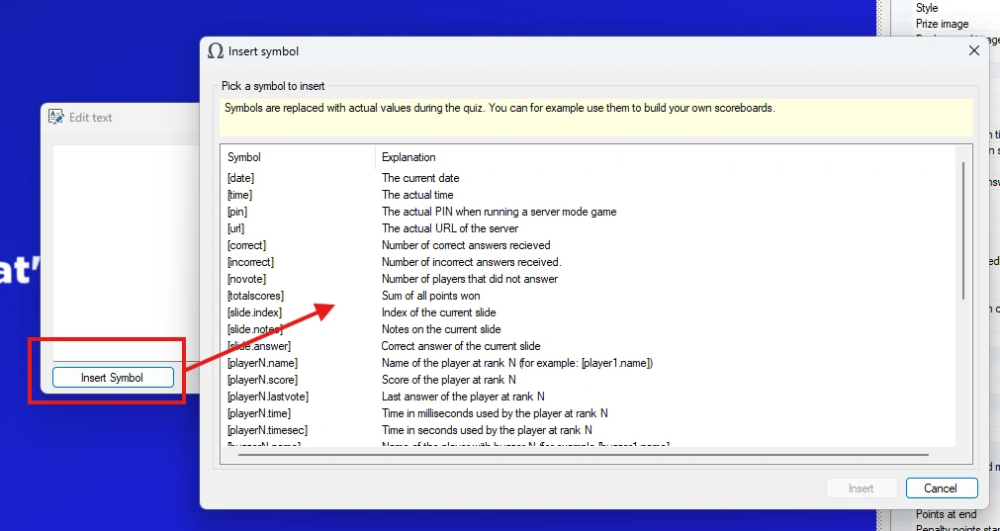
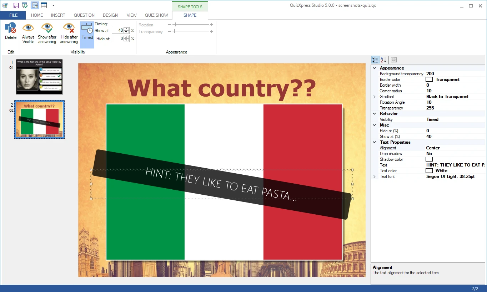

# Vormen

U kunt willekeurige vormen of afbeeldingen aan uw dia toevoegen. Vormen kunnen voor verschillende doeleinden worden gebruikt, bijvoorbeeld:

- U kunt een grote pijl invoegen om iets aan te wijzen in een afbeelding waarover u uw publiek ondervraagt. Door de optie Zichtbaarheid op ‘Zichtbaar na antwoorden’ te zetten, wordt de vorm pas zichtbaar zodra het aftellen van de vraag is afgelopen.

- U kunt een deel van een afbeelding op een dia verbergen door er een vorm overheen te leggen. Door de optie Zichtbaarheid op ‘Verbergen na antwoorden’ te zetten, wordt de vorm verborgen zodra het aftellen is afgerond, zodat zichtbaar wordt wat erachter zit.

Om een vorm in te voegen, gebruikt u de opdracht *Invoegen->Vorm* in het taakvenster (deze opdracht wordt zichtbaar nadat u de achtergrond van de dia hebt geselecteerd). U wordt dan gevraagd een vormbestand te selecteren. Standaard filtert de bestandsbrowser op *\*.emf*- of *\*.wmf*-bestanden. Deze bestandstypen gebruiken een ‘vector’-indeling (in tegenstelling tot bitmapindelingen) die er goed uitziet, ook nadat de vorm is geschaald. Vormen kunnen ook elke ondersteunde afbeeldingsindeling (png, jpg, bmp enzovoort) als bron gebruiken; die andere indelingen kunt u selecteren in de bestandsbrowser. Let op: afbeeldingsbestanden schalen niet goed en het resultaat kan korrelig ogen wanneer ze worden vergroot.

Het vormelement heeft de volgende eigenschappen:

| Eigenschap       | Beschrijving                                                                                                                                                                                     |
|----------------|-------------------------------------------------------------------------------------------------------------------------------------------------------------------------------------------------|
| Afbeelding        | De bronafbeelding voor de vorm. Met de knop … kunt u een andere bron selecteren                                                                                                             |
| Rotatiehoek | De hoek waarmee de vorm optioneel wordt gedraaid                                                                                                                                              |
| Transparantie   | Transparantie van de vorm                                                                                                                                                                       |
| Zichtbaarheid     | Zichtbaarheidsvoorwaarde. Kan worden ingesteld op ‘Altijd zichtbaar’, ‘Zichtbaar na antwoorden’ (verberg de vorm tot de vraag voorbij is) of ‘Verbergen na antwoorden’ (toon de vorm tot de vraag voorbij is). |

Om een vorm te verwijderen, selecteert u deze en drukt u op de toets Delete. QuizXpress wordt geleverd met enkele standaard voorbeeldvormen. U kunt ook uw eigen vormen maken, bijvoorbeeld met Microsoft PowerPoint, door een PowerPoint-vorm als afbeelding op te slaan (klik met de rechtermuisknop op de vorm, kies ‘Opslaan als afbeelding’ en kies *wmf* of *emf* als bestandsindeling).

## Tekstvormen

U kunt tekstitems aan uw quizdia’s toevoegen en de zichtbaarheid ervan is net als bij afbeeldingsvormen te regelen. Een voorbeeld van het gebruik van een tekstitem is het tonen van het juiste antwoord bij een open vraag (nadat de vraag is beantwoord en beoordeeld), of het geven van hints tijdens de vraag. Met het eigenschappenraster kunt u enkele geavanceerdere eigenschappen instellen, zoals de kleur van het tekstachtergrondpaneel en de hoekradius, om fraai ogende visuals te maken (let op: deze eigenschappen zijn niet beschikbaar in het lint). Tekstvormen hebben de volgende aanvullende eigenschappen:

| Eigenschap                | Beschrijving                                                                           |
|-------------------------|---------------------------------------------------------------------------------------|
| Transparantie achtergrond | Transparantie van het achtergrondpaneel. Standaard is de achtergrond volledig transparant. |
| Randkleur            | Kleur van de rand rond het paneel                                                  |
| Randdikte            | Breedte van de lijn rond het paneel                                                    |
| Hoekradius           | Straal van de hoeken van het achtergrondpaneel                                                |
| Kleurenverloop                | Kleurverloopvulling van de achtergrond                                                       |
| Uitlijning               | Tekstuitlijning (links, gecentreerd, rechts)                                                  |
| Schaduw             | Schaduw voor de tekst                                                               |
| Kleur schaduw            | Kleur van de schaduw                                                                    |
| Tekst                    | De tekst zelf                                                                       |
| Tekstkleur              | Kleur van de tekst                                                              |
| Lettertype                    | Lettertype waarmee de tekst wordt getekend                                                    |

Met deze eigenschappen kunt u tekstpanelen maken zoals:

{ width="376" loading=lazy }

### Tekstsymbolen

Met tekstvormen kunt u aangepaste schermen maken die gegevens bevatten die pas bekend zijn tijdens de show. Hiervoor kunnen tekstvelden (vormen) in QuizXpress vooraf gedefinieerde ‘symbolen’ bevatten. Wanneer u de game show met een publiek uitvoert, worden deze symbolen vervangen door de bijbehorende waarden.

Zaken als spelersnamen, scores, antwoorden, antwoordtijden, de PIN-code, diavolgnummer, dianotities, het aantal juiste en onjuiste antwoorden en nog veel meer kunnen worden gebruikt.

Hieronder staan enkele voorbeelden van schermen met een aangepast ontwerp. Links ziet u hoe de dia eruitziet in QuizXpress Studio. Rechts ziet u hoe de dia tijdens een spel eruit kan zien.

| { loading=lazy } | { loading=lazy } |
|---------------------------------------------------------------------------------|---------------------------------------------------------------------------------|
| { loading=lazy }  | { loading=lazy } |
|                                                                                 |                                                                                 |

Wanneer u tekstelementen bewerkt in het tekstbewerkingsvenster (dubbelklik op een tekst of tekstvorm om het te openen), is er een knop ‘Symbool invoegen’ om een tekstsymbool in te voegen. U kunt de symbolen ook handmatig typen. Het dialoogvenster Symbool invoegen toont alle symbolen met bij elk een uitleg.

{ width="544" loading=lazy }

Enkele voorbeelden van symbolen die u kunt gebruiken:

| **\[date\]**        | Huidige datum                                        | **\[slide.answer\]**     | Juiste antwoord van de huidige vraag |
|---------------------|-----------------------------------------------------|--------------------------|------------------------------------|
| **\[time\]**        | Huidige tijd                                        | **\[playerX.name\]**     | Naam van de speler met rang X         |
| **\[pin\]**         | Huidige mobiele PIN                                  | **\[playerX.score\]**    | Score van de speler met rang X        |
| **\[url\]**         | URL van de gameserver                                  | **\[playerX.lastvote\]** | Laatste stem                          |
| **\[correct\]**     | Aantal spelers dat na de vraag juist antwoordde | **\[playerX.time\]**     | Antwoordtijd in milliseconden |
| **\[incorrect\]**   | Aantal spelers dat na de vraag onjuist antwoordde   | **\[playerX.timesec\]**  | Antwoordtijd in seconden      |
| **\[novote\]**      | Aantal spelers dat na de vraag niet antwoordde   | **\[buzzerX.name\]**     | Naam van de speler met buzzer X       |
| **\[slide.index\]** | Dianummer van de huidige vraag                    | **\[buzzerX.score\]**    | Score van de speler met buzzer X      |
| **\[slide.notes\]** | Notities van de huidige vraag                       |                          |                                    |

U kunt de symbolen in elk tekstitem gebruiken. U kunt bijvoorbeeld een tekstvorm invoegen en iets typen als: “Open uw Smart Buzzer-app en maak verbinding met de spelcode: \[pin\]”

Tekstsymbolen zijn een uitstekende manier om uw quizdia’s dynamischer te maken en bijvoorbeeld uw eigen scoreborden te ontwerpen.

## Vormen met timing

U kunt vorm- en tekstitems ook in de loop van de tijd tonen en verbergen door de eigenschappen voor vormen met timing in te stellen op het contextuele linttabblad VORM TOOLS. Hiermee kunt u bijvoorbeeld een ‘hint’ maken die na een bepaalde tijd verschijnt terwijl het aftellen vordert, zoals in het volgende voorbeeld:

{ loading=lazy }

In dit voorbeeld verschijnt het tekstitem met paneel nadat 40% van de aftelttijd voorbij is.

Wanneer u het percentage ‘Verbergen op:’ op 0% laat staan, wordt de hint tot het einde van het aftellen getoond.

U kunt bijvoorbeeld ook elementen die delen van een foto bedekken in de loop van de tijd verwijderen.
