# Sonido

Los fragmentos de sonido pueden utilizarse para preguntas como “¿Quién compuso esta canción?”, “¿Qué ave está cantando aquí?” o “¿Qué ruido es este?”. Para hacerlo más interesante, puede variar la velocidad del sonido a lo largo del tiempo estableciendo las propiedades ‘Speed from’ (porcentaje de velocidad de reproducción cuando el sonido empieza a reproducirse) y ‘Speed to’ (velocidad de reproducción al final del fragmento de sonido). Del mismo modo, puede variar el tono del sonido.

## Insertar un archivo de sonido

Para añadir un fragmento de sonido a una diapositiva del quiz, seleccione la pestaña INSERT de la cinta de opciones y haga clic en el botón ‘Audio’, luego seleccione un archivo mp3 o wav y elija si desea vincular o incrustar el archivo:

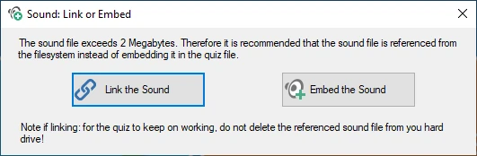{ width="321" loading=lazy }

La vinculación da como resultado archivos de quiz más pequeños y más manejables, pero deberá asegurarse de que todos los archivos externos sigan siendo accesibles, ya sea en su ruta original o en la carpeta donde se almacena el archivo del quiz (alternativamente, puede mantener los archivos externos y [empaquetar su quiz](../other-functionality/packing-and-unpacking-a-quiz.md) antes de distribuirlo; el empaquetado también puede recortar los sonidos a la parte que se reproduce y comprimirlos).

Una vez insertado el archivo, la pestaña contextual AUDIO de la cinta de opciones se hace visible para configurar las distintas opciones.

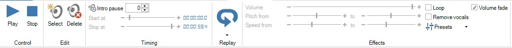{ width="720" loading=lazy }

## Recortar un sonido

Normalmente solo desea reproducir una parte de una canción o grabación: el estribillo, la introducción o simplemente los pocos segundos que delatan la respuesta. El editor de recorte muestra el sonido como una forma de onda, para que pueda ver dónde empieza la música, dónde sube de volumen y dónde se desvanece, y elegir la parte que se va a reproducir escuchándola.

El editor de recorte no modifica el archivo de sonido en sí. Solo establece el tiempo de inicio y de fin del sonido, de modo que siempre puede volver a la pista completa.

### Abrir el editor de recorte

Seleccione el icono de sonido en la diapositiva y utilice una de estas opciones:

- Haga clic en el botón ‘Trim’ del grupo ‘Timing’ de la pestaña AUDIO de la cinta de opciones, junto a los tiempos de inicio y parada. La pequeña flecha de la esquina inferior derecha del grupo ‘Timing’ abre el mismo editor.

    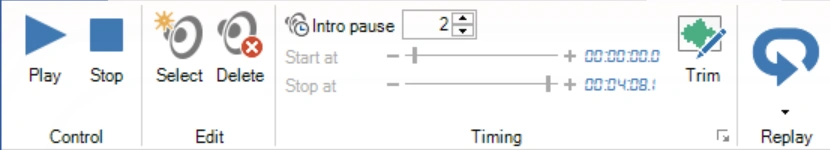{ width="420" loading=lazy }

- Haga clic con el botón derecho en el icono de sonido de la diapositiva y elija ‘Trim sound...’.

    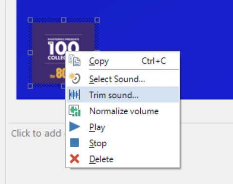{ width="240" loading=lazy }

!!! note
    No se pueden recortar las pistas de Spotify ni los archivos MIDI, ni un archivo de sonido vinculado que no se encuentre. El botón ‘Trim’ aparece atenuado en estos casos.

### Elegir la parte que se va a reproducir

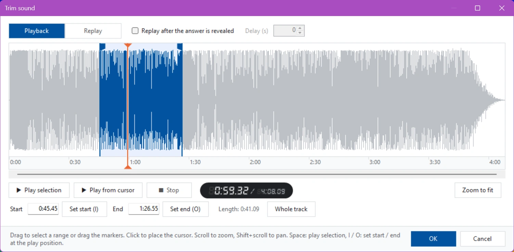{ loading=lazy }

La parte que se reproducirá aparece resaltada en azul. Para cambiarla:

- **Arrastre sobre la forma de onda** para seleccionar una nueva parte, o arrastre los marcadores al inicio y al final de la selección.
- **Escriba los tiempos** en los cuadros ‘Start’ y ‘End’. Puede introducir segundos (`75`), minutos y segundos (`1:15`) u horas, minutos y segundos (`0:01:15`), con decimales si lo desea (`1:15.5`). ‘Length’ muestra cuánto dura la parte seleccionada.
- **Establezca el inicio o el final mientras escucha**: haga clic en ‘Set start (I)’ o ‘Set end (O)’, o pulse I u O en el teclado, en el momento exacto en que oiga el punto adecuado. Cuando no se está reproduciendo ningún sonido, estos botones utilizan la posición del cursor.
- **‘Whole track’** vuelve a seleccionar el sonido completo.

Haga clic en cualquier punto de la forma de onda para colocar el cursor (la línea naranja).

Para escuchar:

- ‘Play selection’ (o la barra espaciadora) reproduce la parte seleccionada. Pulse de nuevo la barra espaciadora para detenerla.
- ‘Play from cursor’ reproduce desde el cursor hasta el final del sonido.
- Mientras se reproduce el sonido, haga clic en la forma de onda para saltar a ese punto.

El indicador situado junto a los botones muestra la posición actual y la duración total del sonido.

Para un trabajo preciso, acerque con la rueda del ratón y utilice Mayús + rueda del ratón o la barra de desplazamiento situada bajo la forma de onda para moverse a izquierda y derecha. ‘Zoom to fit’ vuelve a mostrar todo el sonido.

Haga clic en ‘OK’ para aplicar el nuevo tiempo de inicio y de fin, o en ‘Cancel’ para dejar el sonido como estaba. Puede deshacer un recorte en un solo paso con Deshacer. Si [normalizó el volumen del sonido](#normalizar-el-volumen), QuizXpress mide de nuevo la nueva parte para que siga sonando igual de fuerte.

### Configurar la parte de repetición

En el mismo editor puede elegir la parte que se reproduce de nuevo después de revelar la respuesta (véase [Repetición](#repeticion) más abajo). A menudo es una parte distinta de la canción que la reproducida durante la pregunta, por ejemplo el estribillo.

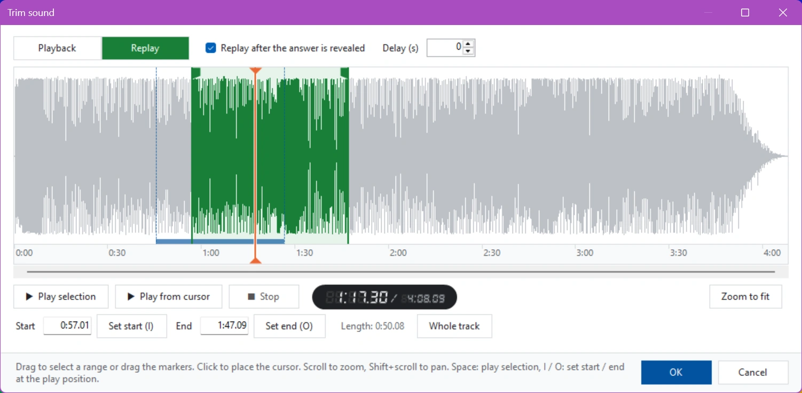{ loading=lazy }

1. Marque ‘Replay after the answer is revealed’. El editor cambia a ‘Replay’ y la selección se vuelve verde.
2. Seleccione la parte de repetición de la misma manera que se ha descrito anteriormente.
3. Opcionalmente, introduzca un ‘Delay (s)’: el número de segundos que se debe esperar después de revelar la respuesta antes de que comience la repetición.

Utilice los botones ‘Playback’ y ‘Replay’ de la parte superior izquierda para alternar entre las dos partes. La parte que no está editando se muestra como una barra en la parte inferior de la forma de onda (azul para la reproducción, verde para la repetición), para que pueda ver cómo se relacionan ambas.

!!! note
    La repetición no está disponible cuando la opción ‘Keep playing’ del sonido está activada, porque entonces el sonido nunca se detiene.

## Repetición

A menudo querrá repetir (parte de) la música una vez finalizada la pregunta, sincronizada con la revelación de la respuesta correcta en la diapositiva. Esto se puede hacer activando la función de repetición de audio:

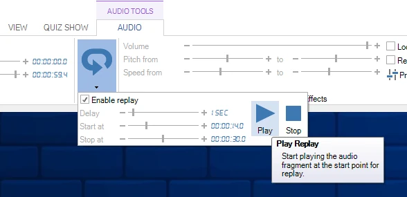{ width="576" loading=lazy }

Puede establecer un retardo inicial, el tiempo de inicio de la canción y el tiempo de fin. La forma más sencilla de elegir la parte de repetición es en la forma de onda del editor de recorte; véase [Configurar la parte de repetición](#configurar-la-parte-de-repeticion).

## Normalizar el volumen

Las canciones y los clips de sonido de distintas fuentes rara vez tienen el mismo volumen: una grabación antigua o una pieza clásica pueden sonar mucho más bajo que una canción pop moderna, de modo que los jugadores se esfuerzan por oír una pregunta y la siguiente les revienta los oídos. La normalización del volumen soluciona esto. QuizXpress mide el volumen real de cada sonido y lo ajusta para que todos los sonidos se reproduzcan con el mismo volumen, tanto en Quiz Studio como durante el programa.

La normalización no modifica los archivos de sonido. Establece la propiedad ‘Loudness gain’ del sonido (véase [más abajo](#la-propiedad-loudness-gain)), de modo que siempre puede cambiarla o deshacerla. Solo se mide la parte del sonido que se reproduce: la parte comprendida entre su tiempo de inicio y de fin.

Puede normalizar todos los sonidos del quiz a la vez, o un solo sonido.

### Todos los sonidos del quiz

Haga clic en ‘Normalize volume’ en el grupo ‘Tools’ de la pestaña HOME de la cinta de opciones.

{ width="220" loading=lazy }

Se abre la ventana ‘Normalize sound volume’ y comienza inmediatamente a medir todos los sonidos del quiz. Las canciones largas tardan unos segundos cada una.

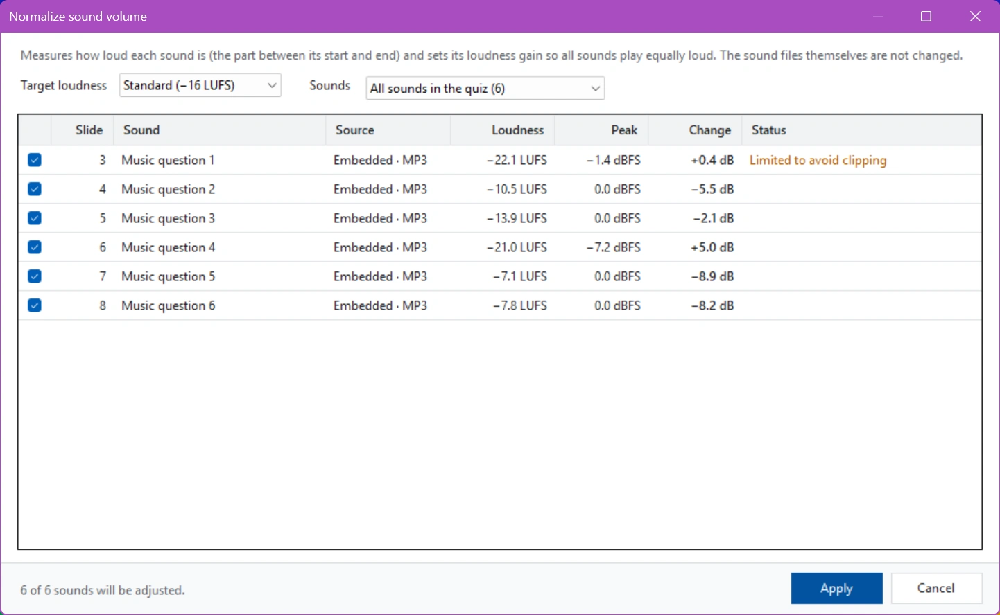{ loading=lazy }

Para cada sonido verá:

- **Slide** y **Sound**: dónde está el sonido y qué es (el nombre del archivo o el texto de la pregunta en el caso de un sonido incrustado).
- **Source**: si el sonido está incrustado en el quiz o vinculado, y su tipo de archivo.
- **Loudness**: lo fuerte que es el sonido, en LUFS (Loudness Units relative to Full Scale, la medida que utilizan los servicios de streaming y las emisoras). Cuanto más cerca de 0, más fuerte: −8 LUFS es una canción pop fuerte, −22 LUFS una grabación suave.
- **Peak**: el momento más fuerte del sonido, en dBFS. 0 dBFS es lo más fuerte que puede almacenar un archivo de sonido.
- **Change**: cuánto subirá (+) o bajará (−) QuizXpress el sonido, en dB.
- **Status**: cualquier cosa que merezca la pena saber sobre el sonido (véase la tabla siguiente).

Elija el ‘Target loudness’:

| Objetivo | Úselo cuando |
|---|---|
| Standard (−16 LUFS) | El valor predeterminado. Aproximadamente tan fuerte como la música en los servicios de streaming. |
| Quieter (−18 LUFS) | Desea un poco más de margen, por ejemplo cuando los sonidos se reproducen sobre música de fondo. |
| Broadcast (−23 LUFS) | Desea el nivel utilizado por la televisión y la radio europeas (EBU R128). Notablemente más bajo; suba el volumen del sistema de sonido para compensar. |

Al cambiar el objetivo, la columna ‘Change’ se actualiza de inmediato; los sonidos no se vuelven a medir. Quiz Studio recuerda el objetivo que eligió y también lo utiliza para normalizar sonidos individuales.

Si seleccionó algunas diapositivas antes de abrir la ventana, la lista ‘Sounds’ le permite elegir entre ‘All sounds in the quiz’ y ‘Sounds on the selected slides’.

Todos los sonidos que van a cambiar aparecen marcados. Desmarque un sonido para dejarlo como está. La línea inferior muestra cuántos sonidos se ajustarán. Haga clic en ‘Apply’ para establecer las nuevas ganancias de volumen. Puede deshacer toda la normalización en un solo paso con Deshacer.

| Estado | Significado |
|---|---|
| Limited to avoid clipping | El sonido es suave pero ya tiene picos fuertes. QuizXpress lo sube solo hasta donde puede sin distorsionar (los picos se mantienen por debajo de −1 dBFS), por lo que puede seguir sonando algo más bajo que los demás. |
| Already at target | El sonido ya tiene el volumen objetivo y no se modifica. |
| Silent | No hay sonido en la parte que se reproduce (compruebe sus tiempos de inicio y de fin). |
| Skipped: MIDI has no audio to measure | Los archivos MIDI no se pueden medir y conservan su volumen. |
| Skipped: Spotify track | Las pistas de Spotify no se pueden medir y conservan su volumen. |
| Sound file is missing | No se encuentra un archivo de sonido vinculado. [Repare el vínculo](../other-functionality/fixing-broken-links.md) e inténtelo de nuevo. |

### Un solo sonido

Para normalizar un solo sonido, por ejemplo después de reemplazarlo, seleccione el icono de sonido en la diapositiva y haga clic en ‘Normalize’ en el grupo ‘Effects’ de la pestaña AUDIO de la cinta de opciones, o haga clic con el botón derecho en el icono de sonido y elija ‘Normalize volume’. La información sobre herramientas del botón muestra el volumen objetivo que se utilizará: el último elegido en la ventana ‘Normalize sound volume’.

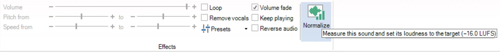{ width="720" loading=lazy }

QuizXpress mide el sonido y establece su ganancia de volumen de inmediato, sin abrir una ventana. Una barra bajo la cinta de opciones muestra el resultado, con un enlace ‘Undo’ para revertirlo:

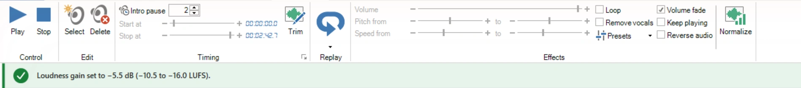{ width="720" loading=lazy }

### La propiedad Loudness gain

El resultado de la normalización se almacena en la propiedad ‘Loudness gain’ del sonido, en la sección ‘Audio’ del panel de propiedades. 0 dB deja el sonido sin cambios; el rango es de −30 a +20 dB. También puede ajustarla con precisión manualmente.

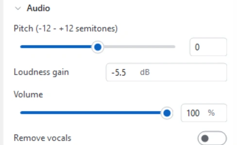{ width="250" loading=lazy }

La ganancia de volumen se suma al ‘Volume’ del sonido. A diferencia del volumen, que solo puede hacer que un sonido suene más bajo, la ganancia de volumen también puede hacer que un sonido suave suene más fuerte.

!!! tip
    Normalice después de recortar un sonido, porque la parte que se reproduce determina lo fuerte que suena. Si un sonido ya estaba normalizado y cambia su tiempo de inicio o de fin en el [editor de recorte](#recortar-un-sonido), QuizXpress mide la nueva parte y ajusta la ganancia de volumen automáticamente.

## Importación de listas de reproducción de Spotify ™

Puede importar sus listas de reproducción de Spotify (opcionalmente con la carátula del álbum y una vista previa de 30 segundos de las canciones) y crear sin esfuerzo un quiz de Trivia Music o un juego de Disco Bingo. QuizXpress no interactúa directamente con Spotify, pero admite un formato de archivo CSV generado por el sitio web [Exportify](https://watsonbox.github.io/exportify/). Para utilizar esta función, exporte su lista de reproducción a CSV con ese sitio e importe el archivo en QuizXpress. Aparecerá un formulario para que elija algunas opciones:

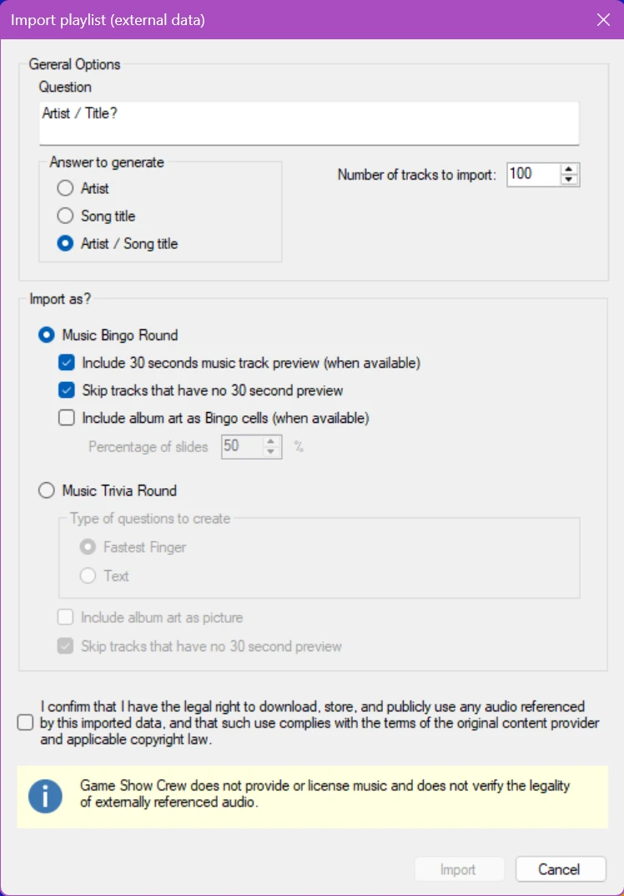{ width="224" loading=lazy }

Si creamos un juego de Bingo con estas opciones, obtenemos una mezcla de celdas con carátulas de álbum y texto de Artista/Título, como:

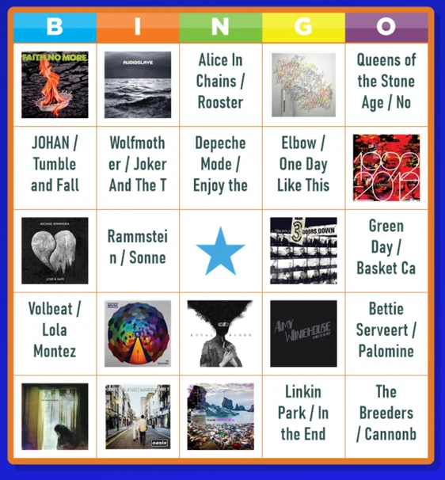{ loading=lazy }

Las diapositivas y los ajustes de juego creados pueden modificarse después de la importación.

## Aplicar efectos de sonido

Hay varios efectos posibles al reproducir sonidos:

- **Aumentar la velocidad del sonido**: se consigue dando el mismo valor a las propiedades ‘speed percentage’ y ‘target speed percentage’ del sonido en el Property Editor. Este valor debe ser superior a 100 para acelerar el sonido. Para mostrar las propiedades de un sonido, haga clic con el botón izquierdo en el icono de sonido en el área de diseño.

- **Reducir la velocidad del sonido**: se consigue dando a ambas propiedades mencionadas un valor inferior a 100. De nuevo, dé el mismo valor a ambas; verá por qué más abajo.

- **De velocidad lenta a velocidad normal**: para conseguirlo, introduzca un valor inferior a 100 en la propiedad ‘speed percentage’ del sonido. Así se garantiza que el sonido comience a reproducirse ralentizado. Deje sin cambios la propiedad ‘target speed percentage’; su valor predeterminado es 100, lo que significa velocidad normal. Como resultado, QuizXpress reproducirá el sonido lentamente al principio, pero a medida que pasa el tiempo alcanzará la velocidad objetivo de 100 (velocidad normal).

- **De velocidad rápida a velocidad normal**: para conseguirlo, seleccione un valor superior a 100 para la propiedad ‘speed percentage’. Deje sin cambios la propiedad ‘target speed percentage’.

- **Reverse**: reproduce el fragmento de sonido al revés, lo que desafía a los jugadores a reconocer la canción (marque la casilla Reverse audio en la cinta de opciones de sonido)

Puede escuchar estos efectos de sonido mientras crea la pregunta que contiene el sonido. Para escuchar el sonido y sus efectos, haga clic en el botón ‘Play’ de la cinta de opciones, o seleccione ‘Play’ en el menú contextual del sonido.

Si no desea que el sonido comience inmediatamente al empezar la pregunta, utilice la propiedad ‘Intro Pause’ del sonido para retrasar la reproducción (esto da a los participantes la oportunidad de leer primero la pregunta, o al presentador del quiz la oportunidad de leerla primero en voz alta).

!!! note

    otros sonidos, como los sonidos de los pulsadores, la música de fondo y la música de la cuenta atrás, pueden configurarse en Quiz Setup.*
