# Geluid

Geluidsfragmenten kunt u gebruiken voor vragen als “Wie schreef dit nummer?”, “Welke vogel zingt hier?” of “Wat is dit voor geluid?”. Om het spannend te maken kunt u de snelheid van het geluid tijdens het afspelen laten veranderen met de eigenschappen ‘Snelheid van’ (afspeelsnelheid in procenten aan het begin van het geluid) en ‘Doel sneldheid’ (afspeelsnelheid aan het einde van het geluidsfragment). Op dezelfde manier kunt u de toonhoogte van het geluid laten variëren.

## Een geluidsbestand invoegen

Om een geluidsfragment aan een quizdia toe te voegen, selecteert u het lint-tabblad INVOEGEN en klikt u op de knop ‘Audio’. Kies vervolgens een mp3- of wav-bestand en geef aan of u het bestand wilt koppelen of insluiten:

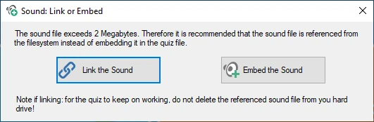{ width="321" loading=lazy }

Koppelen levert kleinere, beter beheersbare quizbestanden op, maar u moet er dan voor zorgen dat alle externe bestanden bereikbaar blijven, op hun oorspronkelijke pad of in de map waarin het quizbestand staat. U kunt de bestanden ook extern laten en uw quiz [inpakken](../other-functionality/packing-and-unpacking-a-quiz.md) voordat u hem verspreidt. Bij het inpakken kunnen geluiden ook worden ingekort tot het deel dat wordt afgespeeld en worden gecomprimeerd.

Zodra het bestand is ingevoegd, wordt het contextuele lint-tabblad AUDIO zichtbaar, waarmee u de verschillende opties instelt.

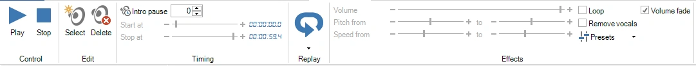{ width="720" loading=lazy }

## Een geluid bijsnijden

Meestal wilt u maar een deel van een nummer of opname afspelen: het refrein, de intro of alleen die paar seconden die het antwoord verraden. De bijsnij-editor toont het geluid als een golfvorm, zodat u kunt zien waar de muziek begint, waar het luid wordt en waar het wegsterft, en het af te spelen deel kiest door ernaar te luisteren.

De bijsnij-editor wijzigt het geluidsbestand zelf niet. Hij stelt alleen de begin- en eindtijd van het geluid in, zodat u altijd terug kunt naar het hele nummer.

### De bijsnij-editor openen

Selecteer het geluidspictogram op de dia en gebruik een van deze mogelijkheden:

- Klik op de knop ‘Bijsnijden’ in de groep ‘Timing en snelheid’ op het lint-tabblad AUDIO, naast de begin- en stoptijden. Het kleine pijltje rechtsonder in de groep ‘Timing en snelheid’ opent dezelfde editor.

    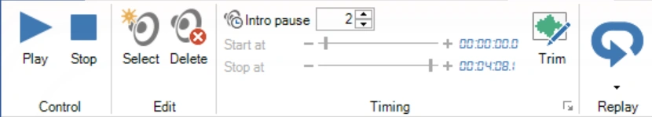{ width="420" loading=lazy }

- Klik met de rechtermuisknop op het geluidspictogram op de dia en kies ‘Geluid bijsnijden...’.

    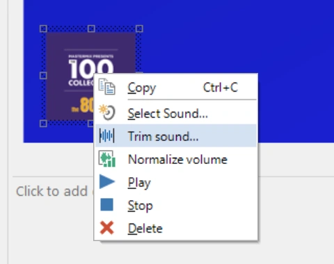{ width="240" loading=lazy }

!!! note
    U kunt Spotify-nummers en MIDI-bestanden niet bijsnijden, en ook geen gekoppeld geluidsbestand dat niet kan worden gevonden. De knop ‘Bijsnijden’ is voor deze bestanden grijs.

### Het af te spelen deel kiezen

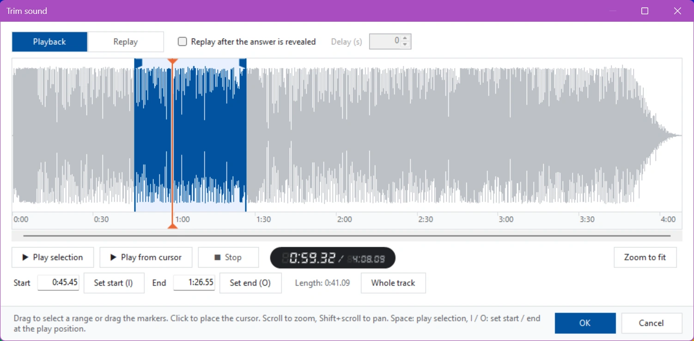{ loading=lazy }

Het deel dat wordt afgespeeld is blauw gemarkeerd. U wijzigt het als volgt:

- **Sleep over de golfvorm** om een nieuw deel te selecteren, of sleep de markeringen aan het begin en einde van de selectie.
- **Typ de tijden** in de vakken ‘Begin’ en ‘Einde’. U kunt seconden (`75`), minuten en seconden (`1:15`) of uren, minuten en seconden (`0:01:15`) invoeren, desgewenst met decimalen (`1:15.5`). ‘Lengte’ toont hoe lang het geselecteerde deel duurt.
- **Stel het begin of einde in terwijl u luistert**: klik op ‘Begin zetten (I)’ of ‘Einde zetten (O)’, of druk op I of O op het toetsenbord, precies op het moment dat u de juiste plek hoort. Als er geen geluid speelt, gebruiken deze knoppen de positie van de cursor.
- **‘Hele nummer’** selecteert opnieuw het volledige geluid.

Klik ergens in de golfvorm om de cursor (de oranje lijn) te plaatsen.

Om te luisteren:

- ‘Selectie afspelen’ (of de spatiebalk) speelt het geselecteerde deel af. Druk nogmaals op de spatiebalk om te stoppen.
- ‘Afspelen vanaf cursor’ speelt af vanaf de cursor tot het einde van het geluid.
- Terwijl het geluid speelt, klikt u op de golfvorm om naar die plek te springen.

Het venstertje naast de knoppen toont de huidige positie en de totale lengte van het geluid.

Voor nauwkeurig werk zoomt u in met het muiswiel en gebruikt u Shift + muiswiel of de schuifbalk onder de golfvorm om naar links en rechts te gaan. ‘Passend zoomen’ toont opnieuw het hele geluid.

Klik op ‘OK’ om de nieuwe begin- en eindtijd toe te passen, of op ‘Annuleren’ om het geluid te laten zoals het was. U kunt een bijsnijding in één stap ongedaan maken met Ongedaan maken. Als u [het volume van het geluid hebt genormaliseerd](#het-volume-normaliseren), meet QuizXpress het nieuwe deel opnieuw, zodat het even luid blijft.

### Het herhalingsdeel instellen

In dezelfde editor kiest u het deel dat opnieuw wordt afgespeeld nadat het antwoord is getoond (zie [Herhaling](#herhaling) hieronder). Vaak is dat een ander deel van het nummer dan het deel dat tijdens de vraag wordt gespeeld, bijvoorbeeld het refrein.

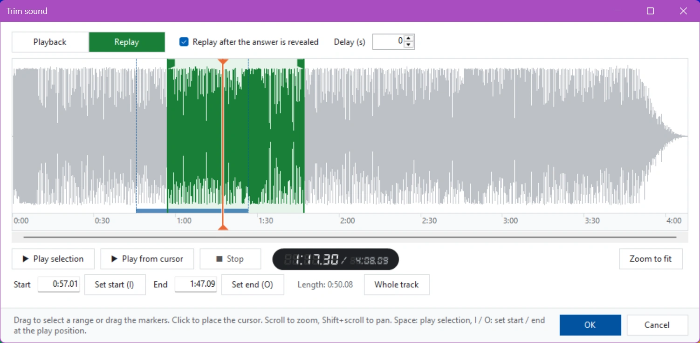{ loading=lazy }

1. Vink ‘Herhalen nadat het antwoord is getoond’ aan. De editor schakelt over naar ‘Herhaling’ en de selectie wordt groen.
2. Selecteer het herhalingsdeel op dezelfde manier als hierboven beschreven.
3. Voer eventueel een ‘Vertraging (s)’ in: het aantal seconden dat moet worden gewacht nadat het antwoord is getoond voordat de herhaling begint.

Met de knoppen ‘Afspelen’ en ‘Herhaling’ linksboven schakelt u tussen de twee delen. Het deel dat u niet bewerkt, wordt als balk onderaan de golfvorm getoond (blauw voor afspelen, groen voor herhaling), zodat u kunt zien hoe de twee zich tot elkaar verhouden.

!!! note
    Herhaling is niet beschikbaar wanneer de optie ‘Blijf spelen’ van het geluid aan staat, omdat het geluid dan nooit stopt.

## Herhaling

Vaak wilt u (een deel van) de muziek opnieuw afspelen nadat de vraag is afgelopen, gesynchroniseerd met het tonen van het juiste antwoord op de dia. Dat doet u door de herhalingsfunctie voor audio in te schakelen:

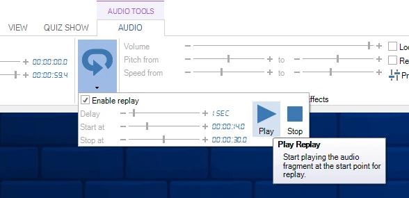{ width="576" loading=lazy }

U kunt een begin-vertraging, de starttijd van het nummer en de eindtijd instellen. De eenvoudigste manier om het herhalingsdeel te kiezen is op de golfvorm in de bijsnij-editor; zie [Het herhalingsdeel instellen](#het-herhalingsdeel-instellen).

## Het volume normaliseren

Nummers en geluidsfragmenten uit verschillende bronnen zijn zelden even luid: een oude opname of een klassiek stuk kan veel zachter zijn dan een moderne popsong, zodat spelers moeite hebben om de ene vraag te horen en door de volgende worden overstelpt. Volumenormalisatie lost dit op. QuizXpress meet hoe luid elk geluid werkelijk is en past het aan zodat alle geluiden even luid klinken, in Quiz Studio en tijdens de show.

Normalisatie wijzigt de geluidsbestanden niet. Het stelt de ‘Luidheidscorrectie’ van het geluid in (zie [hieronder](#de-eigenschap-luidheidscorrectie)), zodat u het altijd kunt aanpassen of ongedaan maken. Alleen het deel van het geluid dat wordt afgespeeld wordt gemeten: het deel tussen de begin- en eindtijd.

U kunt alle geluiden in de quiz tegelijk normaliseren, of één enkel geluid.

### Alle geluiden in de quiz

Klik op ‘Volume normaliseren’ in de groep ‘Tools’ op het lint-tabblad START.

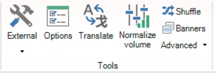{ width="220" loading=lazy }

Het venster ‘Geluidsvolume normaliseren’ wordt geopend en begint meteen met het meten van alle geluiden in de quiz. Lange nummers duren een paar seconden per stuk.

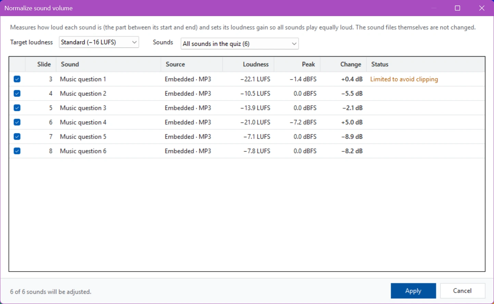{ loading=lazy }

Bij elk geluid ziet u:

- **Dia** en **Geluid**: waar het geluid staat en wat het is (de bestandsnaam, of de vraagtekst bij een ingesloten geluid).
- **Bron**: of het geluid in de quiz is ingesloten of gekoppeld, en het bestandstype.
- **Luidheid**: hoe luid het geluid is, in LUFS (Loudness Units relative to Full Scale, de maat die streamingdiensten en omroepen gebruiken). Dichter bij 0 is luider: −8 LUFS is een luide popsong, −22 LUFS een rustige opname.
- **Piek**: het luidste moment in het geluid, in dBFS. 0 dBFS is het luidste dat een geluidsbestand kan bevatten.
- **Wijziging**: hoeveel QuizXpress het geluid harder (+) of zachter (−) zet, in dB.
- **Status**: alles wat het vermelden waard is over het geluid (zie de tabel hieronder).

Kies de ‘Doelluidheid’:

| Doel | Gebruik het wanneer |
|---|---|
| Standaard (−16 LUFS) | De standaardinstelling. Ongeveer even luid als muziek op streamingdiensten. |
| Zachter (−18 LUFS) | U wat meer speelruimte wilt, bijvoorbeeld wanneer geluiden over achtergrondmuziek heen worden gespeeld. |
| Omroep (−23 LUFS) | U het niveau van Europese tv en radio (EBU R128) wilt. Merkbaar zachter; zet de geluidsinstallatie harder om dit te compenseren. |

Als u het doel wijzigt, wordt de kolom ‘Wijziging’ meteen bijgewerkt; de geluiden worden niet opnieuw gemeten. Quiz Studio onthoudt het gekozen doel en gebruikt het ook om afzonderlijke geluiden te normaliseren.

Als u vóór het openen van het venster enkele dia’s hebt geselecteerd, kunt u in de lijst ‘Geluiden’ kiezen tussen ‘Alle geluiden in de quiz’ en ‘Geluiden op de geselecteerde dia’s’.

Alle geluiden die zullen veranderen zijn aangevinkt. Haal het vinkje weg bij een geluid om het ongewijzigd te laten. De regel onderaan toont hoeveel geluiden worden aangepast. Klik op ‘Toepassen’ om de nieuwe luidheidscorrecties in te stellen. U kunt de hele normalisatie in één stap ongedaan maken met Ongedaan maken.

| Status | Betekenis |
|---|---|
| Beperkt om vervorming te voorkomen | Het geluid is zacht maar heeft al luide pieken. QuizXpress zet het alleen zo ver harder als kan zonder vervorming (pieken blijven onder −1 dBFS), dus het kan iets zachter blijven dan de andere. |
| Al op doelniveau | Het geluid heeft al de doelluidheid en wordt niet gewijzigd. |
| Stil | Er is geen geluid in het deel dat wordt afgespeeld (controleer de begin- en eindtijd). |
| Overgeslagen: MIDI bevat geen audio om te meten | MIDI-bestanden kunnen niet worden gemeten en behouden hun volume. |
| Overgeslagen: Spotify-nummer | Spotify-nummers kunnen niet worden gemeten en behouden hun volume. |
| Geluidsbestand ontbreekt | Een gekoppeld geluidsbestand kan niet worden gevonden. [Herstel de koppeling](../other-functionality/fixing-broken-links.md) en probeer het opnieuw. |

### Eén enkel geluid

Om slechts één geluid te normaliseren, bijvoorbeeld nadat u het hebt vervangen, selecteert u het geluidspictogram op de dia en klikt u op ‘Normaliseren’ in de groep ‘Effecten’ op het lint-tabblad AUDIO, of klikt u met de rechtermuisknop op het geluidspictogram en kiest u ‘Volume normaliseren’. De knopinfo van de knop toont de doelluidheid die wordt gebruikt: de doelluidheid die u het laatst in het venster ‘Geluidsvolume normaliseren’ hebt gekozen.

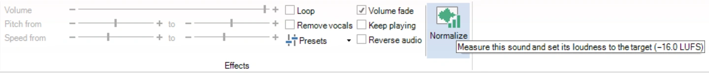{ width="720" loading=lazy }

QuizXpress meet het geluid en stelt de luidheidscorrectie meteen in, zonder een venster te openen. Een balk onder het lint toont het resultaat, met een link ‘Ongedaan maken’ om het terug te draaien:

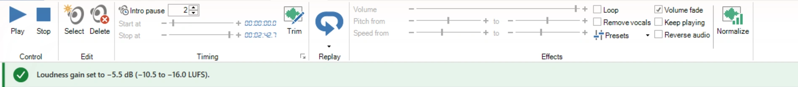{ width="720" loading=lazy }

### De eigenschap Luidheidscorrectie

Het resultaat van de normalisatie wordt opgeslagen in de eigenschap ‘Luidheidscorrectie’ van het geluid, in de sectie ‘Audio’ van het eigenschappenpaneel. 0 dB laat het geluid ongewijzigd; het bereik is −30 tot +20 dB. U kunt de waarde ook met de hand verfijnen.

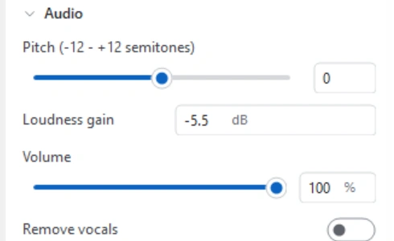{ width="250" loading=lazy }

De luidheidscorrectie komt bovenop het ‘Volume’ van het geluid. Anders dan het volume, dat een geluid alleen zachter kan maken, kan de luidheidscorrectie een zacht geluid ook luider maken.

!!! tip
    Normaliseer nadat u een geluid hebt bijgesneden, omdat het deel dat wordt afgespeeld bepaalt hoe luid het is. Als een geluid al was genormaliseerd en u de begin- of eindtijd wijzigt in de [bijsnij-editor](#een-geluid-bijsnijden), meet QuizXpress het nieuwe deel en past de luidheidscorrectie automatisch aan.

## Spotify ™ afspeellijst importeren

U kunt uw Spotify-afspeellijsten importeren (eventueel met albumhoezen en een voorbeeld van 30 seconden van de nummers) en zo moeiteloos een Trivia Music-quiz of een Disco Bingo-spel maken. QuizXpress communiceert niet rechtstreeks met Spotify, maar ondersteunt een CSV-bestandsindeling die wordt gemaakt door de website [Exportify](https://watsonbox.github.io/exportify/). Om deze functie te gebruiken exporteert u uw afspeellijst met die site naar CSV en importeert u het bestand in QuizXpress. Er verschijnt een formulier waarin u enkele keuzes maakt:

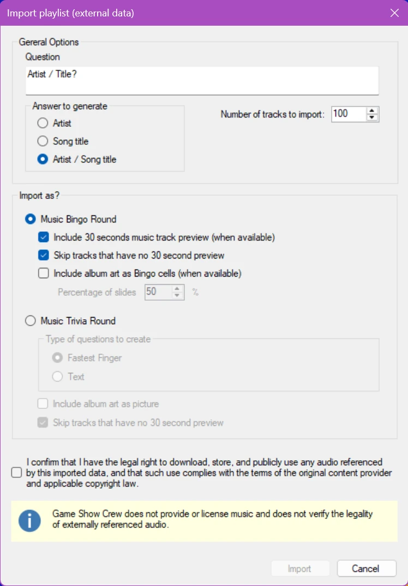{ width="224" loading=lazy }

Als we met deze opties een Bingo-spel maken, krijgen we een mix van cellen met albumhoezen en tekst met artiest/titel, zoals:

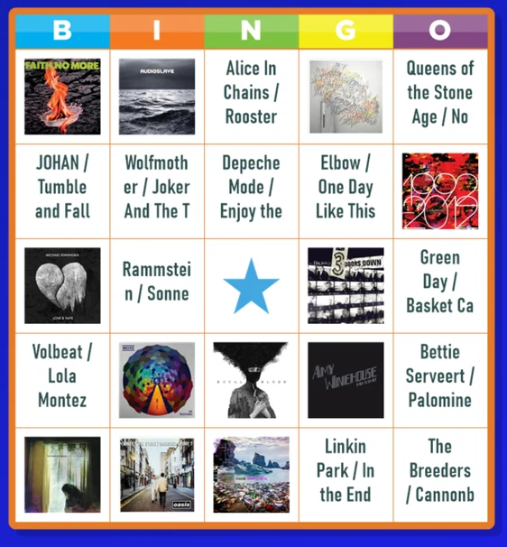{ loading=lazy }

De gemaakte dia’s en spelinstellingen kunt u na het importeren nog aanpassen.

## Geluidseffecten toepassen

Bij het afspelen van geluiden zijn diverse effecten mogelijk:

- **Geluid sneller afspelen** – dit doet u door de eigenschappen ‘snelheidspercentage’ en ‘doelsnelheidspercentage’ van het geluid in de eigenschappeneditor dezelfde waarde te geven. Deze waarde moet groter zijn dan 100 om het geluid te versnellen. Om de eigenschappen van een geluid te tonen, klikt u met de linkermuisknop op het geluidspictogram in het ontwerpgebied.

- **Geluid langzamer afspelen** – dit doet u door beide hierboven genoemde eigenschappen een waarde kleiner dan 100 te geven. Geef ook hier beide eigenschappen dezelfde waarde; hieronder ziet u waarom.

- **Van langzaam naar normaal tempo** – voer hiervoor een waarde kleiner dan 100 in bij de eigenschap ‘snelheidspercentage’ van het geluid. Zo begint het geluid vertraagd te spelen. Laat de eigenschap ‘doelsnelheidspercentage’ ongewijzigd; de standaardwaarde is 100, wat normale snelheid betekent. Als gevolg hiervan speelt QuizXpress het geluid eerst langzaam af, maar na verloop van tijd bereikt het de doelsnelheid van 100 (normale snelheid).

- **Van snel naar normaal tempo** – kies hiervoor een waarde groter dan 100 voor de eigenschap ‘snelheidspercentage’. Laat de eigenschap ‘doelsnelheidspercentage’ ongewijzigd.

- **Omgekeerd** – speelt het geluidsfragment achterstevoren af, zodat de spelers het nummer moeten herkennen (vink het selectievakje Audio omkeren aan in het geluidslint)

U kunt naar deze geluidseffecten luisteren terwijl u de vraag met het geluid maakt. Om naar het geluid en de effecten te luisteren, klikt u op de knop ‘Afspelen’ in het lint, of kiest u ‘Afspelen’ in het contextmenu van het geluid.

Als u niet wilt dat het geluid meteen begint zodra de vraag start, gebruikt u de eigenschap ‘Intro Pauze’ van het geluid om het afspelen uit te stellen (zo kunnen deelnemers de vraag eerst lezen, of kan de quizmaster de vraag eerst voorlezen).

!!! note

    andere geluiden, zoals de buzzergeluiden, achtergrondmuziek en aftelmuziek, kunt u instellen in Quiz Setup.*
