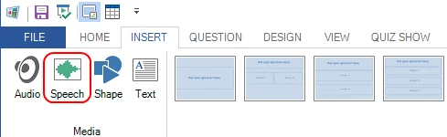
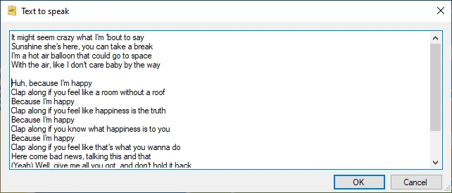
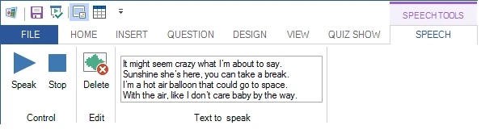

# Sintesi vocale

È possibile aggiungere la sintesi vocale alle diapositive del quiz. QuizXpress utilizza il sintetizzatore vocale di Windows per leggere ad alta voce i testi specificati. Ad esempio, si può creare una domanda in cui viene letto ad alta voce il testo di una canzone e il pubblico deve indovinare l'artista o il brano.

Per inserire un elemento vocale, selezionare la scheda della barra multifunzione INSERT e fare clic sul pulsante ‘Speech’:

{ width="428" loading=lazy }

Successivamente sarà possibile inserire il testo da pronunciare:

{ width="425" loading=lazy }

Dopo aver creato l'elemento vocale, è possibile modificarlo utilizzando i controlli nella scheda contestuale della barra multifunzione.

{ width="595" loading=lazy }
