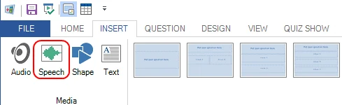
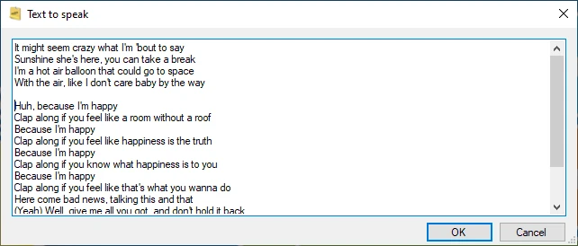
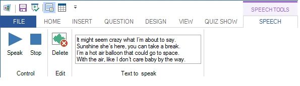

# Spraak

U kunt computerspraak aan uw quizdia’s toevoegen. QuizXpress gebruikt de spraaksynthesizer van Windows om tekst die u opgeeft hardop voor te lezen. U kunt bijvoorbeeld een vraag maken waarbij songteksten worden voorgelezen en het publiek de artiest of het nummer moet raden.

Om een spraakitem in te voegen, selecteert u het lint-tabblad INVOEGEN en klikt u op de knop ‘Spraak’:

{ width="428" loading=lazy }

Vervolgens kunt u de tekst invoeren die moet worden uitgesproken:

{ width="425" loading=lazy }

Nadat het spraakitem is gemaakt, kunt u het wijzigen met de knoppen op het contextuele lint-tabblad.

{ width="595" loading=lazy }
