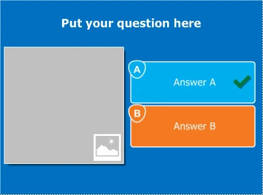
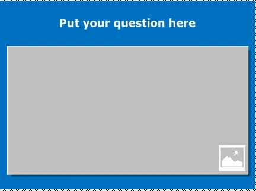
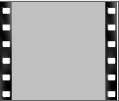
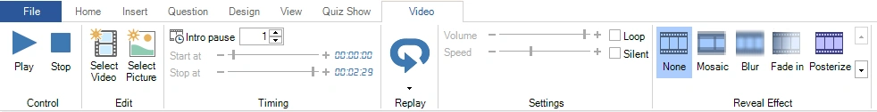
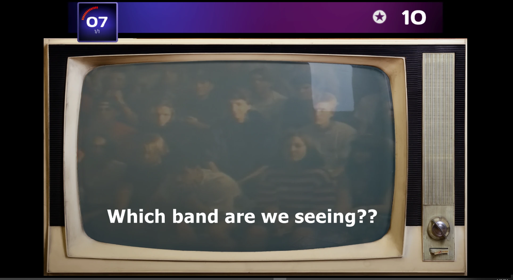
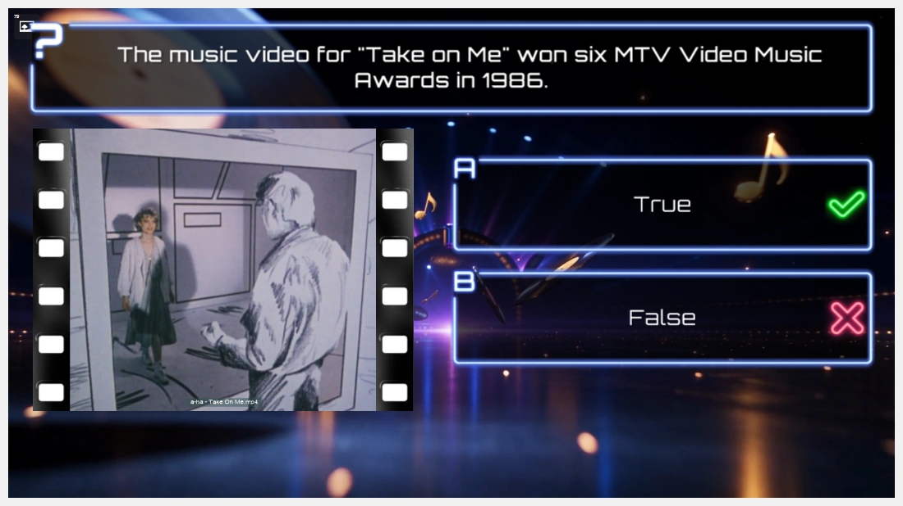

# Video

QuizXpress también admite el uso de fragmentos de vídeo. Los fragmentos de vídeo pueden utilizarse en preguntas, pero también, por ejemplo, para comunicar un mensaje de marketing a su público. Existe un formato de diapositiva especial de ‘vídeo a pantalla completa’ que reproduce el vídeo seleccionado a pantalla completa durante el programa.

QuizXpress admite varios formatos de archivo, pero para reproducir correctamente los archivos de vídeo es necesario que esté instalado en su sistema el CODEC de vídeo adecuado (un componente de Windows utilizado para transmitir un formato de vídeo concreto). El instalador de QuizXpress añade a su sistema el paquete de códecs LAV. La última versión de ese paquete de CODEC se puede encontrar aquí: <https://github.com/Nevcairiel/LAVFilters/releases>

## Insertar un vídeo

Para añadir un vídeo a una pregunta, primero cree una nueva pregunta con una plantilla que tenga un marcador de posición de imagen/vídeo.

| { width="163" loading=lazy } | { width="161" loading=lazy } | { loading=lazy } | Esta última plantilla muestra el vídeo en modo de pantalla completa. ¡También puede utilizarla para mostrar material promocional de su empresa entre las preguntas! |
|-------------------------------------------------------------------------------|---------------------------------------------------------------------------------|-------------------------------|-----------------------------------------------------------------------------------------------------------------------------------------------------|

A continuación, haga clic con el botón derecho en el marcador de posición del cuadro de imagen y haga clic en ‘Select Video’ en el menú contextual. Se abre un cuadro de diálogo de archivo en el que puede seleccionar un fragmento de vídeo *(\*.avi, \*.wmv, \*.mov, \*.mp4, \*.mpg, \*.mpeg, \*.flv, \*.3gp, \*.webm*).

Al igual que el audio, un vídeo puede vincularse o incrustarse. Incrustar un fragmento de vídeo en un quiz significa que el fragmento se incorpora al archivo del quiz. Vincular un fragmento de vídeo significa que se crea una referencia desde el archivo del quiz a un vídeo del sistema de archivos. En general, se recomienda *vincular* los vídeos mientras todavía está editando el quiz. Cuando termine de editar, puede utilizar la [función ‘Pack’](../other-functionality/packing-and-unpacking-a-quiz.md) para combinar todos los archivos vinculados externamente en un único archivo de quiz grande (máx. 2 GB). El empaquetado también puede recortar los vídeos a la parte que se reproduce y comprimirlos, lo que mantiene pequeño el archivo empaquetado. Con este archivo combinado, es fácil trasladar su quiz a otro ordenador sin tener que preocuparse por los recursos externos.

!!! note

    al vincular vídeos, asegúrese de no eliminarlos de su sistema de archivos. Al copiar el quiz a otro ordenador, los vídeos deben copiarse en la misma carpeta que el archivo del quiz para que QuizXpress pueda localizarlos.*

El contenido de vídeo incrustado no puede superar los 30 MB. En general, procure que sus vídeos sean lo más pequeños posible: si su pregunta dura solo treinta segundos, tiene poco sentido insertar un vídeo de cuatro minutos. En ese caso, utilice una herramienta de edición de vídeo para recortarlo.

## Editar las propiedades del vídeo

Al seleccionar un vídeo, se hace visible la pestaña contextual de la cinta de opciones para vídeo:

{ loading=lazy }

Desde aquí puede previsualizar el vídeo, establecer los marcadores de inicio y fin, ajustar el volumen y cambiar la velocidad de reproducción (tenga en cuenta que cambiar la velocidad de reproducción puede no funcionar con todos los tipos de vídeo y depende de los CODEC utilizados). También puede configurar un efecto que cambie con el tiempo. Por ejemplo, puede utilizar el efecto Mosaic para mostrar el vídeo totalmente pixelado al principio y revelar gradualmente los detalles mientras formula a su público una pregunta sobre el vídeo, con puntos decrecientes. También puede reproducir el vídeo en modo silencioso y repetir el fragmento en bucle hasta que termine la pregunta. Con ‘Select Picture’, puede volver a convertir el elemento de la diapositiva en una imagen estática.

Con Replay, puede activar la repetición de una parte del vídeo una vez finalizada la pregunta (cuando se revela la respuesta correcta).

## Vídeo de fondo

Un vídeo también puede reproducirse detrás de toda la diapositiva, como fondo. Un vídeo de fondo de este tipo no se coloca en un marcador de posición: haga clic con el botón derecho en el fondo de la diapositiva y elija ‘Background video…’, o establezca la propiedad ‘Background video’ de la diapositiva. Un vídeo de fondo se repite en bucle y se reproduce sin sonido de forma predeterminada. Consulte [Vídeo de fondo](../backgrounds.md#video-de-fondo) para ver todos sus ajustes.

En la captura de pantalla siguiente, un vídeo de fondo se combina con una forma superpuesta para crear un efecto de televisor antiguo (se coloca una forma con una pantalla transparente encima del vídeo de fondo).

{ loading=lazy }

!!! note
    Las versiones anteriores tenían una casilla ‘Background’ para un vídeo en un marcador de posición. Esa casilla ya no existe: un vídeo de fondo tiene ahora su propio lugar detrás de la diapositiva. Los vídeos de fondo de los quizzes creados con una versión anterior se convierten automáticamente al abrir el quiz.

## Combinar un vídeo de fondo con un vídeo en un marcador de posición

Como el vídeo de fondo no utiliza un marcador de posición, una diapositiva puede tener ambos: un vídeo de fondo que se reproduce detrás de la diapositiva y un vídeo (o imagen) en su marcador de posición, que se reproduce encima. Por ejemplo, utilice una animación de estudio en bucle como vídeo de fondo y el fragmento de película de la pregunta en el marcador de posición.

{ loading=lazy }

Cada uno de los dos vídeos conserva sus propios ajustes. El vídeo del marcador de posición comienza después de su pausa de introducción y siempre se pausa y se reanuda junto con el quiz. El vídeo de fondo comienza en cuanto aparece la diapositiva y, a menos que active ‘Sync with quiz’, sigue reproduciéndose. Deje el vídeo de fondo en silencio (el valor predeterminado) para que su sonido no se mezcle con el del vídeo del marcador de posición.
