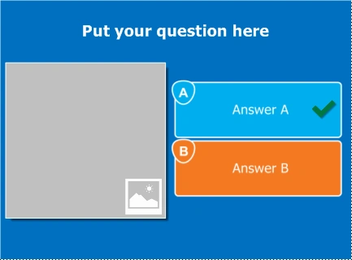
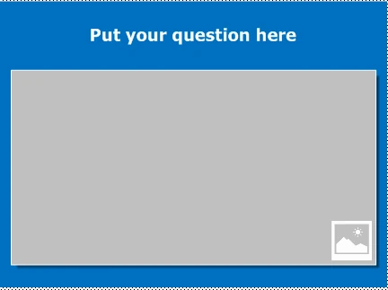
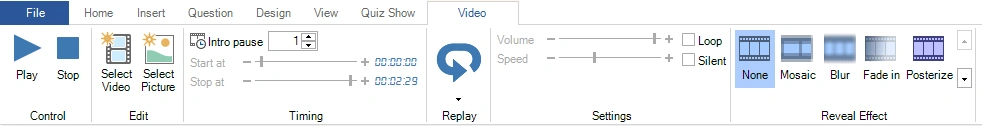
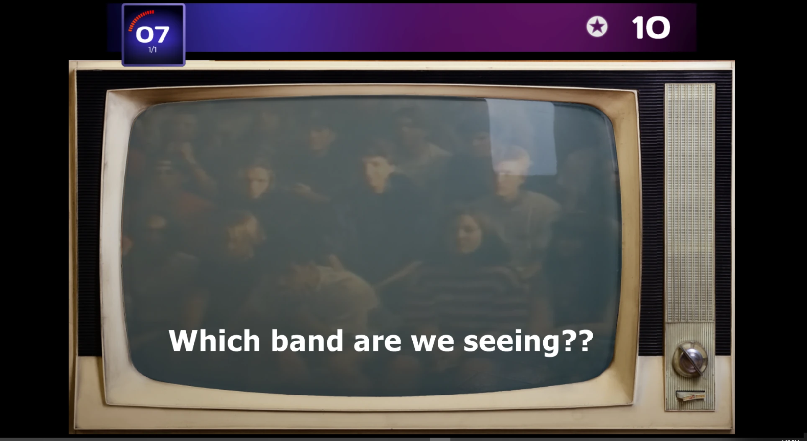
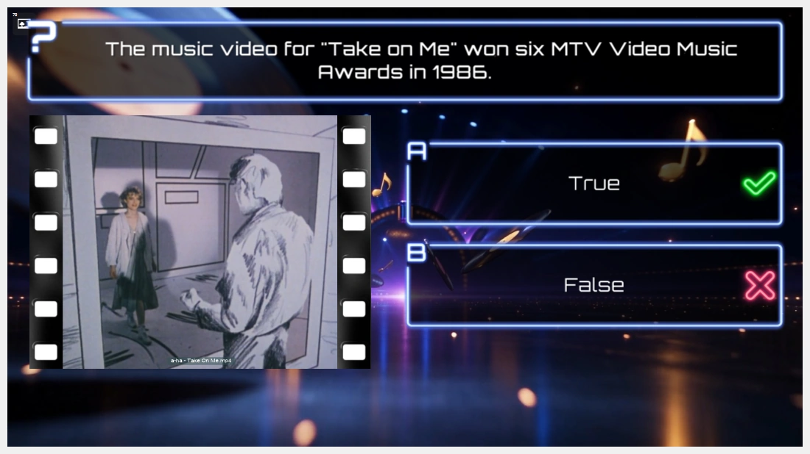

# Video

QuizXpress ondersteunt ook videofragmenten. Videofragmenten kunt u gebruiken in vragen, maar bijvoorbeeld ook om een marketingboodschap aan uw publiek over te brengen. Er is een speciale dia-indeling ‘volledig scherm video’ die de gekozen video tijdens de quizshow op het volledige scherm afspeelt.

QuizXpress ondersteunt diverse bestandsindelingen, maar om videobestanden goed af te spelen moet de juiste videocodec (een Windows-component waarmee een bepaalde video-indeling wordt gestreamd) op uw systeem zijn geïnstalleerd. Het QuizXpress-installatieprogramma voegt het LAV Codec-pakket aan uw systeem toe. De nieuwste versie van dat codecpakket vindt u hier: <https://github.com/Nevcairiel/LAVFilters/releases>

## Een video invoegen

Om een video aan een vraag toe te voegen, maakt u eerst een nieuwe vraag met een sjabloon met één plaatshouder voor afbeelding/video.

| { width="163" loading=lazy } | { width="161" loading=lazy } | { loading=lazy } | Dit laatste sjabloon toont de video op het volledige scherm. U kunt het ook gebruiken om tussen de vragen door promotiemateriaal over uw bedrijf te tonen! |
|-------------------------------------------------------------------------------|---------------------------------------------------------------------------------|-------------------------------|-----------------------------------------------------------------------------------------------------------------------------------------------------|

Klik vervolgens met de rechtermuisknop op de plaatshouder van het afbeeldingsvak en klik in het contextmenu op ‘Selecteer video’. Dit opent een bestandsdialoogvenster waarin u een videofragment kunt kiezen *(\*.avi, \*.wmv, \*.mov, \*.mp4, \*.mpg, \*.mpeg, \*.flv, \*.3gp, \*.webm*).

Net als audio kan een video worden gekoppeld of ingesloten. Een videofragment insluiten in een quiz betekent dat het fragment in het quizbestand wordt opgenomen. Een videofragment koppelen betekent dat het quizbestand verwijst naar een video op het bestandssysteem. Over het algemeen wordt *koppelen* aanbevolen zolang u de quiz nog bewerkt. Als u klaar bent met bewerken, kunt u de [functie ‘Inpakken’](../other-functionality/packing-and-unpacking-a-quiz.md) gebruiken om alle extern gekoppelde bestanden samen te voegen tot één groot quizbestand (max. 2 GB). Bij het inpakken kunnen video’s ook worden bijgesneden tot het deel dat wordt afgespeeld en worden gecomprimeerd, waardoor het ingepakte bestand klein blijft. Met dit gecombineerde bestand verplaatst u uw quiz eenvoudig naar een andere computer, zonder dat u zich zorgen hoeft te maken over de externe bestanden.

!!! note

    zorg er bij het koppelen van video’s voor dat u de video’s niet van uw bestandssysteem verwijdert. Als u de quiz naar een andere computer kopieert, moeten de video’s in dezelfde map worden gezet als het quizbestand, zodat QuizXpress ze kan vinden.*

Ingesloten videocontent mag niet groter zijn dan 30 MB. Probeer uw video’s over het algemeen zo klein mogelijk te houden: als uw vraag maar dertig seconden duurt, heeft het weinig zin een video van vier minuten in te voegen. Knip de video in dat geval bij met een videobewerkingsprogramma.

## Video-eigenschappen bewerken

Wanneer u een video selecteert, wordt het contextuele lint-tabblad voor video zichtbaar:

{ loading=lazy }

Hier kunt u een voorbeeld van de video bekijken, de begin- en eindmarkeringen instellen, het volume instellen en de afspeelsnelheid wijzigen (let op: het wijzigen van de afspeelsnelheid werkt mogelijk niet voor alle videotypen en hangt af van de gebruikte codecs). U kunt ook een effect instellen dat in de loop van de tijd verandert. U kunt bijvoorbeeld het effect Mozaïek gebruiken om de video aan het begin volledig gepixeld te tonen en de details geleidelijk te onthullen terwijl u uw publiek een vraag over de video stelt, met aflopende punten. U kunt de video ook zonder geluid afspelen en het fragment herhalen tot de vraag eindigt. Met ‘Selecteer afbeelding’ wijzigt u het diaelement weer in een statische afbeelding.

Met Herhaling kunt u inschakelen dat een deel van de video opnieuw wordt afgespeeld nadat de vraag is afgelopen (wanneer het juiste antwoord wordt getoond).

## Video op de achtergrond

Een video kan ook achter de hele dia worden afgespeeld, als achtergrond. Zo’n achtergrondvideo staat niet in een plaatshouder: klik met de rechtermuisknop op de achtergrond van de dia en kies ‘Achtergrondvideo…’, of stel de eigenschap ‘Achtergrondvideo’ van de dia in. Een achtergrondvideo wordt standaard herhaald en zonder geluid afgespeeld. Zie [Achtergrondvideo](../backgrounds.md#achtergrondvideo) voor alle instellingen.

In de onderstaande schermafbeelding wordt een achtergrondvideo gecombineerd met een overlay-vorm voor een ouderwets tv-effect (een vorm met een transparant scherm wordt boven op de achtergrondvideo geplaatst).

{ loading=lazy }

!!! note
    Eerdere versies hadden een selectievakje ‘Achtergrond’ voor een video in een plaatshouder. Dat vakje is verdwenen: een achtergrondvideo heeft nu een eigen plek achter de dia. Achtergrondvideo’s in quizzen die met een eerdere versie zijn gemaakt, worden automatisch geconverteerd wanneer u de quiz opent.

## Een achtergrondvideo combineren met een video in een plaatshouder

Omdat de achtergrondvideo geen plaatshouder gebruikt, kan een dia beide hebben: een achtergrondvideo die achter de dia speelt en een video (of afbeelding) in de plaatshouder, die er bovenop speelt. Gebruik bijvoorbeeld een zich herhalende studio-animatie als achtergrondvideo en het filmfragment van de vraag in de plaatshouder.

{ loading=lazy }

De twee video’s behouden elk hun eigen instellingen. De video in de plaatshouder start na de intropauze en pauzeert en hervat altijd samen met de quiz. De achtergrondvideo start zodra de dia verschijnt en blijft doorspelen, tenzij u ‘Synchroniseren met quiz’ inschakelt. Laat de achtergrondvideo stil (de standaardinstelling), zodat het geluid niet vermengd raakt met het geluid van de video in de plaatshouder.
