# Word Game

Un élément Word Game est un élément graphique permettant de créer des questions autour de mots et de phrases. Lorsque vous insérez un Word Game, la fenêtre suivante apparaît :

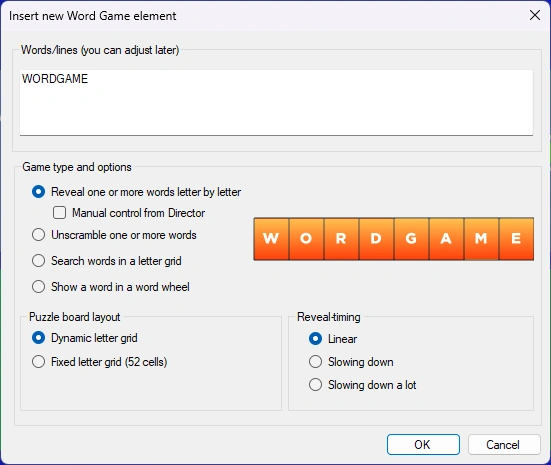{ width="320" loading=lazy }.

Vous y saisissez le texte à afficher et sélectionnez le type de jeu ainsi que les options associées.

Il existe quatre jeux différents :

| *Word Reveal* (présenté ici au format de grille fixe de 52 lettres). Les lettres apparaissent au fil du temps, en partant d’une grille vide | 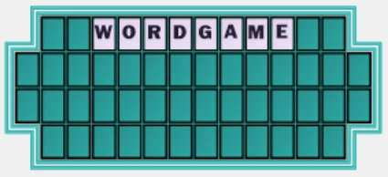{ width="279" loading=lazy } |
|--------------------------------------------------------------------------------------------------------------------------------|---------------------------------------------------------------------------------|
| *Word Scramble* (anagramme). Le mot ou la phrase se remet en ordre au fil du temps                                             | { width="388" loading=lazy } |
| *Letter Grid. Les mots sont cachés dans une grille de lettres aléatoire. Lorsque la question est terminée, les mots sont mis en évidence.* | 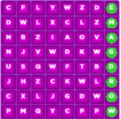{ width="122" loading=lazy }  |
| *Word Wheel. Le mot est présenté sous forme de roue (éventuellement tournante). Une lettre est retirée au hasard et placée au centre.* | 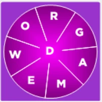{ width="126" loading=lazy } |

Word Reveal et Word Scramble peuvent tous deux être présentés visuellement sous forme de grille classique sur plusieurs lignes (grille de lettres dynamique) ou sur un tableau fixe de 52 cases (comme dans le jeu télévisé La Roue de la fortune©). Notez que pour ces deux éléments, c’est à vous de répartir la phrase sur plusieurs lignes en appuyant sur Entrée pour passer à la ligne suivante.

Avec Word Reveal, vous pouvez choisir de contrôler manuellement la révélation depuis QuizXpress Director. Lorsque le quiz est lancé, l’onglet ‘Reveal Word Game’ s’affiche alors dans QuizXpress Director dès que la diapositive est affichée. Vous pouvez y révéler manuellement une lettre citée par un joueur en appuyant sur le bouton correspondant, ou bien révéler une voyelle, une consonne, un mot ou la phrase entière (all).

Si la lettre fait partie de la phrase, elle est révélée dans le lecteur de quiz. Après avoir appuyé sur une lettre, Director indique aussi si elle figure dans la phrase (lettre verte) ou non (lettre rouge).

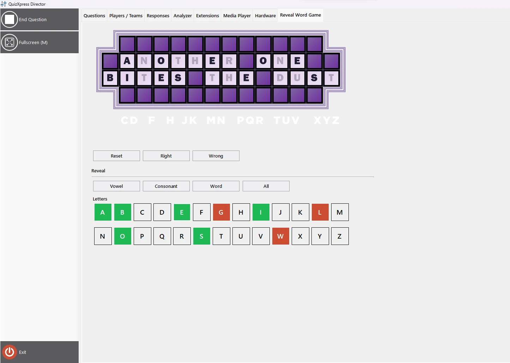{ loading=lazy }

Si un joueur tente de deviner le mot, vous pouvez le juger en appuyant sur le bouton juste ou faux, après quoi une grande coche verte ou une croix rouge apparaît à l’écran du lecteur de quiz pour le public.

Le lecteur de quiz affiche la grille de lettres avec les lettres révélées. Il peut aussi afficher un aperçu des lettres qui n’ont pas encore été choisies (en activant l’option ‘Show alphabet strip’ dans les propriétés avancées de QuizXpress Studio).

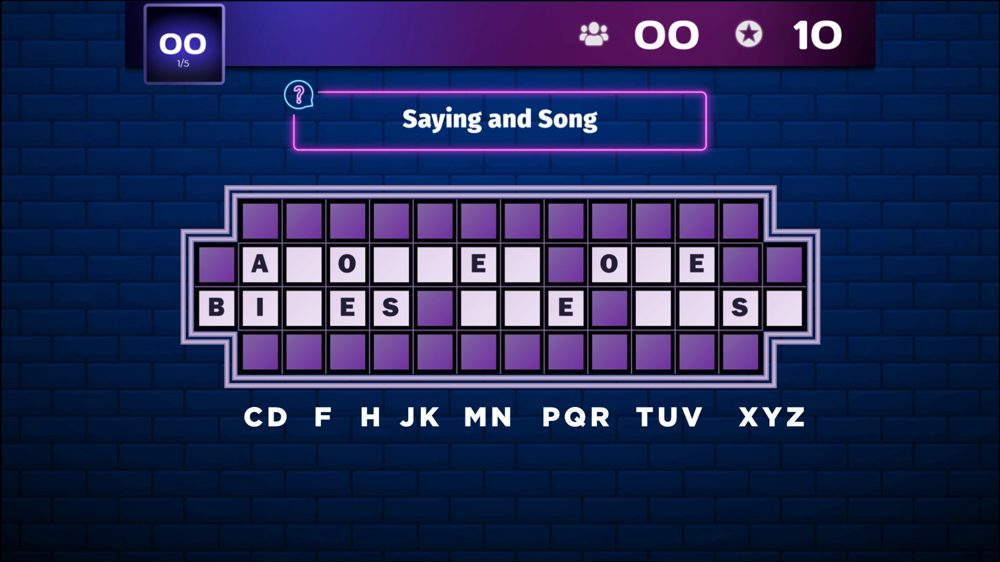{ loading=lazy }

Le mode manuel permet aussi d’acheter des voyelles et de gagner ou perdre des points en devinant des consonnes. Les paramètres de score pour les voyelles et les consonnes peuvent être configurés dans QuizXpress Studio après avoir sélectionné l’élément Word Game sur la diapositive.

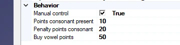{ width="359" loading=lazy }

Le joueur qui jouera au jeu peut être sélectionné pendant le quiz dans QuizXpress Director, dans l’onglet Reveal Word game.

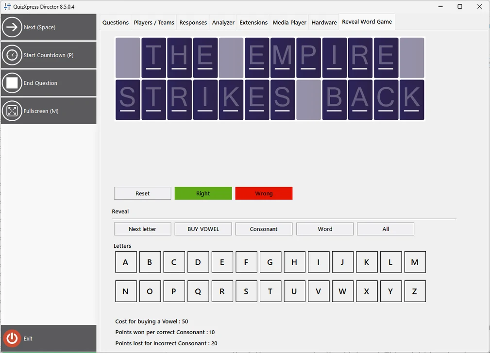{ width="505" loading=lazy }

Les points gagnés ou perdus sont affichés dans le lecteur de quiz.

| { loading=lazy } | 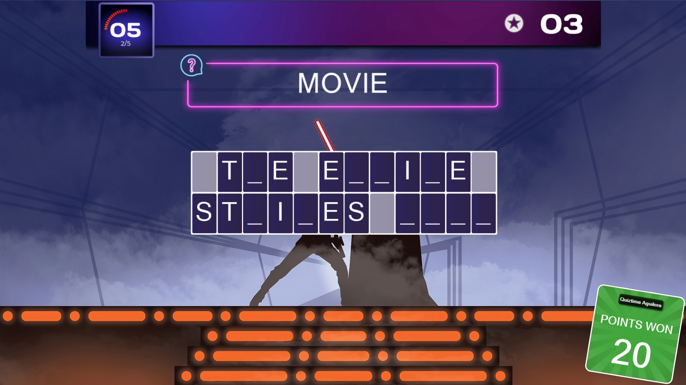{ loading=lazy } | 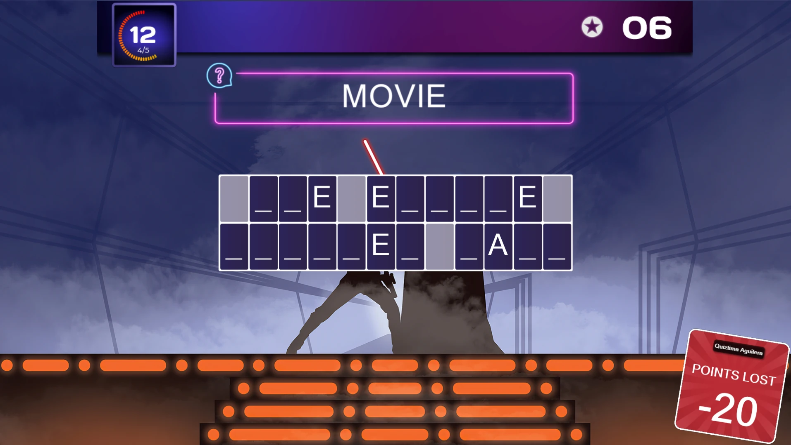{ loading=lazy } |
|---------------------------------------------------------------------------------|---------------------------------------------------------------------------------|---------------------------------------------------------------------------------|
| **Achat d’une voyelle**                                                         | **Consonne correcte**                                                           | **Consonne incorrecte**                                                         |

Pour les jeux automatiques Word Reveal et Word Scramble, vous pouvez configurer le rythme de révélation ou de remise en ordre. Par défaut, chaque étape dure le même temps, ce qui signifie que, pour le jeu de révélation, les lettres apparaissent à intervalle fixe. Cela peut convenir pour un seul mot, mais pour une phrase plus longue, vous préférerez peut-être un autre schéma, par exemple en montrant plus de lettres au début puis en ralentissant. Vous pouvez choisir l’option de votre choix dans la section ‘Reveal timing’.

Une fois l’élément Word Game inséré dans votre diapositive, vous pouvez le configurer plus en détail : cliquez sur l’élément Word Game, puis modifiez ses paramètres dans le ruban Word Game en haut de Studio, ou dans la grille des propriétés avancées affichée à droite de QuizXpress Studio.

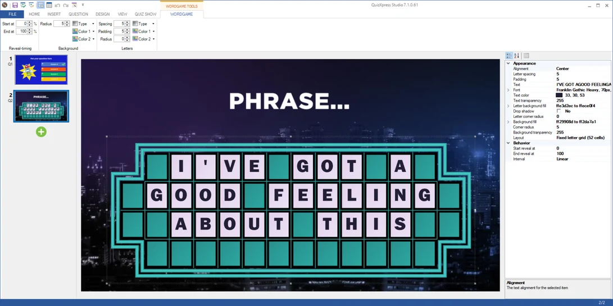{ loading=lazy }

Vous pouvez utiliser cet élément pour différents types de questions. Par exemple, une question de type fastest finger où le joueur qui buzze devine la phrase correcte à partir des lettres révélées jusque-là, ou nomme une lettre à révéler puis tente de deviner la phrase. Vous pouvez aussi utiliser une question à réponse en texte libre avec QuizXpress mobile, où tous les joueurs peuvent saisir la bonne réponse. En combinant cela avec des points dégressifs, les joueurs les plus rapides obtiennent plus de points. Vous pouvez également donner son tour à chaque joueur et lui faire gagner des points en mode de révélation manuelle combiné aux points. La couleur, la police, la taille des lettres, les marges, etc. peuvent tous être modifiés dans le ruban ou dans la grille des propriétés avancées.

L’élément Word Game respecte la propriété ‘Show correct answer’ de la diapositive. Lorsqu’elle est réglée sur ‘Do not show’, le Word Game ne révèle pas la bonne réponse à la fin de la question. Lorsqu’elle est réglée sur ‘Global’ (valeur par défaut), le Word Game suit le paramètre ‘Show correct answer on quiz slides’ de Quiz Setup.
