# Woordspel

Een woordspelelement is een grafisch element om vragen rond woorden en zinnen te maken. Wanneer u een woordspel invoegt, verschijnt het volgende venster:

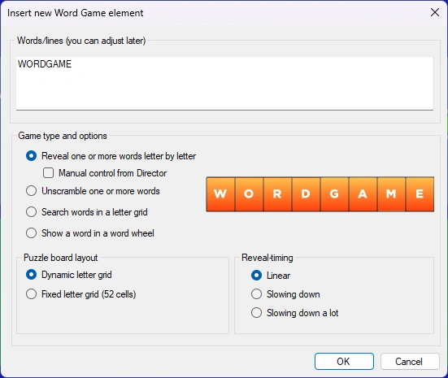{ width="320" loading=lazy }.

Hier voert u de weer te geven tekst in en kiest u het type spel en eventuele bijbehorende opties.

Er zijn vier verschillende spellen:

| *Woord onthullen* (hier getoond in het vaste 52-letterraster). De letters verschijnen na verloop van tijd, te beginnen met een leeg raster | 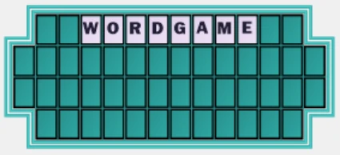{ width="279" loading=lazy } |
|--------------------------------------------------------------------------------------------------------------------------------|---------------------------------------------------------------------------------|
| *Woord scramble* (anagram). Het woord of de zin wordt na verloop van tijd ontward                                              | { width="388" loading=lazy } |
| *Letterraster. De woorden zijn verstopt in een willekeurig letterraster. Als de vraag voorbij is, worden de woorden gemarkeerd.* | 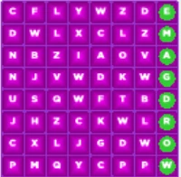{ width="122" loading=lazy }  |
| *Woordenwiel. Het woord wordt getoond als een (eventueel draaiend) wiel. Eén letter wordt willekeurig verwijderd en in het midden geplaatst.* | 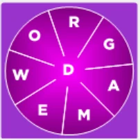{ width="126" loading=lazy } |

Zowel Woord onthullen als Woord scramble kunnen visueel worden weergegeven als een gewoon raster met meerdere regels (dynamisch letterraster) of op een vast letterbord met 52 cellen (zoals te zien in de tv-quiz Wheel of Fortune©). Let op: bij deze twee elementen bepaalt u zelf hoe de zin over meerdere regels wordt verdeeld, door op Enter te drukken om naar de volgende regel te gaan.

Bij Woord onthullen kunt u ervoor kiezen het onthullen handmatig te bedienen vanuit QuizXpress Director. Tijdens een quizshow verschijnt dan het tabblad ‘Woordspel onthullen’ in QuizXpress Director zodra de dia wordt getoond. Hier kunt u een letter die een speler noemt handmatig onthullen door op de bijbehorende knop te drukken, of een klinker, medeklinker, woord of de hele zin (alles) onthullen.

Als de letter deel uitmaakt van de zin, wordt hij onthuld in de quizspeler. Nadat u op een letter hebt gedrukt, toont Director ook of die in de zin voorkomt (groene letter) of niet (rode letter).

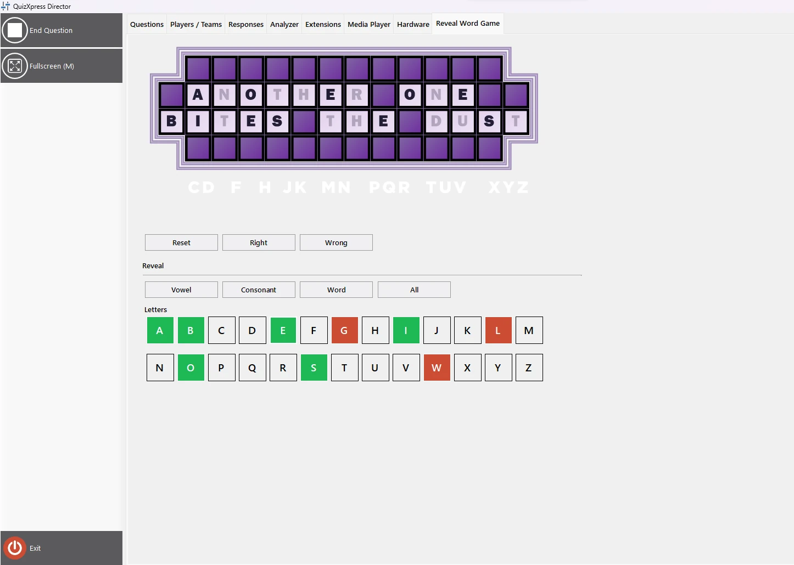{ loading=lazy }

Als een speler het woord probeert te raden, kunt u dat beoordelen door op de knop juist of onjuist te drukken, waarna een groot groen vinkje of rood kruis op het scherm van de quizspeler verschijnt voor het publiek.

De quizspeler toont het letterraster met de onthulde letters. Hij kan ook een overzicht tonen van de letters die nog niet zijn gekozen (door de optie ‘Laat alfabetstrook zien’ in te schakelen in de geavanceerde eigenschappen in QuizXpress Studio).

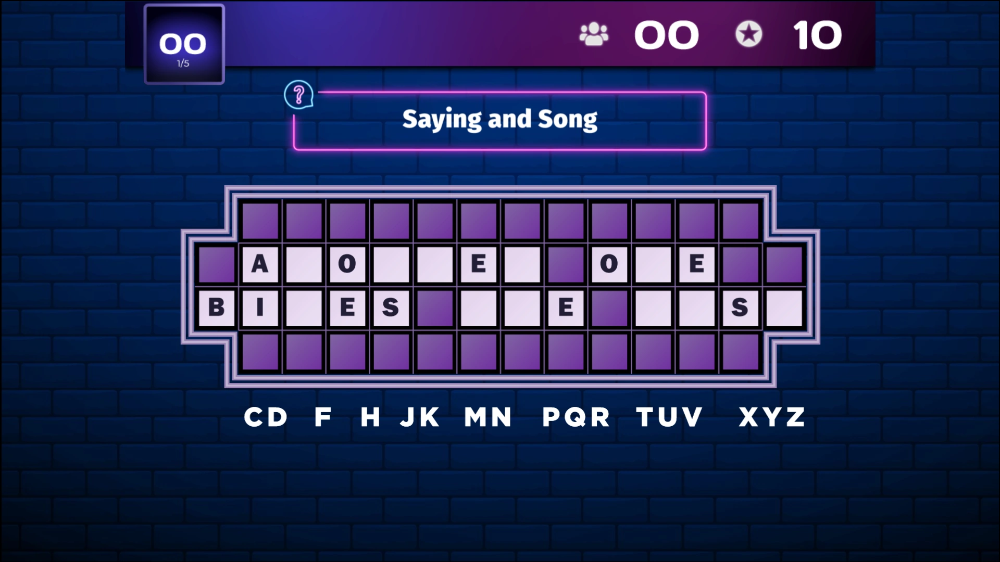{ loading=lazy }

De handmatige modus ondersteunt ook het kopen van klinkers en het winnen of verliezen van punten voor het raden van medeklinkers. De scoreinstellingen voor klinkers en medeklinkers kunt u configureren in QuizXpress Studio nadat u het woordspelelement op de dia hebt geselecteerd.

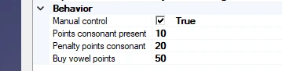{ width="359" loading=lazy }

De speler die het spel speelt, kunt u tijdens de quiz kiezen in QuizXpress Director op het tabblad Woordspel onthullen.

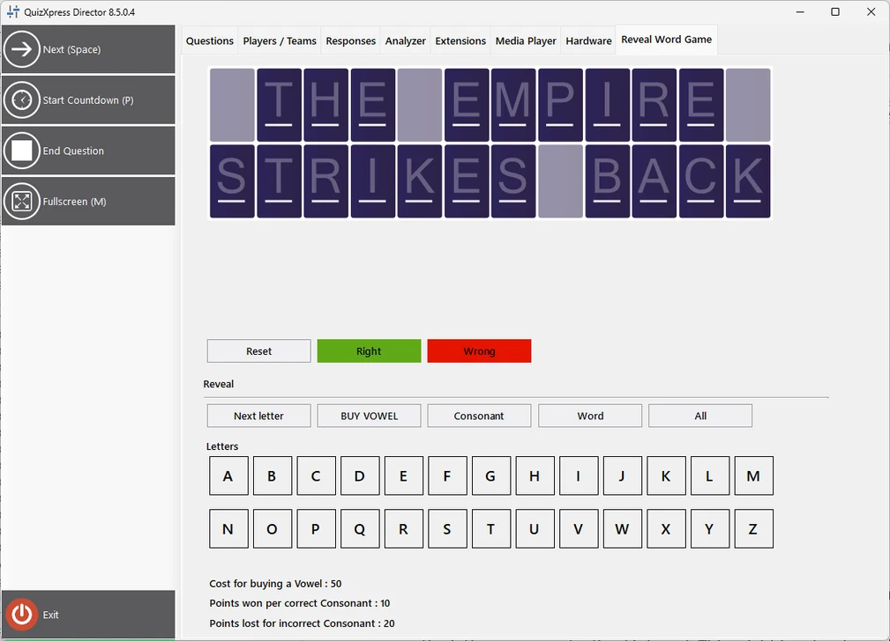{ width="505" loading=lazy }

Gewonnen of verloren punten worden getoond in de quizspeler.

| 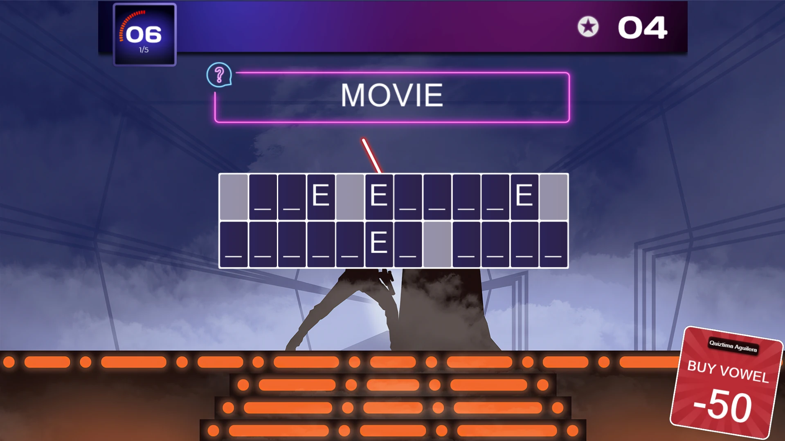{ loading=lazy } | 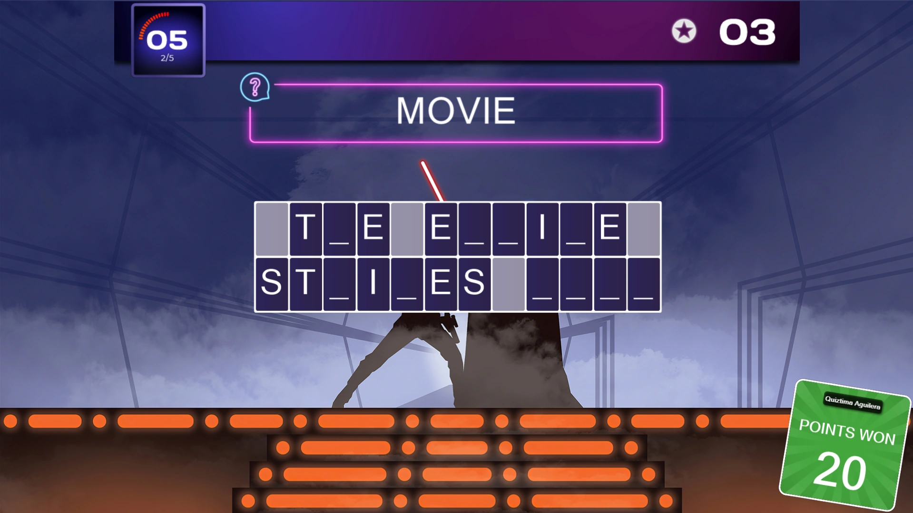{ loading=lazy } | { loading=lazy } |
|---------------------------------------------------------------------------------|---------------------------------------------------------------------------------|---------------------------------------------------------------------------------|
| **Klinker kopen**                                                               | **Juiste medeklinker**                                                          | **Onjuiste medeklinker**                                                        |

Voor het automatische Woord onthullen en Woord scramble kunt u de timing van het onthullen/ontwarren instellen. Standaard kost elke stap evenveel tijd, wat bij het onthulspel betekent dat de letters met een vast interval verschijnen. Dat is misschien prima voor één woord, maar bij een langere zin wilt u wellicht een ander schema gebruiken, bijvoorbeeld eerst meer letters tonen en daarna vertragen. U kiest uw voorkeur in de sectie ‘Onthulling-timing’.

Zodra een woordspelelement op uw dia is ingevoegd, kunt u het verder configureren: klik op het woordspelelement en wijzig de instellingen in het lint Woordspel bovenaan Studio, of in het geavanceerde eigenschappenraster rechts in QuizXpress Studio.

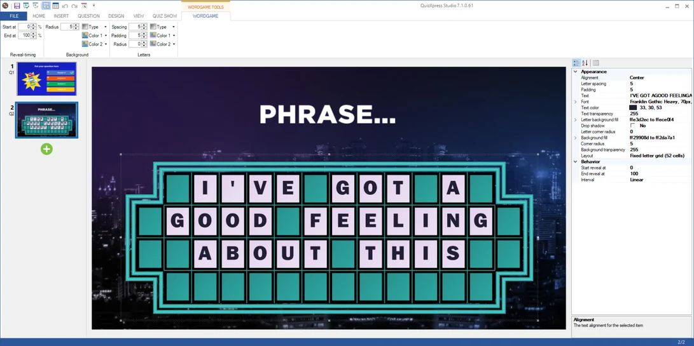{ loading=lazy }

U kunt dit element voor verschillende soorten vragen gebruiken. Bijvoorbeeld een snelste-drukkervraag waarbij de speler die als eerste buzzt de juiste zin raadt op basis van de tot dan toe onthulde letters, of een letter noemt die wordt onthuld en daarna de zin probeert te raden. Of u kunt een vraag met een volledig tekstantwoord gebruiken met QuizXpress mobile, waarbij alle spelers het juiste antwoord kunnen typen. Combineert u dit met aflopende punten, dan krijgen snellere spelers meer punten. U kunt ook elke speler een beurt geven en punten laten winnen met de handmatige onthulmodus in combinatie met punten. De kleur, het lettertype, de lettergrootte, de opvulling enzovoort zijn allemaal te bewerken in het lint of het geavanceerde eigenschappenraster.

Het woordspelelement volgt de eigenschap ‘Toon correct antwoord’ van de dia. Als deze op ‘Niet tonen’ staat, onthult het woordspel het juiste antwoord niet wanneer de vraag eindigt. Als deze op ‘Globale instelling’ staat (de standaardwaarde), volgt het woordspel de instelling ‘Toon het goede antwoord na de vraag’ uit Quiz Setup.
