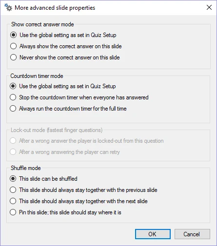

# Proprietà avanzate della diapositiva

In questa finestra di dialogo è possibile configurare alcune proprietà più avanzate per la domanda corrente:

{ width="177" loading=lazy }

**Show correct answer mode**

Impostazione che indica se la risposta corretta debba essere mostrata al termine della domanda. Per impostazione predefinita viene utilizzata l'impostazione definita in QuizXpress Setup.

**Countdown timer mode**

Impostazione che indica come debba comportarsi il conto alla rovescia per questa domanda. Per impostazione predefinita viene utilizzata l'impostazione definita in QuizXpress Setup.

**Lock-out mode for fastest finger question**

Normalmente un giocatore che fornisce una risposta errata viene escluso dalla domanda. Con questa impostazione è possibile modificare tale comportamento in modo che i giocatori possano riprovare con una risposta diversa. Disponibile solo se la diapositiva è di tipo Dito più Veloce.

**Shuffle mode**

QuizXpress consente di mescolare le domande di un quiz quando viene giocato in QuizXpress Live! Poiché potrebbe essere necessario mantenere alcune diapositive al loro posto (ad esempio i Billboard che annunciano i round) oppure mantenerle abbinate alla diapositiva precedente o successiva (ad esempio quando le informazioni di una diapositiva riguardano la diapositiva successiva o precedente, oppure per le puntate), questa impostazione offre proprio questo supporto. Indica che cosa deve accadere alla diapositiva quando QuizXpress Live seleziona un sottoinsieme mescolato delle domande del file del quiz (configurato in Quiz Setup, dove è possibile scegliere di rendere casuale una percentuale delle domande). Questa impostazione è utile quando si desidera eseguire più volte lo stesso quiz, ad esempio a una fiera. Nota: queste opzioni sono accessibili anche dalla griglia delle proprietà (a livello di diapositiva).
