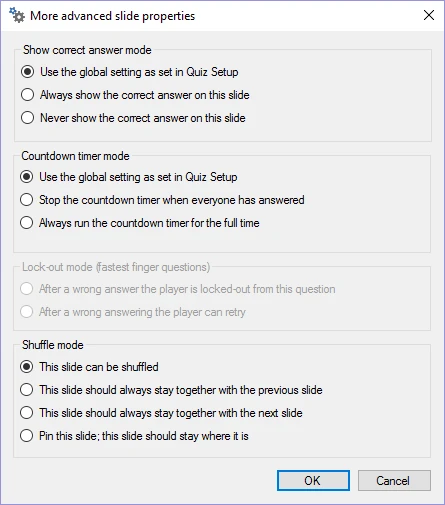

# Geavanceerde diaeigenschappen

In dit dialoogvenster kunt u enkele meer geavanceerde eigenschappen voor de huidige vraag instellen:

{ width="177" loading=lazy }

**Instelling voor tonen goede antwoord**

Instelling die aangeeft of het juiste antwoord moet worden getoond nadat de vraag is afgelopen. Standaard wordt de instelling gebruikt die in QuizXpress Setup is gedefinieerd.

**Countdown timer instelling**

Instelling die aangeeft hoe de afteltimer zich voor deze vraag moet gedragen. Standaard wordt de instelling gebruikt die in QuizXpress Setup is gedefinieerd.

**Instelling voor uitsluiting (snelste drukker vraag)**

Normaal gesproken wordt een speler die een fout antwoord geeft, van de vraag uitgesloten. Met deze instelling kunt u dat gedrag wijzigen, zodat spelers het opnieuw kunnen proberen met een ander antwoord. Alleen beschikbaar als de dia een snelste-drukkerdia is.

**Shuffle instelling**

QuizXpress kan de vragen in een quiz door elkaar husselen wanneer deze in QuizXpress Live! wordt gespeeld. Omdat u sommige dia’s misschien op hun plaats wilt houden (bijvoorbeeld billboards die rondes aankondigen) of gekoppeld wilt houden aan een voorgaande of volgende dia (bijvoorbeeld wanneer informatie op een dia geldt voor de volgende of vorige dia, of bij weddenschappen), biedt deze instelling daarvoor ondersteuning. Ze geeft aan wat er met de dia moet gebeuren wanneer QuizXpress Live! een gehusselde deelverzameling van de vragen in het quizbestand kiest (te configureren in Quiz Setup, waar u kunt kiezen om een percentage van de vragen willekeurig te maken). Deze instelling is handig wanneer u dezelfde quiz meerdere keren wilt spelen, bijvoorbeeld op een beurs. Let op: deze opties zijn ook bereikbaar via het eigenschappenraster (op dianiveau).
