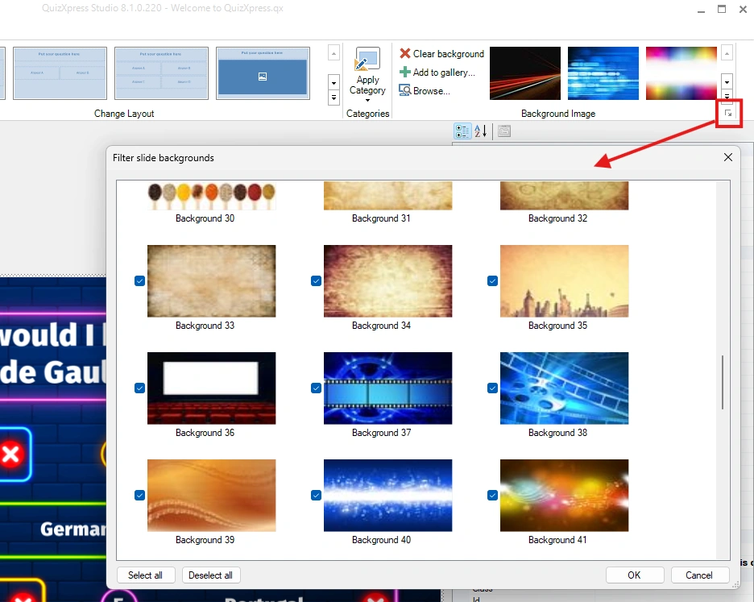
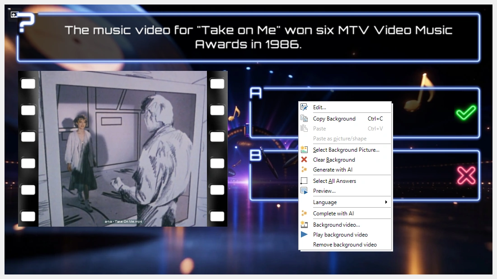
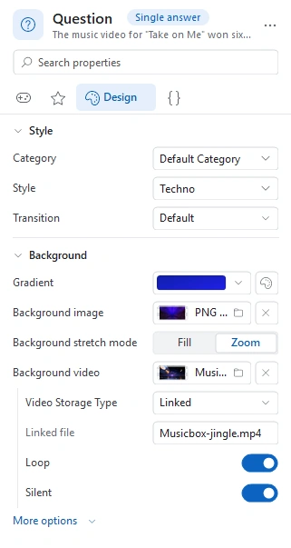

# Sfondi

Ogni stile di QuizXpress ha uno sfondo. È possibile cambiare lo sfondo di una diapositiva (anche dopo aver selezionato uno stile) facendo clic con il pulsante destro del mouse sulla diapositiva e scegliendo ‘Select background picture…’.

In alternativa, è possibile scegliere un'immagine di sfondo dalla galleria degli sfondi nella sezione Background Image della barra multifunzione Design. È anche possibile aggiungere i propri sfondi alla galleria.

Come per gli stili, è possibile organizzare meglio l'area di lavoro filtrando gli sfondi che non si utilizzano. Si accede al filtro tramite il pulsante di avvio della finestra di dialogo (« dialog launcher ») nella sezione Background Image della barra multifunzione Design.

{ width="466" loading=lazy }

## Video di sfondo

Invece di un'immagine fissa, una diapositiva può avere anche un video in riproduzione dietro di essa: nuvole in movimento, un conto alla rovescia, un'animazione in loop con i propri colori. La domanda, le risposte e tutto il resto della diapositiva rimangono sopra il video.

Per aggiungerne uno, fare clic con il pulsante destro del mouse sullo sfondo della diapositiva e scegliere ‘Background video…’, quindi selezionare un file video. È anche possibile impostarlo nel pannello delle proprietà: selezionare la diapositiva e fare clic sulla proprietà ‘Background video’ nella sezione Background della pagina Design. Se si selezionano più diapositive e si imposta la proprietà, tutte ricevono lo stesso video di sfondo; il video viene memorizzato una sola volta nel file del quiz.

{ loading=lazy }

Nell'editor la diapositiva mostra il primo fotogramma del video, con una piccola icona video nell'angolo in alto a sinistra, così da poter vedere quali diapositive hanno un video di sfondo. Per vederlo in movimento, fare clic con il pulsante destro del mouse sullo sfondo e scegliere ‘Play background video’ (e ‘Stop background video’ per fermarlo). Anche l'anteprima (F5) lo riproduce.

Un video di sfondo non occupa un segnaposto immagine/video, quindi è comunque possibile inserire nella stessa diapositiva un'immagine o un [video in un segnaposto](adding-multimedia-content/video.md#combinare-un-video-di-sfondo-con-un-video-in-un-segnaposto); viene riprodotto sopra il video di sfondo.

Quando una diapositiva ha un video di sfondo, sotto la proprietà ‘Background video’ compaiono le seguenti impostazioni:

{ width="322" loading=lazy }

| Property           | Description                                                                                                                                                                                                 |
|--------------------|-------------------------------------------------------------------------------------------------------------------------------------------------------------------------------------------------------------|
| Video storage type | Embedded (il video è memorizzato nel file del quiz) oppure linked (il quiz fa riferimento al file video su disco). Vedere [Video](adding-multimedia-content/video.md#inserire-un-video) per sapere quando usare l'uno o l'altro. |
| Linked file        | Il nome del file video, per un video collegato                                                                                                                                                              |
| Loop               | Riavvia il video al termine. Attivo per impostazione predefinita.                                                                                                                                           |
| Silent             | Riproduce il video senza audio. Attivo per impostazione predefinita, in modo che il video di sfondo non interferisca con i suoni delle domande.                                                             |
| Sync with quiz     | Mette in pausa il video quando una squadra prenota la risposta con il buzzer, il conto alla rovescia viene messo in pausa o la domanda termina, e lo riprende quando la domanda prosegue. Disattivato per impostazione predefinita: il video continua semplicemente a essere riprodotto. (Sotto ‘More options’.) |

Per rimuovere il video di sfondo, fare clic con il pulsante destro del mouse sullo sfondo della diapositiva e scegliere ‘Remove background video’.

!!! tip
    Assegnando un video di sfondo a una [categoria](using-categories.md), ogni diapositiva formattata con quella categoria lo riceve a sua volta.

Durante il quiz, il video di sfondo parte non appena compare la diapositiva. Mantenere i video di sfondo brevi e leggeri: di solito basta un loop di pochi secondi in HD.
