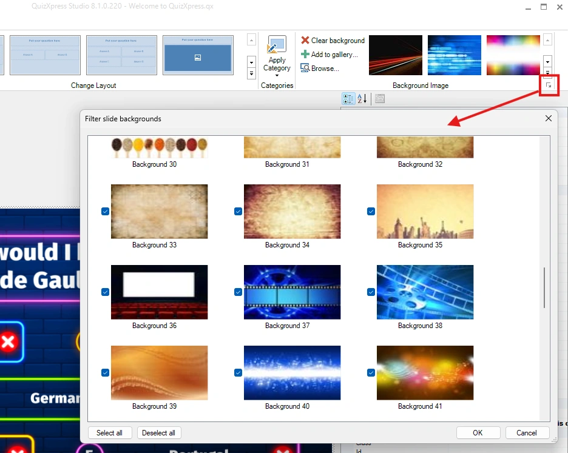
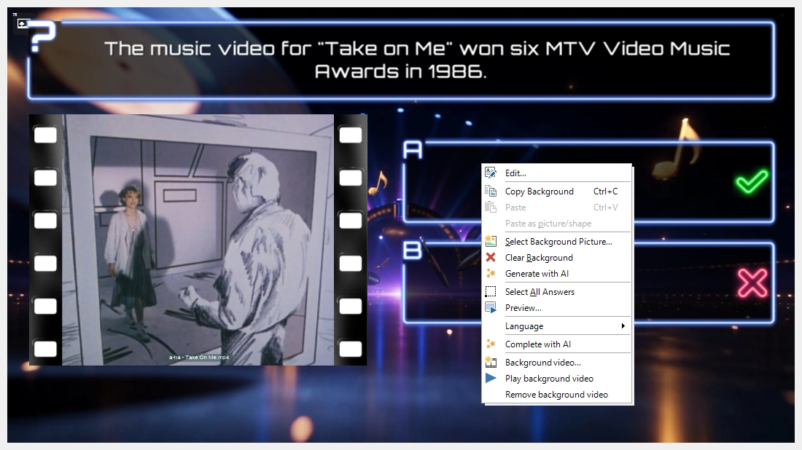
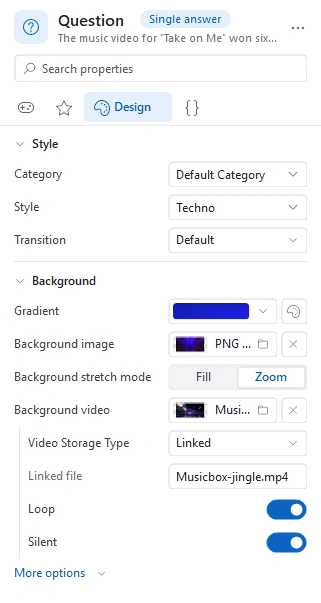

# Achtergronden

Elke stijl in QuizXpress heeft een achtergrond. U kunt de achtergrond van een dia wijzigen (ook nadat u een stijl hebt gekozen) door met de rechtermuisknop op een dia te klikken en ‘Selecteer achtergrondafbeelding…’ te kiezen.

U kunt ook een achtergrondafbeelding kiezen uit de achtergrondgalerij in de sectie Achtergrond afbeelding van het lint Ontwerp. U kunt ook uw eigen achtergronden aan de galerij toevoegen.

Net als bij stijlen kunt u uw werkruimte beter organiseren door achtergronden die u niet gebruikt weg te filteren. U opent het filter via de knop voor het dialoogvenster (de ‘dialog launcher’) in de sectie Achtergrond afbeelding van het lint Ontwerp.

{ width="466" loading=lazy }

## Achtergrondvideo

In plaats van een stilstaande afbeelding kan een dia ook een video hebben die erachter speelt: bewegende wolken, een aftelling, een herhalende animatie in uw eigen kleuren. De vraag, de antwoorden en al het andere op de dia blijven boven op de video staan.

Om er een toe te voegen, klikt u met de rechtermuisknop op de achtergrond van de dia en kiest u ‘Achtergrondvideo…’. Selecteer daarna een videobestand. U kunt het ook instellen in het eigenschappenpaneel: selecteer de dia en klik op de eigenschap ‘Achtergrondvideo’ in de sectie Achtergrond van de pagina Ontwerp. Als u meerdere dia’s selecteert en de eigenschap instelt, krijgen ze allemaal dezelfde achtergrondvideo; de video wordt maar één keer in het quizbestand opgeslagen.

{ loading=lazy }

In de editor toont de dia het eerste beeld van de video, met linksboven een klein videopictogram, zodat u kunt zien welke dia’s een achtergrondvideo hebben. Om de video te zien bewegen, klikt u met de rechtermuisknop op de achtergrond en kiest u ‘Achtergrondvideo afspelen’ (en ‘Achtergrondvideo stoppen’ om te stoppen). Het voorbeeld (F5) speelt de video ook af.

Een achtergrondvideo neemt geen plaatshouder voor afbeelding/video in beslag, dus u kunt op dezelfde dia nog steeds een afbeelding of een [video in een plaatshouder](adding-multimedia-content/video.md#een-achtergrondvideo-combineren-met-een-video-in-een-plaatshouder) plaatsen; die speelt bovenop de achtergrondvideo.

Zodra een dia een achtergrondvideo heeft, verschijnen onder de eigenschap ‘Achtergrondvideo’ de volgende instellingen:

{ width="322" loading=lazy }

| Eigenschap         | Beschrijving                                                                                                                                                                                                |
|--------------------|-------------------------------------------------------------------------------------------------------------------------------------------------------------------------------------------------------------|
| Video Opslag Type  | Ingesloten (de video wordt in het quizbestand opgeslagen) of gekoppeld (de quiz verwijst naar het videobestand op schijf). Zie [Video](adding-multimedia-content/video.md#een-video-invoegen) voor wanneer u wat gebruikt. |
| Extern bestand     | De naam van het videobestand, voor een gekoppelde video                                                                                                                                                     |
| Herhalen           | Start de video opnieuw wanneer hij eindigt. Standaard aan.                                                                                                                                                  |
| Stil               | Speel de video zonder geluid af. Standaard aan, zodat de achtergrondvideo uw vraaggeluiden niet in de weg zit.                                                                                              |
| Synchroniseren met quiz | Pauzeer de video wanneer een team buzzt, de afteltijd is gepauzeerd of de vraag eindigt, en hervat hem wanneer de vraag verdergaat. Standaard uit: de video blijft gewoon doorspelen. (Onder ‘Meer opties’.) |

Om de achtergrondvideo te verwijderen, klikt u met de rechtermuisknop op de achtergrond van de dia en kiest u ‘Achtergrondvideo verwijderen’.

!!! tip
    Geef een [categorie](using-categories.md) een achtergrondvideo, en elke dia die u met die categorie opmaakt krijgt hem ook.

Tijdens de quiz start de achtergrondvideo zodra de dia verschijnt. Houd achtergrondvideo’s kort en licht: een lus van een paar seconden in HD is meestal genoeg.
