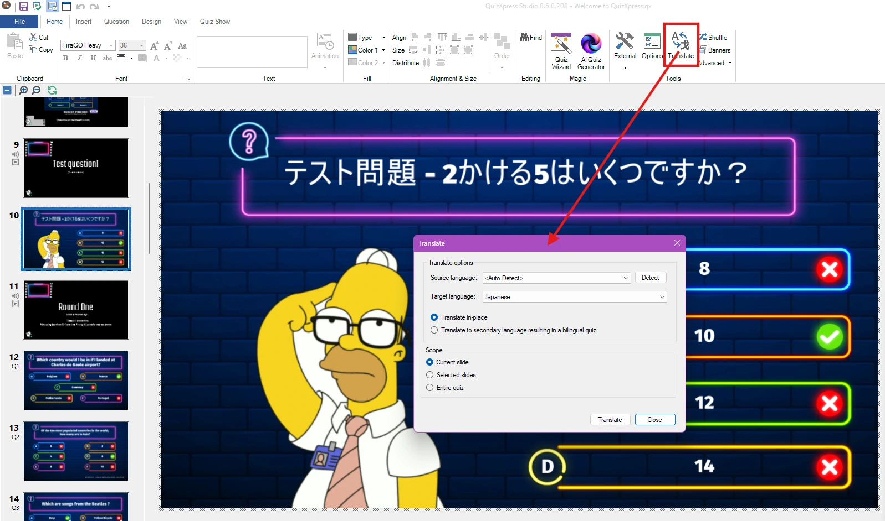
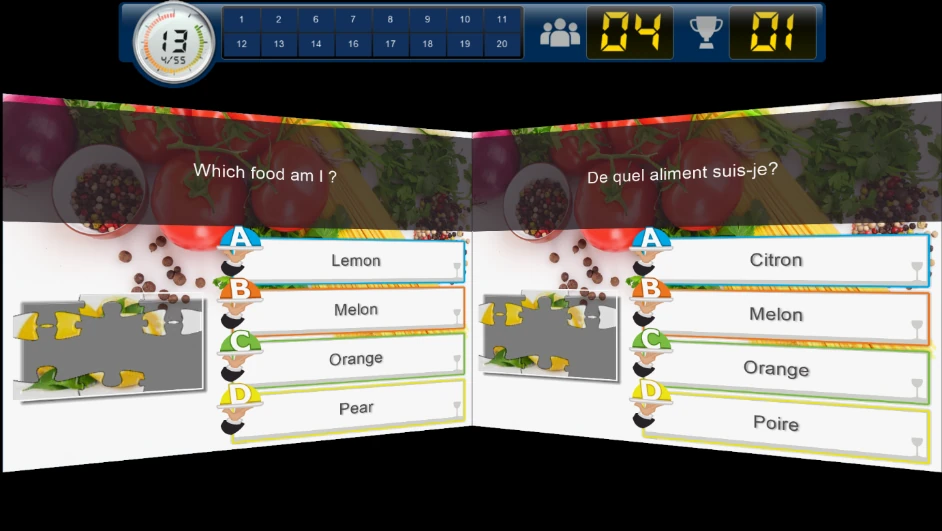
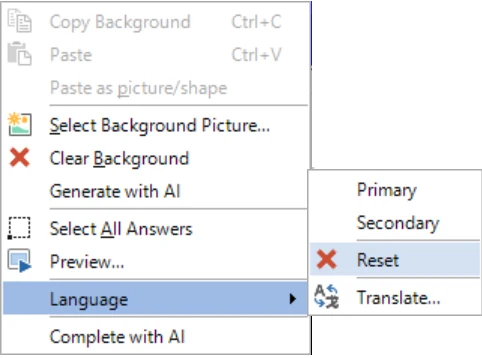

# Quiz bilingue

È possibile creare quiz per un pubblico bilingue. A tale scopo, QuizXpress Studio consente di inserire domande e risposte sia in una lingua principale (Primary) sia in una lingua secondaria (Secondary).

Per inserire il contenuto in due lingue, selezionare una diapositiva e assicurarsi che la finestra Properties sia visibile. Impostare quindi la proprietà *Language* su Primary o Secondary.

{ width="317" loading=lazy }

{ width="65" loading=lazy }

Dopo aver impostato la lingua su Secondary, accanto alla diapositiva compare una scheda che consente di passare dalla lingua Primary alla lingua Secondary facendo clic sulla rispettiva scheda.

Una volta inserito il testo nella lingua secondaria, questo viene salvato nel quiz. Passando da Primary a Secondary e viceversa è possibile vedere entrambe le lingue.

È possibile tradurre automaticamente un quiz in un'altra lingua. A tale scopo, fare clic sul pulsante Translate nella scheda della barra multifunzione HOME:

{ loading=lazy }

In QuizXpress Live! le diapositive di entrambe le lingue vengono presentate contemporaneamente sullo schermo: la lingua Primary a sinistra e la lingua Secondary a destra.

{ width="603" loading=lazy }

!!! note

    se è stato creato un quiz bilingue, è comunque possibile eseguirlo in una sola lingua. A tale scopo, passare l'argomento della riga di comando -language=0\|1\|2 a Quiz Show.exe (il lettore del quiz): 0 esegue il quiz in modalità bilingue, 1 nella lingua principale e 2 nella lingua secondaria. Il modo più semplice è creare un collegamento di Windows e impostarvi l'argomento **-language** corretto.*

Per rimuovere la lingua secondaria da una diapositiva, fare clic con il pulsante destro del mouse sulla diapositiva e scegliere Language > Reset.

{ width="366" loading=lazy }
