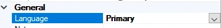
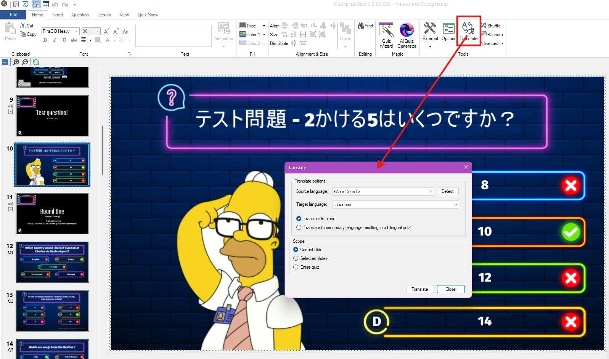
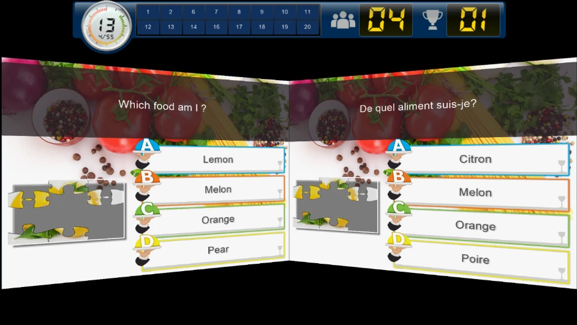
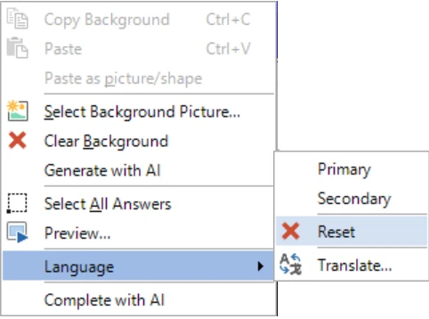

# Tweetalige quizzen

U kunt quizzen maken voor een tweetalig publiek. Daarvoor kunt u in QuizXpress Studio vragen en antwoorden invoeren in zowel een primaire als een secundaire taal.

Om de inhoud voor twee talen in te voeren, selecteert u een dia en zorgt u ervoor dat het venster Eigenschappen zichtbaar is. Stel nu de eigenschap *Taal* in op Primair of Secundair.

{ width="317" loading=lazy }

{ width="65" loading=lazy }

Nadat u de taal op Secundair hebt gezet, verschijnt naast de dia een tabblad waarmee u tussen de primaire en secundaire taal kunt wisselen door op het betreffende tabblad te klikken.

Zodra u tekst in de secundaire taal invoert, wordt die in de quiz opgeslagen. Als u heen en weer schakelt tussen Primair en Secundair, ziet u beide talen.

U kunt een quiz automatisch naar een andere taal laten vertalen. Klik daarvoor op de knop Vertalen op het lint-tabblad START:

{ loading=lazy }

In QuizXpress Live! worden de dia’s van beide talen tegelijk op het scherm getoond: de primaire taal links en de secundaire taal rechts.

{ width="603" loading=lazy }

!!! note

    als u een tweetalige quiz hebt gemaakt, kunt u deze nog steeds als eentalige quiz uitvoeren. Geef hiervoor het opdrachtregelargument -language=0\|1\|2 door aan Quiz Show.exe (de quizspeler): 0 voert de quiz tweetalig uit, 1 in de primaire taal en 2 in de secundaire taal. Het gemakkelijkst doet u dit door een Windows-snelkoppeling te maken en daar het juiste **-language**-argument in te stellen.*

Als u de secundaire taal van een dia wilt verwijderen, klikt u met de rechtermuisknop op de dia en kiest u Taal > Resetten.

{ width="366" loading=lazy }
