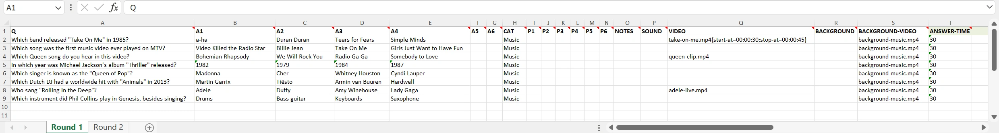
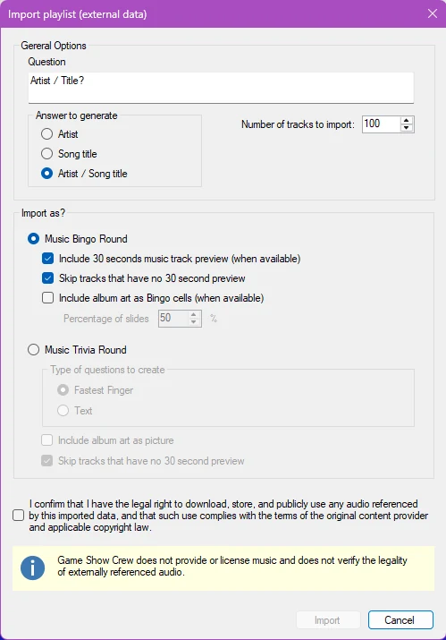
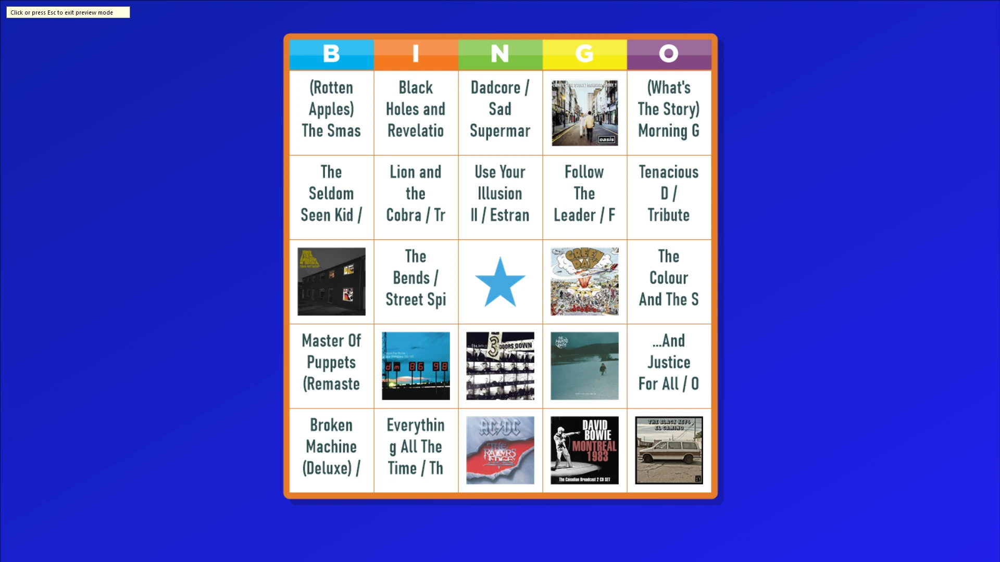
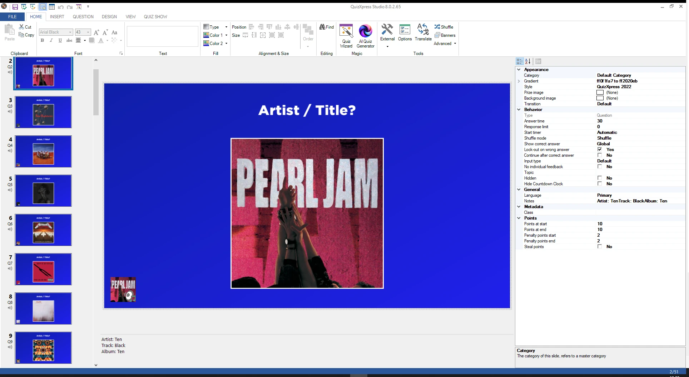
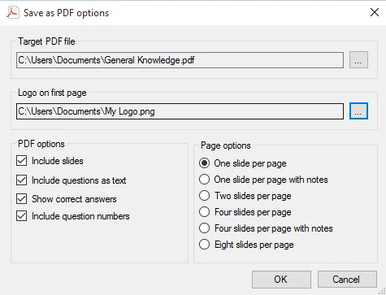

# Importazione ed esportazione delle domande

In QuizXpress Studio è possibile importare da diverse fonti ed esportare verso di esse. Per farlo, fare clic sulla scheda della barra multifunzione FILE, quindi su Import o Export per visualizzare le opzioni.

## Importazione in formato Excel

QuizXpress Studio consente di importare domande da Microsoft Excel. Potrebbe risultare più comodo inserire le domande in Excel (anche se QuizXpress Studio dispone anche di una vista tabellare per inserire rapidamente le domande), oppure potrebbe esistere un database di domande esportabile in Excel.

QuizXpress Studio supporta il formato file nativo di Office 2007 .xlsx e il formato CSV (file di testo con valori separati da virgole). Si consiglia il formato .xlsx, perché presenta meno problemi di localizzazione, caratteri speciali e così via.

Per definire le domande in Excel, aprire il modello preinstallato *quiztemplate.xlsx* (questo file si trova nella cartella di installazione di QuizXpress). È anche possibile aprire il modello dal menu backstage, nella sezione ‘Import’. Di seguito il modello compilato con alcune domande musicali, ciascuna con un video di sfondo e alcune con un video:

{ loading=lazy }

La prima riga è obbligatoria e deve riportare i nomi delle intestazioni indicati di seguito:

<table>
<colgroup>
<col style="width: 17%" />
<col style="width: 82%" />
</colgroup>
<thead>
<tr class="header">
<th>Colonna</th>
<th>Descrizione</th>
</tr>
</thead>
<tbody>
<tr class="odd">
<td>Q</td>
<td>Colonna che contiene il testo della domanda. Se si desidera importare una lingua principale e una secondaria, separare il testo delle due lingue con || .</td>
</tr>
<tr class="even">
<td>A1-A6</td>
<td>
Colonne che contengono le risposte per le domande a risposta multipla. La risposta corretta deve trovarsi nella colonna A1; il sistema mescola le risposte automaticamente. Si possono lasciare vuote tutte le colonne A* per una domanda aperta, oppure compilare solo A1 e A2 per una domanda a risposta multipla con due risposte, e così via.

È inoltre possibile indicare esplicitamente la risposta corretta per le domande a risposta multipla racchiudendola tra parentesi quadre (‘[‘ e ‘]’). In questo caso il sistema non mescola le risposte. Se si desidera importare una lingua principale e una secondaria, separare il testo delle due lingue con ||.
</td>
</tr>
<tr class="odd">
<td>CAT</td>
<td>Un nome di categoria facoltativo. Le domande importate vengono formattate automaticamente in base a questa categoria. Se si desidera usare una categoria personalizzata, è necessario crearla nel quiz prima dell'importazione.</td>
</tr>
<tr class="even">
<td>P1-P6</td>
<td>Nome file facoltativo di un file immagine. Può essere il percorso assoluto (completo) del file oppure un semplice nome file se il file immagine si trova nella stessa cartella del file XLSX importato. I formati di file supportati sono <em>jpg, png, bmp, wmf, emf</em> e <em>gif.</em> È inoltre possibile indicare esplicitamente l'immagine della risposta corretta per le domande a risposta multipla racchiudendo il nome del file immagine tra parentesi quadre (‘[‘ e ‘]’).</td>
</tr>
<tr class="odd">
<td>NOTES</td>
<td>Le note facoltative del Quizmaster da aggiungere alla domanda</td>
</tr>
<tr class="even">
<td>SOUND</td>
<td>Un percorso facoltativo a un file audio da aggiungere alla domanda</td>
</tr>
<tr class="odd">
<td>VIDEO</td>
<td>Un percorso facoltativo a un file video (WMV, AVI, ecc.) da aggiungere alla domanda (non utilizzabile in combinazione con P1-P4). Lasciare vuoti tutti gli altri campi per ottenere una diapositiva video a schermo intero.</td>
</tr>
<tr class="even">
<td>BACKGROUND</td>
<td>Un percorso facoltativo a un'immagine di sfondo per la diapositiva (png, jpg, bmp, ecc.)</td>
</tr>
<tr class="odd">
<td>BACKGROUND-VIDEO</td>
<td>Un percorso facoltativo a un video che viene riprodotto dietro la diapositiva (vedere <a href="../backgrounds/">Video di sfondo</a>). Non occupa alcun segnaposto, quindi può essere combinato con immagini (P1-P6) o con un VIDEO. Quando la domanda ha una categoria con un video di sfondo, il video di questa colonna lo sostituisce per tale domanda.</td>
</tr>
</tbody>
</table>

Le cartelle di lavoro create con un modello precedente, senza la colonna BACKGROUND-VIDEO, possono comunque essere importate.

Oltre a questo insieme fisso di colonne, esistono diverse colonne definibili dall'utente che si possono scegliere dall'elenco a discesa nel modello Excel:

| Colonna              | Descrizione                                                                                                                                 |
|----------------------|---------------------------------------------------------------------------------------------------------------------------------------------|
| A7                   | Definisce la risposta 7. Da utilizzare per l'importazione di Trivia Feud                                                                    |
| A8                   | Definisce la risposta 8. Da utilizzare per l'importazione di Trivia Feud                                                                    |
| POINTS-START         | Punti da vincere all'inizio del conto alla rovescia                                                                                         |
| POINTS-END           | Punti da vincere alla fine del conto alla rovescia                                                                                          |
| PENALTY-POINTS-START | Punti di penalità all'inizio del conto alla rovescia                                                                                        |
| PENALTY-POINTS-END   | Punti di penalità alla fine del conto alla rovescia                                                                                         |
| NO-ANSWER-POINTS     | Punti di penalità quando non viene data alcuna risposta                                                                                     |
| BONUS-POINTS-1       | Punti bonus per il giocatore più veloce con la risposta corretta                                                                            |
| BONUS-POINTS-2       | Punti bonus per il secondo giocatore più veloce con la risposta corretta                                                                    |
| BONUS-POINTS-3       | Punti bonus per il terzo giocatore più veloce con la risposta corretta                                                                      |
| ANSWER-TIME          | Tempo di risposta in secondi                                                                                                                |
| STYLE                | Nome dello stile della diapositiva (vedere i suggerimenti nel selettore degli stili di Studio per i nomi corretti; ad esempio: Millionaire, Neon Tubes, ecc.) |
| TRANSITION           | Il nome della transizione della diapositiva. Valori validi: Default, None, MoveRight, MoveLeft, MoveToFront, PageTurnLeft, ScaleToZero, LiftAndMoveRight, Fade |
| SHUFFLEMODE          |                                                                                                                                             |
| EVALUATION-MODE      |                                                                                                                                             |
| NEAREST-WINS-WINNERS |                                                                                                                                             |
| TEXT-EVALUATION      |                                                                                                                                             |
| TOLERANCE            |                                                                                                                                             |
| END-OF-ROUND-ACTION  |                                                                                                                                             |

Salvare il file in Excel, quindi selezionare ‘FILE->Import->Import from Excel’ in QuizXpress Studio. Si apre un file browser in cui selezionare il file Excel da importare.

In base alle colonne compilate, QuizXpress seleziona automaticamente un layout di diapositiva adatto. Ad esempio, per ottenere una domanda a risposta multipla con 3 risposte e un video, compilare le colonne Q, A1, A2, A3 e VIDEO. Per ottenere una domanda aperta con un frammento audio, un'immagine e un'immagine di sfondo, compilare le colonne Q, P1, SOUND e BACKGROUND.

Per impostazione predefinita, tutte le diapositive vengono create come domande del quiz. È tuttavia possibile specificare il tipo di diapositiva da creare facendo precedere il testo della colonna Q da uno dei seguenti identificatori:

| Prefisso | Descrizione                                                                                                                                                                                                                                                                                                                                                                                                                                                                  |
|--------|------------------------------------------------------------------------------------------------------------------------------------------------------------------------------------------------------------------------------------------------------------------------------------------------------------------------------------------------------------------------------------------------------------------------------------------------------------------------------|
| {Q}    | Crea una domanda normale. È possibile usare i seguenti qualificatori aggiuntivi per specificare come viene creata la domanda: **EA** – Everyone Answers, **FF** – Dito più Veloce, **NUM** – crea una domanda numerica, **LET** – crea una domanda a lettera, **TXT** – crea una domanda a testo libero, **CA** – Countdown Automatically, **CM** – Countdown Manual. Ad esempio, **{Q, EA, CM}** crea una domanda a cui tutti possono rispondere (voto), con avvio manuale del timer del conto alla rovescia. |
| {T}    | Crea una domanda di test                                                                                                                                                                                                                                                                                                                                                                                                                                                     |
| {W}    | Crea una diapositiva di puntata (è necessario specificare nelle risposte anche due o più percentuali, ad esempio ‘20%’)                                                                                                                                                                                                                                                                                                                                                      |
| {B}    | Crea una diapositiva billboard (statica)                                                                                                                                                                                                                                                                                                                                                                                                                                     |
| {A}    | Crea una diapositiva di risposta del pubblico                                                                                                                                                                                                                                                                                                                                                                                                                                |
| {D}    | Crea una diapositiva demografica                                                                                                                                                                                                                                                                                                                                                                                                                                             |
| {L}    | Crea una diapositiva last-man-standing                                                                                                                                                                                                                                                                                                                                                                                                                                       |
| {E}    | Crea una diapositiva di fine round                                                                                                                                                                                                                                                                                                                                                                                                                                           |
| {M}    | Crea una diapositiva Majority Rules                                                                                                                                                                                                                                                                                                                                                                                                                                          |
| {J}    | Crea una diapositiva Tabellone Trivia                                                                                                                                                                                                                                                                                                                                                                                                                                            |
| {TL}   | Crea una diapositiva Trivia Ladder                                                                                                                                                                                                                                                                                                                                                                                                                                           |
| {TF}   | Crea una diapositiva Trivia Feud (usare A1..A8 per le voci del sondaggio)                                                                                                                                                                                                                                                                                                                                                                                                    |
| {SR}   | Crea una diapositiva Speed Round (deve terminare con una diapositiva di fine round)                                                                                                                                                                                                                                                                                                                                                                                          |

Quindi, ad esempio, il testo “{A}Vi piace questa serata quiz?” importa una diapositiva Audience Response con il testo “Vi piace questa serata quiz?”

L'audio e il video inseriti nella diapositiva tramite le colonne SOUND, VIDEO e BACKGROUND-VIDEO sono normalmente incorporati, il che significa che l'intero contenuto del file audio/video viene memorizzato all'interno del file del quiz. Questo può produrre file di quiz di grandi dimensioni. Per evitarlo, è possibile far precedere i valori di queste colonne da ‘{L}’ per indicare che si desidera collegare i file multimediali. Ad esempio: “{L} C:\Users\Public\Videos\Sample Videos\Wildlife.wmv”. Si noti che i file collegati devono rimanere presenti sul sistema durante l'esecuzione del quiz. Quando più domande usano lo stesso file video di sfondo, questo viene memorizzato una sola volta nel quiz.

È possibile aggiungere impostazioni a un video nella colonna VIDEO o BACKGROUND-VIDEO inserendole tra parentesi graffe dopo il nome del file, separate da punti e virgola. Ad esempio: “intro.mp4{loop=false;sync-with-quiz=true}”. Le impostazioni omesse mantengono il valore predefinito.

| Impostazione   | Descrizione                                                                                                               |
|----------------|---------------------------------------------------------------------------------------------------------------------------|
| start-at       | Punto in cui il video inizia, ad esempio 00:00:05                                                                         |
| stop-at        | Punto in cui il video si ferma, ad esempio 00:00:20                                                                       |
| loop           | true o false: riproduce di nuovo il video alla fine. Predefinito: true per un video di sfondo, false per un video in un segnaposto |
| silent         | true o false: riproduzione senza audio. Predefinito: true per un video di sfondo, false per un video in un segnaposto     |
| volume         | Volume da 0 a 100 (predefinito 100)                                                                                       |
| speed          | Velocità di riproduzione in percentuale, da 25 a 250 (predefinito 100)                                                    |
| effect         | Un effetto video, come Blur o Mosaic                                                                                      |
| intro-pause    | Solo VIDEO: secondi di attesa prima che il video inizi (predefinito 1)                                                    |
| sync-with-quiz | Solo BACKGROUND-VIDEO: true per mettere in pausa il video di sfondo insieme al quiz (predefinito false)                   |

È possibile creare dei round nel quiz aggiungendo più fogli di lavoro alla cartella di lavoro di Excel. Per ogni foglio di lavoro viene inserita nel quiz una diapositiva di tipo ‘billboard’, contenente il nome del foglio di lavoro per annunciare il round successivo. Ad esempio, supponiamo di avere due fogli di lavoro, ‘Round 1’ e ‘Round 2’, ciascuno con dieci domande. Importando il file Excel in QuizXpress Studio si ottiene un quiz contenente: un billboard con il testo ‘Round 1’, seguito da dieci domande, seguito da un billboard con il testo ‘Round 2’, di nuovo seguito da dieci domande.

## Esportazione in Excel

‘FILE->Export->Export to Excel’ salva le domande del quiz nello stesso formato, come file CSV che si apre in Excel e può essere importato di nuovo. Le immagini, i suoni e i video vengono salvati accanto al file CSV. I suoni e i video mantengono il nome del file originale, e un file condiviso da più domande, come il video di sfondo di una categoria, viene salvato una sola volta. Per i video vengono scritte solo le impostazioni che differiscono dal valore predefinito.

## Importazione da PowerPoint

QuizXpress Studio consente anche di importare domande da PowerPoint. In questo caso le diapositive di PowerPoint vengono importate come immagini e collocate su diapositive Billboard. Se si desidera trasformare le diapositive in domande, è necessaria una rielaborazione: impostare prima il tipo di diapositiva su ‘Question’, poi, se sono coinvolte risposte a scelta multipla, modificare il layout della diapositiva in modo che includa lo stesso numero di risposte, impostare lo stile della diapositiva su ‘Just Text’ e rimuovere i testi di domande e risposte in QuizXpress Studio.

## Importazione da Spotify™

Con questa funzione è possibile trasformare le proprie playlist preferite in un quiz musicale QuizXpress o in un bingo musicale con pochissimo sforzo. Spotify rende disponibili circa 30 secondi del brano (predefiniti) e un'immagine della copertina dell'album. Si tratta di due semplici passaggi: prima si esporta la playlist in un file con valori separati da virgole (csv) con Exportify, un sito web pubblico disponibile all'indirizzo: <https://exportify.app/> . Poi si importa questo file csv in QuizXpress Studio utilizzando la funzione di importazione da Excel. Il sistema riconosce il formato e presenta il seguente modulo di opzioni:

{ width="270" loading=lazy }

Qui si specifica cosa creare, insieme a diverse opzioni. In questo esempio stiamo creando un bingo musicale con 75 diapositive: metà delle celle del bingo sarà composta da copertine di album e il resto sarà testo con Artista/Brano. Dopo l'importazione, i clip musicali di 30 secondi si troveranno sulle diapositive e una scheda di bingo di esempio avrà questo aspetto:

{ loading=lazy }

Allo stesso modo è possibile creare un quiz musicale con domande.

{ loading=lazy }

!!! note

    assicurarsi di non violare alcun diritto d'autore quando si utilizza questa funzione.*

## Importazione da QuizXpress

Se si desidera aggiungere le domande di un quiz QuizXpress esistente a un quiz che si sta creando, fare clic sul pulsante *Import from QuizXpress* e selezionare un file QuizXpress. In alternativa, è possibile aprire due istanze di QuizXpress Studio e copiare e incollare le diapositive tra di esse.

## Esportazione in PDF

QuizXpress Studio consente di esportare le domande in formato PDF. Questo file PDF può essere stampato o inviato ai clienti per offrire loro un'anteprima del quiz. Anche il Quizmaster potrebbe essere interessato a ricevere una copia stampata prima del game show. L'esportazione in PDF è disponibile da ‘FILE->Export->Export to PDF’. *(Nota: questa opzione non è disponibile nell'edizione Home).* L'esportazione in PDF offre le seguenti opzioni:

{ width="370" loading=lazy }

| Campo                     | Descrizione                                                          |
|---------------------------|----------------------------------------------------------------------|
| Target PDF File           | Il file PDF di output. Utilizzare il pulsante \[…\] per scegliere una cartella/un file |
| Logo on first page        | Il logo che verrà visualizzato nella prima pagina del PDF            |
| Include slides            | Attivare per includere le immagini delle diapositive                 |
| Include questions as text | Include una panoramica testuale delle domande e delle risposte       |
| Show correct answers      | Include le risposte corrette nell'output.                            |
| Include question numbers  | Include i numeri delle domande nell'esportazione in PDF              |
| Page options              | Consente di combinare più diapositive in una pagina                  |

!!! note

    per poter leggere i documenti PDF sul computer è necessario Adobe PDF reader, scaricabile all'indirizzo <http://get.adobe.com/reader/>*

## Esportazione in HTML

È possibile esportare un quiz in HTML per eseguirlo su un sito web. Si noti che questa funzionalità è molto basilare: tra l'altro, gli effetti audio, video e immagine non sono supportati e, sebbene venga mostrato un punteggio, non c'è alcun annuncio del punteggio finale.
