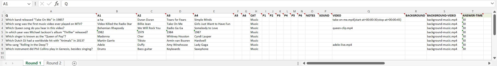
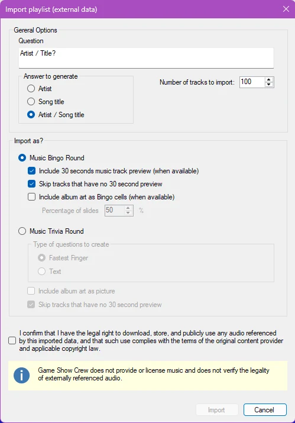
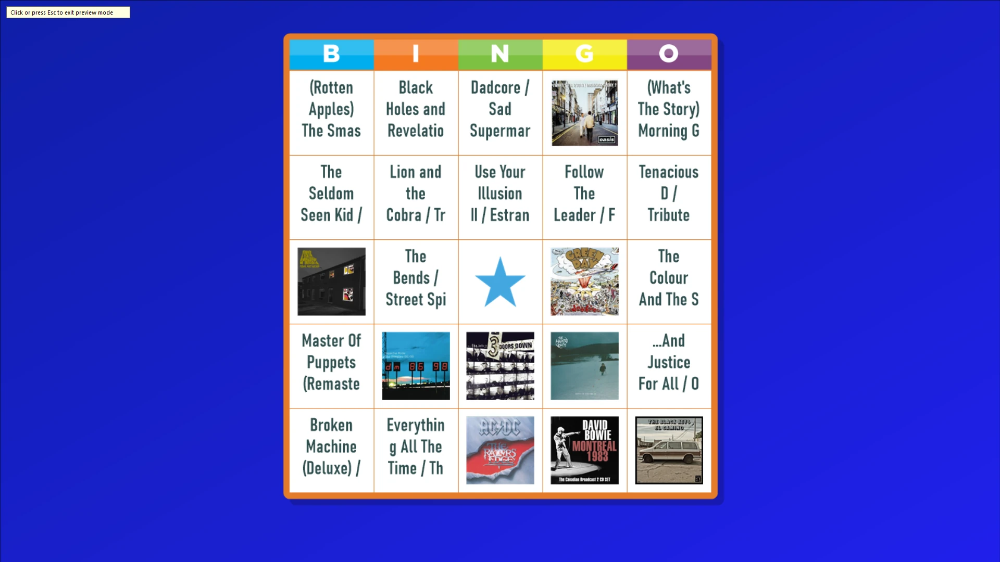
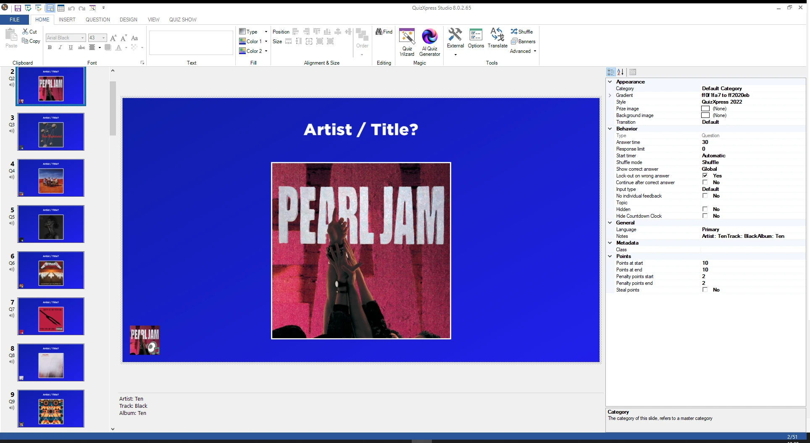
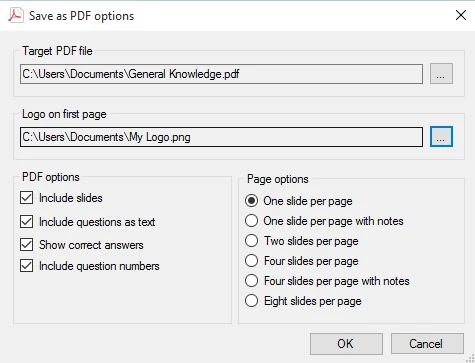

# Vragen importeren en exporteren

In QuizXpress Studio kunt u vragen importeren uit en exporteren naar verschillende bronnen. Klik hiervoor op het lint-tabblad BESTAND en vervolgens op Importeren of Exporteren om de opties te zien.

## Importeren van Excel

Met QuizXpress Studio kunt u vragen uit Microsoft Excel importeren. Het kan handiger zijn om uw vragen in Excel in te voeren (hoewel QuizXpress Studio ook een tabelweergave heeft om snel vragen in te voeren), of u hebt een database met vragen die naar Excel kan worden geëxporteerd.

QuizXpress Studio ondersteunt de oorspronkelijke bestandsindeling .xlsx van Office 2007 en de CSV-indeling (kommagescheiden tekstbestand). De .xlsx-indeling heeft de voorkeur, omdat die minder problemen geeft met lokalisatie, speciale tekens enzovoort.

Om uw vragen in Excel te definiëren, opent u het vooraf geïnstalleerde sjabloon *quiztemplate.xlsx* (u vindt dit bestand in de installatiemap van QuizXpress). U kunt het sjabloon ook openen vanuit het backstage-menu, in de sectie ‘Importeren’. Hieronder staat het sjabloon ingevuld met een paar muziekvragen, elk met een achtergrondvideo en sommige met een video:

{ loading=lazy }

De eerste rij is verplicht en moet de onderstaande kopnamen volgen:

<table>
<colgroup>
<col style="width: 17%" />
<col style="width: 82%" />
</colgroup>
<thead>
<tr class="header">
<th>Kolom</th>
<th>Beschrijving</th>
</tr>
</thead>
<tbody>
<tr class="odd">
<td>Q</td>
<td>Kolom voor de vraagtekst. Als u een primaire en secundaire taal wilt importeren, scheidt u de tekst voor beide talen met || .</td>
</tr>
<tr class="even">
<td>A1-A6</td>
<td>
Kolommen voor de antwoorden bij meerkeuzevragen. Het juiste antwoord moet in kolom A1 staan; het systeem husselt de antwoorden voor u. U kunt alle A*-kolommen leeg laten voor een open vraag, of alleen A1 en A2 invullen voor een meerkeuzevraag met twee antwoorden, enzovoort.

U kunt bij meerkeuzevragen ook expliciet het juiste antwoord markeren door het tussen haakjes (‘[‘ en ‘]’) te plaatsen. In dat geval husselt het systeem de antwoorden niet. Als u een primaire en secundaire taal wilt importeren, scheidt u de tekst voor beide talen met ||.
</td>
</tr>
<tr class="odd">
<td>CAT</td>
<td>Een optionele categorienaam. Geïmporteerde vragen worden automatisch opgemaakt volgens deze categorie. Als u uw eigen categorie wilt gebruiken, moet u die vóór het importeren in de quiz maken.</td>
</tr>
<tr class="even">
<td>P1-P6</td>
<td>Optionele bestandsnaam van een afbeeldingsbestand. Dit kan een absoluut (volledig) pad naar het bestand zijn, of een enkele bestandsnaam als het afbeeldingsbestand in dezelfde map staat als het geïmporteerde XLSX-bestand. Ondersteunde bestandsindelingen zijn <em>jpg, png, bmp, wmf, emf</em> en <em>gif.</em> U kunt bij meerkeuzevragen ook expliciet de afbeelding met het juiste antwoord markeren door de bestandsnaam van de afbeelding tussen haakjes (‘[‘ en ‘]’) te plaatsen.</td>
</tr>
<tr class="odd">
<td>NOTES</td>
<td>De optionele notities voor de quizmaster die aan de vraag worden toegevoegd</td>
</tr>
<tr class="even">
<td>SOUND</td>
<td>Een optioneel pad naar een geluidsbestand dat aan de vraag wordt toegevoegd</td>
</tr>
<tr class="odd">
<td>VIDEO</td>
<td>Een optioneel pad naar een videobestand (WMV, AVI enzovoort) dat aan de vraag wordt toegevoegd (kan niet worden gecombineerd met P1-P4). Laat alle andere velden leeg om een video-dia op volledig scherm te krijgen.</td>
</tr>
<tr class="even">
<td>BACKGROUND</td>
<td>Een optioneel pad naar een achtergrondafbeelding voor de dia (png, jpg, bmp enzovoort)</td>
</tr>
<tr class="odd">
<td>BACKGROUND-VIDEO</td>
<td>Een optioneel pad naar een video die achter de dia speelt (zie <a href="../backgrounds/#background-video">Achtergrondvideo</a>). Deze neemt geen plaatshouder in beslag en kan dus worden gecombineerd met afbeeldingen (P1-P6) of een VIDEO. Als de vraag een categorie met een achtergrondvideo heeft, vervangt de video in deze kolom die voor deze vraag.</td>
</tr>
</tbody>
</table>

Werkmappen die met een ouder sjabloon zijn gemaakt, zonder de kolom BACKGROUND-VIDEO, kunnen nog steeds worden geïmporteerd.

Naast deze vaste set kolommen zijn er een aantal door de gebruiker te definiëren kolommen die u kunt kiezen in de vervolgkeuzelijst in het Excel-sjabloon:

| Kolom                | Beschrijving                                                                                                                                |
|----------------------|---------------------------------------------------------------------------------------------------------------------------------------------|
| A7                   | Definieert antwoord 7. Te gebruiken voor de import van Trivia Feud                                                                          |
| A8                   | Definieert antwoord 8. Te gebruiken voor de import van Trivia Feud                                                                          |
| POINTS-START         | Te winnen punten aan het begin van het aftellen                                                                                             |
| POINTS-END           | Te winnen punten aan het einde van het aftellen                                                                                             |
| PENALTY-POINTS-START | Strafpunten aan het begin van het aftellen                                                                                                  |
| PENALTY-POINTS-END   | Strafpunten aan het einde van het aftellen                                                                                                  |
| NO-ANSWER-POINTS     | Strafpunten wanneer geen antwoord is gegeven                                                                                                |
| BONUS-POINTS-1       | Bonuspunten voor de snelste speler met het juiste antwoord                                                                                  |
| BONUS-POINTS-2       | Bonuspunten voor de op één na snelste speler met het juiste antwoord                                                                        |
| BONUS-POINTS-3       | Bonuspunten voor de op twee na snelste speler met het juiste antwoord                                                                       |
| ANSWER-TIME          | Antwoordtijd in seconden                                                                                                                    |
| STYLE                | Naam van de diastijl (zie de knopinfo in de stijlkiezer van Studio voor de juiste namen; bijvoorbeeld: Millionaire, Neon Tubes enzovoort)   |
| TRANSITION           | De naam van de diatransitie. Geldige waarden: Default, None, MoveRight, MoveLeft, MoveToFront, PageTurnLeft, ScaleToZero, LiftAndMoveRight, Fade |
| SHUFFLEMODE          |                                                                                                                                             |
| EVALUATION-MODE      |                                                                                                                                             |
| NEAREST-WINS-WINNERS |                                                                                                                                             |
| TEXT-EVALUATION      |                                                                                                                                             |
| TOLERANCE            |                                                                                                                                             |
| END-OF-ROUND-ACTION  |                                                                                                                                             |

Sla het bestand op in Excel en selecteer vervolgens ‘BESTAND->Importeren->Importeren van Excel’ in QuizXpress Studio. Er verschijnt een bestandsverkenner waarin u het te importeren Excel-bestand kunt kiezen.

Op basis van de kolommen die u invult, kiest QuizXpress automatisch een passende dia-indeling. Om bijvoorbeeld een meerkeuzevraag met 3 antwoorden en een video te krijgen, vult u de kolommen Q, A1, A2, A3 en VIDEO in. Om een open vraag met een geluidsfragment, een afbeelding en een achtergrondafbeelding te krijgen, vult u de kolommen Q, P1, SOUND en BACKGROUND in.

Standaard worden alle dia’s als quizvragen gemaakt. U kunt echter het type dia opgeven dat moet worden gemaakt door de tekst in de kolom Q vooraf te laten gaan door een van de volgende identificaties:

| Voorvoegsel | Beschrijving                                                                                                                                                                                                                                                                                                                                                                                                                                                                  |
|--------|------------------------------------------------------------------------------------------------------------------------------------------------------------------------------------------------------------------------------------------------------------------------------------------------------------------------------------------------------------------------------------------------------------------------------------------------------------------------------|
| {Q}    | Maak een gewone vraag. U kunt de volgende extra kwalificaties gebruiken om op te geven hoe de vraag wordt gemaakt: **EA** – Iedereen antwoordt, **FF** – Snelste drukker, **NUM** – maak een getalvraag, **LET** – maak een letter-vraag, **TXT** – maak een vraag met volledige tekst, **CA** – Automatisch aftellen, **CM** – Handmatig aftellen. Bijvoorbeeld: **{Q, EA, CM}** maakt een vraag waarbij iedereen kan antwoorden (stemmen), met een handmatige start van de afteltimer. |
| {T}    | Maak een testvraag                                                                                                                                                                                                                                                                                                                                                                                                                                                           |
| {W}    | Maak een weddenschapdia (u moet in de antwoorden ook twee of meer percentages opgeven, zoals ‘20%’)                                                                                                                                                                                                                                                                                                                                                                          |
| {B}    | Maak een (statische) billboarddia                                                                                                                                                                                                                                                                                                                                                                                                                                            |
| {A}    | Maak een publieksreactiedia                                                                                                                                                                                                                                                                                                                                                                                                                                                  |
| {D}    | Maak een demografische dia                                                                                                                                                                                                                                                                                                                                                                                                                                                   |
| {L}    | Maak een last-man-standing-dia                                                                                                                                                                                                                                                                                                                                                                                                                                               |
| {E}    | Maak een dia Einde ronde                                                                                                                                                                                                                                                                                                                                                                                                                                                     |
| {M}    | Maak een dia Meerderheid bepaalt                                                                                                                                                                                                                                                                                                                                                                                                                                             |
| {J}    | Maak een Trivia Bord-dia                                                                                                                                                                                                                                                                                                                                                                                                                                                     |
| {TL}   | Maak een Trivia Ladder-dia                                                                                                                                                                                                                                                                                                                                                                                                                                                   |
| {TF}   | Maak een Trivia Feud-dia (gebruik A1..A8 voor de items van de enquête)                                                                                                                                                                                                                                                                                                                                                                                                       |
| {SR}   | Maak een Speed Round-dia (moet eindigen met een dia Einde ronde)                                                                                                                                                                                                                                                                                                                                                                                                             |

Zo importeert de tekst “{A}Vindt u deze quizavond leuk?” bijvoorbeeld een publieksreactiedia met de tekst “Vindt u deze quizavond leuk?”

Geluid en video die u met de kolommen SOUND, VIDEO en BACKGROUND-VIDEO in uw dia invoegt, worden normaal gesproken ingesloten, wat betekent dat de volledige inhoud van het geluids-/videobestand in het quizbestand wordt opgeslagen. Dit kan grote quizbestanden opleveren. Om dat te voorkomen, kunt u de waarden in deze kolommen vooraf laten gaan door ‘{L}’ om aan te geven dat u de mediabestanden wilt koppelen. Bijvoorbeeld: “{L} C:\Users\Public\Videos\Sample Videos\Wildlife.wmv”. Let op: gekoppelde bestanden moeten op uw systeem aanwezig blijven wanneer u de quiz uitvoert. Als meerdere vragen hetzelfde achtergrondvideobestand gebruiken, wordt dat maar één keer in de quiz opgeslagen.

U kunt instellingen aan een video toevoegen in de kolom VIDEO of BACKGROUND-VIDEO door ze na de bestandsnaam tussen accolades te plaatsen, gescheiden door puntkomma’s. Bijvoorbeeld: “intro.mp4{loop=false;sync-with-quiz=true}”. Instellingen die u weglaat, behouden hun standaardwaarde.

| Instelling     | Beschrijving                                                                                                              |
|----------------|---------------------------------------------------------------------------------------------------------------------------|
| start-at       | Waar de video begint, bijvoorbeeld 00:00:05                                                                               |
| stop-at        | Waar de video stopt, bijvoorbeeld 00:00:20                                                                                |
| loop           | true of false: speel de video opnieuw af wanneer hij eindigt. Standaard: true voor een achtergrondvideo, false voor een video in een plaatshouder |
| silent         | true of false: speel zonder geluid af. Standaard: true voor een achtergrondvideo, false voor een video in een plaatshouder |
| volume         | Volume van 0 tot 100 (standaard 100)                                                                                      |
| speed          | Afspeelsnelheid in procenten, van 25 tot 250 (standaard 100)                                                              |
| effect         | Een video-effect, zoals Blur of Mosaic                                                                                    |
| intro-pause    | Alleen VIDEO: seconden wachten voordat de video begint (standaard 1)                                                      |
| sync-with-quiz | Alleen BACKGROUND-VIDEO: true om de achtergrondvideo samen met de quiz te pauzeren (standaard false)                      |

U kunt rondes in uw quiz maken door meerdere werkbladen aan de Excel-werkmap toe te voegen. Voor elk werkblad wordt een quizdia van het type ‘billboard’ in de quiz ingevoegd, met de naam van het werkblad om de volgende ronde aan te kondigen. Stel dat u bijvoorbeeld twee werkbladen hebt, ‘Ronde 1’ en ‘Ronde 2’, elk met tien vragen. Wanneer u het Excel-bestand in QuizXpress Studio importeert, krijgt u een quiz met: een billboard met de tekst ‘Ronde 1’, gevolgd door tien vragen, gevolgd door een billboard met de tekst ‘Ronde 2’, opnieuw gevolgd door tien vragen.

## Exporteren naar Excel

‘BESTAND->Exporteren->Exporteren naar Excel’ slaat de vragen van uw quiz in dezelfde indeling op, als CSV-bestand dat in Excel opent en opnieuw kan worden geïmporteerd. Afbeeldingen, geluiden en video’s worden naast het CSV-bestand opgeslagen. Geluiden en video’s behouden de naam van hun oorspronkelijke bestand, en een bestand dat door meerdere vragen wordt gedeeld, zoals de achtergrondvideo van een categorie, wordt maar één keer opgeslagen. Bij video’s worden alleen de instellingen weggeschreven die van de standaardwaarde afwijken.

## Importeren uit PowerPoint

Met QuizXpress Studio kunt u ook vragen uit PowerPoint importeren. In dat geval worden de PowerPoint-dia’s als afbeeldingen geïmporteerd en op Billboard-dia’s geplaatst. Als u dia’s in vragen wilt veranderen, is wat nabewerking nodig: stel eerst het diatype in op ‘Vraag’ en wijzig daarna, als het om meerkeuzeantwoorden gaat, de dia-indeling zodat die hetzelfde aantal antwoorden bevat, stel de diastijl in op ‘Just Text’ en verwijder de vraag- en antwoordteksten in QuizXpress Studio.

## Importeren uit Spotify™

Met deze functie maakt u van uw favoriete afspeellijsten vrijwel moeiteloos een QuizXpress-muziekquiz of een muziekbingo. Spotify stelt ~30 seconden van het muzieknummer (vooraf bepaald) en een afbeelding van de albumhoes beschikbaar. Er zijn twee eenvoudige stappen: eerst exporteert u uw afspeellijst naar een door komma’s gescheiden bestand (csv) met Exportify, een openbare website op: <https://exportify.app/> . Daarna importeert u dit csv-bestand in QuizXpress Studio met de Excel-importfunctie. Het systeem herkent de indeling en toont u het volgende optieformulier:

{ width="270" loading=lazy }

Hier geeft u op wat er moet worden gemaakt, samen met diverse opties. In dit voorbeeld maken we een muziekbingo met 75 dia’s: de helft van de bingocellen bestaat uit albumhoezen en de rest uit tekst met artiest/nummer. Na het importeren staan de muziekfragmenten van 30 seconden op de dia’s en ziet een voorbeeldbingokaart er zo uit:

{ loading=lazy }

Op dezelfde manier kunt u een muziekquiz met vragen maken.

{ loading=lazy }

!!! note

    zorg ervoor dat u met deze functie geen auteursrechten schendt.*

## Importeren uit QuizXpress

Als u vragen uit een bestaande QuizXpress-quiz wilt toevoegen aan een quiz die u aan het maken bent, klikt u op de knop *Importeer een QuizXpress bestand* en selecteert u een QuizXpress-bestand. U kunt ook twee exemplaren van QuizXpress Studio openen en dia’s ertussen kopiëren en plakken.

## Exporteren naar PDF

Met QuizXpress Studio kunt u uw vragen in PDF-indeling exporteren. Dit PDF-bestand kunt u afdrukken of naar uw klanten sturen om hun een voorproefje van de quiz te geven. Ook uw quizmaster wil misschien vóór de quizshow een afdruk ontvangen. De PDF-export is beschikbaar via ‘BESTAND->Exporteren->Exporteren naar PDF’. *(Let op: deze optie is niet beschikbaar in de Home-editie).* De PDF-export biedt de volgende opties:

{ width="370" loading=lazy }

| Veld                      | Beschrijving                                                         |
|---------------------------|----------------------------------------------------------------------|
| Doel PDF bestand          | Het PDF-uitvoerbestand. Gebruik de knop \[…\] om naar een map/bestand te bladeren |
| Logo op de eerste pagina  | Het logo dat op de eerste pagina van de PDF wordt getoond            |
| Slides opnemen            | Schakel in om afbeeldingen van de dia’s op te nemen                  |
| Tekst opnemen             | Neem een tekstueel overzicht van de vragen en antwoorden op          |
| Toon het goede antwoord op de slide | Neem de juiste antwoorden op in de uitvoer.                |
| Vraagnummers opnemen      | Neem de vraagnummers op in de PDF-export                             |
| Pagina opties             | Hiermee kunt u meerdere dia’s op één pagina combineren               |

!!! note

    om PDF-documenten op uw computer te kunnen lezen, hebt u de Adobe PDF-lezer nodig, die te downloaden is op <http://get.adobe.com/reader/>*

## Exporteren naar HTML

U kunt een quiz naar HTML exporteren om hem op een website uit te voeren. Let op: deze functionaliteit is zeer basaal: onder andere audio, video en afbeeldingseffecten worden niet ondersteund, en hoewel een score wordt getoond, is er geen aankondiging van de eindscore.
