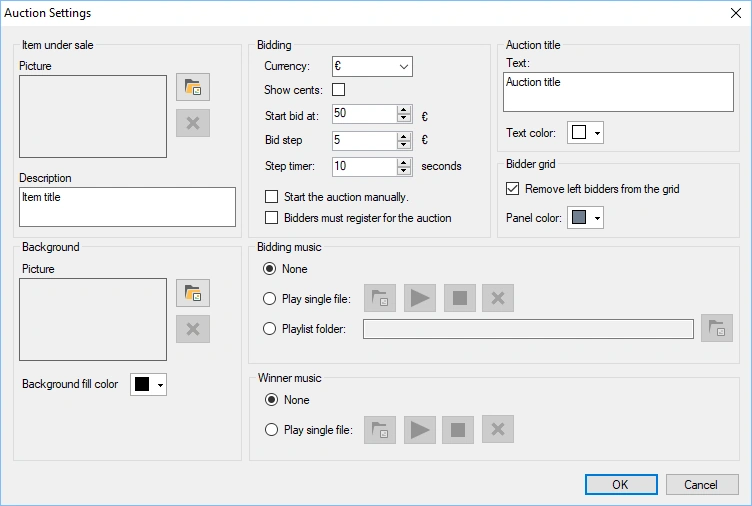
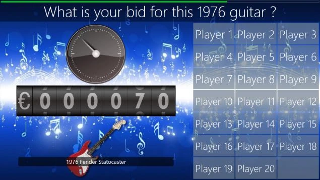

# Auction

Con questo plugin è possibile mettere all'asta degli oggetti durante un quiz mentre il pubblico fa le proprie offerte con i dispositivi portatili — ideale per le raccolte fondi!

Durante l'asta, man mano che l'importo dell'offerta aumenta, i giocatori si ritirano quando non sono più interessati.

Le opzioni di configurazione disponibili sono:

- Item under sale: immagine dell'oggetto messo all'asta

- Description: descrizione dell'oggetto messo all'asta. La descrizione viene visualizzata nella parte superiore dello schermo dell'asta.

- Background: immagine di sfondo dello schermo dell'asta.

- Background fill color: in alternativa, è possibile impostare un colore di sfondo a tinta unita per lo schermo dell'asta.

- Currency: valuta visualizzata prima dell'importo corrente dell'asta

- Show cents: include i centesimi nell'importo dell'asta

- Start bid at: imposta il prezzo di partenza dell'oggetto messo all'asta

- Bid step: imposta l'incremento con cui sale il prezzo dell'asta

- Step timer: imposta l'intervallo dopo il quale l'importo dell'asta viene aumentato

- Start the auction manually: avvia l'asta solo quando si preme Next (altrimenti parte immediatamente)

- Bidders must register for the auction: per impostazione predefinita partecipano tutti e gli offerenti si ritirano quando non sono più interessati all'oggetto messo all'asta. Selezionare questa impostazione se si desidera che ogni offerente indichi esplicitamente se intende partecipare prima dell'inizio dell'asta.

- Bidding music: musica riprodotta durante l'asta (nessuna musica, un file musicale o una cartella contenente file musicali)

- Winner music: imposta la musica riprodotta quando l'oggetto messo all'asta viene venduto

- Auction title text: il titolo dell'asta viene visualizzato sopra l'immagine dell'oggetto messo all'asta (oppure come solo testo se non è impostata alcuna immagine).

- Auction title text color: il colore del testo del titolo dell'asta.

- Remove left bidders from the grid: con questa impostazione selezionata, i giocatori che si sono ritirati dall'asta vengono rimossi dal pannello degli offerenti.

- Bidder grid panel color: imposta il colore dei pannelli della griglia degli offerenti.

{ width="410" loading=lazy }

Di seguito è possibile vedere un'immagine di un'asta in corso:

{ width="405" loading=lazy }
