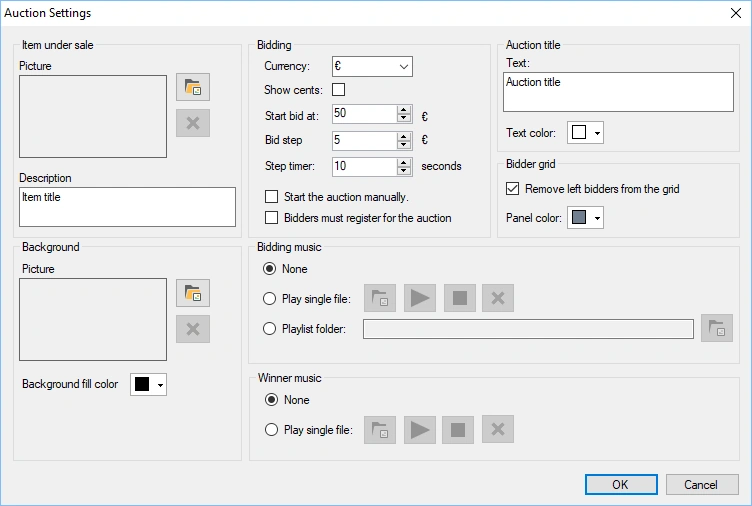
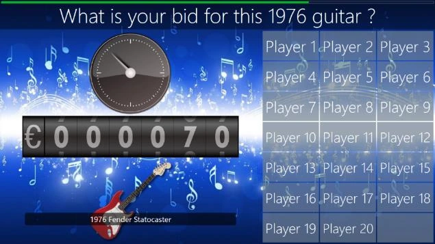

# Veiling

Met deze plug-in kunt u tijdens een quiz items veilen terwijl het publiek met zijn handhelds biedt, ideaal voor fondsenwervers!

Tijdens de veiling stijgt het bod en haken spelers af wanneer ze niet langer geïnteresseerd zijn.

De beschikbare configuratieopties zijn:

- Te verkopen item: afbeelding van het item dat wordt geveild

- Omschrijving: omschrijving van het item dat wordt geveild. De omschrijving wordt bovenaan het veilingscherm getoond.

- Achtergrond: achtergrondafbeelding van het veilingscherm.

- Achtergrondvulling: als alternatief kunt u een effen achtergrondkleur voor het veilingscherm instellen.

- Valuta: valuta die vóór het actuele veilingbedrag wordt getoond

- Centen tonen: neem centen op in het veilingbedrag

- Startprijs: stel de startprijs van het geveilde item in

- Opbod bedrag: stel het bedrag in waarmee de veilingprijs stijgt

- Stap tijd: stel het interval in waarna het veilingbedrag wordt verhoogd

- Start de veiling handmatig: start de veiling pas wanneer u op Volgende drukt (anders start hij meteen)

- Bieders moeten zich eerst registeren: standaard doet iedereen mee en haken bieders af wanneer ze niet langer geïnteresseerd zijn in het geveilde item. Schakel deze instelling in als u wilt dat elke bieder vóór de start van de veiling expliciet aangeeft of hij wil meedoen.

- Muziek tijdens veiling: muziek die tijdens de veiling wordt afgespeeld (geen muziek, één muziekbestand kiezen of een map met muziekbestanden kiezen)

- Muziek bij afslag: stel de muziek in die wordt afgespeeld wanneer het geveilde item is verkocht

- Veling titel: de veilingtitel wordt getoond over de afbeelding van het geveilde item (of alleen als tekst als er geen afbeelding is ingesteld).

- Kleur van de veilingtitel: de kleur van de veilingtitel.

- Verwijder vertrokken bieders uit de tabel: als deze instelling is ingeschakeld, worden spelers die zijn afgehaakt uit het biederspaneel verwijderd.

- Kleur van de biedertabel: stel de kleur van de panelen van de biedertabel in.

{ width="410" loading=lazy }

Hieronder ziet u een afbeelding van een veiling in actie:

{ width="405" loading=lazy }
