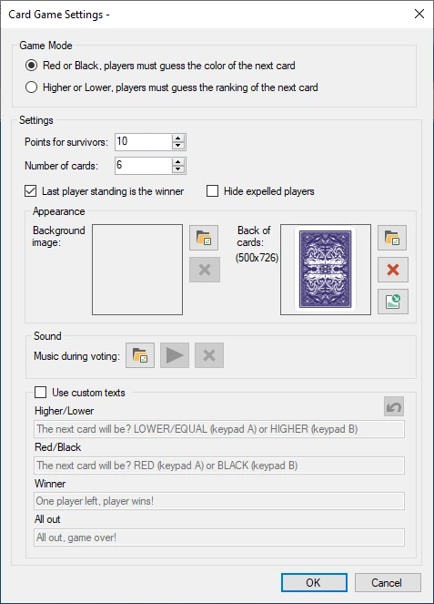
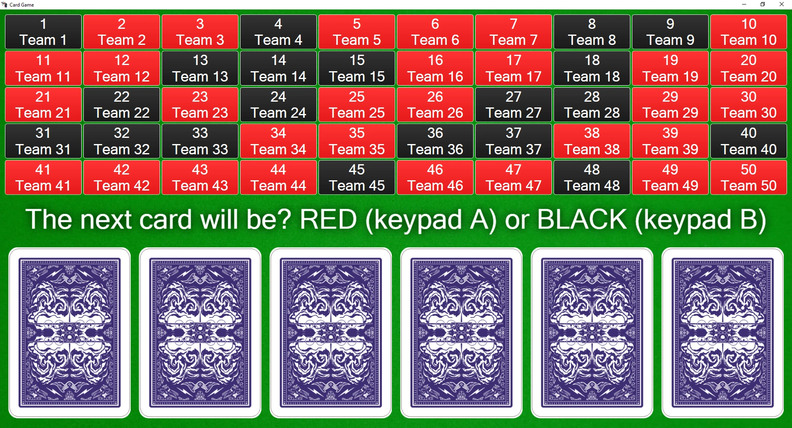

# Card game

Dans le jeu de cartes, le public doit survivre à plusieurs cartes en prédisant correctement la carte suivante (rouge/noir ou plus haut/plus bas) pour gagner des points.

Options de configuration disponibles :

{ width="255" loading=lazy }

- Game Mode : choisissez entre une prédiction rouge/noir ou plus haut/plus bas

- Points for survivors : combien de points les joueurs gagnent s'ils ont survécu jusqu'à la fin

- Number of cards : combien de cartes sont sur la table

- Last player standing is the winner : avec cette option, le dernier joueur à survivre gagne, même si toutes les cartes n'ont pas été retournées

- Hide expelled players : masque de la grille des joueurs ceux qui ne sont plus dans la partie.

- Background image : choisissez une image d'arrière-plan affichée pendant le jeu

- Music during voting : choisissez la musique jouée pendant que tous les joueurs placent leurs paris

- Back of cards : l'image à utiliser au dos de la carte (utilisez 357 x 500 pixels). Utilisez-la pour personnaliser le jeu à votre image.

- Use custom texts : remplacez les textes par défaut présentés aux joueurs par vos propres textes.

Voici une image du jeu de cartes en action.

{ loading=lazy }

Chaque joueur est représenté par un carré. Lorsqu'un choix est fait, le carré devient rouge ou noir.

Pour passer d'une étape à l'autre du jeu de cartes (afficher le message invitant les joueurs à faire un choix, révéler la carte suivante), il suffit d'appuyer sur le bouton ‘Next’ dans le panneau de gauche.

{ width="160" loading=lazy }

Les carrés des joueurs éliminés sont grisés, ce qui indique qu'ils ne participent plus à cette session du jeu de cartes.
