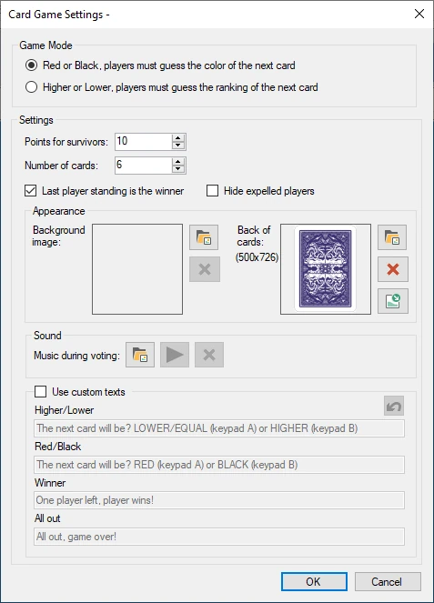
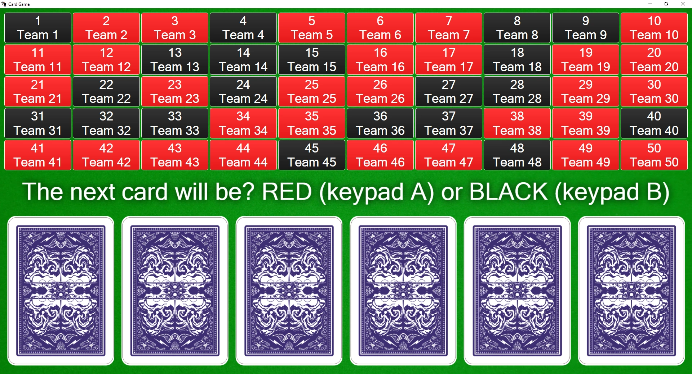

# Card Game

Nel gioco delle carte il pubblico deve sopravvivere a diverse carte prevedendo correttamente la carta successiva (rosso/nero oppure più alta/più bassa) per guadagnare punti.

Opzioni di configurazione disponibili:

{ width="255" loading=lazy }

- Modalità di Gioco: scegliere tra previsione rosso/nero o più alta/più bassa

- Punti per i Sopravvissuti: quanti punti vincono i giocatori sopravvissuti fino alla fine

- Numero Carte: quante carte ci sono sul tavolo

- Fai vincere l'ultimo giocatore Sopravvissuto: con questa opzione vince l'ultimo giocatore sopravvissuto, anche se non tutte le carte sono state girate

- Nascondi Giocatori Eliminati: nasconde dalla griglia dei giocatori quelli che non sono più in gioco.

- Immagine Sfondo: scegliere un'immagine di sfondo mostrata durante il gioco

- Audio durante la Votazione: scegliere la musica riprodotta mentre tutti i giocatori effettuano le proprie puntate

- Back of cards: l'immagine da utilizzare sul retro della carta (utilizzare 357 x 500 pixel). Utilizzarla per personalizzare il gioco con il proprio marchio.

- Usa Testi Personalizzati: sostituire i testi predefiniti mostrati ai giocatori con testi personalizzati.

Di seguito è riportata un'immagine del gioco delle carte in azione.

{ loading=lazy }

Ogni giocatore è rappresentato da un quadrato. Quando viene fatta una scelta, il quadrato diventa rosso o nero.

Per passare attraverso le varie fasi del gioco delle carte (mostrare il messaggio che invita i giocatori a fare una scelta, rivelare la carta successiva) è sufficiente premere il pulsante ‘Next’ nel pannello a sinistra.

{ width="160" loading=lazy }

I quadrati dei giocatori eliminati appaiono in grigio, a indicare che non partecipano più a questa sessione del gioco delle carte.
