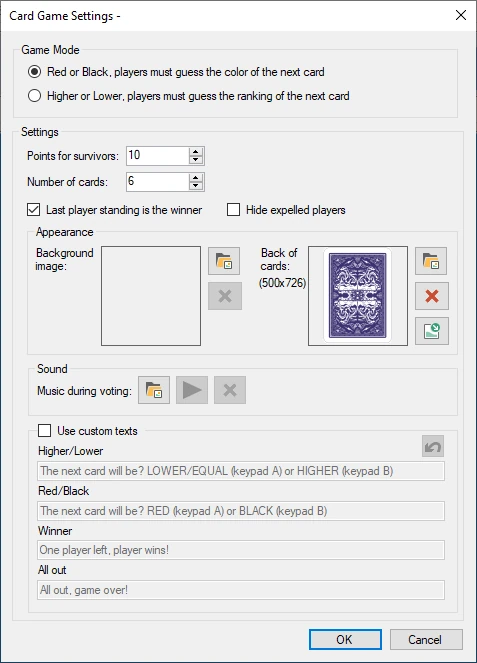
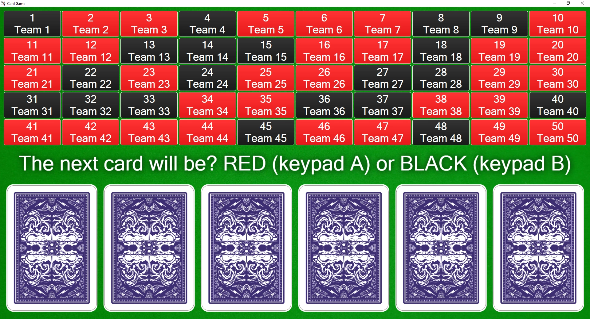

# Kaartspel

In het kaartspel moet het publiek meerdere kaarten overleven door de volgende kaart correct te voorspellen (rood/zwart of hoger/lager) om punten te winnen.

Beschikbare configuratieopties:

{ width="255" loading=lazy }

- Spelmodus: kies tussen raden van rood/zwart of hoger/lager

- Punten voor overlevenden: hoeveel punten de spelers winnen wanneer ze tot het einde overleefden

- Aantal kaarten: hoeveel kaarten er op tafel liggen

- De laatst overgebleven deelnemer is de winnaar: met deze optie wint de speler die als laatste overleefde, ook als niet alle kaarten zijn omgedraaid

- Verberg uitgesloten spelers: verberg de spelers die niet meer in het spel zitten uit het spelersraster.

- Achtergrondafbeelding: kies een achtergrondafbeelding die tijdens het spel wordt getoond

- Muziek tijdens stemmen: kies de muziek die wordt afgespeeld terwijl alle spelers hun keuze maken

- Achterkant van de kaarten: de afbeelding die voor de achterkant van de kaart wordt gebruikt (gebruik 357 x 500 pixels). Gebruik dit om het spel in uw eigen huisstijl te zetten.

- Gebruik aangepaste teksten: vervang de standaardteksten die aan de spelers worden getoond door uw eigen teksten.

Hieronder ziet u een afbeelding van het kaartspel in actie.

{ loading=lazy }

Elke speler wordt vertegenwoordigd door een vierkant. Wanneer een keuze is gemaakt, wordt het vierkant rood of zwart.

Om de verschillende stappen van het kaartspel te doorlopen (bericht aan de spelers tonen om een keuze te maken, de volgende kaart onthullen) drukt u gewoon op de knop ‘Volgende’ in het paneel aan de linkerkant.

{ width="160" loading=lazy }

De vierkanten van spelers die uit het spel zijn, worden grijs weergegeven, ten teken dat ze niet meer meedoen aan deze sessie van het kaartspel.
