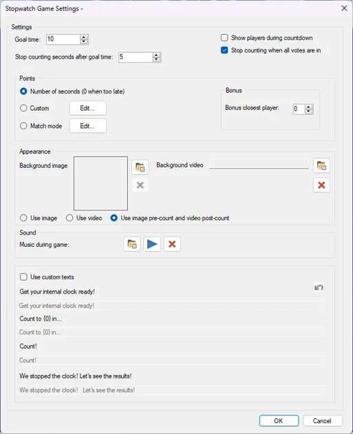
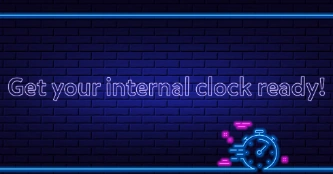
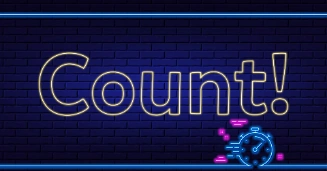
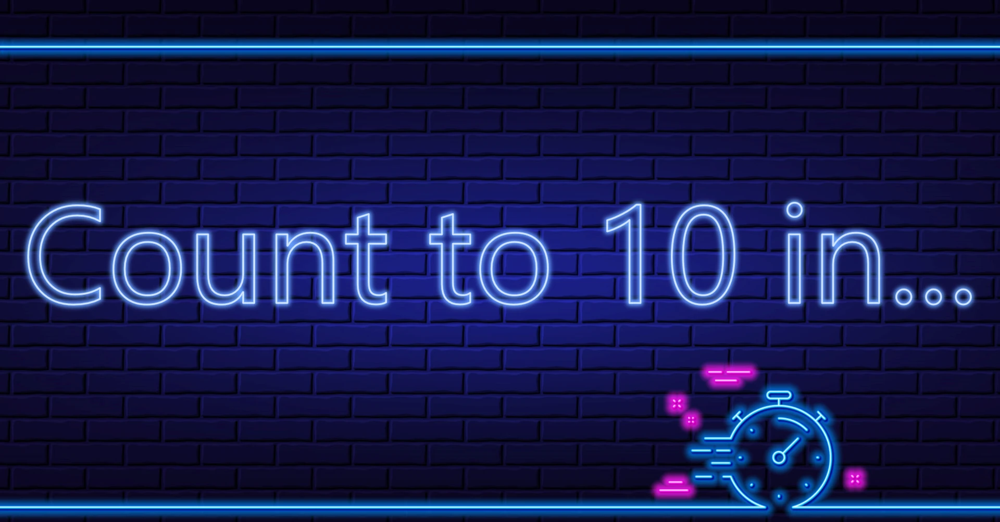
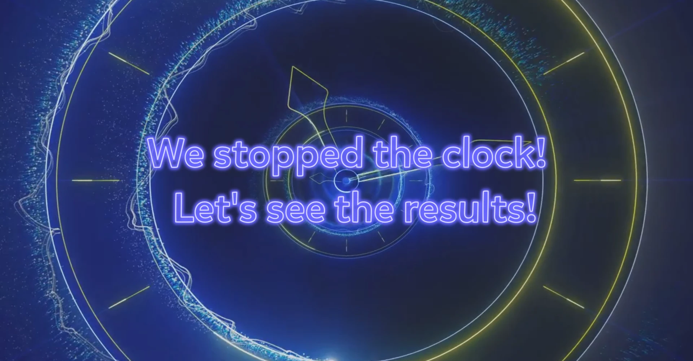
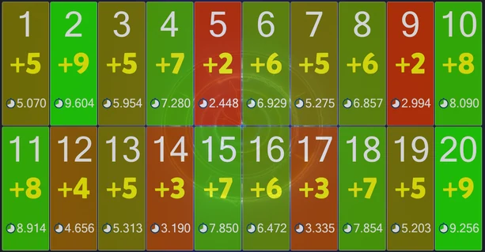

# Chrono Challenge

Il Chrono Challenge è un gioco di precisione. L'idea è contare il tempo e premere il buzzer il più vicino possibile a un determinato numero di secondi.

Opzioni di configurazione disponibili:

{ width="257" loading=lazy }

- Goal time è il tempo in secondi fino al quale i giocatori contano.

- Stop counting seconds after goal time. Il tempo di voto prosegue per questo numero di secondi dopo che il tempo obiettivo è stato raggiunto. Ad esempio, se il tempo obiettivo è 10 secondi e ‘stop counting seconds after goal time’ è cinque, il tempo di voto totale è 15 secondi.

- Esistono tre modi per assegnare i punti:

  - Number of seconds. I punti vengono assegnati in base al numero di secondi dopo i quali un giocatore ha premuto. Più il giocatore è vicino, più punti vince.

  - Custom. Il Quizmaster può configurare quali punti vengono assegnati per quali intervalli di tempo.

  - Match Mode. I giocatori vengono classificati in base alla vicinanza al tempo obiettivo. Più alta è la posizione di un giocatore, più punti ottiene.

- Bonus closest player: il giocatore più vicino al tempo obiettivo vince punti aggiuntivi

- Background image: imposta l'immagine di sfondo del gioco.

- Background video: imposta il video di sfondo del gioco.

- Il Quizmaster può scegliere di usare solo l'immagine, solo il video oppure entrambi: l'immagine (prima del conteggio) e il video (dopo il conteggio)

- Voting music imposta la musica riprodotta durante il voto.

- Use custom texts. Modifica i messaggi predefiniti mostrati durante il gioco.

  - Get your internal clock ready!: il testo mostrato all'inizio del gioco.

  - Count to (0) in: il testo mostrato quando i giocatori stanno per iniziare a contare.

  - Count!: il testo mostrato quando i giocatori iniziano a contare.

  - We stopped the clock! Let’s see the results!: il testo mostrato quando l'orologio è stato fermato e i tempi di risposta dei giocatori stanno per essere valutati.

{ width="213" loading=lazy }All'inizio del gioco i giocatori vengono avvisati di prepararsi a contare!

{ width="209" loading=lazy }{ loading=lazy }

Dopo un breve conto alla rovescia mostrato sullo schermo (3-2-1), i giocatori devono continuare a contare e premere il buzzer allo scadere del tempo indicato. Trascorso il numero di secondi stabilito dalle impostazioni, l'orologio viene fermato.

{ loading=lazy }

I giocatori vengono valutati in base a quanto le loro risposte si discostano dal tempo obiettivo (a seconda della modalità di gioco scelta).

{ loading=lazy }
