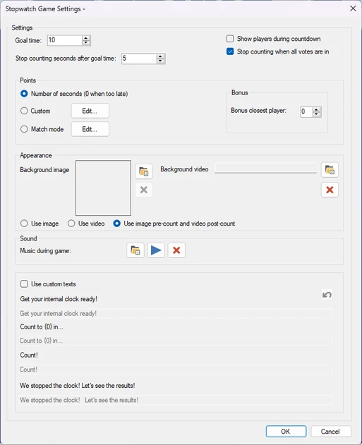
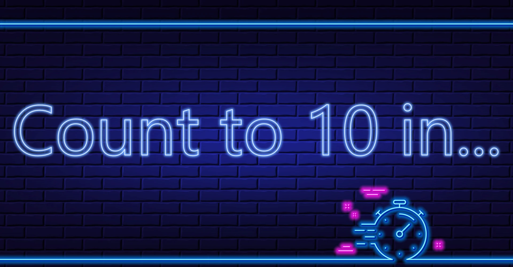
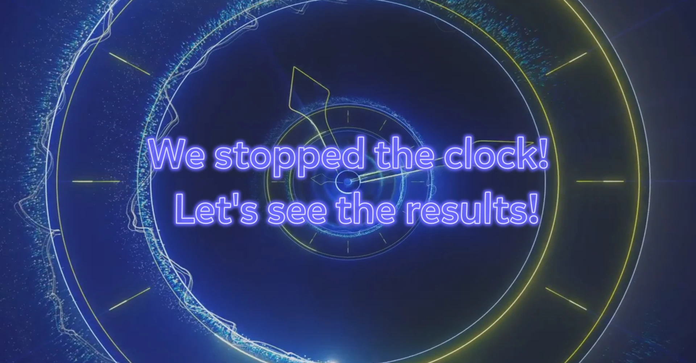
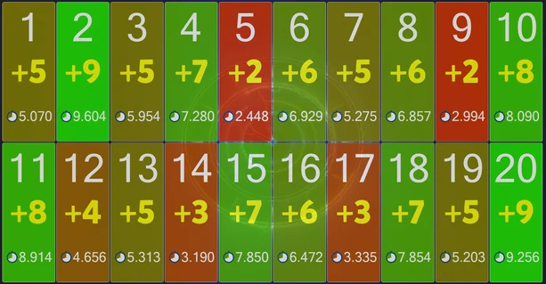

# Chrono Challenge

De Chrono Challenge is een spel van precisie. Het idee is om de tijd te tellen en de buzzer zo dicht mogelijk bij een bepaald aantal seconden in te drukken.

Beschikbare configuratieopties:

{ width="257" loading=lazy }

- Doel tijd is het aantal seconden waarnaar de spelers toe tellen.

- Aantal seconden waarna de klok stopt na de doeltijd. De stemtijd loopt na het bereiken van de doeltijd nog zoveel seconden door. Als de doeltijd bijvoorbeeld 10 seconden is en de instelling ‘aantal seconden waarna de klok stopt na de doeltijd’ vijf, is de totale stemtijd 15 seconden.

- Er zijn drie manieren om punten toe te kennen:

  - Aantal seconden. Punten worden toegekend op basis van het aantal seconden waarna een speler drukte. Hoe dichter de speler erbij zit, hoe meer punten hij wint.

  - Aangepast. De quizmaster kan instellen welke punten bij welke tijden worden gewonnen.

  - Wedstrijd modus. Spelers worden gerangschikt op hoe dicht ze bij de doeltijd zitten. Hoe hoger de rang van een speler, hoe meer punten de speler krijgt.

- Bonus dichtstbijzijnde speler: de speler die het dichtst bij de doeltijd zit, wint extra punten

- Achtergrondafbeelding: stelt de achtergrondafbeelding van het spel in.

- Achtergrondvideo: stelt de achtergrondvideo van het spel in.

- De quizmaster kan kiezen om alleen de afbeelding, alleen de video of allebei te gebruiken: de afbeelding (voor het tellen) en de video (na het tellen)

- Muziek tijdens stemmen stelt de muziek in die tijdens het stemmen speelt.

- Gebruik aangepaste teksten. Wijzig de standaardberichten die tijdens het spel worden getoond.

  - Activeer uw interne klok!: de tekst die wordt getoond wanneer het spel start.

  - Tel naar (0) in: de tekst die wordt getoond wanneer de spelers op het punt staan te beginnen met tellen.

  - Tel!: de tekst die wordt getoond wanneer de spelers beginnen met tellen.

  - We hebben de klok gestopt! Laten we de resultaten bekijken!: de tekst die wordt getoond wanneer de klok is gestopt en de antwoordtijden van de spelers zo worden beoordeeld.

{ width="213" align=left loading=lazy }Aan het begin van het spel worden de spelers gewaarschuwd dat ze zich moeten voorbereiden om te tellen!

{ width="209" loading=lazy }{ loading=lazy }

Na een korte aftelling op het scherm (3-2-1) moeten de spelers blijven tellen en de buzzer indrukken wanneer de aangegeven tijd is verstreken. Nadat het door de instellingen bepaalde aantal seconden is verstreken, wordt de klok gestopt.

{ loading=lazy }

Spelers worden beoordeeld op hoe ver hun antwoorden van de doeltijd afliggen (afhankelijk van de gekozen spelmodus).

{ loading=lazy }
