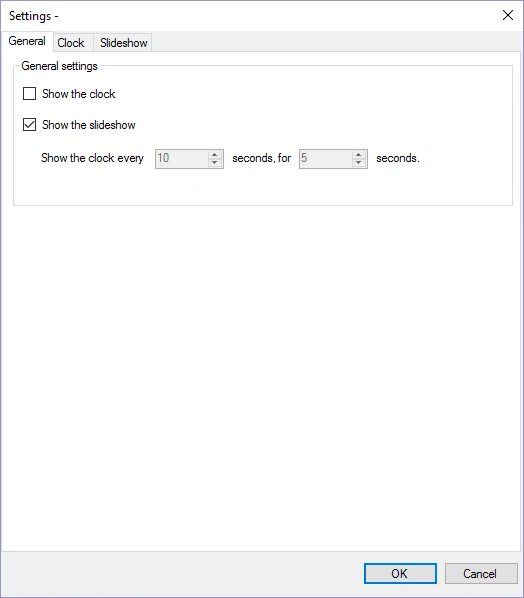
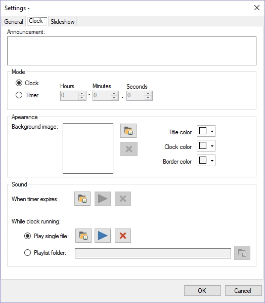
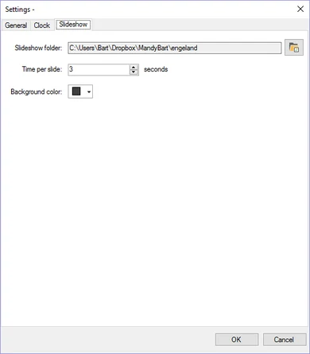
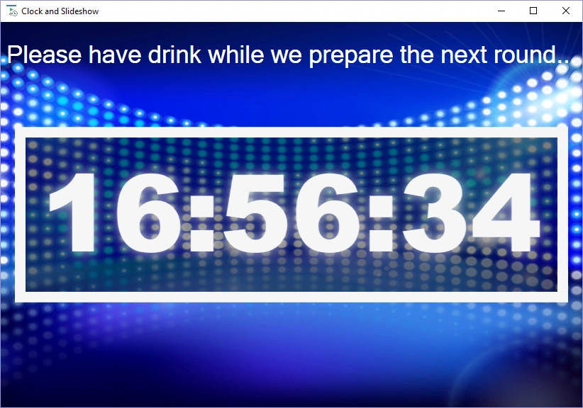

# Modulo Orologio e Slideshow

Questo modulo può mostrare un orologio digitale (o un conto alla rovescia), una presentazione di immagini con fantastici effetti di transizione, oppure un mix di entrambi.

Opzioni di configurazione:

| { width="195" loading=lazy } | { width="199" loading=lazy } | { width="195" loading=lazy } |
|---------------------------------------------------------------------------------|------------------------------------------------------------------------------|---------------------------------------------------------------------------------|

Nella prima pagina è possibile configurare se mostrare l'orologio, la presentazione o entrambi (nel qual caso l'orologio viene mostrato a un intervallo configurabile per un periodo di tempo stabilito)

Per l'orologio è possibile configurare le seguenti opzioni:

- Announcement: testo visualizzato sullo schermo sopra l'orologio

- Mode – Clock: l'ora viene mostrata sullo schermo

- Mode – Timer: un timer conta alla rovescia dal tempo specificato fino a 00:00:00

- Background Image: immagine mostrata sullo sfondo

- Timer expires sound: suono riprodotto allo scadere del timer

- Clock ticking sound: suono riprodotto mentre l'orologio scorre oppure,

- A playlist folder: la cartella da cui il modulo riproduce in modo casuale file MP3 mentre l'orologio scorre. (Si noti che quando si utilizza l'orologio *incorporato nel* quiz, questa cartella deve esistere anche sul PC su cui si esegue il quiz.)

Nell'ultima pagina è possibile configurare la presentazione selezionando una cartella da cui vengono prese le immagini, insieme alle informazioni sulla tempistica.

Di seguito è riportata un'immagine dell'orologio in azione (impostazioni predefinite).

{ width="605" loading=lazy }
